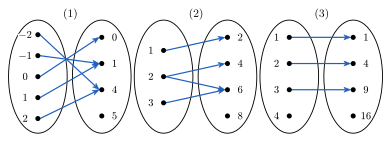
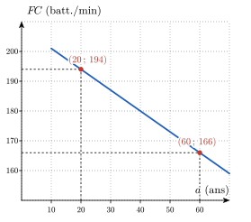
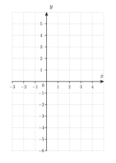
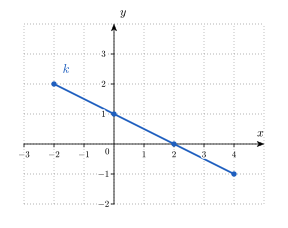
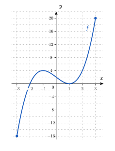

<!-- SOCLE = LE NOYAU (à faire par tous, en séance ou à la maison).
     Fonctions et représentations. Les exercices passent d'un registre à l'autre (texte, tableau, graphe, formule).
     Figures : img/*.svg, générées par img/figs.py (texte vectorisé, rendu identique en PDF typst et sur le site).
     HIÉRARCHIE DES INDICES (à respecter partout) :
       Indice 1 = renvoi à la théorie du cours (titres des slides IMSV-5) ;
       Indice 2 = une QUESTION à se poser (jamais sa réponse) ;
       Indice 3 = une ÉTAPE (un pas concret, sans donner la solution).
     Chaque sous-question a ses propres indices. Numéro AUTOMATIQUE (pas écrit). Faisable SANS calculatrice.
     Notations du cours : f(x), \mathit{Dom}(f), \mathit{Im}(f), f^{\leftarrow}(E), f^{-1}, g \circ f, \mathbb{R}_0, \mathbb{R}^{+}.
     Objectifs provisoires : O1 = représenter une fonction ; O2 = domaine, image, signe, variations ; O3 = composer et inverser. -->

::: {.callout-caution .exo title="Exercice|Socle|1|O1"}
Les quatre courbes ci-dessous sont dessinées dans un repère d'axes $x$ et $y$.

{fig-alt="Quatre courbes numérotées de (1) à (4) : une parabole ouverte vers le haut, un cercle, une hyperbole en deux branches et une parabole ouverte vers la droite" width="11.2cm" fig-align="center"}

(a) Pour chacune des courbes (1) à (4), indique si elle est le graphe d'une fonction de $x$. Justifie chaque réponse par une phrase qui utilise la définition d'une fonction.
(b) La courbe (3) est le graphe de la fonction $f$ définie par $f(x) = \dfrac{1}{x}$. Écris en une phrase l'abscisse pour laquelle $f$ n'a pas d'image, puis écris $\mathit{Dom}(f)$.
(c) Pour chacune des deux relations suivantes, indique s'il s'agit d'une fonction et justifie ta réponse par une phrase. Relation 1 : à chaque patient d'un service, on associe sa température corporelle mesurée ce matin à 8 h. Relation 2 : à chaque valeur de température mesurée, on associe le patient qui a cette température.
:::

::: {.aides}
::: {.panel-tabset}

## Indice 1

Retourne à la théorie du cours : *Fonctions : définition opérationnelle*, *Fonctions : exemples et contre-exemples* et *Domaine d'une fonction*.

## Indice 2

*Question à te poser.*

(a) Une même abscisse peut-elle correspondre à deux points différents de la courbe ?
(b) Quelle opération de la formule de $f$ impose une condition sur $x$ ?
(c) Dans chaque relation, un même élément de départ peut-il être associé à deux éléments d'arrivée différents ?

## Indice 3

*Étape.*

(a) Imagine une droite verticale que tu fais glisser de gauche à droite, et compte, pour chaque position, le nombre de points qu'elle a en commun avec la courbe.
(b) Écris la condition d'existence du quotient $\dfrac{1}{x}$, puis l'ensemble des nombres $x$ qui la vérifient.
(c) Pour chaque relation, choisis un élément de départ (un patient, puis une température) et écris tous les éléments d'arrivée qui lui sont associés.

## Solution

On cherche à savoir si chaque courbe est le graphe d'une fonction. Par définition, une fonction associe à chaque abscisse au plus une ordonnée : une courbe est donc le graphe d'une fonction si et seulement si toute droite verticale la rencontre en au plus un point.

(a) La courbe (1) est le graphe d'une fonction, car toute droite verticale la rencontre en exactement un point. Deux abscisses différentes, par exemple $-1$ et $1$, peuvent avoir la même ordonnée, ce que la définition autorise. La courbe (2) n'est pas le graphe d'une fonction : la droite verticale d'équation $x = 0$ rencontre le cercle aux points $(0\,;\,2)$ et $(0\,;\,-2)$, donc l'abscisse $0$ aurait deux images. La courbe (3) est le graphe d'une fonction, car chaque abscisse non nulle correspond à exactement un point. La courbe (4) n'est pas le graphe d'une fonction : la droite verticale d'équation $x = 1$ rencontre la courbe aux points $(1\,;\,1)$ et $(1\,;\,-1)$, donc l'abscisse $1$ aurait deux images.
(b) Un quotient n'existe que si son dénominateur est non nul. Pour $x = 0$, l'expression $\dfrac{1}{0}$ n'existe pas : l'abscisse $0$ n'a pas d'image, et la droite verticale d'équation $x = 0$ ne rencontre pas la courbe (3). On en déduit que $\mathit{Dom}(f) = \mathbb{R}_0$.
(c) La relation 1 est une fonction : chaque patient a une seule température mesurée ce matin à 8 h, donc chaque élément de départ est associé à un seul élément d'arrivée. La relation 2 n'est pas une fonction : si deux patients ont la même température, par exemple $37$ °C, alors cette valeur de départ est associée à deux patients différents.

## Piège

Une erreur fréquente consiste à croire qu'une fonction ne peut pas prendre deux fois la même valeur. Elle est tentante parce que la parabole (1) « revient » à la même hauteur de part et d'autre de son axe, mais elle est fausse : la définition interdit seulement qu'une abscisse ait deux ordonnées, et deux abscisses différentes peuvent partager la même ordonnée.

Une autre erreur consiste à croire qu'une fonction doit avoir une image pour toute abscisse. Elle est tentante parce que la courbe (3) a un « trou » en $x = 0$, mais elle est fausse : la courbe (3) est bien le graphe d'une fonction, car la définition exige « au plus un » point par abscisse, et non « exactement un ».

:::
:::

::: {.callout-caution .exo title="Exercice|Socle|1|O1"}
Chacun des trois diagrammes ci-dessous est un diagramme sagittal. Il représente une règle : à gauche se trouve l'ensemble de départ, à droite l'ensemble d'arrivée, et une flèche relie un élément de départ à l'élément d'arrivée qui lui est associé.

{fig-alt="Trois diagrammes sagittaux. Diagramme (1) : de {−2, −1, 0, 1, 2} vers {0, 1, 4, 5}, avec −2 vers 4, −1 vers 1, 0 vers 0, 1 vers 1 et 2 vers 4. Diagramme (2) : de {1, 2, 3} vers {2, 4, 6, 8}, avec 1 vers 2, 2 vers 4, 2 vers 6 et 3 vers 6. Diagramme (3) : de {1, 2, 3, 4} vers {1, 4, 9, 16}, avec 1 vers 1, 2 vers 4 et 3 vers 9" width="12.5cm" fig-align="center"}

(a) Pour chaque diagramme, indique si la règle représentée est une fonction de l'ensemble de départ vers l'ensemble d'arrivée. Justifie chaque réponse par une phrase qui utilise la définition d'une fonction.
(b) Le diagramme (1) représente une fonction $f$. Écris $\mathit{Dom}(f)$ et $\mathit{Im}(f)$, puis écris l'ensemble des antécédents de $1$ et l'élément de l'ensemble d'arrivée qui n'a aucun antécédent.
(c) Écris $\mathit{Graph}(f)$ sous la forme d'un ensemble de couples, puis écris une formule qui donne $f(x)$ pour tout $x$ de $\mathit{Dom}(f)$.
(d) Le diagramme (3) représente une fonction $g$. Écris $\mathit{Dom}(g)$ et $\mathit{Im}(g)$, puis explique en une phrase pourquoi l'élément $4$ de l'ensemble de départ n'empêche pas $g$ d'être une fonction.
:::

::: {.aides}
::: {.panel-tabset}

## Indice 1

Retourne à la théorie du cours : *Fonctions : définition opérationnelle* pour (a) et (d), *Domaine d'une fonction* et *Image d'une fonction* pour (b) et (d), et *Graphe d'une fonction* pour (c).

## Indice 2

*Question à te poser.*

(a) Combien de flèches partent de chaque élément de l'ensemble de départ ?
(b) Quels éléments de l'ensemble d'arrivée sont atteints par au moins une flèche ?
(c) Quelle opération transforme chaque élément de départ en l'élément d'arrivée qui lui est associé ?
(d) Que dit la définition d'une fonction sur le nombre de flèches qui partent d'un élément de départ ?

## Indice 3

*Étape.*

(a) Pour chaque diagramme, compte les flèches qui partent de chaque élément de départ, et repère les éléments qui en ont deux ou plus.
(b) Écris la liste des éléments de départ qui sont le début d'une flèche, puis la liste des éléments d'arrivée qui sont le bout d'une flèche. Pour les antécédents de $1$, lis les flèches qui aboutissent en $1$.
(c) Écris un couple par flèche, puis compare chaque élément de départ avec l'élément d'arrivée correspondant.
(d) Écris la liste des éléments de départ qui sont le début d'une flèche, puis compte les flèches qui partent de l'élément $4$ et compare ce nombre à ce qu'exige la définition.

## Solution

On utilise la définition d'une fonction : une fonction associe à chaque élément de départ au plus un élément d'arrivée. Sur un diagramme sagittal, cela signifie que chaque élément de départ est le début d'au plus une flèche.

(a) Dans le diagramme (1), chaque élément de départ est le début d'exactement une flèche, donc la règle est une fonction. Dans le diagramme (2), l'élément $2$ est le début de deux flèches, l'une vers $4$ et l'autre vers $6$ : l'élément $2$ aurait deux images, donc la règle n'est pas une fonction. Dans le diagramme (3), les éléments $1$, $2$ et $3$ sont chacun le début d'une seule flèche et l'élément $4$ n'en a aucune : chaque élément de départ est donc le début d'au plus une flèche, et la règle est une fonction.
(b) Les éléments de départ qui sont le début d'une flèche sont $-2$, $-1$, $0$, $1$ et $2$, donc $\mathit{Dom}(f) = \{-2,\,-1,\,0,\,1,\,2\}$. Les éléments d'arrivée qui sont le bout d'une flèche sont $0$, $1$ et $4$, donc $\mathit{Im}(f) = \{0,\,1,\,4\}$. Les flèches qui aboutissent en $1$ partent de $-1$ et de $1$, donc l'ensemble des antécédents de $1$ est $\{-1,\,1\}$. L'élément $5$ de l'ensemble d'arrivée n'est le bout d'aucune flèche : il n'a aucun antécédent.
(c) Chaque flèche donne un couple, donc $\mathit{Graph}(f) = \{(-2\,;\,4),\ (-1\,;\,1),\ (0\,;\,0),\ (1\,;\,1),\ (2\,;\,4)\}$. Dans chaque couple, la seconde valeur est le carré de la première, donc $f(x) = x^2$ pour tout $x$ de $\mathit{Dom}(f)$.
(d) Les éléments de départ $1$, $2$ et $3$ sont le début d'une flèche, donc $\mathit{Dom}(g) = \{1,\,2,\,3\}$. Les éléments d'arrivée $1$, $4$ et $9$ sont le bout d'une flèche, donc $\mathit{Im}(g) = \{1,\,4,\,9\}$. L'élément $4$ n'empêche pas $g$ d'être une fonction, parce que la définition exige au plus une flèche par élément de départ, et non exactement une : l'élément $4$ n'appartient simplement pas au domaine de $g$.

## Piège

En (a), une erreur fréquente consiste à rejeter le diagramme (1) parce que l'élément $1$ reçoit deux flèches. Elle est tentante parce que deux flèches aboutissent au même point, mais elle est fausse : la définition interdit seulement qu'un élément de départ ait deux images, et deux éléments de départ différents peuvent avoir la même image.

Une autre erreur consiste à rejeter le diagramme (3) parce que l'élément $4$ n'a pas de flèche. Elle est tentante parce que l'on pense qu'une fonction doit être définie partout dans l'ensemble de départ, mais elle est fausse : la définition exige « au plus une » flèche par élément de départ, et le domaine peut être strictement contenu dans l'ensemble de départ.

:::
:::

::: {.callout-caution .exo title="Exercice|Socle|2|O1"}
Soit la fonction $f$ définie sur $\mathbb{R}$ par $f(x) = x^2 - 2x - 3$. Son graphe est dessiné ci-dessous.

{fig-alt="Parabole d'équation y = x² − 2x − 3 sur un quadrillage" width="8.3cm" fig-align="center"}

(a) Calcule $f(4)$ et $f(-1)$ à l'aide de la formule. Donne chaque réponse sous la forme d'un nombre.
(b) Résous l'équation $f(x) = 5$ en écrivant les calculs, puis écris l'ensemble des antécédents de $5$. Vérifie ensuite ta réponse en repérant sur le graphe les points d'ordonnée $5$.
(c) Indique, par un nombre pour chaque valeur, combien d'antécédents ont $-4$ et $-5$, en t'aidant du graphe. Justifie ensuite la réponse pour $-4$ par un calcul.
(d) Écris l'image de $f$ sous la forme d'un intervalle, puis explique en une phrase pourquoi $-5$ n'en fait pas partie.
:::

::: {.aides}
::: {.panel-tabset}

## Indice 1

Retourne à la théorie du cours : *Une fonction, deux types de questions* pour (a), (b) et (c), et *Image d'une fonction* pour (d).

## Indice 2

*Question à te poser.*

(a) Dans $f(4)$, le nombre $4$ est-il l'entrée ou la sortie de la fonction ?
(b) Dans l'équation $f(x) = 5$, le nombre $5$ est-il l'entrée ou la sortie, et que cherche-t-on ?
(c) Une droite horizontale à la hauteur $-4$, puis à la hauteur $-5$, rencontre-t-elle la courbe, et en combien de points ?
(d) Quelles sont les ordonnées de tous les points du graphe, du plus bas au plus haut ?

## Indice 3

*Étape.*

(a) Remplace $x$ par la valeur demandée dans la formule, puis effectue le calcul.
(b) Ramène l'équation à une équation dont le second membre est $0$.
(c) Dessine sur le graphe la droite horizontale à la hauteur demandée et compte ses points communs avec la courbe ; pour le calcul, ramène l'équation $f(x) = -4$ à une équation dont le second membre est $0$ et observe le premier membre.
(d) Repère le point le plus bas du graphe et regarde si la courbe monte ou descend de part et d'autre.

## Solution

On évalue $f$ lorsque l'entrée est connue et on résout une équation lorsque la sortie est connue, comme dans *Une fonction, deux types de questions*.

{fig-alt="Droites horizontales à la hauteur 5 et à la hauteur −4 sur le graphe de f" width="8.3cm" fig-align="center"}

(a) L'entrée est connue, donc on remplace $x$ dans la formule. On obtient $f(4) = 4^2 - 2 \cdot 4 - 3 = 16 - 8 - 3 = 5$ et $f(-1) = (-1)^2 - 2 \cdot (-1) - 3 = 1 + 2 - 3 = 0$.
(b) La sortie $5$ est connue et on cherche les entrées $x$ correspondantes, donc on résout l'équation. On soustrait $5$ aux deux membres de $x^2 - 2x - 3 = 5$, ce qui donne l'équation du second degré $x^2 - 2x - 8 = 0$, de coefficients $a = 1$, $b = -2$ et $c = -8$. On calcule son discriminant : $\Delta = b^2 - 4ac = (-2)^2 - 4 \cdot 1 \cdot (-8) = 4 + 32 = 36$. Le discriminant est strictement positif, donc l'équation a deux solutions : $x = \dfrac{2 - 6}{2} = -2$ et $x = \dfrac{2 + 6}{2} = 4$. L'ensemble des antécédents de $5$ est $f^{\leftarrow}(\{5\}) = \{-2,\,4\}$. Sur le graphe, la droite horizontale à la hauteur $5$ rencontre la courbe aux abscisses $-2$ et $4$, ce qui confirme le calcul.
(c) La droite horizontale à la hauteur $-4$ touche la courbe en un seul point, le point le plus bas, donc $-4$ a un antécédent. La droite horizontale à la hauteur $-5$ passe sous la courbe sans la rencontrer, donc $-5$ n'a aucun antécédent. Pour justifier le premier résultat, on ajoute $4$ aux deux membres de $x^2 - 2x - 3 = -4$, ce qui donne $x^2 - 2x + 1 = 0$. On reconnaît le carré $(x - 1)^2$, donc l'équation s'écrit $(x - 1)^2 = 0$, et sa seule solution est $x = 1$.
(d) L'image est l'ensemble des ordonnées des points du graphe. Le point le plus bas est $(1\,;\,-4)$ et les deux branches de la parabole montent sans limite à partir de ce point, donc $\mathit{Im}(f) = [-4,\,+\infty[$. Le nombre $-5$ n'en fait pas partie, car il est inférieur à $-4$ : aucun point du graphe n'a cette ordonnée, donc $-5$ n'a pas d'antécédent.

## Piège

En (b), une erreur fréquente consiste à remplacer $x$ par $5$ dans la formule et à calculer $f(5)$. Elle est tentante parce que le nombre $5$ apparaît dans l'énoncé, mais elle est fausse : $5$ est ici la sortie de la fonction, et le calcul de $f(5)$ répond à une autre question que celle posée.

En (b), une autre erreur consiste à s'arrêter à une seule solution. Elle est tentante parce qu'on trouve une première valeur facilement, mais elle est fausse : le discriminant de $x^2 - 2x - 8 = 0$ est strictement positif, donc l'équation a deux solutions, et le graphe le confirme puisque la droite horizontale rencontre la courbe en deux points.

:::
:::

::: {.callout-caution .exo title="Exercice|Socle|2|O1"}
Selon l'étude de Tanaka, Monahan et Seals (2001), la fréquence cardiaque maximale $FC$ d'un adulte en bonne santé, exprimée en battements par minute, est une fonction affine de son âge $a$, exprimé en années.[^tanaka-s3] Le graphe ci-dessous représente cette fonction pour des âges compris entre $10$ et $70$ ans. Deux de ses points sont indiqués.

[^tanaka-s3]: H. Tanaka, K. D. Monahan et D. R. Seals, « Age-predicted maximal heart rate revisited », *Journal of the American College of Cardiology*, 37(1), 2001, p. 153-156.

{fig-alt="Droite décroissante passant par les points (20 ; 194) et (60 ; 166), âge en abscisse et fréquence cardiaque maximale en ordonnée" width="9.2cm" fig-align="center"}

(a) À partir des deux points indiqués, calcule la pente $m$ de la droite. Donne une valeur avec son unité, puis interprète-la par une phrase.
(b) Calcule l'ordonnée à l'origine $p$, puis écris l'expression de $FC(a)$ sous la forme $FC(a) = m\,a + p$.
(c) Complète le tableau de valeurs ci-dessous à l'aide de l'expression obtenue en (b).

| $a$ (ans) | $20$ | $30$ | $40$ | $50$ | $60$ |
|:---:|:---:|:---:|:---:|:---:|:---:|
| $FC(a)$ (battements par minute) | $194$ | | | | $166$ |

(d) Les valeurs du tableau suffiraient-elles, sans le texte de l'énoncé, à retrouver l'expression de $FC$ ? Réponds par une phrase qui indique l'information supplémentaire qui permet de conclure.
:::

::: {.aides}
::: {.panel-tabset}

## Indice 1

Retourne à la théorie du cours : *Réactivation — Fonctions particulières* pour (a) et (b), *De la formule au tableau et au graphe* pour (c), et *Quatre représentations pour une même fonction* pour (d).

## Indice 2

*Question à te poser.*

(a) De combien varie $FC$ quand $a$ augmente d'une unité, si l'on compare les deux points indiqués ?
(b) Quelle égalité doit vérifier chacun des deux points indiqués quand on remplace $FC(a)$ par $m\,a + p$ ?
(c) Quelle valeur de $a$ remplace-t-on dans l'expression pour chaque colonne vide ?
(d) Combien de fonctions différentes peuvent passer par cinq points donnés ?

## Indice 3

*Étape.*

(a) Calcule le quotient « variation de $FC$ divisée par la variation de $a$ » entre le point d'âge $20$ ans et le point d'âge $60$ ans.
(b) Remplace $m$ et les coordonnées du point $(20\,;\,194)$ dans $FC = m\,a + p$, puis isole $p$.
(c) Remplace $a$ par $30$, par $40$, puis par $50$ dans l'expression, et effectue chaque calcul.
(d) Compare ce que le tableau contient avec ce qu'il faudrait pour décrire la fonction en dehors des cinq âges.

## Solution

On cherche l'expression d'une fonction affine à partir de deux points de son graphe.

**Données et relation.** On donne deux points du graphe, $(20\,;\,194)$ et $(60\,;\,166)$, lus sur la figure, et l'information du texte selon laquelle $FC$ est une fonction affine de l'âge. On cherche la pente $m$, l'ordonnée à l'origine $p$, puis les valeurs manquantes du tableau. La relation du cours est $FC(a) = m\,a + p$, où $m$ est la pente et $p$ l'ordonnée à l'origine.

(a) La pente est le quotient de la variation de $FC$ par la variation de $a$ entre les deux points $(20\,;\,194)$ et $(60\,;\,166)$ : $m = \dfrac{166 - 194}{60 - 20} = \dfrac{-28}{40} = -0{,}7$ battement par minute et par année. Cela signifie que, lorsque l'âge augmente d'un an, la fréquence cardiaque maximale diminue de $0{,}7$ battement par minute.
(b) Le point $(20\,;\,194)$ appartient à la droite, donc $194 = -0{,}7 \cdot 20 + p$, soit $194 = -14 + p$, donc $p = 208$ battements par minute. L'expression est $FC(a) = -0{,}7\,a + 208$.
(c) On remplace $a$ dans l'expression. $FC(30) = -0{,}7 \cdot 30 + 208 = -21 + 208 = 187$, $FC(40) = -28 + 208 = 180$ et $FC(50) = -35 + 208 = 173$ battements par minute. Contrôle : $FC(60) = -42 + 208 = 166$, ce qui retrouve la valeur donnée. Le tableau complété est le suivant.

| $a$ (ans) | $20$ | $30$ | $40$ | $50$ | $60$ |
|:---:|:---:|:---:|:---:|:---:|:---:|
| $FC(a)$ (battements par minute) | $194$ | $187$ | $180$ | $173$ | $166$ |

(d) Non : le tableau ne donne que cinq valeurs, et une infinité de fonctions passent par ces cinq points. C'est l'information du texte, « fonction affine », qui permet de conclure : une droite est entièrement déterminée par deux de ses points.

## Piège

En (a), une erreur fréquente consiste à soustraire les coordonnées dans deux ordres différents, par exemple $166 - 194$ au numérateur mais $20 - 60$ au dénominateur. Elle est tentante parce que chaque soustraction paraît correcte isolément, mais elle est fausse : on obtient $+0{,}7$ au lieu de $-0{,}7$, car les deux soustractions doivent suivre le même ordre des points.

En (b), une autre erreur consiste à prendre $p = 194$. Elle est tentante parce que $194$ est la première ordonnée lue sur la figure, mais elle est fausse : l'ordonnée à l'origine est la valeur de $FC$ pour $a = 0$, et non la valeur au premier point indiqué.

:::
:::

::: {.callout-caution .exo title="Exercice|Socle|2|O1"}
Une même fonction peut être décrite par un texte, par une formule, par un tableau de valeurs ou par un graphe. Dans cet exercice, tu passes d'un de ces registres à un autre.

(a) La fonction $g$ est décrite par le texte suivant : « on multiplie le nombre par $2$, puis on soustrait $3$ ». Écris la formule de $g(x)$, complète le tableau ci-dessous, puis place les points du tableau dans le repère de la figure et trace le graphe de $g$.

| $x$ | $-1$ | $0$ | $1$ | $2$ | $3$ |
|:---:|:---:|:---:|:---:|:---:|:---:|
| $g(x)$ | | | | | |

{fig-alt="Repère quadrillé vide, avec x de −3 à 4 et y de −6 à 5" width="7.6cm" fig-align="center"}

(b) La fonction $f$ est décrite par le tableau suivant.

| $x$ | $-1$ | $0$ | $1$ | $2$ | $3$ |
|:---:|:---:|:---:|:---:|:---:|:---:|
| $f(x)$ | $4$ | $1$ | $0$ | $1$ | $4$ |

Écris une formule simple qui donne la valeur de $f(x)$ pour chacun de ces cinq nombres $x$, puis écris un texte qui décrit $f$ comme une suite d'opérations effectuées sur $x$.

(c) La fonction $k$ est décrite par son graphe ci-dessous.

{fig-alt="Droite passant par les points (−2 ; 2), (0 ; 1), (2 ; 0) et (4 ; −1)" width="9.5cm" fig-align="center"}

Lis les valeurs de $k(-2)$, $k(0)$, $k(2)$ et $k(4)$. Écris ensuite la formule de $k(x)$, puis un texte qui décrit $k$ comme une suite d'opérations effectuées sur $x$.

(d) Pour chacune des fonctions $g$, $f$ et $k$, indique si elle est croissante, décroissante, ou ni l'une ni l'autre sur l'intervalle $[-1,\,3]$. Utilise le registre de ton choix et justifie par une phrase.
:::

::: {.aides}
::: {.panel-tabset}

## Indice 1

Retourne à la théorie du cours : *Quatre représentations pour une même fonction* pour (a), (b) et (c), *De la formule au tableau et au graphe* pour (a) et (c), et *Croissance et décroissance* pour (d).

## Indice 2

*Question à te poser.*

(a) Dans quel ordre le texte demande-t-il d'effectuer les deux opérations sur $x$ ?
(b) Pour quelle valeur de $x$ la fonction $f$ s'annule-t-elle, et que remarques-tu sur les valeurs de $f(x)$ de part et d'autre de cette valeur ?
(c) De combien varie $k(x)$ quand $x$ augmente de $2$ ?
(d) Quand $x$ augmente, les valeurs de la fonction augmentent-elles toujours, diminuent-elles toujours, ou changent-elles de sens ?

## Indice 3

*Étape.*

(a) Écris $g(x)$ en deux temps : le produit d'abord, puis la soustraction. Remplace ensuite $x$ par chaque valeur du tableau, et place chaque point $(x\,;\,g(x))$.
(b) Puisque $f(1) = 0$, cherche une expression de $x$ qui s'annule en $x = 1$, puis compare ses valeurs à celles du tableau.
(c) Calcule de combien $k(x)$ change quand $x$ augmente de $2$, puis de combien quand $x$ augmente de $1$, et utilise $k(0)$ comme valeur de départ.
(d) Pour $g$ et $f$, lis les valeurs du tableau de gauche à droite. Pour $k$, regarde si le graphe monte ou descend quand on se déplace vers la droite.

## Solution

On passe d'un registre à l'autre, comme dans *Quatre représentations pour une même fonction* : on traduit un texte, un tableau ou un graphe en formule, puis la formule dans les autres registres.

(a) Le texte demande de multiplier d'abord $x$ par $2$, puis de soustraire $3$ au produit : on obtient $g(x) = 2x - 3$. On remplace ensuite $x$ par chaque valeur : $g(-1) = 2 \cdot (-1) - 3 = -5$, $g(0) = -3$, $g(1) = -1$, $g(2) = 1$ et $g(3) = 3$. Le tableau complété est le suivant.

| $x$ | $-1$ | $0$ | $1$ | $2$ | $3$ |
|:---:|:---:|:---:|:---:|:---:|:---:|
| $g(x)$ | $-5$ | $-3$ | $-1$ | $1$ | $3$ |

On place les points $(-1\,;\,-5)$, $(0\,;\,-3)$, $(1\,;\,-1)$, $(2\,;\,1)$ et $(3\,;\,3)$. Ils sont alignés, car $g(x)$ augmente de $2$ chaque fois que $x$ augmente de $1$ : le graphe de $g$ est une droite.

(b) Le tableau donne $f(1) = 0$, donc on cherche une expression de $x$ qui s'annule en $x = 1$, par exemple $x - 1$. Pour les cinq valeurs du tableau, $x - 1$ vaut $-2$, $-1$, $0$, $1$ et $2$. Les valeurs $4$, $1$, $0$, $1$ et $4$ du tableau sont exactement les carrés de ces nombres, donc on propose $f(x) = (x - 1)^2$. Le texte correspondant est : « on soustrait $1$ au nombre, puis on élève le résultat au carré ». Un tableau de cinq valeurs ne détermine pas la fonction à lui seul : on a choisi la formule la plus simple qui vérifie les cinq colonnes.

(c) On lit sur le graphe $k(-2) = 2$, $k(0) = 1$, $k(2) = 0$ et $k(4) = -1$. Quand $x$ augmente de $2$, la valeur de $k(x)$ diminue de $1$, donc elle diminue de $\dfrac12$ quand $x$ augmente de $1$. Les points sont alignés et $k(0) = 1$, donc $k(x) = -\dfrac{x}{2} + 1$. On vérifie avec deux autres points : $k(4) = -2 + 1 = -1$ et $k(-2) = 1 + 1 = 2$. Le texte correspondant est : « on divise le nombre par $2$, on change le signe du résultat, puis on ajoute $1$ ».

(d) La fonction $g(x) = 2x - 3$ est affine de pente $2$, qui est positive : son graphe est une droite qui monte, donc $g$ est croissante sur $[-1,\,3]$. La fonction $k(x) = -\dfrac{x}{2} + 1$ est affine de pente $-\dfrac12$, qui est négative : son graphe est une droite qui descend, donc $k$ est décroissante sur $[-1,\,3]$, de $k(-1) = \dfrac32$ à $k(3) = -\dfrac12$. La fonction $f$ n'est ni croissante ni décroissante sur $[-1,\,3]$ : ses valeurs diminuent de $4$ à $0$ quand $x$ passe de $-1$ à $1$, puis augmentent de $0$ à $4$ quand $x$ passe de $1$ à $3$.

## Piège

En (a), une erreur fréquente consiste à écrire $2(x - 3)$. Elle est tentante parce que le texte contient le mot « soustrait » et le nombre $3$ à la fin, mais elle est fausse : on soustrait $3$ après la multiplication, donc on obtient $2x - 3$ et non $2x - 6$.

En (b), une autre erreur consiste à proposer une formule après avoir regardé seulement deux colonnes du tableau, par exemple $1 - x$, qui vérifie $f(0) = 1$ et $f(1) = 0$. Elle est tentante parce qu'elle est simple, mais elle est fausse : elle donne $2$ en $x = -1$ au lieu de $4$. Il faut contrôler la formule sur toutes les colonnes.

En (c), une dernière erreur consiste à écrire $k(x) = \dfrac{x}{2} + 1$. Elle est tentante parce que la variation de $\dfrac12$ par unité de $x$ est lue sans son signe, mais elle est fausse : le graphe descend, et la formule donne $k(2) = 2$ au lieu de $0$.

:::
:::

::: {.callout-caution .exo title="Exercice|Socle|2|O2"}
On étudie le domaine de plusieurs fonctions données par une formule.

(a) Écris le domaine de $f_1(x) = \sqrt{6 - x}$ sous la forme d'un intervalle.
(b) Écris le domaine de $f_2(x) = \dfrac{1}{x^2 - 9}$ sous la forme « $\mathbb{R}$ privé de certaines valeurs ».
(c) Écris le domaine de $f_3(x) = \dfrac{\sqrt{x + 2}}{x - 4}$. Écris d'abord chacune des conditions d'existence, puis le domaine, sous la forme d'un intervalle privé d'une valeur.
(d) L'indice de masse corporelle[^who] d'un adulte de $80$ kg, en fonction de sa taille $h$ exprimée en mètres, est donné par $\mathit{IMC}(h) = \dfrac{80}{h^2}$, en kg/m². Écris le domaine mathématique maximal de cette expression, puis le domaine pratique imposé par le contexte.
(e) Calcule l'IMC d'un adulte de $80$ kg qui mesure $2$ m. Donne le résultat avec son unité.

[^who]: Organisation mondiale de la Santé, *Obesity: preventing and managing the global epidemic*, WHO Technical Report Series 894, 2000 : l'indice de masse corporelle est le quotient de la masse en kilogrammes par le carré de la taille en mètres.
:::

::: {.aides}
::: {.panel-tabset}

## Indice 1

Retourne à la théorie du cours : *Domaine d'une fonction* et *Déterminer un domaine par étapes* pour (a), (b) et (c), *Domaine mathématique vs. domaine pertinent* pour (d), et *Une fonction, deux types de questions* pour (e).

## Indice 2

*Question à te poser.*

(a) Pour quels nombres sous la racine carrée la racine carrée existe-t-elle ?
(b) Quelle valeur ne peut jamais prendre un dénominateur ?
(c) Quelles sont les deux opérations de la formule qui imposent une condition, et quelle est la condition de chacune ?
(d) Quelle valeur de $h$ interdit la formule, et quelles valeurs de $h$ n'ont pas de sens pour la taille d'un adulte ?
(e) Dans $\mathit{IMC}(2)$, le nombre $2$ est-il l'entrée ou la sortie de la fonction ?

## Indice 3

*Étape.*

(a) Écris l'inégalité « le nombre sous la racine est supérieur ou égal à $0$ » et isole $x$.
(b) Résous l'équation « le dénominateur est égal à $0$ » pour trouver les valeurs à exclure.
(c) Écris une condition pour la racine carrée et une condition pour le dénominateur, puis réunis-les sur la droite des réels.
(d) Écris l'équation « le dénominateur est égal à $0$ », puis demande-toi quel signe doit avoir une taille.
(e) Remplace $h$ par $2$ et calcule d'abord le carré.

## Solution

On cherche les valeurs de $x$ pour lesquelles chaque expression existe, c'est-à-dire ses conditions d'existence. Une racine carrée n'existe que pour un nombre positif ou nul, et un quotient n'existe que si son dénominateur est non nul.

(a) La racine carrée existe si $6 - x \geq 0$. On ajoute $x$ aux deux membres, ce qui donne $6 \geq x$, soit $x \leq 6$. Donc $\mathit{Dom}(f_1) = ]-\infty,\,6]$.
(b) Le quotient n'existe pas si $x^2 - 9 = 0$. Cette équation équivaut à $x^2 = 9$, c'est-à-dire à $x = 3$ ou $x = -3$. Donc $\mathit{Dom}(f_2) = \mathbb{R} \setminus \{-3,\,3\}$.
(c) Il y a deux conditions. La racine carrée impose $x + 2 \geq 0$, soit $x \geq -2$. Le dénominateur impose $x - 4 \neq 0$, soit $x \neq 4$. Le nombre $4$ appartient à l'intervalle $[-2,\,+\infty[$, donc il faut le retirer : $\mathit{Dom}(f_3) = [-2,\,+\infty[\, \setminus \{4\}$.
(d) Mathématiquement, l'expression $\dfrac{80}{h^2}$ n'existe pas si $h^2 = 0$, c'est-à-dire si $h = 0$. Le domaine mathématique maximal est donc $\mathbb{R}_0$. Dans le contexte, la taille d'un adulte est strictement positive : le domaine pratique est $]0,\,+\infty[$. Le domaine pratique est plus petit que le domaine mathématique, car le contexte exclut aussi les tailles négatives, que la formule accepterait.
(e) La taille est l'entrée, donc on remplace $h$ par $2$ : $\mathit{IMC}(2) = \dfrac{80}{2^2} = \dfrac{80}{4} = 20$ kg/m². Un adulte de $80$ kg qui mesure $2$ m a donc un IMC de $20$ kg/m², valeur comprise dans l'intervalle de $18{,}5$ à moins de $25$ kg/m² que l'OMS associe à une corpulence normale.

## Piège

En (a), une erreur fréquente consiste à écrire $x \geq 6$. Elle est tentante parce que l'inégalité $6 - x \geq 0$ contient le symbole $\geq$, mais elle est fausse : en ajoutant $x$ aux deux membres, on obtient $6 \geq x$, c'est-à-dire $x \leq 6$.

En (b), une autre erreur consiste à exclure seulement $3$. Elle est tentante parce qu'on pense à la racine « positive », mais elle est fausse : l'équation $x^2 = 9$ a deux solutions, $3$ et $-3$, et les deux annulent le dénominateur.

En (d), une dernière erreur consiste à donner $\mathbb{R}_0$ comme domaine pratique. Elle est tentante parce que c'est le domaine de la formule, mais elle est fausse : une taille négative n'a aucun sens pour un adulte, même si la formule l'accepte.

:::
:::

::: {.callout-caution .exo title="Exercice|Socle|2|O2"}
On considère la fonction $f$ définie sur l'intervalle $[-3,\,3]$ par $f(x) = (x + 2)(x - 1)^2$. Son graphe est dessiné ci-dessous.

{fig-alt="Graphe de f sur [−3, 3] : la courbe monte de (−3 ; −16) jusqu'à un maximum local en x = −1, redescend jusqu'à un minimum local en x = 1, puis monte jusqu'à (3 ; 20)" width="7.7cm" fig-align="center"}

(a) Lis l'image de $f$ sur le graphe et écris-la sous la forme d'un intervalle. Lis aussi la valeur de $f(0)$.
(b) Lis sur le graphe l'ensemble $f^{\leftarrow}(\{4\})$, puis vérifie par un calcul avec la formule chacune des valeurs trouvées.
(c) Écris le nombre d'antécédents de chacune des valeurs $2$, $10$ et $25$, en lisant le graphe.
(d) Écris $f([-3,\,0])$ sous la forme d'un intervalle. Explique en une phrase pourquoi $f(0)$ n'est pas la borne supérieure de cet intervalle.
:::

::: {.aides}
::: {.panel-tabset}

## Indice 1

Retourne à la théorie du cours : *Graphe d'une fonction* et *Image d'une fonction* pour (a) et (d), et *Préimage* pour (b) et (c).

## Indice 2

*Question à te poser.*

(a) Quelles sont les ordonnées du point le plus bas et du point le plus haut du graphe ?
(b) Quelles sont les abscisses des points du graphe dont l'ordonnée vaut $4$ ?
(c) Une droite horizontale à chacune des hauteurs $2$, $10$ et $25$ rencontre-t-elle la courbe, et en combien de points ?
(d) Sur l'intervalle $[-3,\,0]$, en quel point la courbe atteint-elle sa plus grande hauteur ?

## Indice 3

*Étape.*

(a) Repère le point le plus bas et le point le plus haut du graphe, et lis leurs ordonnées.
(b) Trace la droite horizontale à la hauteur $4$ et lis les abscisses de ses points communs avec la courbe, puis calcule $f$ en ces abscisses.
(c) Trace les trois droites horizontales aux hauteurs $2$, $10$ et $25$, et compte leurs points communs avec la courbe.
(d) Suis la courbe de l'abscisse $-3$ à l'abscisse $0$ et note l'ordonnée la plus basse et l'ordonnée la plus haute que tu rencontres.

## Solution

On lit le graphe : l'image est l'ensemble des ordonnées des points du graphe, et les antécédents d'une valeur sont les abscisses des points du graphe situés à cette hauteur.

{fig-alt="Droites horizontales aux hauteurs 4, 2 et 10 sur le graphe de f" width="7.7cm" fig-align="center"}

(a) L'image est l'ensemble des ordonnées des points du graphe. Le point le plus bas est $(-3\,;\,-16)$ et le point le plus haut est $(3\,;\,20)$, et la courbe passe par toutes les hauteurs intermédiaires, donc $\mathit{Im}(f) = [-16,\,20]$. La courbe coupe l'axe des ordonnées à la hauteur $2$, donc $f(0) = 2$.
(b) La préimage de $\{4\}$ est l'ensemble des abscisses des points d'ordonnée $4$. La droite horizontale à la hauteur $4$ rencontre la courbe aux abscisses $-1$ et $2$, donc $f^{\leftarrow}(\{4\}) = \{-1,\,2\}$. Vérification : $f(-1) = (-1 + 2)(-1 - 1)^2 = 1 \cdot 4 = 4$ et $f(2) = (2 + 2)(2 - 1)^2 = 4 \cdot 1 = 4$.
(c) La droite horizontale à la hauteur $2$ rencontre la courbe en trois points, dont un d'abscisse $0$ : la valeur $2$ a trois antécédents. La droite horizontale à la hauteur $10$ rencontre la courbe en un seul point, situé à droite du graphe : la valeur $10$ a un antécédent. La hauteur $25$ est supérieure au maximum $20$ du graphe : la valeur $25$ n'a aucun antécédent.
(d) Sur $[-3,\,0]$, la courbe monte de $(-3\,;\,-16)$ jusqu'au point $(-1\,;\,4)$, puis redescend jusqu'au point $(0\,;\,2)$. La plus petite ordonnée est $-16$ et la plus grande est $4$, donc $f([-3,\,0]) = [-16,\,4]$. Le nombre $f(0) = 2$ n'est pas la borne supérieure, car la courbe atteint la hauteur $4$ à l'intérieur de l'intervalle, en $x = -1$, avant de redescendre.

## Piège

En (d), une erreur fréquente consiste à calculer l'image d'un intervalle à partir des seules valeurs aux extrémités : on trouverait $[-16,\,2]$. Cette méthode est tentante parce qu'elle donne le bon résultat pour une fonction qui monte toujours ou qui descend toujours, mais elle est fausse ici : la fonction monte puis redescend, donc les extrémités ne suffisent pas.

En (c), une autre erreur consiste à tracer des droites verticales au lieu de droites horizontales. Elle est tentante parce que la droite verticale sert à reconnaître une fonction, mais elle est fausse ici : les antécédents d'une valeur se cherchent à une hauteur donnée, donc avec une droite horizontale.

:::
:::

::: {.callout-caution .exo title="Exercice|Socle|2|O2"}
On reprend la fonction $f$ définie sur $[-3,\,3]$ par $f(x) = (x + 2)(x - 1)^2$, dont voici le graphe.

{fig-alt="Graphe de f sur [−3, 3] : la courbe monte de (−3 ; −16) jusqu'à un maximum local en x = −1, redescend jusqu'à un minimum local en x = 1, puis monte jusqu'à (3 ; 20)" width="7.7cm" fig-align="center"}

(a) Calcule les racines de $f$ à l'aide de la forme factorisée de la formule.
(b) Étudie le signe de $f$ sur $[-3,\,3]$. Présente le résultat dans un tableau de signes et justifie-le par une phrase qui parle des deux facteurs de la formule.
(c) Lis sur le graphe les intervalles sur lesquels $f$ est croissante, puis ceux sur lesquels elle est décroissante.
(d) Écris les extrema locaux de $f$ : pour chacun, indique s'il s'agit d'un maximum ou d'un minimum, son abscisse et sa valeur. Écris ensuite les extrema globaux de $f$ sur $[-3,\,3]$.
(e) Donne un intervalle sur lequel $f$ est strictement positive et décroissante, puis un intervalle sur lequel $f$ est négative et croissante.
:::

::: {.aides}
::: {.panel-tabset}

## Indice 1

Retourne à la théorie du cours : *Racines et étude de signe* pour (a) et (b), *Croissance et décroissance* pour (c) et (e), et *Extrema locaux et globaux* pour (d).

## Indice 2

*Question à te poser.*

(a) Quand un produit de facteurs est-il égal à $0$ ?
(b) Quel facteur de la formule ne peut jamais être strictement négatif ?
(c) Sur quels morceaux du graphe la courbe monte-t-elle de gauche à droite, et sur lesquels descend-elle ?
(d) En quels points la courbe change-t-elle de sens ?
(e) Comment combiner les résultats de (b) et de (c) pour trouver des abscisses qui vérifient deux conditions à la fois ?

## Indice 3

*Étape.*

(a) Écris que chaque facteur est égal à $0$ et résous chacune des deux équations.
(b) Place les racines sur une droite, puis étudie le signe de chacun des deux facteurs sur chaque intervalle qu'elles délimitent.
(c) Suis la courbe de gauche à droite et note les abscisses où elle change de sens.
(d) Lis l'ordonnée de chaque point où la courbe change de sens, puis compare-la aux ordonnées des deux extrémités du graphe.
(e) Écris l'un sous l'autre les intervalles où $f$ est strictement positive et ceux où $f$ décroît, et garde leur partie commune ; procède de même pour « négative » et « croissante ».

## Solution

On étudie le signe de $f$ à partir de sa forme factorisée, puis on lit ses variations et ses extrema sur le graphe.

(a) Les racines de $f$ sont les valeurs de $x$ telles que $f(x) = 0$. Un produit est nul si et seulement si l'un de ses facteurs est nul : $x + 2 = 0$ donne $x = -2$ et $(x - 1)^2 = 0$ donne $x = 1$. Les racines de $f$ sont donc $-2$ et $1$.
(b) Le signe de $f$ est constant entre deux racines successives. Les racines $-2$ et $1$ découpent $[-3,\,3]$ en trois intervalles. Le facteur $(x - 1)^2$ est positif ou nul, et il ne s'annule qu'en $x = 1$ : sur chaque intervalle, le signe de $f$ est donc celui du facteur $x + 2$, qui est négatif pour $x < -2$ et positif pour $x > -2$. On obtient le tableau suivant.

| $x$ | $[-3,\,-2[$ | $-2$ | $]-2,\,1[$ | $1$ | $]1,\,3]$ |
|:---:|:---:|:---:|:---:|:---:|:---:|
| signe de $f(x)$ | $-$ | $0$ | $+$ | $0$ | $+$ |

La fonction $f$ est donc strictement négative sur $[-3,\,-2[$, strictement positive sur $]-2,\,1[$ et sur $]1,\,3]$, et nulle en $-2$ et en $1$. Contrôle : $f(-3) = -16 < 0$ et $f(0) = 2 > 0$, ce qui correspond au graphe.
(c) La courbe monte de gauche à droite jusqu'au point d'abscisse $-1$, descend ensuite jusqu'au point d'abscisse $1$, puis remonte jusqu'à l'abscisse $3$. La fonction $f$ est croissante sur $[-3,\,-1]$ et sur $[1,\,3]$, et décroissante sur $[-1,\,1]$.
(d) En $x = -1$, la courbe change de sens et atteint sa hauteur maximale dans un voisinage de ce point : $f$ a un maximum local en $-1$, de valeur $f(-1) = 4$. En $x = 1$, la courbe change de sens et atteint sa hauteur minimale dans un voisinage de ce point : $f$ a un minimum local en $1$, de valeur $f(1) = 0$. Sur tout l'intervalle $[-3,\,3]$, le point le plus haut du graphe est $(3\,;\,20)$ et le point le plus bas est $(-3\,;\,-16)$ : le maximum global est $20$, atteint en $x = 3$, et le minimum global est $-16$, atteint en $x = -3$.
(e) La fonction $f$ est décroissante sur $[-1,\,1]$ et strictement positive sur $]-2,\,1[$, donc elle est strictement positive et décroissante sur $]-1,\,1[$. Elle est négative sur $[-3,\,-2[$ et croissante sur $[-3,\,-1]$, donc elle est négative et croissante sur $[-3,\,-2[$.

## Piège

En (b), une erreur fréquente consiste à conclure que $f$ change de signe en $x = 1$ parce que $1$ est une racine. Elle est tentante parce que, pour la plupart des fonctions, une racine marque un changement de signe, mais elle est fausse ici : le facteur $(x - 1)^2$ est toujours positif ou nul, donc la courbe touche l'axe des abscisses en $x = 1$ sans le traverser.

En (d), une autre erreur consiste à dire que le minimum local en $x = 1$, de valeur $0$, est le minimum global. Elle est tentante parce que la courbe touche l'axe en ce point, mais elle est fausse : un minimum local n'est le plus petit que dans un voisinage de son point, alors que $f(-3) = -16$ est inférieure à $0$.

En (e), une dernière erreur consiste à croire que le signe de $f$ impose son sens de variation. Elle est tentante parce que, pour beaucoup de fonctions simples, une courbe située au-dessus de l'axe monte, mais elle est fausse : la fonction $f$ est positive à la fois sur $]-1,\,1[$, où elle décroît, et sur $]1,\,3]$, où elle croît, car le signe et la croissance sont des notions indépendantes.

:::
:::

::: {.callout-caution .exo title="Exercice|Socle|2|O3"}
La fonction $f$ est définie sur l'intervalle $[0,\,4]$ par le graphe ci-dessous : les points marqués sont $(0\,;\,2)$, $(1\,;\,0)$, $(2\,;\,1)$, $(3\,;\,3)$ et $(4\,;\,2)$, reliés par des segments. La fonction $g$ est définie sur $\{0,\,1,\,2,\,3\}$ par le tableau suivant.

{fig-alt="Ligne brisée passant par les points (0 ; 2), (1 ; 0), (2 ; 1), (3 ; 3) et (4 ; 2)" width="6.6cm" fig-align="center"}

| $y$ | $0$ | $1$ | $2$ | $3$ |
|:---:|:---:|:---:|:---:|:---:|
| $g(y)$ | $5$ | $-1$ | $4$ | $7$ |

(a) Calcule $(g \circ f)(x)$ pour $x = 0,\,1,\,2,\,3,\,4$, en lisant $f$ sur le graphe puis $g$ dans le tableau. Présente les résultats dans un tableau.
(b) Calcule $(f \circ g)(2)$. Explique en une phrase pourquoi $(f \circ g)(1)$ n'existe pas.
(c) Soient $h(x) = x - 2$ et $k(x) = \sqrt{x}$. Écris les expressions de $(k \circ h)(x)$ et de $(h \circ k)(x)$, puis le domaine de chacune de ces deux fonctions.
(d) Calcule $(k \circ h)(4)$ et $(h \circ k)(4)$, puis conclus sur l'égalité de $k \circ h$ et de $h \circ k$.
:::

::: {.aides}
::: {.panel-tabset}

## Indice 1

Retourne à la théorie du cours : *Composition : enchaînement de relations* pour (a) et (b), *Calculer une composition* pour (c) et (d), et *Domaine d'une fonction* pour les domaines demandés en (c).

## Indice 2

*Question à te poser.*

(a) Dans $(g \circ f)(x)$, quelle fonction s'applique en premier, et à quel nombre s'applique la seconde ?
(b) Pour que $f(g(x))$ existe, à quel ensemble le nombre $g(x)$ doit-il appartenir ?
(c) Dans $(k \circ h)(x)$, par quelle expression remplace-t-on la variable de $k$ ? Et dans $(h \circ k)(x)$ ?
(d) Que suffit-il de trouver pour montrer que deux fonctions ne sont pas égales ?

## Indice 3

*Étape.*

(a) Pour chaque valeur de $x$, lis d'abord $f(x)$ sur le graphe, puis cherche cette valeur dans la ligne $y$ du tableau de $g$.
(b) Calcule d'abord $g(2)$ et $g(1)$ à l'aide du tableau, puis repère sur l'axe des abscisses l'intervalle sur lequel $f$ est définie.
(c) Écris $(k \circ h)(x) = k(h(x))$, remplace $h(x)$ par son expression, puis procède de même pour $h \circ k$.
(d) Remplace $x$ par $4$ dans chacune des deux expressions obtenues en (c).

## Solution

On compose deux fonctions : pour calculer $(g \circ f)(x) = g(f(x))$, on applique d'abord $f$ à $x$, puis $g$ au résultat.

(a) On lit $f(x)$ sur le graphe, puis on cherche cette valeur dans le tableau de $g$. Les valeurs de $f$ sont $2$, $0$, $1$, $3$ et $2$ pour $x = 0,\,1,\,2,\,3,\,4$. On en déduit les valeurs de $g \circ f$ ci-dessous.

| $x$ | $0$ | $1$ | $2$ | $3$ | $4$ |
|:---:|:---:|:---:|:---:|:---:|:---:|
| $f(x)$ | $2$ | $0$ | $1$ | $3$ | $2$ |
| $(g \circ f)(x)$ | $4$ | $5$ | $-1$ | $7$ | $4$ |

(b) On a $g(2) = 4$, et $4$ appartient à $\mathit{Dom}(f) = [0,\,4]$, donc $(f \circ g)(2) = f(4) = 2$. Pour $(f \circ g)(1)$, on a $g(1) = -1$, et $-1$ n'appartient pas à $\mathit{Dom}(f) = [0,\,4]$ : $f(-1)$ n'existe pas, donc $(f \circ g)(1)$ n'existe pas.
(c) On remplace la variable de $k$ par $h(x)$ : $(k \circ h)(x) = k(x - 2) = \sqrt{x - 2}$. Elle existe si $x - 2 \geq 0$, donc $\mathit{Dom}(k \circ h) = [2,\,+\infty[$. On remplace la variable de $h$ par $k(x)$ : $(h \circ k)(x) = h(\sqrt{x}) = \sqrt{x} - 2$. Elle existe si $x \geq 0$, donc $\mathit{Dom}(h \circ k) = [0,\,+\infty[$.
(d) On a $(k \circ h)(4) = \sqrt{4 - 2} = \sqrt{2}$ et $(h \circ k)(4) = \sqrt{4} - 2 = 0$. Ces deux nombres sont différents, donc $k \circ h \neq h \circ k$ : la composition n'est pas commutative.

## Piège

Une erreur fréquente consiste à lire $g \circ f$ de gauche à droite et à appliquer $g$ en premier. Elle est tentante parce qu'on lit de gauche à droite, mais elle est fausse : $(g \circ f)(x) = g(f(x))$ applique $f$ en premier.

En (b), une autre erreur consiste à écrire $f(g(1))$ sans vérifier que $g(1)$ appartient au domaine de $f$. Elle est tentante parce que la formule de composition s'écrit sans condition, mais elle est fausse : les valeurs de la première fonction doivent appartenir au domaine de la seconde.

:::
:::

::: {.callout-caution .exo title="Exercice|Socle|2|O3"}
La fonction $f$ est définie sur $\mathbb{R}$ par $f(x) = -2x + 4$. Son graphe et la droite d'équation $y = x$ sont dessinés ci-dessous.

{fig-alt="Droite d'équation y = −2x + 4 et droite y = x sur un quadrillage, avec le point (1 ; 2) du graphe de f" width="10.1cm" fig-align="center"}

(a) Calcule l'expression de la fonction réciproque $f^{-1}$ en écrivant les trois étapes du calcul.
(b) Vérifie ton résultat en calculant $(f^{-1} \circ f)(x)$, puis conclus par une phrase.
(c) Le point $(1\,;\,2)$ appartient au graphe de $f$. Écris les coordonnées de son symétrique par rapport à la droite $y = x$, puis explique en une phrase pourquoi ce symétrique appartient au graphe de $f^{-1}$.
(d) La fonction $h$ est définie sur $\mathbb{R}$ par $h(x) = x^2 - 4$. Montre qu'elle n'a pas de réciproque sur $\mathbb{R}$ en donnant deux nombres différents qui ont la même image.
(e) On restreint $h$ à l'intervalle $]-\infty,\,0]$. Calcule l'expression de la réciproque de cette restriction et écris son domaine.
:::

::: {.aides}
::: {.panel-tabset}

## Indice 1

Retourne à la théorie du cours : *Réciproque : vision graphique* pour (a), (c) et (e), et *Défaire une opération : fonction réciproque* pour (b) et (d).

## Indice 2

*Question à te poser.*

(a) Quand on connaît la sortie $y$, comment retrouve-t-on l'entrée $x$ ?
(b) Que doit valoir $f^{-1}(f(x))$ si $f^{-1}$ « défait » $f$ ?
(c) Que devient un point quand on échange son abscisse et son ordonnée ?
(d) Peut-on donner une image unique à une valeur qui a deux antécédents ?
(e) Quel est le signe d'un nombre $x$ de l'intervalle $]-\infty,\,0]$, et quelle racine carrée choisit-on pour le retrouver ?

## Indice 3

*Étape.*

(a) Pose $y = -2x + 4$, isole $x$ en fonction de $y$, puis échange les noms $x$ et $y$.
(b) Remplace la variable de $f^{-1}$ par l'expression de $f(x)$ et simplifie.
(c) Échange l'abscisse et l'ordonnée du point $(1\,;\,2)$, puis écris ce que signifie $f(1) = 2$ en termes d'entrée et de sortie.
(d) Cherche deux nombres opposés dont le carré est le même.
(e) Pose $y = x^2 - 4$, isole $x^2$, puis écris $x$ comme une racine carrée en tenant compte du signe de $x$.

## Solution

On cherche la fonction qui « défait » $f$ : si $y = f(x)$, la fonction réciproque $f^{-1}$ associe à $y$ l'entrée $x$ de départ.

{fig-alt="Les graphes de f et de sa réciproque, symétriques par rapport à la droite y = x, avec les points (1 ; 2) et (2 ; 1)" width="10.1cm" fig-align="center"}

(a) On pose $y = -2x + 4$. On isole $x$ : $2x = 4 - y$, donc $x = \dfrac{4 - y}{2} = 2 - \dfrac{y}{2}$. On échange les noms $x$ et $y$ pour écrire la réciproque comme fonction de $x$ : $f^{-1}(x) = 2 - \dfrac{x}{2}$.
(b) On calcule $(f^{-1} \circ f)(x) = f^{-1}(-2x + 4) = 2 - \dfrac{-2x + 4}{2} = 2 - (-x + 2) = x$. On obtient $x$ pour tout nombre réel $x$, donc $f^{-1}$ défait bien $f$.
(c) On a $f(1) = -2 + 4 = 2$, donc le point $(1\,;\,2)$ appartient au graphe de $f$. Son symétrique par rapport à la droite $y = x$ est obtenu en échangeant l'abscisse et l'ordonnée : c'est le point $(2\,;\,1)$. Comme $f(1) = 2$, on a $f^{-1}(2) = 1$, donc le point $(2\,;\,1)$ appartient au graphe de $f^{-1}$.
(d) On a $h(3) = 3^2 - 4 = 5$ et $h(-3) = (-3)^2 - 4 = 5$. La valeur $5$ a donc deux antécédents, $3$ et $-3$. Une réciproque devrait associer à $5$ un seul nombre, ce qui est impossible : $h$ n'est pas injective sur $\mathbb{R}$, donc elle n'a pas de réciproque sur $\mathbb{R}$.
(e) Sur $]-\infty,\,0]$, la fonction $h$ est injective, car deux nombres négatifs ou nuls différents ont des carrés différents. On pose $y = x^2 - 4$, donc $x^2 = y + 4$. Comme $x \leq 0$, on a $x = -\sqrt{y + 4}$. On échange les noms $x$ et $y$ : la réciproque est $h^{-1}(x) = -\sqrt{x + 4}$. Son domaine est l'image de la restriction de $h$ : pour $x \leq 0$, on a $x^2 \geq 0$ donc $h(x) \geq -4$. Inversement, pour tout nombre $y \geq -4$, le nombre $x = -\sqrt{y + 4}$ est négatif ou nul et vérifie $h(x) = y$ : toutes les valeurs supérieures ou égales à $-4$ sont donc atteintes. Ainsi $\mathit{Dom}(h^{-1}) = [-4,\,+\infty[$, ce qui correspond à la condition d'existence $x + 4 \geq 0$.

## Piège

En (e), une erreur fréquente consiste à choisir la racine positive $\sqrt{x + 4}$ par habitude. Elle est tentante parce que la restriction à $\mathbb{R}^{+}$ est la plus courante, mais elle est fausse ici : $x$ est négatif ou nul, donc il faut le signe moins, sinon l'expression ne défait pas $h$.

En (a), une autre erreur consiste à oublier d'échanger $x$ et $y$ à la fin. Elle est tentante parce que l'expression de $x$ en fonction de $y$ est déjà correcte, mais elle est fausse pour écrire la réciproque comme fonction de $x$ : sans l'échange, le graphe obtenu n'est pas le symétrique du graphe de $f$ par rapport à $y = x$.

:::
:::

::: {.callout-note appearance="simple"}
**Annonce.** L'exercice [T.1 du Transfert](transfert.qmd#exercice-T1) sera résolu pas à pas, ensemble, vers le milieu de la séance. Tu peux le chercher dès que tu as terminé le socle.
:::
