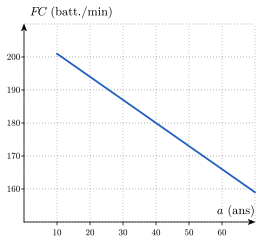
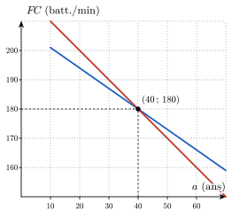
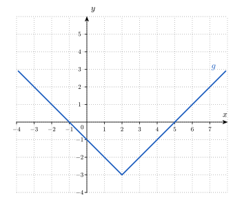
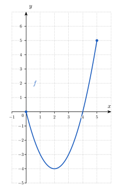
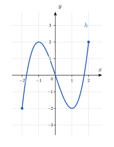

<!-- RENFORCEMENT : variations du socle (même compétence, entraînement en plus).
     Faisable SANS calculatrice ; valeurs différentes du socle.
     Numéro AUTOMATIQUE (catégorie Renforcement -> R.1, R.2…). Mêmes aides que le socle : Indice 1 (théorie), Indice 2 (question), Indice 3 (étape),
     chacun avec une ligne par sous-question, puis Solution et Piège. -->

::: {.callout-note appearance="simple"}
Ces exercices restent **dans les objectifs** de la séance : à faire une fois le socle et le transfert
bouclés, en séance ou à la maison.
:::

### Renforcement — le socle, un cran plus loin

::: {.callout-caution .exo title="Exercice|Renforcement|2|O1"}
Avant l'étude de Tanaka, Monahan et Seals, on estimait la fréquence cardiaque maximale d'un adulte d'âge $a$ (en années) par $FC_F(a) = 220 - a$, en battements par minute, formule attribuée à Fox et ses collègues.[^fox-r1] La formule de Tanaka, Monahan et Seals[^tanaka-r1] est $FC_T(a) = 208 - 0{,}7\,a$. Le graphe de $FC_T$ est dessiné ci-dessous.

[^fox-r1]: S. M. Fox, J. P. Naughton et W. L. Haskell, « Physical activity and the prevention of coronary heart disease », *Annals of Clinical Research*, 3, 1971, p. 404-432. L'origine de cette formule est discutée dans R. A. Robergs et R. Landwehr, « The surprising history of the HRmax = 220 − age equation », *Journal of Exercise Physiology online*, 5(2), 2002.

[^tanaka-r1]: H. Tanaka, K. D. Monahan et D. R. Seals, « Age-predicted maximal heart rate revisited », *Journal of the American College of Cardiology*, 37(1), 2001, p. 153-156.

{fig-alt="Droite décroissante qui représente FC_T pour des âges de 10 à 70 ans" width="9.2cm" fig-align="center"}

(a) Complète le tableau suivant avec les valeurs de $FC_F$ et de $FC_T$, en battements par minute.

| $a$ (ans) | $20$ | $40$ | $60$ |
|:---:|:---:|:---:|:---:|
| $FC_F(a)$ | | | |
| $FC_T(a)$ | | | |

(b) Trace sur le graphe donné le graphe de $FC_F$, à l'aide des valeurs du tableau.
(c) Résous l'équation $FC_F(a) = FC_T(a)$. Écris l'âge trouvé, puis la valeur commune des deux fréquences avec son unité.
(d) Pour un adulte de $60$ ans, écris par une phrase laquelle des deux formules donne la plus grande valeur, en citant les deux valeurs.
:::

::: {.aides}
::: {.panel-tabset}

## Indice 1

Retourne à la théorie du cours : *De la formule au tableau et au graphe* pour (a) et (b), *Une fonction, deux types de questions* pour (c), et *Quatre représentations pour une même fonction* pour (d).

## Indice 2

*Question à te poser.*

(a) Quelle valeur de $a$ remplace-t-on dans les formules pour chaque colonne ?
(b) Combien de points suffit-il de placer pour tracer le graphe d'une fonction affine ?
(c) Que doivent valoir les deux sorties pour l'âge cherché ?
(d) Quelles valeurs lit-on dans la colonne de $60$ ans du tableau ?

## Indice 3

*Étape.*

(a) Remplace $a$ par $20$, puis par $40$, puis par $60$ dans chaque formule et effectue chaque calcul.
(b) Place dans le repère les trois points $(a\,;\,FC_F(a))$ du tableau, puis trace la droite qui passe par eux.
(c) Écris l'équation $220 - a = 208 - 0{,}7\,a$, puis regroupe les termes en $a$ d'un côté du signe égal et les nombres de l'autre.
(d) Compare les deux nombres de la colonne de $60$ ans et écris l'écart entre eux.

## Solution

On compare deux fonctions affines, chacune étant donnée par sa formule, puis par son tableau et par son graphe.

{fig-alt="Les deux droites FC_F et FC_T, qui se croisent au point (40 ; 180)" width="9.2cm" fig-align="center"}

(a) On remplace $a$ dans chaque formule : $FC_F(20) = 200$, $FC_F(40) = 180$ et $FC_F(60) = 160$ ; $FC_T(20) = 208 - 14 = 194$, $FC_T(40) = 208 - 28 = 180$ et $FC_T(60) = 208 - 42 = 166$, toutes en battements par minute.
(b) Les trois points $(20\,;\,200)$, $(40\,;\,180)$ et $(60\,;\,160)$ sont alignés, car $FC_F$ est une fonction affine. On trace la droite qui passe par ces points ; elle est tracée en rouge sur la figure.
(c) On soustrait $208$ et on ajoute $a$ aux deux membres de $220 - a = 208 - 0{,}7\,a$, ce qui donne $12 = a - 0{,}7\,a = 0{,}3\,a$. On divise par $0{,}3$ : $a = \dfrac{12}{0{,}3} = 40$. À $40$ ans, les deux formules donnent $FC_F(40) = FC_T(40) = 180$ battements par minute. L'âge $40$ ans est l'abscisse du point d'intersection des deux droites : à cet âge, les deux formules donnent la même fréquence cardiaque maximale.
(d) À $60$ ans, $FC_T(60) = 166$ est supérieure à $FC_F(60) = 160$ : la formule de Tanaka, Monahan et Seals donne $6$ battements par minute de plus. Sur le graphe, à droite du point d'intersection, la droite de $FC_T$ est au-dessus de celle de $FC_F$.

## Piège

En (c), une erreur fréquente consiste à multiplier $12$ par $0{,}3$ au lieu de le diviser, ce qui donne $3{,}6$. Elle est tentante parce que $0{,}3$ est le coefficient de $a$, mais elle est fausse : $0{,}3\,a = 12$ signifie que $a$ est multiplié par $0{,}3$, donc on retrouve $a$ en divisant par $0{,}3$.

:::
:::

::: {.callout-caution .exo title="Exercice|Renforcement|2|O2"}
(a) Écris le domaine de $f_1(x) = \sqrt{2x - 6}$ sous la forme d'un intervalle.
(b) Écris le domaine de $f_2(x) = \dfrac{1}{x^2 - x - 6}$ sous la forme « $\mathbb{R}$ privé de certaines valeurs ».
(c) Écris le domaine de $f_3(x) = \dfrac{5}{\sqrt{4 - x}}$ sous la forme d'un intervalle.
(d) Une poche de $500$ mL est perfusée à un débit constant $d$, exprimé en mL/h. La durée de la perfusion, en heures, est donnée par $t(d) = \dfrac{500}{d}$. Écris le domaine mathématique maximal de $t$ et son domaine pratique. Calcule ensuite la durée de la perfusion pour un débit de $125$ mL/h.
:::

::: {.aides}
::: {.panel-tabset}

## Indice 1

Retourne à la théorie du cours : *Domaine d'une fonction* et *Déterminer un domaine par étapes* pour (a), (b) et (c), et *Domaine mathématique vs. domaine pertinent* pour (d).

## Indice 2

*Question à te poser.*

(a) Pour quels nombres sous la racine carrée la racine carrée existe-t-elle ?
(b) Quelle valeur un dénominateur ne peut-il jamais prendre ?
(c) Quelles sont les deux opérations de la formule qui imposent une condition, et quelle est la condition de chacune ?
(d) Quelle valeur de $d$ interdit la formule, et quels débits ont un sens pour une perfusion ?

## Indice 3

*Étape.*

(a) Écris l'inégalité « le nombre sous la racine est supérieur ou égal à $0$ » et résous-la.
(b) Écris l'équation « le dénominateur est égal à $0$ », puis factorise son membre de gauche pour la résoudre.
(c) Écris une condition pour la racine carrée et une condition pour le dénominateur, puis combine-les en une seule inégalité.
(d) Écris la valeur de $d$ qui annule le dénominateur, puis remplace $d$ par $125$ dans la formule.

## Solution

On cherche les valeurs de $x$ pour lesquelles chaque expression existe : une racine carrée n'existe que pour un nombre positif ou nul, et un quotient n'existe que si son dénominateur est non nul.

(a) La racine existe si $2x - 6 \geq 0$. On ajoute $6$ puis on divise par $2$ : $x \geq 3$. Donc $\mathit{Dom}(f_1) = [3,\,+\infty[$.
(b) Le quotient n'existe pas si $x^2 - x - 6 = 0$. C'est une équation du second degré de coefficients $a = 1$, $b = -1$ et $c = -6$. Son discriminant vaut $\Delta = b^2 - 4ac = (-1)^2 - 4 \cdot 1 \cdot (-6) = 1 + 24 = 25$. Il est strictement positif, donc l'équation a deux solutions : $x = \dfrac{1 - 5}{2} = -2$ et $x = \dfrac{1 + 5}{2} = 3$. Donc $\mathit{Dom}(f_2) = \mathbb{R} \setminus \{-2,\,3\}$.
(c) Il y a deux conditions : la racine carrée exige $4 - x \geq 0$, et le quotient exige $\sqrt{4 - x} \neq 0$, donc $4 - x \neq 0$. Ensemble, elles exigent $4 - x > 0$, soit $x < 4$. Donc $\mathit{Dom}(f_3) = ]-\infty,\,4[$.
(d) Le quotient n'existe pas si $d = 0$, donc le domaine mathématique maximal est $\mathbb{R}_0$. Un débit de perfusion est strictement positif, donc le domaine pratique est $]0,\,+\infty[$. Pour $d = 125$, on obtient $t(125) = \dfrac{500}{125} = 4$ heures.

## Piège

En (c), une erreur fréquente consiste à écrire $x \leq 4$. Elle est tentante parce que la racine carrée accepte la valeur $0$, mais elle est fausse ici : la racine est au dénominateur, donc elle ne peut pas valoir $0$ et la valeur $x = 4$ est exclue.

:::
:::

::: {.callout-caution .exo title="Exercice|Renforcement|2|O1"}
La fonction $g$ est définie sur $\mathbb{R}$ par $g(x) = |x - 2| - 3$. Son graphe est dessiné ci-dessous.

{fig-alt="Graphe de g : une courbe en forme de V dont la pointe est au point (2 ; −3)" width="11.9cm" fig-align="center"}

(a) Calcule $g(-1)$ et $g(5)$ à l'aide de la formule.
(b) Résous l'équation $g(x) = 1$ en écrivant les calculs, puis écris l'ensemble des antécédents de $1$. Vérifie sur le graphe.
(c) Écris le nombre d'antécédents de $-4$ et justifie ta réponse par une phrase.
(d) Écris l'image de $g$ sous la forme d'un intervalle.
:::

::: {.aides}
::: {.panel-tabset}

## Indice 1

Retourne à la théorie du cours : *Une fonction, deux types de questions* pour (a), (b) et (c), et *Image d'une fonction* pour (d).

## Indice 2

*Question à te poser.*

(a) Le nombre donné est-il l'entrée ou la sortie de $g$ ?
(b) Le nombre $1$ est-il l'entrée ou la sortie de $g$, et que cherche-t-on ?
(c) Quelle valeur la valeur absolue $|x - 2|$ devrait-elle prendre pour que $g(x) = -4$ ?
(d) Quelle est la plus petite valeur que peut prendre $|x - 2|$, et pour quel $x$ est-elle atteinte ?

## Indice 3

*Étape.*

(a) Remplace $x$ par la valeur demandée dans la formule, puis calcule d'abord la valeur absolue.
(b) Écris l'équation $g(x) = 1$ et isole $|x - 2|$ dans un membre.
(c) Écris l'équation $g(x) = -4$ et isole $|x - 2|$, puis compare le signe de chaque membre.
(d) Écris une inégalité qui minore $|x - 2|$, puis ajoute $-3$ aux deux membres.

## Solution

On évalue $g$ quand l'entrée est connue et on résout une équation quand la sortie est connue.

(a) On remplace $x$ : $g(-1) = |-1 - 2| - 3 = 3 - 3 = 0$ et $g(5) = |5 - 2| - 3 = 3 - 3 = 0$.
(b) La sortie $1$ est connue, donc on résout $|x - 2| - 3 = 1$. On ajoute $3$ aux deux membres : $|x - 2| = 4$. Deux nombres ont pour valeur absolue $4$ : $x - 2 = 4$ ou $x - 2 = -4$, donc $x = 6$ ou $x = -2$. L'ensemble des antécédents de $1$ est $\{-2,\,6\}$. Sur le graphe, la droite horizontale à la hauteur $1$ rencontre la courbe aux abscisses $-2$ et $6$.
(c) L'équation $g(x) = -4$ s'écrit $|x - 2| = -1$ après addition de $3$ aux deux membres. Une valeur absolue n'est jamais négative, donc cette équation n'a pas de solution : $-4$ n'a aucun antécédent.
(d) On a $|x - 2| \geq 0$ pour tout $x$, donc $g(x) \geq -3$. Inversement, pour tout nombre $y \geq -3$, le nombre $x = y + 5$ vérifie $g(x) = |y + 3| - 3 = y + 3 - 3 = y$ : toutes les valeurs supérieures ou égales à $-3$ sont atteintes. Donc $\mathit{Im}(g) = [-3,\,+\infty[$.

## Piège

En (b), une erreur fréquente consiste à ne garder que $x - 2 = 4$ et à oublier $x - 2 = -4$. Elle est tentante parce que la première équation se résout directement, mais elle est fausse : deux nombres opposés ont la même valeur absolue, et le graphe confirme l'existence de deux antécédents.

:::
:::

::: {.callout-caution .exo title="Exercice|Renforcement|2|O2"}
La fonction $f$ est définie sur l'intervalle $[0,\,5]$ par $f(x) = x^2 - 4x$. Son graphe est dessiné ci-dessous.

{fig-alt="Graphe de f sur [0, 5] : la courbe descend de (0 ; 0) jusqu'au point (2 ; −4), puis monte jusqu'au point (5 ; 5)" width="8.1cm" fig-align="center"}

(a) Lis l'image de $f$ sur le graphe et écris-la sous la forme d'un intervalle.
(b) Calcule $f([3,\,5])$ et écris le résultat sous la forme d'un intervalle. Justifie par une phrase que les valeurs aux extrémités suffisent sur cet intervalle.
(c) Résous l'équation $f(x) = 5$, puis écris l'ensemble $f^{\leftarrow}(\{5\})$ en tenant compte du domaine de $f$.
:::

::: {.aides}
::: {.panel-tabset}

## Indice 1

Retourne à la théorie du cours : *Image d'une fonction* pour (a) et (b), *Croissance et décroissance* pour (b), et *Préimage* pour (c).

## Indice 2

*Question à te poser.*

(a) Quelles sont les ordonnées du point le plus bas et du point le plus haut du graphe ?
(b) La courbe monte-t-elle ou descend-elle de gauche à droite sur $[3,\,5]$ ?
(c) À quel ensemble un antécédent de $5$ doit-il appartenir ?

## Indice 3

*Étape.*

(a) Repère le point le plus bas et le point le plus haut du graphe, et lis leurs ordonnées.
(b) Calcule $f(3)$ et $f(5)$ à l'aide de la formule.
(c) Écris l'équation $x^2 - 4x = 5$, ramène-la à une équation dont le second membre est $0$, puis résous-la.

## Solution

On lit l'image sur le graphe, on utilise le sens de variation pour calculer l'image d'un intervalle, et on résout une équation en tenant compte du domaine.

(a) L'image est l'ensemble des ordonnées des points du graphe. Le point le plus bas est $(2\,;\,-4)$ et le point le plus haut est $(5\,;\,5)$, donc $\mathit{Im}(f) = [-4,\,5]$.
(b) Sur $[3,\,5]$, la courbe monte de gauche à droite, donc $f$ est croissante : la plus petite valeur est $f(3) = 9 - 12 = -3$ et la plus grande est $f(5) = 25 - 20 = 5$. On obtient $f([3,\,5]) = [-3,\,5]$. Les valeurs aux extrémités suffisent ici, car la fonction ne change pas de sens sur cet intervalle.
(c) On soustrait $5$ aux deux membres de $x^2 - 4x = 5$ : $x^2 - 4x - 5 = 0$. C'est une équation du second degré de coefficients $a = 1$, $b = -4$ et $c = -5$. Son discriminant vaut $\Delta = (-4)^2 - 4 \cdot 1 \cdot (-5) = 16 + 20 = 36$. Il est strictement positif, donc l'équation a deux solutions : $x = \dfrac{4 - 6}{2} = -1$ et $x = \dfrac{4 + 6}{2} = 5$. Le nombre $-1$ n'appartient pas au domaine $[0,\,5]$, donc on l'exclut : $f^{\leftarrow}(\{5\}) = \{5\}$.

## Piège

En (a), une erreur fréquente consiste à calculer l'image à partir des valeurs aux extrémités, $f(0) = 0$ et $f(5) = 5$, et à écrire $[0,\,5]$. Elle est tentante parce que les valeurs aux extrémités sont faciles à calculer, mais elle est fausse : la courbe descend d'abord jusqu'à $-4$ en $x = 2$.

En (c), une autre erreur consiste à garder $x = -1$. Elle est tentante parce que $-1$ est bien solution de l'équation, mais elle est fausse : un antécédent doit appartenir au domaine de $f$.

:::
:::

::: {.callout-caution .exo title="Exercice|Renforcement|3|O2"}
La fonction $h$ est définie sur l'intervalle $[-2,\,2]$ par $h(x) = x^3 - 3x$. Son graphe est dessiné ci-dessous.

{fig-alt="Graphe de h sur [−2, 2] : la courbe monte de (−2 ; −2) jusqu'au point (−1 ; 2), descend jusqu'au point (1 ; −2), puis monte jusqu'au point (2 ; 2)" width="7.3cm" fig-align="center"}

(a) Calcule les racines de $h$. Pour cela, écris $h(x) = x(x^2 - 3)$ et factorise $x^2 - 3$.
(b) Étudie le signe de $h$ sur $[-2,\,2]$ et présente le résultat dans un tableau de signes.
(c) Lis sur le graphe les intervalles de croissance et de décroissance de $h$.
(d) Écris les extrema locaux de $h$, puis ses extrema globaux sur $[-2,\,2]$, en précisant pour chacun l'abscisse et la valeur.
:::

::: {.aides}
::: {.panel-tabset}

## Indice 1

Retourne à la théorie du cours : *Racines et étude de signe* pour (a) et (b), *Croissance et décroissance* pour (c), et *Extrema locaux et globaux* pour (d).

## Indice 2

*Question à te poser.*

(a) Quand un produit de facteurs est-il égal à $0$ ?
(b) En combien d'intervalles les racines découpent-elles $[-2,\,2]$ ?
(c) Sur quels morceaux la courbe monte-t-elle, et sur lesquels descend-elle ?
(d) En quels points la courbe change-t-elle de sens, et ces points sont-ils les plus hauts ou les plus bas de tout le graphe ?

## Indice 3

*Étape.*

(a) Écris que chacun des facteurs est égal à $0$ et résous chaque équation.
(b) Place les racines sur une droite, puis calcule $h$ en un point de chaque intervalle.
(c) Suis la courbe de gauche à droite et note les abscisses où elle change de sens.
(d) Lis l'ordonnée de chaque point où la courbe change de sens, puis compare-la aux ordonnées des deux extrémités du graphe.

## Solution

On factorise $h$ pour trouver ses racines et son signe, puis on lit ses variations et ses extrema sur le graphe.

(a) Les racines de $h$ sont les valeurs de $x$ telles que $h(x) = 0$. On écrit $h(x) = x(x^2 - 3) = x(x - \sqrt{3})(x + \sqrt{3})$. Un produit est nul si et seulement si l'un de ses facteurs est nul, donc $x = 0$, $x = \sqrt{3}$ ou $x = -\sqrt{3}$. Ces trois racines appartiennent à $[-2,\,2]$, car $\sqrt{3} < 2$.
(b) Le signe de $h$ est constant entre deux racines successives. Les racines $-\sqrt{3}$, $0$ et $\sqrt{3}$ découpent $[-2,\,2]$ en quatre intervalles. On évalue $h$ en un point de chacun : $h(-2) = -8 + 6 = -2 < 0$, $h(-1) = -1 + 3 = 2 > 0$, $h(1) = 1 - 3 = -2 < 0$ et $h(2) = 8 - 6 = 2 > 0$. On obtient le tableau suivant.

| $x$ | $[-2,\,-\sqrt{3}[$ | $-\sqrt{3}$ | $]-\sqrt{3},\,0[$ | $0$ | $]0,\,\sqrt{3}[$ | $\sqrt{3}$ | $]\sqrt{3},\,2]$ |
|:---:|:---:|:---:|:---:|:---:|:---:|:---:|:---:|
| signe de $h(x)$ | $-$ | $0$ | $+$ | $0$ | $-$ | $0$ | $+$ |

(c) La courbe monte jusqu'au point d'abscisse $-1$, descend jusqu'au point d'abscisse $1$, puis remonte. La fonction $h$ est croissante sur $[-2,\,-1]$ et sur $[1,\,2]$, et décroissante sur $[-1,\,1]$.
(d) En $x = -1$, la courbe change de sens et atteint localement sa hauteur maximale : $h$ a un maximum local en $-1$, de valeur $h(-1) = 2$. En $x = 1$, elle atteint localement sa hauteur minimale : $h$ a un minimum local en $1$, de valeur $h(1) = -2$. Sur $[-2,\,2]$, les valeurs aux extrémités sont $h(-2) = -2$ et $h(2) = 2$. Le maximum global vaut donc $2$, atteint en $x = -1$ et en $x = 2$, et le minimum global vaut $-2$, atteint en $x = -2$ et en $x = 1$.

## Piège

En (d), une erreur fréquente consiste à ne citer que $x = -1$ pour le maximum global. Elle est tentante parce que le sommet de la courbe est le point le plus visible, mais elle est fausse : $h(2) = 2$ est aussi égale au maximum, donc un extremum global peut être atteint en plusieurs abscisses, dont une extrémité de l'intervalle.

En (a), une autre erreur consiste à ne garder que $x = \sqrt{3}$ pour l'équation $x^2 = 3$. Elle est tentante parce qu'on pense à la racine carrée positive, mais elle est fausse : $x^2 = 3$ a deux solutions, $\sqrt{3}$ et $-\sqrt{3}$.

:::
:::

::: {.callout-caution .exo title="Exercice|Renforcement|2|O3"}
Soient les fonctions $f$, $g$ et $h$ définies sur $\mathbb{R}$ par $f(x) = 3x - 2$, $g(x) = x^2$ et $h(x) = x^2 - 1$.

(a) Écris les expressions de $(g \circ f)(x)$ et de $(f \circ g)(x)$, développées et simplifiées.
(b) Calcule l'expression de la fonction réciproque $f^{-1}$, puis vérifie-la en calculant $(f \circ f^{-1})(x)$.
(c) Donne deux nombres différents qui ont la même image par $h$ et conclus sur l'existence d'une réciproque de $h$ sur $\mathbb{R}$.
(d) On restreint $h$ à l'intervalle $\mathbb{R}^{+}$. Calcule la réciproque de cette restriction et écris son domaine.
:::

::: {.aides}
::: {.panel-tabset}

## Indice 1

Retourne à la théorie du cours : *Calculer une composition* pour (a), *Réciproque : vision graphique* pour le calcul de (b) et pour (d), et *Défaire une opération : fonction réciproque* pour la vérification de (b) et pour (c).

## Indice 2

*Question à te poser.*

(a) Dans $(g \circ f)(x)$, quelle fonction s'applique en premier, et par quelle expression remplace-t-on la variable de $g$ ?
(b) Quand on connaît la sortie $y$, comment retrouve-t-on l'entrée $x$ ?
(c) Peut-on donner une image unique à une valeur qui a deux antécédents ?
(d) Quel est le signe d'un nombre $x$ de l'intervalle $\mathbb{R}^{+}$, et quelle racine carrée choisit-on pour le retrouver ?

## Indice 3

*Étape.*

(a) Remplace la variable de $g$ par $3x - 2$ et développe le carré obtenu, puis remplace la variable de $f$ par $x^2$.
(b) Pose $y = 3x - 2$ et isole $x$ en fonction de $y$, puis échange les noms $x$ et $y$.
(c) Cherche deux nombres opposés et calcule $h$ en chacun d'eux.
(d) Pose $y = x^2 - 1$, isole $x^2$, puis écris $x$ comme une racine carrée en tenant compte du signe de $x$.

## Solution

On compose en remplaçant la variable de la seconde fonction par l'expression de la première, puis on calcule une réciproque en posant $y = f(x)$, en isolant $x$ et en échangeant les noms $x$ et $y$.

(a) On remplace la variable de $g$ par $f(x)$ : $(g \circ f)(x) = g(3x - 2) = (3x - 2)^2 = 9x^2 - 12x + 4$. On remplace la variable de $f$ par $g(x)$ : $(f \circ g)(x) = f(x^2) = 3x^2 - 2$. Les deux expressions sont différentes : la composition n'est pas commutative.
(b) On pose $y = 3x - 2$, donc $3x = y + 2$ et $x = \dfrac{y + 2}{3}$. On échange les noms $x$ et $y$ : $f^{-1}(x) = \dfrac{x + 2}{3}$. Vérification : $(f \circ f^{-1})(x) = 3 \cdot \dfrac{x + 2}{3} - 2 = x + 2 - 2 = x$.
(c) On a $h(1) = 0$ et $h(-1) = 0$ : la valeur $0$ a deux antécédents, $1$ et $-1$. Une réciproque devrait associer à $0$ un seul nombre, donc $h$ n'a pas de réciproque sur $\mathbb{R}$.
(d) Sur $\mathbb{R}^{+}$, deux nombres positifs différents ont des carrés différents, donc la restriction de $h$ est injective. On pose $y = x^2 - 1$, donc $x^2 = y + 1$. Comme $x \geq 0$, on a $x = \sqrt{y + 1}$. On échange les noms $x$ et $y$ : $h^{-1}(x) = \sqrt{x + 1}$. Son domaine est l'image de la restriction : pour $x \geq 0$, on a $x^2 \geq 0$ donc $h(x) \geq -1$. Inversement, pour tout nombre $y \geq -1$, le nombre $x = \sqrt{y + 1}$ est positif ou nul et vérifie $h(x) = y$ : toutes ces valeurs sont atteintes. Donc $\mathit{Dom}(h^{-1}) = [-1,\,+\infty[$.

## Piège

En (a), une erreur fréquente consiste à écrire $(3x - 2)^2 = 9x^2 - 4$. Elle est tentante parce qu'on élève chaque terme au carré, mais elle est fausse : le carré d'une différence contient le double produit, $-2 \cdot 3x \cdot 2 = -12x$.

:::
:::
