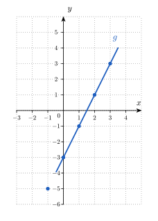
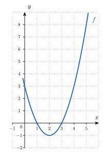
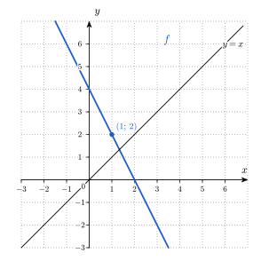
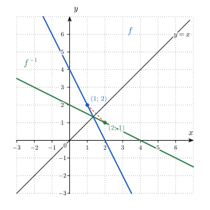

<!-- SOCLE = LE NOYAU, à faire par tous en séance : environ 30 minutes.
     Fonctions et représentations. Les exercices passent d'un registre à l'autre (texte, tableau, graphe, formule).
     Figures : img/*.svg, générées par img/figs.py (texte vectorisé, rendu identique en PDF typst et sur le site).
     HIÉRARCHIE DES INDICES (à respecter partout) :
       Indice 1 = renvoi à la théorie du cours (titres des slides IMSV-5) ;
       Indice 2 = une QUESTION à se poser (jamais sa réponse) ;
       Indice 3 = une ÉTAPE (un pas concret, sans donner la solution).
     Chaque sous-question a ses propres indices. Numéro AUTOMATIQUE (pas écrit). Faisable SANS calculatrice.
     Notations du cours : f(x), \mathit{Dom}(f), \mathit{Im}(f), f^{\leftarrow}(E), f^{-1}, g \circ f, \mathbb{R}_0, \mathbb{R}^{+}.
     S.4 = l'exercice confronté puis corrigé ensemble à la fin du socle : énoncé seul, SANS aides (la solution pas à pas est dans les slides).
     Objectifs : voir index.qmd (O1 à O7, repris des AAVs de la théorie). -->

::: {.callout-caution .exo title="Exercice|Socle|1|O1"}
Chacun des trois diagrammes ci-dessous est un diagramme sagittal. Il représente une règle : à gauche se trouve l'ensemble de départ, à droite l'ensemble d'arrivée, et une flèche relie un élément de départ à l'élément d'arrivée qui lui est associé.

{fig-alt="Trois diagrammes sagittaux. Diagramme (1) : de {−2, −1, 0, 1, 2} vers {0, 1, 4, 5}, avec −2 vers 4, −1 vers 1, 0 vers 0, 1 vers 1 et 2 vers 4. Diagramme (2) : de {1, 2, 3} vers {2, 4, 6, 8}, avec 1 vers 2, 2 vers 4, 2 vers 6 et 3 vers 6. Diagramme (3) : de {1, 2, 3, 4} vers {1, 4, 9, 16}, avec 1 vers 1, 2 vers 4 et 3 vers 9" width="12.5cm" fig-align="center"}

(a) Pour chaque diagramme, indique si la règle représentée est une fonction de l'ensemble de départ vers l'ensemble d'arrivée. Justifie chaque réponse par une phrase qui utilise la définition d'une fonction.
(b) Le diagramme (1) représente une fonction $f$. Écris $\mathit{Dom}(f)$ et $\mathit{Im}(f)$, puis écris $f^{\leftarrow}(\{1\})$, l'ensemble des antécédents de $1$, et l'élément de l'ensemble d'arrivée qui n'a aucun antécédent.
:::

::: {.aides}
::: {.panel-tabset}

## Indice 1

Retourne à la théorie du cours : *Fonctions : définition opérationnelle* pour (a), et *Domaine d'une fonction*, *Image d'une fonction* et *Préimage* pour (b).

## Indice 2

*Question à te poser.*

(a) Combien de flèches partent de chaque élément de l'ensemble de départ ?
(b) Quels éléments de l'ensemble d'arrivée sont atteints par au moins une flèche ?

## Indice 3

*Étape.*

(a) Pour chaque diagramme, compte les flèches qui partent de chaque élément de départ, et repère les éléments qui en ont deux ou plus.
(b) Écris la liste des éléments de départ qui sont le début d'une flèche, puis la liste des éléments d'arrivée qui sont le bout d'une flèche. Pour les antécédents de $1$, lis les flèches qui aboutissent en $1$.

## Solution

On utilise la définition d'une fonction : une fonction associe à chaque élément de départ au plus un élément d'arrivée. Sur un diagramme sagittal, cela signifie que chaque élément de départ est le début d'au plus une flèche.

(a) Dans le diagramme (1), chaque élément de départ est le début d'exactement une flèche, donc la règle est une fonction. Dans le diagramme (2), l'élément $2$ est le début de deux flèches, l'une vers $4$ et l'autre vers $6$ : l'élément $2$ aurait deux images, donc la règle n'est pas une fonction. Dans le diagramme (3), les éléments $1$, $2$ et $3$ sont chacun le début d'une seule flèche et l'élément $4$ n'en a aucune : chaque élément de départ est donc le début d'au plus une flèche, et la règle est une fonction.
(b) Les éléments de départ qui sont le début d'une flèche sont $-2$, $-1$, $0$, $1$ et $2$, donc $\mathit{Dom}(f) = \{-2,\,-1,\,0,\,1,\,2\}$. Les éléments d'arrivée qui sont le bout d'une flèche sont $0$, $1$ et $4$, donc $\mathit{Im}(f) = \{0,\,1,\,4\}$. Les flèches qui aboutissent en $1$ partent de $-1$ et de $1$, donc $f^{\leftarrow}(\{1\}) = \{-1,\,1\}$. L'élément $5$ de l'ensemble d'arrivée n'est le bout d'aucune flèche : il n'a aucun antécédent.

## Piège

En (a), une erreur fréquente consiste à rejeter le diagramme (1) parce que l'élément $1$ reçoit deux flèches. Elle est tentante parce que deux flèches aboutissent au même point, mais elle est fausse : la définition interdit seulement qu'un élément de départ ait deux images, et deux éléments de départ différents peuvent avoir la même image.

Une autre erreur consiste à rejeter le diagramme (3) parce que l'élément $4$ n'a pas de flèche. Elle est tentante parce que l'on pense qu'une fonction doit être définie partout dans l'ensemble de départ, mais elle est fausse : la définition exige « au plus une » flèche par élément de départ, et le domaine peut être strictement contenu dans l'ensemble de départ.

:::
:::

::: {.callout-caution .exo title="Exercice|Socle|2|O4"}
Une même fonction peut être décrite par un texte, par une formule, par un tableau de valeurs ou par un graphe. Dans cet exercice, tu passes d'un de ces registres à un autre.

(a) La fonction $g$ est décrite par le texte suivant : « on multiplie le nombre par $2$, puis on soustrait $3$ ». Écris la formule de $g(x)$, complète le tableau ci-dessous, puis place les points du tableau dans le repère de la figure et trace le graphe de $g$.

| $x$ | $-1$ | $0$ | $1$ | $2$ | $3$ |
|:---:|:---:|:---:|:---:|:---:|:---:|
| $g(x)$ | | | | | |

{fig-alt="Repère quadrillé vide, avec x de −3 à 4 et y de −6 à 5" width="7.6cm" fig-align="center"}

(b) La fonction $f$ est décrite par le tableau suivant.

| $x$ | $-1$ | $0$ | $1$ | $2$ | $3$ |
|:---:|:---:|:---:|:---:|:---:|:---:|
| $f(x)$ | $4$ | $1$ | $0$ | $1$ | $4$ |

Écris une formule simple qui donne la valeur de $f(x)$ pour chacun de ces cinq nombres $x$, puis écris un texte qui décrit $f$ comme une suite d'opérations effectuées sur $x$.
:::

::: {.aides}
::: {.panel-tabset}

## Indice 1

Retourne à la théorie du cours : *Quatre représentations pour une même fonction* pour (a) et (b), et *De la formule au tableau et au graphe* pour (a).

## Indice 2

*Question à te poser.*

(a) Dans quel ordre le texte demande-t-il d'effectuer les deux opérations sur $x$ ?
(b) Pour quelle valeur de $x$ la fonction $f$ s'annule-t-elle, et que remarques-tu sur les valeurs de $f(x)$ de part et d'autre de cette valeur ?

## Indice 3

*Étape.*

(a) Écris $g(x)$ en deux temps : le produit d'abord, puis la soustraction. Remplace ensuite $x$ par chaque valeur du tableau, et place chaque point $(x\,;\,g(x))$.
(b) Puisque $f(1) = 0$, cherche une expression de $x$ qui s'annule en $x = 1$, puis compare ses valeurs à celles du tableau.

## Solution

On passe d'un registre à l'autre, comme dans *Quatre représentations pour une même fonction* : on traduit un texte ou un tableau en formule, puis la formule dans les autres registres.

(a) Le texte demande de multiplier d'abord $x$ par $2$, puis de soustraire $3$ au produit : on obtient $g(x) = 2x - 3$. On remplace ensuite $x$ par chaque valeur : $g(-1) = 2 \cdot (-1) - 3 = -5$, $g(0) = -3$, $g(1) = -1$, $g(2) = 1$ et $g(3) = 3$. Le tableau complété est le suivant.

| $x$ | $-1$ | $0$ | $1$ | $2$ | $3$ |
|:---:|:---:|:---:|:---:|:---:|:---:|
| $g(x)$ | $-5$ | $-3$ | $-1$ | $1$ | $3$ |

On place les points $(-1\,;\,-5)$, $(0\,;\,-3)$, $(1\,;\,-1)$, $(2\,;\,1)$ et $(3\,;\,3)$. Ils sont alignés, car $g(x)$ augmente de $2$ chaque fois que $x$ augmente de $1$ : le graphe de $g$ est une droite.

{fig-alt="Repère quadrillé avec les cinq points (−1 ; −5), (0 ; −3), (1 ; −1), (2 ; 1) et (3 ; 3) alignés sur la droite qui représente g" width="7.6cm" fig-align="center"}

(b) Le tableau donne $f(1) = 0$, donc on cherche une expression de $x$ qui s'annule en $x = 1$, par exemple $x - 1$. Pour les cinq valeurs du tableau, $x - 1$ vaut $-2$, $-1$, $0$, $1$ et $2$. Les valeurs $4$, $1$, $0$, $1$ et $4$ du tableau sont exactement les carrés de ces nombres, donc on propose $f(x) = (x - 1)^2$. Le texte correspondant est : « on soustrait $1$ au nombre, puis on élève le résultat au carré ». Un tableau de cinq valeurs ne détermine pas la fonction à lui seul : on a choisi la formule la plus simple qui vérifie les cinq colonnes.

## Piège

En (a), une erreur fréquente consiste à écrire $2(x - 3)$. Elle est tentante parce que le texte contient le mot « soustrait » et le nombre $3$ à la fin, mais elle est fausse : on soustrait $3$ après la multiplication, donc on obtient $2x - 3$ et non $2x - 6$.

En (b), une autre erreur consiste à proposer une formule après avoir regardé seulement deux colonnes du tableau, par exemple $1 - x$, qui vérifie $f(0) = 1$ et $f(1) = 0$. Elle est tentante parce qu'elle est simple, mais elle est fausse : elle donne $2$ en $x = -1$ au lieu de $4$. Il faut contrôler la formule sur toutes les colonnes.

:::
:::

::: {.callout-caution .exo title="Exercice|Socle|2|O7"}
On considère la fonction $f$ définie sur l'intervalle $[-3,\,3]$ par $f(x) = (x + 2)(x - 1)^2$. Son graphe est dessiné ci-dessous.

{fig-alt="Graphe de f sur [−3, 3] : la courbe monte de (−3 ; −16) jusqu'au point (−1 ; 4), redescend jusqu'au point (1 ; 0), puis monte jusqu'à (3 ; 20)" width="7.7cm" fig-align="center"}

(a) Lis sur le graphe les intervalles sur lesquels $f$ est croissante, puis ceux sur lesquels elle est décroissante.
(b) Écris tous les extrema locaux de $f$ : pour chacun, indique s'il s'agit d'un maximum ou d'un minimum, son abscisse et sa valeur. Indique ensuite, par une phrase, lesquels sont aussi des extrema de $f$ sur $[-3,\,3]$.
:::

::: {.aides}
::: {.panel-tabset}

## Indice 1

Retourne à la théorie du cours : *Croissance et décroissance* pour (a), et *Extrema locaux et globaux* pour (b).

## Indice 2

*Question à te poser.*

(a) Sur quels morceaux du graphe la courbe monte-t-elle de gauche à droite, et sur lesquels descend-elle ?
(b) Pour l'abscisse $-3$, quelles valeurs de $f$ faut-il comparer à $f(-3)$, sachant que le domaine s'arrête en $-3$ ?

## Indice 3

*Étape.*

(a) Suis la courbe de gauche à droite et note les abscisses où elle change de sens.
(b) Repère sur la courbe les sommets et les creux, puis les deux extrémités du graphe ; pour chacun de ces quatre points, compare la valeur de $f$ aux valeurs prises tout près, à l'intérieur du domaine, puis compare les quatre valeurs entre elles.

## Solution

On lit les variations de $f$ sur le graphe, puis on en déduit ses extrema locaux.

(a) La courbe monte de gauche à droite jusqu'au point d'abscisse $-1$, descend ensuite jusqu'au point d'abscisse $1$, puis remonte jusqu'à l'abscisse $3$. La fonction $f$ est croissante sur $[-3,\,-1]$ et sur $[1,\,3]$, et décroissante sur $[-1,\,1]$.
(b) Un extremum local se lit dans un voisinage d'un point, en ne gardant que les abscisses du domaine. En $x = -1$, la courbe monte puis descend : près de $-1$, la plus grande valeur de $f$ est atteinte en $-1$, donc $f$ a un maximum local en $-1$, de valeur $f(-1) = 1 \cdot (-2)^2 = 4$. En $x = 1$, la courbe descend puis monte : $f$ a un minimum local en $1$, de valeur $f(1) = 3 \cdot 0 = 0$. Aux extrémités, le voisinage ne contient que les abscisses situées d'un seul côté. En $x = -3$, la courbe monte immédiatement à droite, donc $f$ a un minimum local en $-3$, de valeur $f(-3) = (-1) \cdot (-4)^2 = -16$. En $x = 3$, la courbe monte jusqu'à l'extrémité, donc $f$ a un maximum local en $3$, de valeur $f(3) = 5 \cdot 2^2 = 20$. Il y a donc quatre extrema locaux. Parmi eux, le maximum local en $3$ est aussi le maximum de $f$ sur $[-3,\,3]$, qui vaut $20$, et le minimum local en $-3$ est aussi le minimum de $f$ sur $[-3,\,3]$, qui vaut $-16$. Le maximum local de valeur $4$ en $-1$ et le minimum local de valeur $0$ en $1$ ne sont pas des extrema de $f$ sur $[-3,\,3]$, car $4 < 20$ et $0 > -16$.

## Piège

En (b), une première erreur consiste à ne citer que les deux points où la courbe change de sens, $-1$ et $1$. Elle est tentante parce que ce sont les sommets visibles du graphe, mais elle est fausse : le voisinage d'une extrémité ne contient que les abscisses du domaine, donc $-3$ et $3$ sont aussi des extrema locaux.

En (b), une seconde erreur consiste à donner $4$ comme maximum de $f$ sur $[-3,\,3]$. Elle est tentante parce que le point $(-1\,;\,4)$ est le sommet le plus visible, mais elle est fausse : un maximum local n'est le plus grand que dans un voisinage de son abscisse, et $f(3) = 20$ est plus grand que $4$.

:::
:::

::: {#cau-ex-S4 .callout-caution .exo title="Exercice|Socle|2|O3"}
La fonction $f$ est définie sur $\mathbb{R}$ par $f(x) = x^2 - 4x + 3$. Une partie de son graphe est dessinée ci-dessous.

{fig-alt="Parabole d'équation y = x² − 4x + 3, dont le point le plus bas est (2 ; −1) ; elle passe par (0 ; 3), (4 ; 3) et (5 ; 8)" width="7.6cm" fig-align="center"}

Pour chacun des intervalles des questions (a) à (d), indique laquelle des quatre réponses suivantes convient, en écrivant sa lettre.

- **A.** La fonction $f$ admet un maximum et un minimum sur l'intervalle.
- **B.** La fonction $f$ admet uniquement un maximum sur l'intervalle.
- **C.** La fonction $f$ admet uniquement un minimum sur l'intervalle.
- **D.** La fonction $f$ n'admet ni maximum ni minimum sur l'intervalle.

Justifie ensuite chaque réponse par une phrase qui donne l'abscisse et la valeur de chaque extremum, ou qui explique pourquoi un extremum n'existe pas.

(a) $[0,\,5]$
(b) $[0,\,5[$
(c) $]2,\,5]$
(d) $[0,\,4[$
:::

::: {.callout-note appearance="simple"}
L'exercice **S.4** est corrigé ensemble à la fin du temps consacré au socle, après la confrontation de vos réponses : il n'a donc pas de coups de pouce. Cherche-le seul·e pendant le socle et repère l'endroit exact où tu bloques.
:::

::: {.callout-caution .exo title="Exercice|Socle|2|O1"}
(a) Écris le domaine de la fonction $f(x) = \dfrac{\sqrt{x + 3}}{x - 1}$. Écris d'abord chacune des conditions d'existence, puis le domaine, sous la forme d'un intervalle privé d'une valeur.
(b) Une poche de $500$ mL est perfusée à un débit constant $d$, exprimé en mL/h. La durée de la perfusion, en heures, est donnée par $t(d) = \dfrac{500}{d}$. Écris le domaine mathématique maximal de $t$, puis son domaine pratique. Calcule ensuite la durée de la perfusion pour un débit de $125$ mL/h, puis le débit qui donne une durée de $5$ h.
:::

::: {.aides}
::: {.panel-tabset}

## Indice 1

Retourne à la théorie du cours : *Domaine d'une fonction* et *Déterminer un domaine par étapes* pour (a), et *Domaine mathématique vs. domaine pertinent* ainsi que *Une fonction, deux types de questions* pour (b).

## Indice 2

*Question à te poser.*

(a) Quelles opérations de la formule imposent une condition sur $x$ ?
(b) Dans $t(125)$ et dans l'égalité $t(d) = 5$, le nombre donné est-il l'entrée ou la sortie de la fonction ?

## Indice 3

*Étape.*

(a) Écris la condition qu'impose la racine carrée et celle qu'impose le dénominateur, puis garde les nombres qui vérifient les deux.
(b) Écris la valeur de $d$ qui annule le dénominateur et la condition qu'impose un débit, puis remplace $d$ par $125$ et résous l'équation $\dfrac{500}{d} = 5$.

## Solution

On cherche les valeurs pour lesquelles chaque expression existe : une racine carrée n'existe que pour un nombre positif ou nul, et un quotient n'existe que si son dénominateur est non nul.

(a) La racine carrée impose $x + 3 \geq 0$, soit $x \geq -3$. Le dénominateur impose $x - 1 \neq 0$, soit $x \neq 1$. Le nombre $1$ appartient à l'intervalle $[-3,\,+\infty[$, donc il faut le retirer : $\mathit{Dom}(f) = [-3,\,+\infty[\, \setminus \{1\}$.

(b) Le quotient n'existe pas si $d = 0$, donc le domaine mathématique maximal de $t$ est $\mathbb{R}_0$. Un débit de perfusion est strictement positif, donc le domaine pratique est $]0,\,+\infty[$. Le débit $125$ mL/h est l'entrée, donc on évalue la fonction : $t(125) = \dfrac{500}{125} = 4$ h. La durée $5$ h est la sortie, donc on résout l'équation $\dfrac{500}{d} = 5$. On multiplie les deux membres par $d$, qui est non nul : $500 = 5\,d$, donc $d = 100$ mL/h. Vérification : $t(100) = \dfrac{500}{100} = 5$ h. Il faut donc un débit de $100$ mL/h pour que la perfusion dure $5$ heures.

## Piège

En (a), une erreur fréquente consiste à n'écrire que la condition de la racine carrée et à donner $[-3,\,+\infty[$. Elle est tentante parce que la racine carrée attire l'attention, mais elle est fausse : le dénominateur s'annule en $x = 1$, qui appartient à cet intervalle et doit en être retiré.

En (b), une autre erreur consiste à donner $\mathbb{R}_0$ comme domaine pratique. Elle est tentante parce que c'est le domaine de la formule, mais elle est fausse : un débit négatif n'a aucun sens pour une perfusion.

:::
:::

::: {.callout-caution .exo title="Exercice|Socle|2|O2"}
La fonction $f$ est définie par $f(x) = \dfrac{x\,(x - 3)}{x + 1}$.

(a) Écris le domaine de $f$, puis calcule les racines de $f$.
(b) Étudie le signe de $f$ : présente le résultat dans un tableau de signes qui contient une ligne pour chacun des trois facteurs $x$, $x - 3$ et $x + 1$, et une ligne pour $f(x)$. Indique par le symbole $\nexists$ la valeur de $x$ en laquelle $f$ n'est pas définie.
(c) Déduis du tableau de (b) l'ensemble des solutions de l'inéquation $f(x) \geq 0$.
:::

::: {.aides}
::: {.panel-tabset}

## Indice 1

Retourne à la théorie du cours : *Domaine d'une fonction* pour (a), *Racines et étude de signe* pour (a) et (b), et *Étude de signe : quid des « trous » ?* pour la colonne de la valeur exclue en (b).

## Indice 2

*Question à te poser.*

(a) Quelle valeur de $x$ rend le dénominateur égal à $0$, et quand une fraction est-elle égale à $0$ ?
(b) Quel est le signe de chacun des trois facteurs de part et d'autre de la valeur pour laquelle il s'annule ?
(c) Dans la ligne de $f(x)$, quelles colonnes portent le signe $+$ ou le nombre $0$ ?

## Indice 3

*Étape.*

(a) Écris que le dénominateur doit être différent de $0$, puis écris que le numérateur est égal à $0$ et résous cette équation.
(b) Place sur une droite les trois valeurs qui annulent un facteur, puis remplis une ligne par facteur, et applique la règle des signes d'un produit et d'un quotient dans chaque colonne.
(c) Garde les colonnes où la dernière ligne contient $+$ ou $0$, puis écris l'ensemble des solutions comme une réunion d'intervalles, en soignant les crochets.

## Solution

On détermine d'abord le domaine et les racines, puis on étudie le signe de chaque facteur, et on en déduit le signe du quotient.

(a) La fraction n'existe que si le dénominateur est non nul : $x + 1 \neq 0$, donc $x \neq -1$ et le domaine de $f$ est $\mathbb{R} \setminus \{-1\}$. Une fraction est nulle si et seulement si son numérateur est nul et son dénominateur ne l'est pas : $x(x - 3) = 0$ donne $x = 0$ ou $x = 3$, et ces deux valeurs appartiennent au domaine. Les racines de $f$ sont donc $0$ et $3$.
(b) Les valeurs $-1$, $0$ et $3$ annulent respectivement le dénominateur et chacun des facteurs du numérateur : elles découpent la droite en quatre intervalles. Le facteur $x + 1$ est négatif pour $x < -1$ et positif pour $x > -1$ ; le facteur $x$ est négatif pour $x < 0$ et positif pour $x > 0$ ; le facteur $x - 3$ est négatif pour $x < 3$ et positif pour $x > 3$. Un quotient est positif quand le nombre de facteurs négatifs est pair, et négatif quand il est impair. On obtient le tableau suivant.

| $x$ | $-\infty$ | | $-1$ | | $0$ | | $3$ | | $+\infty$ |
|:---:|:---:|:---:|:---:|:---:|:---:|:---:|:---:|:---:|:---:|
| signe de $x$ | $-$ | $-$ | $-$ | $-$ | $0$ | $+$ | $+$ | $+$ | $+$ |
| signe de $x - 3$ | $-$ | $-$ | $-$ | $-$ | $-$ | $-$ | $0$ | $+$ | $+$ |
| signe de $x + 1$ | $-$ | $-$ | $0$ | $+$ | $+$ | $+$ | $+$ | $+$ | $+$ |
| signe de $f(x)$ | $-$ | $-$ | $\nexists$ | $+$ | $0$ | $-$ | $0$ | $+$ | $+$ |

Contrôle : $f(-2) = \dfrac{(-2)(-5)}{-1} = -10 < 0$ et $f(-\tfrac{1}{2}) = \dfrac{(-\tfrac{1}{2})(-\tfrac{7}{2})}{\tfrac{1}{2}} = \tfrac{7}{2} > 0$, ce qui correspond au tableau.
(c) Dans la ligne de $f(x)$, les signes $+$ ou $0$ se trouvent entre $-1$ et $0$, en $0$, en $3$ et à droite de $3$ : l'inégalité $f(x) \geq 0$ est vérifiée sur $]-1,\,0[$, en $0$, en $3$ et sur $]3,\,+\infty[$. L'ensemble des solutions de $f(x) \geq 0$ est donc $]-1,\,0] \cup [3,\,+\infty[$. La valeur $-1$ est exclue, car $f$ n'y est pas définie.

## Piège

En (b), une erreur fréquente consiste à placer un signe, par exemple $-$ ou $0$, dans la colonne de $x = -1$ au lieu de $\nexists$. Elle est tentante parce que le facteur $x + 1$ s'annule en $-1$, comme un facteur du numérateur, mais elle est fausse : un dénominateur nul rend la fraction non définie, donc $f(-1)$ n'existe pas et ne vaut pas $0$.

En (c), une autre erreur consiste à écrire $[-1,\,0]$ avec un crochet fermé en $-1$. Elle est tentante parce que $-1$ est une borne de l'intervalle où $f$ est positive, mais elle est fausse : $-1$ n'appartient pas au domaine, donc le crochet est ouvert en $-1$.

:::
:::

::: {.callout-caution .exo title="Exercice|Socle|2|O5"}
Soient les fonctions $h(x) = x - 2$ et $k(x) = -\sqrt{x}$.

(a) Écris les expressions de $(k \circ h)(x)$ et de $(h \circ k)(x)$, puis le domaine de chacune de ces deux fonctions.
(b) Calcule $(k \circ h)(4)$ et $(h \circ k)(4)$, puis conclus sur l'égalité de $k \circ h$ et de $h \circ k$.
(c) La fonction $k \circ h$ est-elle croissante sur son domaine ? Justifie ta réponse avec la définition de la croissance.
:::

::: {.aides}
::: {.panel-tabset}

## Indice 1

Retourne à la théorie du cours : *Calculer une composition* pour (a) et (b), *Domaine d'une fonction* pour les domaines demandés en (a), et *Croissance et décroissance* pour (c).

## Indice 2

*Question à te poser.*

(a) Dans $(k \circ h)(x)$, par quelle expression remplace-t-on la variable de $k$ ? Et dans $(h \circ k)(x)$ ?
(b) Que suffit-il de trouver pour montrer que deux fonctions ne sont pas égales ?
(c) Que doit-on trouver pour montrer qu'une fonction n'est pas croissante ? Si $x_1 < x_2$, comment se comparent $x_1 - 2$ et $x_2 - 2$, puis leurs racines carrées, puis les opposés de ces racines ?

## Indice 3

*Étape.*

(a) Écris $(k \circ h)(x) = k(h(x))$, remplace $h(x)$ par son expression, puis procède de même pour $h \circ k$.
(b) Remplace $x$ par $4$ dans chacune des deux expressions obtenues en (a).
(c) Calcule $(k \circ h)(2)$ et $(k \circ h)(6)$ et compare-les, puis, pour deux nombres quelconques $x_1 < x_2$ de $[2,\,+\infty[$, compare $(k \circ h)(x_1)$ et $(k \circ h)(x_2)$ en suivant les étapes de la composition.

## Solution

On compose deux fonctions : pour calculer $(k \circ h)(x) = k(h(x))$, on applique d'abord $h$ à $x$, puis $k$ au résultat.

(a) On remplace la variable de $k$ par $h(x)$ : $(k \circ h)(x) = k(x - 2) = -\sqrt{x - 2}$. Elle existe si $x - 2 \geq 0$, donc $\mathit{Dom}(k \circ h) = [2,\,+\infty[$. On remplace la variable de $h$ par $k(x)$ : $(h \circ k)(x) = h(-\sqrt{x}) = -\sqrt{x} - 2$. Elle existe si $x \geq 0$, donc $\mathit{Dom}(h \circ k) = [0,\,+\infty[$.
(b) On a $(k \circ h)(4) = -\sqrt{4 - 2} = -\sqrt{2}$ et $(h \circ k)(4) = -\sqrt{4} - 2 = -4$. Ces deux nombres sont différents, donc $k \circ h \neq h \circ k$ : la composition n'est pas commutative.
(c) Non. On a $(k \circ h)(2) = -\sqrt{0} = 0$ et $(k \circ h)(6) = -\sqrt{4} = -2$ : on a $2 < 6$ mais $(k \circ h)(2) > (k \circ h)(6)$, donc $k \circ h$ n'est pas croissante. Plus précisément, soient $x_1 < x_2$ deux nombres de $[2,\,+\infty[$. Alors $x_1 - 2 < x_2 - 2$, donc $\sqrt{x_1 - 2} \leq \sqrt{x_2 - 2}$ car la racine carrée est croissante, donc $-\sqrt{x_1 - 2} \geq -\sqrt{x_2 - 2}$ car on change le sens d'une inégalité en passant aux opposés. Ainsi $(k \circ h)(x_1) \geq (k \circ h)(x_2)$ : $k \circ h$ est décroissante sur $[2,\,+\infty[$.

## Piège

Une erreur fréquente consiste à lire $k \circ h$ de gauche à droite et à appliquer $k$ en premier. Elle est tentante parce qu'on lit de gauche à droite, mais elle est fausse : $(k \circ h)(x) = k(h(x))$ applique $h$ en premier.

En (c), une autre erreur consiste à conclure que $k \circ h$ est croissante parce que $h$ l'est, ou à ne regarder que le sens de variation de $k$. Elle est tentante parce qu'on lit le sens de variation d'une seule des deux fonctions, mais elle est fausse : le sens de variation de la composée dépend des deux fonctions à la fois. Ici $h$ est croissante et $k$ est décroissante, et la composée est décroissante.

:::
:::

::: {.callout-caution .exo title="Exercice|Socle|2|O6"}
La fonction $f$ est définie sur $\mathbb{R}$ par $f(x) = -2x + 4$. Son graphe et la droite d'équation $y = x$ sont dessinés ci-dessous.

{fig-alt="Droite d'équation y = −2x + 4 et droite y = x sur un quadrillage, avec le point (1 ; 2) du graphe de f" width="10.1cm" fig-align="center"}

(a) Calcule l'expression de la fonction réciproque $f^{-1}$ en écrivant les trois étapes du calcul.
(b) La fonction $h$ est définie sur $\mathbb{R}$ par $h(x) = x^2 - 4$. Elle n'a pas de réciproque sur $\mathbb{R}$, car $h(3) = h(-3)$. On restreint donc $h$ à l'intervalle $]-\infty,\,0]$. Calcule l'expression de la réciproque de cette restriction et écris son domaine.
:::

::: {.aides}
::: {.panel-tabset}

## Indice 1

Retourne à la théorie du cours : *Réciproque : vision graphique* pour (a) et (b), et *Défaire une opération : fonction réciproque* pour la condition d'injectivité de (b).

## Indice 2

*Question à te poser.*

(a) Quand on connaît la sortie $y$, comment retrouve-t-on l'entrée $x$ ?
(b) Quel est le signe d'un nombre $x$ de l'intervalle $]-\infty,\,0]$, et quelle racine carrée choisit-on pour le retrouver ?

## Indice 3

*Étape.*

(a) Pose $y = -2x + 4$, isole $x$ en fonction de $y$, puis échange les noms $x$ et $y$.
(b) Pose $y = x^2 - 4$, isole $x^2$, puis écris $x$ comme une racine carrée en tenant compte du signe de $x$.

## Solution

On cherche la fonction qui « défait » $f$ : si $y = f(x)$, la fonction réciproque $f^{-1}$ associe à $y$ l'entrée $x$ de départ.

{fig-alt="Les graphes de f et de sa réciproque, symétriques par rapport à la droite y = x" width="10.1cm" fig-align="center"}

(a) On pose $y = -2x + 4$. On isole $x$ : $2x = 4 - y$, donc $x = \dfrac{4 - y}{2} = 2 - \dfrac{y}{2}$. On échange les noms $x$ et $y$ pour écrire la réciproque comme fonction de $x$ : $f^{-1}(x) = 2 - \dfrac{x}{2}$.
(b) Sur $]-\infty,\,0]$, la fonction $h$ est injective, car deux nombres négatifs ou nuls différents ont des carrés différents. On pose $y = x^2 - 4$, donc $x^2 = y + 4$. Comme $x \leq 0$, on a $x = -\sqrt{y + 4}$. On échange les noms $x$ et $y$ : la réciproque est $h^{-1}(x) = -\sqrt{x + 4}$. Son domaine est l'image de la restriction de $h$ : pour $x \leq 0$, on a $x^2 \geq 0$ donc $h(x) \geq -4$. Inversement, pour tout nombre $y \geq -4$, le nombre $x = -\sqrt{y + 4}$ est négatif ou nul et vérifie $h(x) = y$ : toutes les valeurs supérieures ou égales à $-4$ sont donc atteintes. Ainsi $\mathit{Dom}(h^{-1}) = [-4,\,+\infty[$, ce qui correspond à la condition d'existence $x + 4 \geq 0$.

## Piège

En (b), une erreur fréquente consiste à choisir la racine positive $\sqrt{x + 4}$ par habitude. Elle est tentante parce que la restriction à $\mathbb{R}^{+}$ est la plus courante, mais elle est fausse ici : $x$ est négatif ou nul, donc il faut le signe moins, sinon l'expression ne défait pas $h$.

En (a), une autre erreur consiste à oublier d'échanger $x$ et $y$ à la fin. Elle est tentante parce que l'expression de $x$ en fonction de $y$ est déjà correcte, mais elle est fausse pour écrire la réciproque comme fonction de $x$ : sans l'échange, le graphe obtenu n'est pas le symétrique du graphe de $f$ par rapport à $y = x$.

:::
:::

::: {.callout-note appearance="simple"}
**Annonce.** L'exercice  @cau-ex-S4 sera corrigé ensemble à la fin du temps consacré au socle, après la confrontation de vos réponses. Cherche-le seul·e pendant le socle, puis passe au [transfert](transfert.qmd).
:::
