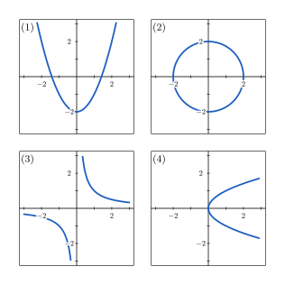
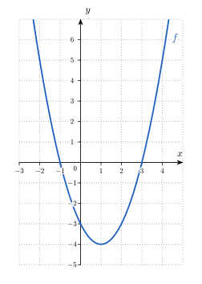
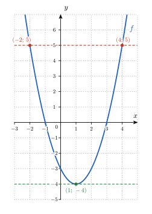
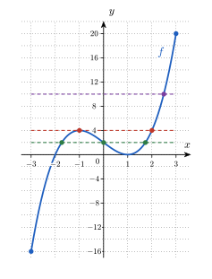
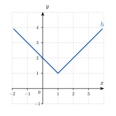
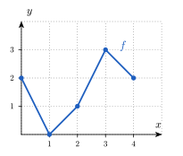

<!-- RENFORCEMENT : variations du socle (même compétence, entraînement en plus).
     Faisable SANS calculatrice ; valeurs différentes du socle.
     Numéro AUTOMATIQUE (catégorie Renforcement -> R.1, R.2…). Mêmes aides que le socle : Indice 1 (théorie), Indice 2 (question), Indice 3 (étape),
     chacun avec une ligne par sous-question, puis Solution et Piège. -->

::: {.callout-note appearance="simple"}
Ces exercices restent **dans les objectifs** de la séance : à faire une fois le socle et le transfert
bouclés, à la maison : ils ne sont pas prévus pendant la séance.
:::

::: {.callout-caution .exo title="Exercice|Renforcement|1|O3"}
Les quatre courbes ci-dessous sont dessinées dans un repère d'axes $x$ et $y$.

{fig-alt="Quatre courbes numérotées de (1) à (4) : une parabole ouverte vers le haut, un cercle, une hyperbole en deux branches et une parabole ouverte vers la droite" width="11.2cm" fig-align="center"}

(a) Pour chacune des courbes (1) à (4), indique si elle est le graphe d'une fonction de $x$. Justifie chaque réponse par une phrase qui utilise la définition d'une fonction.
(b) La courbe (3) est le graphe de la fonction $f$ définie par $f(x) = \dfrac{1}{x}$. Écris en une phrase l'abscisse pour laquelle $f$ n'a pas d'image, puis écris $\mathit{Dom}(f)$.
(c) Pour chacune des deux relations suivantes, indique s'il s'agit d'une fonction et justifie ta réponse par une phrase. Relation 1 : à chaque patient d'un service, on associe sa température corporelle mesurée ce matin à 8 h. Relation 2 : à chaque valeur de température mesurée, on associe le patient qui a cette température.
:::

::: {.aides}
::: {.panel-tabset}

## Indice 1

Retourne à la théorie du cours : *Fonctions : définition opérationnelle*, *Fonctions : exemples et contre-exemples* et *Domaine d'une fonction*.

## Indice 2

*Question à te poser.*

(a) Une même abscisse peut-elle correspondre à deux points différents de la courbe ?
(b) Quelle opération de la formule de $f$ impose une condition sur $x$ ?
(c) Dans chaque relation, un même élément de départ peut-il être associé à deux éléments d'arrivée différents ?

## Indice 3

*Étape.*

(a) Imagine une droite verticale que tu fais glisser de gauche à droite, et compte, pour chaque position, le nombre de points qu'elle a en commun avec la courbe.
(b) Écris la condition d'existence du quotient $\dfrac{1}{x}$, puis l'ensemble des nombres $x$ qui la vérifient.
(c) Pour chaque relation, choisis un élément de départ (un patient, puis une température) et écris tous les éléments d'arrivée qui lui sont associés.

## Solution

On cherche à savoir si chaque courbe est le graphe d'une fonction. Par définition, une fonction associe à chaque abscisse au plus une ordonnée : une courbe est donc le graphe d'une fonction si et seulement si toute droite verticale la rencontre en au plus un point.

(a) La courbe (1) est le graphe d'une fonction, car toute droite verticale la rencontre en exactement un point. Deux abscisses différentes, par exemple $-1$ et $1$, peuvent avoir la même ordonnée, ce que la définition autorise. La courbe (2) n'est pas le graphe d'une fonction : la droite verticale d'équation $x = 0$ rencontre le cercle aux points $(0\,;\,2)$ et $(0\,;\,-2)$, donc l'abscisse $0$ aurait deux images. La courbe (3) est le graphe d'une fonction, car chaque abscisse non nulle correspond à exactement un point. La courbe (4) n'est pas le graphe d'une fonction : la droite verticale d'équation $x = 1$ rencontre la courbe aux points $(1\,;\,1)$ et $(1\,;\,-1)$, donc l'abscisse $1$ aurait deux images.
(b) Un quotient n'existe que si son dénominateur est non nul. Pour $x = 0$, l'expression $\dfrac{1}{0}$ n'existe pas : l'abscisse $0$ n'a pas d'image, et la droite verticale d'équation $x = 0$ ne rencontre pas la courbe (3). On en déduit que $\mathit{Dom}(f) = \mathbb{R}_0$.
(c) La relation 1 est une fonction : chaque patient a une seule température mesurée ce matin à 8 h, donc chaque élément de départ est associé à un seul élément d'arrivée. La relation 2 n'est pas une fonction : si deux patients ont la même température, par exemple $37$ °C, alors cette valeur de départ est associée à deux patients différents.

## Piège

Une erreur fréquente consiste à croire qu'une fonction ne peut pas prendre deux fois la même valeur. Elle est tentante parce que la parabole (1) « revient » à la même hauteur de part et d'autre de son axe, mais elle est fausse : la définition interdit seulement qu'une abscisse ait deux ordonnées, et deux abscisses différentes peuvent partager la même ordonnée.

Une autre erreur consiste à croire qu'une fonction doit avoir une image pour toute abscisse. Elle est tentante parce que la courbe (3) a un « trou » en $x = 0$, mais elle est fausse : la courbe (3) est bien le graphe d'une fonction, car la définition exige « au plus un » point par abscisse, et non « exactement un ».

:::
:::

::: {.callout-caution .exo title="Exercice|Renforcement|2|O1"}
Soit la fonction $f$ définie sur $\mathbb{R}$ par $f(x) = x^2 - 2x - 3$. Son graphe est dessiné ci-dessous.

{fig-alt="Parabole d'équation y = x² − 2x − 3 sur un quadrillage" width="8.3cm" fig-align="center"}

(a) Calcule $f(4)$ et $f(-1)$ à l'aide de la formule. Donne chaque réponse sous la forme d'un nombre.
(b) Résous l'équation $f(x) = 5$ en écrivant les calculs, puis écris l'ensemble des antécédents de $5$. Vérifie ensuite ta réponse en repérant sur le graphe les points d'ordonnée $5$.
(c) Indique, par un nombre pour chaque valeur, combien d'antécédents ont $-4$ et $-5$, en t'aidant du graphe. Justifie ensuite la réponse pour $-4$ par un calcul.
(d) Écris l'image de $f$ sous la forme d'un intervalle, puis explique en une phrase pourquoi $-5$ n'en fait pas partie.
:::

::: {.aides}
::: {.panel-tabset}

## Indice 1

Retourne à la théorie du cours : *Une fonction, deux types de questions* pour (a), (b) et (c), et *Image d'une fonction* pour (d).

## Indice 2

*Question à te poser.*

(a) Dans $f(4)$, le nombre $4$ est-il l'entrée ou la sortie de la fonction ?
(b) Dans l'équation $f(x) = 5$, le nombre $5$ est-il l'entrée ou la sortie, et que cherche-t-on ?
(c) Une droite horizontale à la hauteur $-4$, puis à la hauteur $-5$, rencontre-t-elle la courbe, et en combien de points ?
(d) Quelles sont les ordonnées de tous les points du graphe, du plus bas au plus haut ?

## Indice 3

*Étape.*

(a) Remplace $x$ par la valeur demandée dans la formule, puis effectue le calcul.
(b) Ramène l'équation à une équation dont le second membre est $0$.
(c) Dessine sur le graphe la droite horizontale à la hauteur demandée et compte ses points communs avec la courbe ; pour le calcul, ramène l'équation $f(x) = -4$ à une équation dont le second membre est $0$ et observe le premier membre.
(d) Repère le point le plus bas du graphe et regarde si la courbe monte ou descend de part et d'autre.

## Solution

On évalue $f$ lorsque l'entrée est connue et on résout une équation lorsque la sortie est connue, comme dans *Une fonction, deux types de questions*.

{fig-alt="Droites horizontales à la hauteur 5 et à la hauteur −4 sur le graphe de f" width="8.3cm" fig-align="center"}

(a) L'entrée est connue, donc on remplace $x$ dans la formule. On obtient $f(4) = 4^2 - 2 \cdot 4 - 3 = 16 - 8 - 3 = 5$ et $f(-1) = (-1)^2 - 2 \cdot (-1) - 3 = 1 + 2 - 3 = 0$.
(b) La sortie $5$ est connue et on cherche les entrées $x$ correspondantes, donc on résout l'équation. On soustrait $5$ aux deux membres de $x^2 - 2x - 3 = 5$, ce qui donne l'équation du second degré $x^2 - 2x - 8 = 0$, de coefficients $a = 1$, $b = -2$ et $c = -8$. On calcule son discriminant : $\Delta = b^2 - 4ac = (-2)^2 - 4 \cdot 1 \cdot (-8) = 4 + 32 = 36$. Le discriminant est strictement positif, donc l'équation a deux solutions : $x = \dfrac{2 - 6}{2} = -2$ et $x = \dfrac{2 + 6}{2} = 4$. L'ensemble des antécédents de $5$ est $f^{\leftarrow}(\{5\}) = \{-2,\,4\}$. Sur le graphe, la droite horizontale à la hauteur $5$ rencontre la courbe aux abscisses $-2$ et $4$, ce qui confirme le calcul.
(c) La droite horizontale à la hauteur $-4$ touche la courbe en un seul point, le point le plus bas, donc $-4$ a un antécédent. La droite horizontale à la hauteur $-5$ passe sous la courbe sans la rencontrer, donc $-5$ n'a aucun antécédent. Pour justifier le premier résultat, on ajoute $4$ aux deux membres de $x^2 - 2x - 3 = -4$, ce qui donne $x^2 - 2x + 1 = 0$. On reconnaît le carré $(x - 1)^2$, donc l'équation s'écrit $(x - 1)^2 = 0$, et sa seule solution est $x = 1$.
(d) L'image est l'ensemble des ordonnées des points du graphe. Le point le plus bas est $(1\,;\,-4)$ et les deux branches de la parabole montent sans limite à partir de ce point, donc $\mathit{Im}(f) = [-4,\,+\infty[$. Le nombre $-5$ n'en fait pas partie, car il est inférieur à $-4$ : aucun point du graphe n'a cette ordonnée, donc $-5$ n'a pas d'antécédent.

## Piège

En (b), une erreur fréquente consiste à remplacer $x$ par $5$ dans la formule et à calculer $f(5)$. Elle est tentante parce que le nombre $5$ apparaît dans l'énoncé, mais elle est fausse : $5$ est ici la sortie de la fonction, et le calcul de $f(5)$ répond à une autre question que celle posée.

En (b), une autre erreur consiste à s'arrêter à une seule solution. Elle est tentante parce qu'on trouve une première valeur facilement, mais elle est fausse : le discriminant de $x^2 - 2x - 8 = 0$ est strictement positif, donc l'équation a deux solutions, et le graphe le confirme puisque la droite horizontale rencontre la courbe en deux points.

:::
:::

::: {.callout-caution .exo title="Exercice|Renforcement|2|O1"}
Selon l'étude de Tanaka, Monahan et Seals (2001), la fréquence cardiaque maximale $FC$ d'un adulte en bonne santé, exprimée en battements par minute, est une fonction affine de son âge $a$, exprimé en années.[^tanaka-s3] Le graphe ci-dessous représente cette fonction pour des âges compris entre $10$ et $70$ ans. Deux de ses points sont indiqués.

[^tanaka-s3]: H. Tanaka, K. D. Monahan et D. R. Seals, « Age-predicted maximal heart rate revisited », *Journal of the American College of Cardiology*, 37(1), 2001, p. 153-156.

{fig-alt="Droite décroissante passant par les points (20 ; 194) et (60 ; 166), âge en abscisse et fréquence cardiaque maximale en ordonnée" width="9.2cm" fig-align="center"}

(a) À partir des deux points indiqués, calcule la pente $m$ de la droite. Donne une valeur avec son unité, puis interprète-la par une phrase.
(b) Calcule l'ordonnée à l'origine $p$, puis écris l'expression de $FC(a)$ sous la forme $FC(a) = m\,a + p$.
(c) Complète le tableau de valeurs ci-dessous à l'aide de l'expression obtenue en (b).

| $a$ (ans) | $20$ | $30$ | $40$ | $50$ | $60$ |
|:---:|:---:|:---:|:---:|:---:|:---:|
| $FC(a)$ (battements par minute) | $194$ | | | | $166$ |

(d) Les valeurs du tableau suffiraient-elles, sans le texte de l'énoncé, à retrouver l'expression de $FC$ ? Réponds par une phrase qui indique l'information supplémentaire qui permet de conclure.
:::

::: {.aides}
::: {.panel-tabset}

## Indice 1

Retourne à la théorie du cours : *Réactivation — Fonctions particulières* pour (a) et (b), *De la formule au tableau et au graphe* pour (c), et *Quatre représentations pour une même fonction* pour (d).

## Indice 2

*Question à te poser.*

(a) De combien varie $FC$ quand $a$ augmente d'une unité, si l'on compare les deux points indiqués ?
(b) Quelle égalité doit vérifier chacun des deux points indiqués quand on remplace $FC(a)$ par $m\,a + p$ ?
(c) Quelle valeur de $a$ remplace-t-on dans l'expression pour chaque colonne vide ?
(d) Combien de fonctions différentes peuvent passer par cinq points donnés ?

## Indice 3

*Étape.*

(a) Calcule le quotient « variation de $FC$ divisée par la variation de $a$ » entre le point d'âge $20$ ans et le point d'âge $60$ ans.
(b) Remplace $m$ et les coordonnées du point $(20\,;\,194)$ dans $FC = m\,a + p$, puis isole $p$.
(c) Remplace $a$ par $30$, par $40$, puis par $50$ dans l'expression, et effectue chaque calcul.
(d) Compare ce que le tableau contient avec ce qu'il faudrait pour décrire la fonction en dehors des cinq âges.

## Solution

On cherche l'expression d'une fonction affine à partir de deux points de son graphe.

**Données et relation.** On donne deux points du graphe, $(20\,;\,194)$ et $(60\,;\,166)$, lus sur la figure, et l'information du texte selon laquelle $FC$ est une fonction affine de l'âge. On cherche la pente $m$, l'ordonnée à l'origine $p$, puis les valeurs manquantes du tableau. La relation du cours est $FC(a) = m\,a + p$, où $m$ est la pente et $p$ l'ordonnée à l'origine.

(a) La pente est le quotient de la variation de $FC$ par la variation de $a$ entre les deux points $(20\,;\,194)$ et $(60\,;\,166)$ : $m = \dfrac{166 - 194}{60 - 20} = \dfrac{-28}{40} = -0{,}7$ battement par minute et par année. Cela signifie que, lorsque l'âge augmente d'un an, la fréquence cardiaque maximale diminue de $0{,}7$ battement par minute.
(b) Le point $(20\,;\,194)$ appartient à la droite, donc $194 = -0{,}7 \cdot 20 + p$, soit $194 = -14 + p$, donc $p = 208$ battements par minute. L'expression est $FC(a) = -0{,}7\,a + 208$.
(c) On remplace $a$ dans l'expression. $FC(30) = -0{,}7 \cdot 30 + 208 = -21 + 208 = 187$, $FC(40) = -28 + 208 = 180$ et $FC(50) = -35 + 208 = 173$ battements par minute. Contrôle : $FC(60) = -42 + 208 = 166$, ce qui retrouve la valeur donnée. Le tableau complété est le suivant.

| $a$ (ans) | $20$ | $30$ | $40$ | $50$ | $60$ |
|:---:|:---:|:---:|:---:|:---:|:---:|
| $FC(a)$ (battements par minute) | $194$ | $187$ | $180$ | $173$ | $166$ |

(d) Non : le tableau ne donne que cinq valeurs, et une infinité de fonctions passent par ces cinq points. C'est l'information du texte, « fonction affine », qui permet de conclure : une droite est entièrement déterminée par deux de ses points.

## Piège

En (a), une erreur fréquente consiste à soustraire les coordonnées dans deux ordres différents, par exemple $166 - 194$ au numérateur mais $20 - 60$ au dénominateur. Elle est tentante parce que chaque soustraction paraît correcte isolément, mais elle est fausse : on obtient $+0{,}7$ au lieu de $-0{,}7$, car les deux soustractions doivent suivre le même ordre des points.

En (b), une autre erreur consiste à prendre $p = 194$. Elle est tentante parce que $194$ est la première ordonnée lue sur la figure, mais elle est fausse : l'ordonnée à l'origine est la valeur de $FC$ pour $a = 0$, et non la valeur au premier point indiqué.

:::
:::

::: {.callout-caution .exo title="Exercice|Renforcement|2|O1"}
Avant l'étude de Tanaka, Monahan et Seals, on estimait la fréquence cardiaque maximale d'un adulte d'âge $a$ (en années) par $FC_F(a) = 220 - a$, en battements par minute, formule attribuée à Fox et ses collègues.[^fox-r1] La formule de Tanaka, Monahan et Seals[^tanaka-r1] est $FC_T(a) = 208 - 0{,}7\,a$. Le graphe de $FC_T$ est dessiné ci-dessous.

[^fox-r1]: S. M. Fox, J. P. Naughton et W. L. Haskell, « Physical activity and the prevention of coronary heart disease », *Annals of Clinical Research*, 3, 1971, p. 404-432. L'origine de cette formule est discutée dans R. A. Robergs et R. Landwehr, « The surprising history of the HRmax = 220 − age equation », *Journal of Exercise Physiology online*, 5(2), 2002.

[^tanaka-r1]: H. Tanaka, K. D. Monahan et D. R. Seals, « Age-predicted maximal heart rate revisited », *Journal of the American College of Cardiology*, 37(1), 2001, p. 153-156.

{fig-alt="Droite décroissante qui représente FC_T pour des âges de 10 à 70 ans" width="9.2cm" fig-align="center"}

(a) Complète le tableau suivant avec les valeurs de $FC_F$ et de $FC_T$, en battements par minute.

| $a$ (ans) | $20$ | $40$ | $60$ |
|:---:|:---:|:---:|:---:|
| $FC_F(a)$ | | | |
| $FC_T(a)$ | | | |

(b) Trace sur le graphe donné le graphe de $FC_F$, à l'aide des valeurs du tableau.
(c) Résous l'équation $FC_F(a) = FC_T(a)$. Écris l'âge trouvé, puis la valeur commune des deux fréquences avec son unité.
(d) Pour un adulte de $60$ ans, écris par une phrase laquelle des deux formules donne la plus grande valeur, en citant les deux valeurs.
:::

::: {.aides}
::: {.panel-tabset}

## Indice 1

Retourne à la théorie du cours : *De la formule au tableau et au graphe* pour (a) et (b), *Une fonction, deux types de questions* pour (c), et *Quatre représentations pour une même fonction* pour (d).

## Indice 2

*Question à te poser.*

(a) Quelle valeur de $a$ remplace-t-on dans les formules pour chaque colonne ?
(b) Combien de points suffit-il de placer pour tracer le graphe d'une fonction affine ?
(c) Que doivent valoir les deux sorties pour l'âge cherché ?
(d) Quelles valeurs lit-on dans la colonne de $60$ ans du tableau ?

## Indice 3

*Étape.*

(a) Remplace $a$ par $20$, puis par $40$, puis par $60$ dans chaque formule et effectue chaque calcul.
(b) Place dans le repère les trois points $(a\,;\,FC_F(a))$ du tableau, puis trace la droite qui passe par eux.
(c) Écris l'équation $220 - a = 208 - 0{,}7\,a$, puis regroupe les termes en $a$ d'un côté du signe égal et les nombres de l'autre.
(d) Compare les deux nombres de la colonne de $60$ ans et écris l'écart entre eux.

## Solution

On compare deux fonctions affines, chacune étant donnée par sa formule, puis par son tableau et par son graphe.

{fig-alt="Les deux droites FC_F et FC_T, qui se croisent au point (40 ; 180)" width="9.2cm" fig-align="center"}

(a) On remplace $a$ dans chaque formule : $FC_F(20) = 200$, $FC_F(40) = 180$ et $FC_F(60) = 160$ ; $FC_T(20) = 208 - 14 = 194$, $FC_T(40) = 208 - 28 = 180$ et $FC_T(60) = 208 - 42 = 166$, toutes en battements par minute.
(b) Les trois points $(20\,;\,200)$, $(40\,;\,180)$ et $(60\,;\,160)$ sont alignés, car $FC_F$ est une fonction affine. On trace la droite qui passe par ces points ; elle est tracée en rouge sur la figure.
(c) On soustrait $208$ et on ajoute $a$ aux deux membres de $220 - a = 208 - 0{,}7\,a$, ce qui donne $12 = a - 0{,}7\,a = 0{,}3\,a$. On divise par $0{,}3$ : $a = \dfrac{12}{0{,}3} = 40$. À $40$ ans, les deux formules donnent $FC_F(40) = FC_T(40) = 180$ battements par minute. L'âge $40$ ans est l'abscisse du point d'intersection des deux droites : à cet âge, les deux formules donnent la même fréquence cardiaque maximale.
(d) À $60$ ans, $FC_T(60) = 166$ est supérieure à $FC_F(60) = 160$ : la formule de Tanaka, Monahan et Seals donne $6$ battements par minute de plus. Sur le graphe, à droite du point d'intersection, la droite de $FC_T$ est au-dessus de celle de $FC_F$.

## Piège

En (c), une erreur fréquente consiste à multiplier $12$ par $0{,}3$ au lieu de le diviser, ce qui donne $3{,}6$. Elle est tentante parce que $0{,}3$ est le coefficient de $a$, mais elle est fausse : $0{,}3\,a = 12$ signifie que $a$ est multiplié par $0{,}3$, donc on retrouve $a$ en divisant par $0{,}3$.

:::
:::

::: {.callout-caution .exo title="Exercice|Renforcement|2|O1"}
On étudie le domaine de plusieurs fonctions données par une formule.

(a) Écris le domaine de $f_1(x) = \sqrt{6 - x}$ sous la forme d'un intervalle.
(b) Écris le domaine de $f_2(x) = \dfrac{1}{x^2 - 9}$ sous la forme « $\mathbb{R}$ privé de certaines valeurs ».
(c) Écris le domaine de $f_3(x) = \dfrac{\sqrt{x + 2}}{x - 4}$. Écris d'abord chacune des conditions d'existence, puis le domaine, sous la forme d'un intervalle privé d'une valeur.
(d) L'indice de masse corporelle[^who] d'un adulte de $80$ kg, en fonction de sa taille $h$ exprimée en mètres, est donné par $\mathit{IMC}(h) = \dfrac{80}{h^2}$, en kg/m². Écris le domaine mathématique maximal de cette expression, puis le domaine pratique imposé par le contexte.
(e) Calcule l'IMC d'un adulte de $80$ kg qui mesure $2$ m. Donne le résultat avec son unité.

[^who]: Organisation mondiale de la Santé, *Obesity: preventing and managing the global epidemic*, WHO Technical Report Series 894, 2000 : l'indice de masse corporelle est le quotient de la masse en kilogrammes par le carré de la taille en mètres.
:::

::: {.aides}
::: {.panel-tabset}

## Indice 1

Retourne à la théorie du cours : *Domaine d'une fonction* et *Déterminer un domaine par étapes* pour (a), (b) et (c), *Domaine mathématique vs. domaine pertinent* pour (d), et *Une fonction, deux types de questions* pour (e).

## Indice 2

*Question à te poser.*

(a) Pour quels nombres sous la racine carrée la racine carrée existe-t-elle ?
(b) Quelle valeur ne peut jamais prendre un dénominateur ?
(c) Quelles sont les deux opérations de la formule qui imposent une condition, et quelle est la condition de chacune ?
(d) Quelle valeur de $h$ interdit la formule, et quelles valeurs de $h$ n'ont pas de sens pour la taille d'un adulte ?
(e) Dans $\mathit{IMC}(2)$, le nombre $2$ est-il l'entrée ou la sortie de la fonction ?

## Indice 3

*Étape.*

(a) Écris l'inégalité « le nombre sous la racine est supérieur ou égal à $0$ » et isole $x$.
(b) Résous l'équation « le dénominateur est égal à $0$ » pour trouver les valeurs à exclure.
(c) Écris une condition pour la racine carrée et une condition pour le dénominateur, puis réunis-les sur la droite des réels.
(d) Écris l'équation « le dénominateur est égal à $0$ », puis demande-toi quel signe doit avoir une taille.
(e) Remplace $h$ par $2$ et calcule d'abord le carré.

## Solution

On cherche les valeurs de $x$ pour lesquelles chaque expression existe, c'est-à-dire ses conditions d'existence. Une racine carrée n'existe que pour un nombre positif ou nul, et un quotient n'existe que si son dénominateur est non nul.

(a) La racine carrée existe si $6 - x \geq 0$. On ajoute $x$ aux deux membres, ce qui donne $6 \geq x$, soit $x \leq 6$. Donc $\mathit{Dom}(f_1) = ]-\infty,\,6]$.
(b) Le quotient n'existe pas si $x^2 - 9 = 0$. Cette équation équivaut à $x^2 = 9$, c'est-à-dire à $x = 3$ ou $x = -3$. Donc $\mathit{Dom}(f_2) = \mathbb{R} \setminus \{-3,\,3\}$.
(c) Il y a deux conditions. La racine carrée impose $x + 2 \geq 0$, soit $x \geq -2$. Le dénominateur impose $x - 4 \neq 0$, soit $x \neq 4$. Le nombre $4$ appartient à l'intervalle $[-2,\,+\infty[$, donc il faut le retirer : $\mathit{Dom}(f_3) = [-2,\,+\infty[\, \setminus \{4\}$.
(d) Mathématiquement, l'expression $\dfrac{80}{h^2}$ n'existe pas si $h^2 = 0$, c'est-à-dire si $h = 0$. Le domaine mathématique maximal est donc $\mathbb{R}_0$. Dans le contexte, la taille d'un adulte est strictement positive : le domaine pratique est $]0,\,+\infty[$. Le domaine pratique est plus petit que le domaine mathématique, car le contexte exclut aussi les tailles négatives, que la formule accepterait.
(e) La taille est l'entrée, donc on remplace $h$ par $2$ : $\mathit{IMC}(2) = \dfrac{80}{2^2} = \dfrac{80}{4} = 20$ kg/m². Un adulte de $80$ kg qui mesure $2$ m a donc un IMC de $20$ kg/m², valeur comprise dans l'intervalle de $18{,}5$ à moins de $25$ kg/m² que l'OMS associe à une corpulence normale.

## Piège

En (a), une erreur fréquente consiste à écrire $x \geq 6$. Elle est tentante parce que l'inégalité $6 - x \geq 0$ contient le symbole $\geq$, mais elle est fausse : en ajoutant $x$ aux deux membres, on obtient $6 \geq x$, c'est-à-dire $x \leq 6$.

En (b), une autre erreur consiste à exclure seulement $3$. Elle est tentante parce qu'on pense à la racine « positive », mais elle est fausse : l'équation $x^2 = 9$ a deux solutions, $3$ et $-3$, et les deux annulent le dénominateur.

En (d), une dernière erreur consiste à donner $\mathbb{R}_0$ comme domaine pratique. Elle est tentante parce que c'est le domaine de la formule, mais elle est fausse : une taille négative n'a aucun sens pour un adulte, même si la formule l'accepte.

:::
:::

::: {.callout-caution .exo title="Exercice|Renforcement|2|O7"}
On considère la fonction $f$ définie sur l'intervalle $[-3,\,3]$ par $f(x) = (x + 2)(x - 1)^2$. Son graphe est dessiné ci-dessous.

{fig-alt="Graphe de f sur [−3, 3] : la courbe monte de (−3 ; −16) jusqu'à un maximum local en x = −1, redescend jusqu'à un minimum local en x = 1, puis monte jusqu'à (3 ; 20)" width="7.7cm" fig-align="center"}

(a) Lis l'image de $f$ sur le graphe et écris-la sous la forme d'un intervalle. Lis aussi la valeur de $f(0)$.
(b) Lis sur le graphe l'ensemble $f^{\leftarrow}(\{4\})$, puis vérifie par un calcul avec la formule chacune des valeurs trouvées.
(c) Écris le nombre d'antécédents de chacune des valeurs $2$, $10$ et $25$, en lisant le graphe.
(d) Écris $f([-3,\,0])$ sous la forme d'un intervalle. Explique en une phrase pourquoi $f(0)$ n'est pas la borne supérieure de cet intervalle.
:::

::: {.aides}
::: {.panel-tabset}

## Indice 1

Retourne à la théorie du cours : *Graphe d'une fonction* et *Image d'une fonction* pour (a) et (d), et *Préimage* pour (b) et (c).

## Indice 2

*Question à te poser.*

(a) Quelles sont les ordonnées du point le plus bas et du point le plus haut du graphe ?
(b) Quelles sont les abscisses des points du graphe dont l'ordonnée vaut $4$ ?
(c) Une droite horizontale à chacune des hauteurs $2$, $10$ et $25$ rencontre-t-elle la courbe, et en combien de points ?
(d) Sur l'intervalle $[-3,\,0]$, en quel point la courbe atteint-elle sa plus grande hauteur ?

## Indice 3

*Étape.*

(a) Repère le point le plus bas et le point le plus haut du graphe, et lis leurs ordonnées.
(b) Trace la droite horizontale à la hauteur $4$ et lis les abscisses de ses points communs avec la courbe, puis calcule $f$ en ces abscisses.
(c) Trace les trois droites horizontales aux hauteurs $2$, $10$ et $25$, et compte leurs points communs avec la courbe.
(d) Suis la courbe de l'abscisse $-3$ à l'abscisse $0$ et note l'ordonnée la plus basse et l'ordonnée la plus haute que tu rencontres.

## Solution

On lit le graphe : l'image est l'ensemble des ordonnées des points du graphe, et les antécédents d'une valeur sont les abscisses des points du graphe situés à cette hauteur.

{fig-alt="Droites horizontales aux hauteurs 4, 2 et 10 sur le graphe de f" width="7.7cm" fig-align="center"}

(a) L'image est l'ensemble des ordonnées des points du graphe. Le point le plus bas est $(-3\,;\,-16)$ et le point le plus haut est $(3\,;\,20)$, et la courbe passe par toutes les hauteurs intermédiaires, donc $\mathit{Im}(f) = [-16,\,20]$. La courbe coupe l'axe des ordonnées à la hauteur $2$, donc $f(0) = 2$.
(b) La préimage de $\{4\}$ est l'ensemble des abscisses des points d'ordonnée $4$. La droite horizontale à la hauteur $4$ rencontre la courbe aux abscisses $-1$ et $2$, donc $f^{\leftarrow}(\{4\}) = \{-1,\,2\}$. Vérification : $f(-1) = (-1 + 2)(-1 - 1)^2 = 1 \cdot 4 = 4$ et $f(2) = (2 + 2)(2 - 1)^2 = 4 \cdot 1 = 4$.
(c) La droite horizontale à la hauteur $2$ rencontre la courbe en trois points, dont un d'abscisse $0$ : la valeur $2$ a trois antécédents. La droite horizontale à la hauteur $10$ rencontre la courbe en un seul point, situé à droite du graphe : la valeur $10$ a un antécédent. La hauteur $25$ est supérieure au maximum $20$ du graphe : la valeur $25$ n'a aucun antécédent.
(d) Sur $[-3,\,0]$, la courbe monte de $(-3\,;\,-16)$ jusqu'au point $(-1\,;\,4)$, puis redescend jusqu'au point $(0\,;\,2)$. La plus petite ordonnée est $-16$ et la plus grande est $4$, donc $f([-3,\,0]) = [-16,\,4]$. Le nombre $f(0) = 2$ n'est pas la borne supérieure, car la courbe atteint la hauteur $4$ à l'intérieur de l'intervalle, en $x = -1$, avant de redescendre.

## Piège

En (d), une erreur fréquente consiste à calculer l'image d'un intervalle à partir des seules valeurs aux extrémités : on trouverait $[-16,\,2]$. Cette méthode est tentante parce qu'elle donne le bon résultat pour une fonction qui monte toujours ou qui descend toujours, mais elle est fausse ici : la fonction monte puis redescend, donc les extrémités ne suffisent pas.

En (c), une autre erreur consiste à tracer des droites verticales au lieu de droites horizontales. Elle est tentante parce que la droite verticale sert à reconnaître une fonction, mais elle est fausse ici : les antécédents d'une valeur se cherchent à une hauteur donnée, donc avec une droite horizontale.

:::
:::

::: {.callout-caution .exo title="Exercice|Renforcement|3|O7"}
La fonction $h$ est définie sur l'intervalle $[-2,\,2]$ par $h(x) = x^3 - 3x$. Son graphe est dessiné ci-dessous.

{fig-alt="Graphe de h sur [−2, 2] : la courbe monte de (−2 ; −2) jusqu'au point (−1 ; 2), descend jusqu'au point (1 ; −2), puis monte jusqu'au point (2 ; 2)" width="7.3cm" fig-align="center"}

(a) Calcule les racines de $h$. Pour cela, écris $h(x) = x(x^2 - 3)$ et factorise $x^2 - 3$.
(b) Étudie le signe de $h$ sur $[-2,\,2]$ et présente le résultat dans un tableau de signes.
(c) Lis sur le graphe les intervalles de croissance et de décroissance de $h$.
(d) Écris tous les extrema locaux de $h$, puis ses extrema globaux sur $[-2,\,2]$, en précisant pour chacun l'abscisse et la valeur.
:::

::: {.aides}
::: {.panel-tabset}

## Indice 1

Retourne à la théorie du cours : *Racines et étude de signe* pour (a) et (b), *Croissance et décroissance* pour (c), et *Extrema locaux et globaux* pour (d).

## Indice 2

*Question à te poser.*

(a) Quand un produit de facteurs est-il égal à $0$ ?
(b) En combien d'intervalles les racines découpent-elles $[-2,\,2]$ ?
(c) Sur quels morceaux la courbe monte-t-elle, et sur lesquels descend-elle ?
(d) Un extremum local peut-il se trouver à une extrémité du domaine, où le voisinage ne contient que les abscisses situées d'un seul côté ?

## Indice 3

*Étape.*

(a) Écris que chacun des facteurs est égal à $0$ et résous chaque équation.
(b) Place les racines sur une droite, puis calcule $h$ en un point de chaque intervalle.
(c) Suis la courbe de gauche à droite et note les abscisses où elle change de sens.
(d) Examine successivement les quatre abscisses $-2$, $-1$, $1$ et $2$ : compare chaque valeur de $h$ aux valeurs prises tout près, à l'intérieur du domaine, puis compare les quatre valeurs entre elles.

## Solution

On factorise $h$ pour trouver ses racines et son signe, puis on lit ses variations et ses extrema sur le graphe.

(a) Les racines de $h$ sont les valeurs de $x$ telles que $h(x) = 0$. On écrit $h(x) = x(x^2 - 3) = x(x - \sqrt{3})(x + \sqrt{3})$. Un produit est nul si et seulement si l'un de ses facteurs est nul, donc $x = 0$, $x = \sqrt{3}$ ou $x = -\sqrt{3}$. Ces trois racines appartiennent à $[-2,\,2]$, car $\sqrt{3} < 2$.
(b) Le signe de $h$ est constant entre deux racines successives. Les racines $-\sqrt{3}$, $0$ et $\sqrt{3}$ découpent $[-2,\,2]$ en quatre intervalles. On évalue $h$ en un point de chacun : $h(-2) = -8 + 6 = -2 < 0$, $h(-1) = -1 + 3 = 2 > 0$, $h(1) = 1 - 3 = -2 < 0$ et $h(2) = 8 - 6 = 2 > 0$. On obtient le tableau suivant.

| $x$ | $-2$ |  | $-\sqrt{3}$ |  | $0$ |  | $\sqrt{3}$ |  | $2$ |
|:---:|:---:|:---:|:---:|:---:|:---:|:---:|:---:|:---:|:---:|
| signe de $h(x)$ | $-$ | $-$ | $0$ | $+$ | $0$ | $-$ | $0$ | $+$ | $+$ |

(c) La courbe monte jusqu'au point d'abscisse $-1$, descend jusqu'au point d'abscisse $1$, puis remonte. La fonction $h$ est croissante sur $[-2,\,-1]$ et sur $[1,\,2]$, et décroissante sur $[-1,\,1]$.
(d) Un extremum local se lit dans un voisinage d'un point, en ne gardant que les abscisses du domaine. En $x = -1$, la courbe change de sens et atteint localement sa hauteur maximale : $h$ a un maximum local en $-1$, de valeur $h(-1) = 2$. En $x = 1$, elle atteint localement sa hauteur minimale : $h$ a un minimum local en $1$, de valeur $h(1) = -2$. Aux extrémités, la courbe monte immédiatement à droite de $-2$ et monte jusqu'en $2$ : $h$ a un minimum local en $-2$, de valeur $h(-2) = -2$, et un maximum local en $2$, de valeur $h(2) = 2$. Il y a donc quatre extrema locaux. Sur $[-2,\,2]$, le maximum global vaut $2$, atteint en $x = -1$ et en $x = 2$, et le minimum global vaut $-2$, atteint en $x = -2$ et en $x = 1$ : ici, chaque extremum local est aussi un extremum global.

## Piège

En (d), une première erreur consiste à oublier les extrémités $-2$ et $2$ parmi les extrema locaux. Elle est tentante parce que la courbe n'y change pas de sens, mais elle est fausse : le voisinage d'une extrémité ne contient que les abscisses du domaine, donc $h$ y a un extremum local.

En (d), une seconde erreur fréquente consiste à ne citer que $x = -1$ pour le maximum global. Elle est tentante parce que le sommet de la courbe est le point le plus visible, mais elle est fausse : $h(2) = 2$ est aussi égale au maximum, donc un extremum global peut être atteint en plusieurs abscisses, dont une extrémité de l'intervalle.

En (a), une autre erreur consiste à ne garder que $x = \sqrt{3}$ pour l'équation $x^2 = 3$. Elle est tentante parce qu'on pense à la racine carrée positive, mais elle est fausse : $x^2 = 3$ a deux solutions, $\sqrt{3}$ et $-\sqrt{3}$.

:::
:::

::: {.callout-caution .exo title="Exercice|Renforcement|2|O3"}
La fonction $h$ est définie sur $\mathbb{R}$ par $h(x) = |x - 1| + 1$. Une partie de son graphe est dessinée ci-dessous.

{fig-alt="Graphe de h : une courbe en forme de V dont la pointe est au point (1 ; 1) ; elle passe par (−1 ; 3), (0 ; 2), (2 ; 2) et (3 ; 3)" width="8cm" fig-align="center"}

Pour chacun des intervalles des questions (a) à (d), indique si $h$ admet sur cet intervalle un maximum et un minimum, uniquement un maximum, uniquement un minimum, ou ni maximum ni minimum. Justifie chaque réponse par une phrase qui donne l'abscisse et la valeur de chaque extremum, ou qui explique pourquoi un extremum n'existe pas.

(a) $[-1,\,3[$
(b) $]-1,\,3[$
(c) $]1,\,3]$
(d) $[0,\,2]$
:::

::: {.aides}
::: {.panel-tabset}

## Indice 1

Retourne à la théorie du cours : *Extrema locaux et globaux* pour (a), (b), (c) et (d), et *Croissance et décroissance* pour décrire le graphe de $h$.

## Indice 2

*Question à te poser.*

(a) Quelle est la plus grande valeur que $h$ prend en une abscisse de $[-1,\,3[$ ?
(b) Que deviennent les valeurs de $h$ lorsque $x$ se rapproche d'une borne exclue de l'intervalle ?
(c) Pour quelles abscisses de $]1,\,3]$ la valeur $h(x)$ est-elle la plus petite possible ?
(d) Combien d'abscisses de $[0,\,2]$ donnent la plus grande valeur de $h$ sur cet intervalle ?

## Indice 3

*Étape.*

(a) Calcule $h(-1)$ et $h(1)$, puis la valeur dont $h(x)$ s'approche quand $x$ s'approche de $3$, et compare ces trois nombres.
(b) Pour chaque borne exclue, calcule la valeur dont $h(x)$ s'approche, puis vérifie si une abscisse de l'intervalle donne exactement cette valeur.
(c) Calcule $h(3)$, puis calcule $h(x)$ pour des abscisses de plus en plus proches de $1$, comme $1{,}1$ et $1{,}01$.
(d) Calcule $h(0)$, $h(1)$ et $h(2)$, puis repère sur le graphe le point le plus bas et les points les plus hauts au-dessus de $[0,\,2]$.

## Solution

On utilise la définition du cours : $h$ atteint son maximum sur un intervalle $I$ en $x_{\mathrm{max}} \in I$ si $h(x) \leq h(x_{\mathrm{max}})$ pour tout $x$ de $I$, et le minimum se définit de la même façon. Un extremum doit donc être atteint en une abscisse qui appartient à l'intervalle. Sur le graphe, $h$ décroît sur $]-\infty,\,1]$ et croît sur $[1,\,+\infty[$ ; pour $x \geq 1$, on a $h(x) = x - 1 + 1 = x$.

(a) La fonction $h$ admet un maximum et un minimum sur $[-1,\,3[$. Le minimum vaut $1$, atteint en $x = 1$, car $|x - 1| \geq 0$ donne $h(x) \geq 1$ pour tout $x$, et $1$ appartient à l'intervalle. Le maximum vaut $3$, atteint en $x = -1$ : sur $[-1,\,1]$, $h$ décroît, donc $h(x) \leq h(-1) = 3$, et sur $]1,\,3[$, $h(x) = x < 3$. La borne $3$ est exclue, mais la valeur $3$ est déjà atteinte en $-1$, qui appartient à l'intervalle.

(b) La fonction $h$ admet uniquement un minimum sur $]-1,\,3[$. Le minimum vaut $1$, atteint en $x = 1$, pour la même raison qu'en (a). En revanche, pour tout $x$ de $]-1,\,3[$, on a $h(x) < 3$, et les valeurs de $h$ se rapprochent de $3$ autant qu'on veut quand $x$ se rapproche de $-1$ ou de $3$. Quelle que soit l'abscisse choisie, une abscisse plus proche d'une borne donne une valeur plus grande : aucune abscisse ne réalise la plus grande valeur, donc $h$ n'a pas de maximum sur cet intervalle.

(c) La fonction $h$ admet uniquement un maximum sur $]1,\,3]$. Sur cet intervalle, $h(x) = x$, donc le maximum vaut $h(3) = 3$, atteint en $x = 3$, qui appartient à l'intervalle. En revanche, $h(x) = x > 1$ pour tout $x$ de $]1,\,3]$, et pour toute abscisse $x_0$ de l'intervalle, l'abscisse $\dfrac{1 + x_0}{2}$ est encore dans l'intervalle et donne une valeur plus petite. La valeur $1$ n'est atteinte qu'en $x = 1$, qui est exclu, donc $h$ n'a pas de minimum sur cet intervalle.

(d) La fonction $h$ admet un maximum et un minimum sur $[0,\,2]$. On calcule $h(0) = 2$, $h(1) = 1$ et $h(2) = 2$. Sur $[0,\,1]$, $h$ décroît de $2$ à $1$, puis sur $[1,\,2]$, elle croît de $1$ à $2$. Le minimum vaut $1$, atteint en $x = 1$, et le maximum vaut $2$, atteint en deux abscisses, $x = 0$ et $x = 2$.

## Piège

En (a), une erreur fréquente consiste à croire qu'une borne exclue fait toujours disparaître un extremum. Elle est tentante parce que c'est souvent le cas, mais elle est fausse : la borne $3$ est exclue, et pourtant le maximum existe, car la valeur $3$ est atteinte en $-1$, qui appartient à l'intervalle.

En (b), une autre erreur consiste à donner $3$ comme maximum, en lisant la hauteur de la courbe au-dessus des bornes. Elle est tentante parce que la courbe semble monter jusqu'à la hauteur $3$, mais elle est fausse : un maximum doit être atteint en une abscisse de l'intervalle, et ni $-1$ ni $3$ n'appartiennent à $]-1,\,3[$.

:::
:::

::: {.callout-caution .exo title="Exercice|Renforcement|2|O5"}
La fonction $f$ est définie sur l'intervalle $[0,\,4]$ par le graphe ci-dessous : les points marqués sont $(0\,;\,2)$, $(1\,;\,0)$, $(2\,;\,1)$, $(3\,;\,3)$ et $(4\,;\,2)$, reliés par des segments. La fonction $g$ est définie sur $\{0,\,1,\,2,\,3\}$ par le tableau suivant.

{fig-alt="Ligne brisée passant par les points (0 ; 2), (1 ; 0), (2 ; 1), (3 ; 3) et (4 ; 2)" width="6.6cm" fig-align="center"}

| $y$ | $0$ | $1$ | $2$ | $3$ |
|:---:|:---:|:---:|:---:|:---:|
| $g(y)$ | $5$ | $-1$ | $4$ | $7$ |

(a) Calcule $(g \circ f)(x)$ pour $x = 0,\,1,\,2,\,3,\,4$, en lisant $f$ sur le graphe puis $g$ dans le tableau. Présente les résultats dans un tableau.
(b) Calcule $(f \circ g)(2)$. Explique en une phrase pourquoi $(f \circ g)(1)$ n'existe pas.
:::

::: {.aides}
::: {.panel-tabset}

## Indice 1

Retourne à la théorie du cours : *Composition : enchaînement de relations* pour (a) et (b).

## Indice 2

*Question à te poser.*

(a) Dans $(g \circ f)(x)$, quelle fonction s'applique en premier, et à quel nombre s'applique la seconde ?
(b) Pour que $f(g(x))$ existe, à quel ensemble le nombre $g(x)$ doit-il appartenir ?

## Indice 3

*Étape.*

(a) Pour chaque valeur de $x$, lis d'abord $f(x)$ sur le graphe, puis cherche cette valeur dans la ligne $y$ du tableau de $g$.
(b) Calcule d'abord $g(2)$ et $g(1)$ à l'aide du tableau, puis repère sur l'axe des abscisses l'intervalle sur lequel $f$ est définie.

## Solution

On compose deux fonctions : pour calculer $(g \circ f)(x) = g(f(x))$, on applique d'abord $f$ à $x$, puis $g$ au résultat.

(a) On lit $f(x)$ sur le graphe, puis on cherche cette valeur dans le tableau de $g$. Les valeurs de $f$ sont $2$, $0$, $1$, $3$ et $2$ pour $x = 0,\,1,\,2,\,3,\,4$. On en déduit les valeurs de $g \circ f$ ci-dessous.

| $x$ | $0$ | $1$ | $2$ | $3$ | $4$ |
|:---:|:---:|:---:|:---:|:---:|:---:|
| $f(x)$ | $2$ | $0$ | $1$ | $3$ | $2$ |
| $(g \circ f)(x)$ | $4$ | $5$ | $-1$ | $7$ | $4$ |

(b) On a $g(2) = 4$, et $4$ appartient à $\mathit{Dom}(f) = [0,\,4]$, donc $(f \circ g)(2) = f(4) = 2$. Pour $(f \circ g)(1)$, on a $g(1) = -1$, et $-1$ n'appartient pas à $\mathit{Dom}(f) = [0,\,4]$ : $f(-1)$ n'existe pas, donc $(f \circ g)(1)$ n'existe pas.

## Piège

Une erreur fréquente consiste à lire $g \circ f$ de gauche à droite et à appliquer $g$ en premier. Elle est tentante parce qu'on lit de gauche à droite, mais elle est fausse : $(g \circ f)(x) = g(f(x))$ applique $f$ en premier.

En (b), une autre erreur consiste à écrire $f(g(1))$ sans vérifier que $g(1)$ appartient au domaine de $f$. Elle est tentante parce que la formule de composition s'écrit sans condition, mais elle est fausse : les valeurs de la première fonction doivent appartenir au domaine de la seconde.

:::
:::

::: {.callout-caution .exo title="Exercice|Renforcement|2|O6"}
Soient les fonctions $f$, $g$ et $h$ définies sur $\mathbb{R}$ par $f(x) = 3x - 2$, $g(x) = x^2$ et $h(x) = x^2 - 1$.

(a) Écris les expressions de $(g \circ f)(x)$ et de $(f \circ g)(x)$, développées et simplifiées.
(b) Calcule l'expression de la fonction réciproque $f^{-1}$, puis vérifie-la en calculant $(f \circ f^{-1})(x)$.
(c) Donne deux nombres différents qui ont la même image par $h$ et conclus sur l'existence d'une réciproque de $h$ sur $\mathbb{R}$.
(d) On restreint $h$ à l'intervalle $\mathbb{R}^{+}$. Calcule la réciproque de cette restriction et écris son domaine.
:::

::: {.aides}
::: {.panel-tabset}

## Indice 1

Retourne à la théorie du cours : *Calculer une composition* pour (a), *Réciproque : vision graphique* pour le calcul de (b) et pour (d), et *Défaire une opération : fonction réciproque* pour la vérification de (b) et pour (c).

## Indice 2

*Question à te poser.*

(a) Dans $(g \circ f)(x)$, quelle fonction s'applique en premier, et par quelle expression remplace-t-on la variable de $g$ ?
(b) Quand on connaît la sortie $y$, comment retrouve-t-on l'entrée $x$ ?
(c) Peut-on donner une image unique à une valeur qui a deux antécédents ?
(d) Quel est le signe d'un nombre $x$ de l'intervalle $\mathbb{R}^{+}$, et quelle racine carrée choisit-on pour le retrouver ?

## Indice 3

*Étape.*

(a) Remplace la variable de $g$ par $3x - 2$ et développe le carré obtenu, puis remplace la variable de $f$ par $x^2$.
(b) Pose $y = 3x - 2$ et isole $x$ en fonction de $y$, puis échange les noms $x$ et $y$.
(c) Cherche deux nombres opposés et calcule $h$ en chacun d'eux.
(d) Pose $y = x^2 - 1$, isole $x^2$, puis écris $x$ comme une racine carrée en tenant compte du signe de $x$.

## Solution

On compose en remplaçant la variable de la seconde fonction par l'expression de la première, puis on calcule une réciproque en posant $y = f(x)$, en isolant $x$ et en échangeant les noms $x$ et $y$.

(a) On remplace la variable de $g$ par $f(x)$ : $(g \circ f)(x) = g(3x - 2) = (3x - 2)^2 = 9x^2 - 12x + 4$. On remplace la variable de $f$ par $g(x)$ : $(f \circ g)(x) = f(x^2) = 3x^2 - 2$. Les deux expressions sont différentes : la composition n'est pas commutative.
(b) On pose $y = 3x - 2$, donc $3x = y + 2$ et $x = \dfrac{y + 2}{3}$. On échange les noms $x$ et $y$ : $f^{-1}(x) = \dfrac{x + 2}{3}$. Vérification : $(f \circ f^{-1})(x) = 3 \cdot \dfrac{x + 2}{3} - 2 = x + 2 - 2 = x$.
(c) On a $h(1) = 0$ et $h(-1) = 0$ : la valeur $0$ a deux antécédents, $1$ et $-1$. Une réciproque devrait associer à $0$ un seul nombre, donc $h$ n'a pas de réciproque sur $\mathbb{R}$.
(d) Sur $\mathbb{R}^{+}$, deux nombres positifs différents ont des carrés différents, donc la restriction de $h$ est injective. On pose $y = x^2 - 1$, donc $x^2 = y + 1$. Comme $x \geq 0$, on a $x = \sqrt{y + 1}$. On échange les noms $x$ et $y$ : $h^{-1}(x) = \sqrt{x + 1}$. Son domaine est l'image de la restriction : pour $x \geq 0$, on a $x^2 \geq 0$ donc $h(x) \geq -1$. Inversement, pour tout nombre $y \geq -1$, le nombre $x = \sqrt{y + 1}$ est positif ou nul et vérifie $h(x) = y$ : toutes ces valeurs sont atteintes. Donc $\mathit{Dom}(h^{-1}) = [-1,\,+\infty[$.

## Piège

En (a), une erreur fréquente consiste à écrire $(3x - 2)^2 = 9x^2 - 4$. Elle est tentante parce qu'on élève chaque terme au carré, mais elle est fausse : le carré d'une différence contient le double produit, $-2 \cdot 3x \cdot 2 = -12x$.

:::
:::
