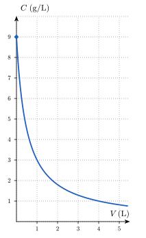
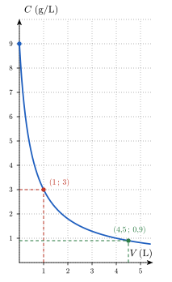
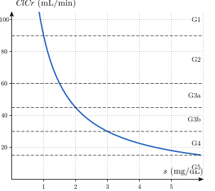
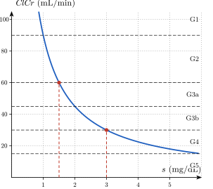

<!-- TRANSFERT : appliquer les savoir-faire du socle à un contexte nouveau (sciences de la vie, données réelles sourcées).
     HIÉRARCHIE DES INDICES : 1 = théorie ; 2 = une QUESTION (pas la réponse) ; 3 = une ÉTAPE.
     Solutions des problèmes : les premières lignes disent ce qui est donné, ce qui est cherché, la relation du cours,
     et l'origine de chaque donnée qui ne figure pas directement dans l'énoncé.
     Numéro AUTOMATIQUE (catégorie Transfert -> T.1, T.2…). Faisable SANS calculatrice. -->

::: {.callout-caution .exo title="Exercice|Transfert|3|O6"}
La surface corporelle $S$ d'un patient, exprimée en m², sert à ajuster la dose de certains médicaments, notamment en chimiothérapie. La formule de Mosteller[^mosteller-t1] la calcule à partir de la taille $h$ du patient, en cm, et de sa masse $w$, en kg :
$$S = \sqrt{\frac{h\,w}{3600}}.$$
Un patient mesure $180$ cm.

[^mosteller-t1]: R. D. Mosteller, « Simplified calculation of body-surface area », *The New England Journal of Medicine*, 317(17), 1987, p. 1098.

(a) Écris $S$ comme une fonction de la masse $w$ pour ce patient, sous la forme d'une racine carrée d'une expression simple de $w$. Calcule ensuite la surface corporelle de ce patient s'il pèse $45$ kg. Donne le résultat en m².
(b) Le médecin veut ajuster la dose pour une surface corporelle de $2$ m². Calcule la masse correspondante, en kg.
(c) Écris la masse $w$ en fonction de la surface corporelle $S$ pour ce patient. Écris ensuite, sous la forme d'un intervalle, les valeurs de $S$ pour lesquelles cette expression a un sens dans le contexte.
:::

::: {.aides}
::: {.panel-tabset}

## Indice 1

Retourne à la théorie du cours : *Dilution : entrée, sortie et paramètres* pour (a), *Une fonction, deux types de questions* pour (b), et *Défaire une opération : fonction réciproque* ainsi que *Domaine mathématique vs. domaine pertinent* pour (c).

## Indice 2

*Question à te poser.*

(a) Quelle grandeur de la formule est fixée pour ce patient, et laquelle reste variable ?
(b) Dans l'égalité $S = 2$, le nombre $2$ est-il l'entrée ou la sortie de la fonction ?
(c) Quelle opération défait une racine carrée ?

## Indice 3

*Étape.*

(a) Remplace $h$ par $180$, puis simplifie la fraction $\dfrac{180}{3600}$ avant de remplacer $w$ par $45$.
(b) Remplace $S$ par $2$ dans l'expression obtenue en (a), puis élève les deux membres au carré.
(c) Élève au carré les deux membres de l'expression obtenue en (a) et isole $w$, puis écris la condition que doit vérifier une masse.

## Solution

**Données et relation.** On donne la formule de Mosteller, la taille $h = 180$ cm du patient et les unités : $S$ en m² et $w$ en kg. On cherche l'expression de $S$ en fonction de $w$, la surface corporelle pour une masse de $45$ kg, la masse qui correspond à une surface de $2$ m², puis l'expression de $w$ en fonction de $S$ et l'intervalle des valeurs de $S$ qui ont un sens. La relation utilisée est la formule de Mosteller : comme dans le cours, la masse $w$ est l'entrée, la surface $S$ est la sortie, et la taille $h$ est un paramètre que l'on fixe à $180$ cm.

**Origine des données.** Toutes les valeurs utilisées figurent dans l'énoncé : aucune donnée n'est à chercher ailleurs.

(a) On fixe le paramètre en remplaçant $h$ par $180$, puis on simplifie la fraction, car $\dfrac{180}{3600} = \dfrac{1}{20}$ :
$$S(w) = \sqrt{\frac{180\,w}{3600}} = \sqrt{\frac{w}{20}}.$$
Pour une masse de $45$ kg, l'entrée est connue, donc on évalue la fonction : $S(45) = \sqrt{\dfrac{45}{20}} = \sqrt{\dfrac{9}{4}} = \dfrac{3}{2} = 1{,}5$. Ce patient a donc une surface corporelle de $1{,}5$ m² s'il pèse $45$ kg.

(b) La surface corporelle $S = 2$ m² est la sortie, et on cherche l'entrée $w$ : on résout l'équation $\sqrt{\dfrac{w}{20}} = 2$. Les deux membres sont positifs, donc on peut les élever au carré sans changer les solutions : $\dfrac{w}{20} = 4$. On multiplie les deux membres par $20$ : $w = 80$. Vérification : $S(80) = \sqrt{\dfrac{80}{20}} = \sqrt{4} = 2$, ce qui redonne la surface demandée. La masse correspondante est donc de $80$ kg.

(c) On isole $w$ une seule fois, pour toutes les valeurs de $S$. On élève au carré les deux membres de $S = \sqrt{\dfrac{w}{20}}$, ce qui donne $S^2 = \dfrac{w}{20}$, puis on multiplie par $20$ : $w = 20\,S^2$. Dans le contexte, $w$ est une masse, donc $w > 0$, et $S$, racine carrée du nombre strictement positif $\dfrac{w}{20}$, est strictement positive. Inversement, toute valeur $S > 0$ donne la masse $w = 20\,S^2 > 0$. Les valeurs de $S$ qui ont un sens forment donc l'intervalle $]0,\,+\infty[$, en m². Contrôle : $20 \cdot 1{,}5^2 = 20 \cdot 2{,}25 = 45$, ce qui redonne la masse de la question (a).

## Piège

En (b), une erreur fréquente consiste à écrire $\dfrac{w}{20} = 2$ et à trouver $40$ kg. Elle est tentante parce qu'on remplace $S$ par $2$ sans voir la racine carrée, mais elle est fausse : pour défaire la racine, il faut élever $2$ au carré. La vérification le montre, car $S(40) = \sqrt{2}$, qui n'est pas égal à $2$.

En (a), une autre erreur consiste à oublier la racine carrée et à écrire $S(45) = \dfrac{45}{20} = 2{,}25$ m². Elle est tentante parce que la fraction se simplifie facilement, mais elle est fausse : la formule de Mosteller prend la racine carrée de ce quotient.

En (c), une dernière erreur consiste à accepter toutes les valeurs de $S$, parce que l'expression $20\,S^2$ existe pour tout nombre réel. Elle est tentante parce que la formule ne contient ni dénominateur ni racine, mais elle est fausse : $S$ est une surface, obtenue comme racine carrée, et elle ne peut pas être négative ou nulle.

:::
:::

::: {.callout-caution .exo title="Exercice|Transfert|2|O1"}
Une poche de sérum physiologique contient $500$ mL de solution aqueuse de chlorure de sodium (NaCl) à la concentration de $9$ g/L.[^nacl-t2] Dans un laboratoire, on ajoute à cette solution un volume $V$ d'eau distillée, exprimé en litres, puis on homogénéise le mélange sans retirer de solution. On note $C(V)$ la concentration en NaCl du mélange, en g/L. Le graphe ci-dessous représente la fonction $C$.

[^nacl-t2]: Le sérum physiologique est une solution injectable de chlorure de sodium à $0{,}9\,\%$ (masse par volume), soit $9$ g/L ; voir par exemple le résumé des caractéristiques du produit de *Chlorure de sodium Fresenius 0,9 %, solution pour perfusion* (Fresenius Kabi France), rubrique 2 : « 1 ml contient 9 mg de chlorure de sodium », base de données publique des médicaments (ANSM), mise à jour du 25 avril 2024.

{fig-alt="Graphe de la concentration en fonction du volume d'eau ajouté : courbe décroissante qui part du point (0 ; 9) et se rapproche de l'axe des abscisses" width="6.9cm" fig-align="center"}

(a) Calcule la masse de NaCl contenue dans la poche, en grammes. Écris ensuite la formule de $C(V)$.
(b) Complète le tableau suivant avec les valeurs de $C(V)$, en g/L.

| $V$ (L) | $0$ | $0{,}5$ | $1$ | $4{,}5$ |
|:---:|:---:|:---:|:---:|:---:|
| $C(V)$ (g/L) | | | | |

(c) Lis sur le graphe le volume d'eau à ajouter pour obtenir une concentration de $3$ g/L. Calcule ensuite, à l'aide de la formule, le volume d'eau à ajouter pour obtenir une concentration de $0{,}9$ g/L. Donne chaque volume en litres.
(d) Écris le domaine pratique de $C$, puis l'image de $C$ pour ce domaine pratique, chacun sous la forme d'un intervalle. Explique en une phrase pourquoi la concentration n'est jamais égale à $0$ g/L.
:::

::: {.aides}
::: {.panel-tabset}

## Indice 1

Retourne à la théorie du cours : *Dilution : entrée, sortie et paramètres* pour (a), *De la formule au tableau et au graphe* pour (b), *Retour à la dilution* pour (c), et *Domaine mathématique vs. domaine pertinent* ainsi que *Image d'une fonction* pour (d).

## Indice 2

*Question à te poser.*

(a) Quelle quantité ne change pas quand on ajoute de l'eau ?
(b) Quelle valeur de $V$ faut-il remplacer dans la formule pour chaque colonne ?
(c) Pour la lecture, sur quel axe lit-on la concentration et sur quel axe lit-on le volume ? Pour le calcul, la concentration $0{,}9$ g/L est-elle l'entrée ou la sortie de la fonction $C$ ?
(d) Quel signe peut avoir le quotient $\dfrac{4{,}5}{0{,}5 + V}$ lorsque $V$ est un volume d'eau ajouté ?

## Indice 3

*Étape.*

(a) Calcule la masse de NaCl dans la poche, en convertissant d'abord $500$ mL en litres.
(b) Remplace $V$ par $0$, puis $0{,}5$, puis $1$, puis $4{,}5$ dans la formule et calcule chaque quotient.
(c) Trace sur le graphe la droite horizontale à la hauteur $3$ et lis l'abscisse du point commun avec la courbe ; pour le calcul, écris l'équation $C(V) = 0{,}9$, multiplie les deux membres par $0{,}5 + V$, puis résous l'équation obtenue.
(d) Écris que le volume ajouté est positif ou nul, puis compare la valeur de $C$ pour $V = 0$ avec les valeurs de $C$ pour de grands volumes.

## Solution

**Données et relation.** On donne le volume initial de solution ($500$ mL), sa concentration initiale ($9$ g/L) et le volume d'eau ajouté $V$ (en litres). On cherche la concentration $C(V)$ après l'ajout, puis le volume $V$ qui donne une concentration fixée. La relation du cours est $C(V) = \dfrac{m_0}{V_0 + V}$, où $m_0$ est la masse de soluté et $V_0$ le volume initial de solution.

**Origine des données qui ne figurent pas directement dans l'énoncé.** La masse $m_0$ n'est pas donnée : on la calcule à partir de la concentration et du volume initial (calcul préalable). Le volume initial est donné en millilitres alors que $V$ est en litres : on convertit $500$ mL en $0{,}5$ L (conversion d'unité). Le volume correspondant à la concentration $3$ g/L est une lecture sur le graphe.

(a) La masse de NaCl est le produit de la concentration par le volume : $m_0 = 9\ \text{g/L} \cdot 0{,}5\ \text{L} = 4{,}5$ g. L'ajout d'eau ne retire aucune solution, donc la masse reste $4{,}5$ g. Le volume total de solution devient $0{,}5 + V$ litres, donc $C(V) = \dfrac{4{,}5}{0{,}5 + V}$ en g/L.
(b) On remplace $V$ par chaque valeur : $C(0) = \dfrac{4{,}5}{0{,}5} = 9$, $C(0{,}5) = \dfrac{4{,}5}{1} = 4{,}5$, $C(1) = \dfrac{4{,}5}{1{,}5} = 3$ et $C(4{,}5) = \dfrac{4{,}5}{5} = 0{,}9$, toutes en g/L. Contrôle : $C(0) = 9$ g/L est bien la concentration de départ.

{fig-alt="Les points (1 ; 3) et (4,5 ; 0,9) sur la courbe de la concentration" width="6.9cm" fig-align="center"}

(c) Sur le graphe, la droite horizontale à la hauteur $3$ rencontre la courbe au point d'abscisse $1$ : il faut ajouter $1$ L d'eau, ce que confirme $C(1) = 3$ g/L. Pour la concentration $0{,}9$ g/L, on connaît la sortie de la fonction et on cherche l'entrée, donc on résout $\dfrac{4{,}5}{0{,}5 + V} = 0{,}9$. On multiplie les deux membres par $0{,}5 + V$, qui est strictement positif : $4{,}5 = 0{,}9\,(0{,}5 + V)$. On divise par $0{,}9$ : $0{,}5 + V = 5$. On en déduit $V = 4{,}5$ L : il faut ajouter $4{,}5$ L d'eau, ce qui correspond à la dernière colonne du tableau.
(d) Le volume d'eau ajouté est positif ou nul, donc le domaine pratique est $[0,\,+\infty[$. Sur ce domaine, le dénominateur $0{,}5 + V$ augmente quand $V$ augmente, donc $C$ décroît, et la valeur la plus grande est $C(0) = 9$. Les valeurs de $C$ sont toutes strictement positives, car $C(V)$ est le quotient d'un nombre positif non nul par un nombre strictement positif. Inversement, pour toute concentration $c$ de $]0,\,9]$, le volume $V = \dfrac{4{,}5}{c} - 0{,}5$ est positif ou nul et vérifie $C(V) = c$ : toutes ces concentrations sont atteintes. L'image est donc $]0,\,9]$, en g/L. La concentration n'est jamais égale à $0$ g/L, car la masse de $4{,}5$ g de NaCl reste dissoute dans le mélange, quel que soit le volume d'eau ajouté.

## Piège

Une erreur fréquente consiste à croire que doubler le volume d'eau ajouté divise la concentration par deux. Elle est tentante parce que la concentration baisse bien quand on ajoute de l'eau, mais elle est fausse : c'est le volume total $0{,}5 + V$ qui intervient, et non le volume ajouté. Par exemple, $C(1) = 3$ g/L alors que $C(0{,}5) = 4{,}5$ g/L, et $3 \neq \dfrac{4{,}5}{2}$.

Une autre erreur consiste à écrire $C(V) = \dfrac{4{,}5}{500 + V}$ sans convertir les $500$ mL en litres. Elle est tentante parce que le nombre $500$ figure dans l'énoncé, mais elle est fausse : $V$ est en litres, donc tous les volumes de la formule doivent être en litres.

:::
:::

::: {.callout-caution .exo title="Exercice|Transfert|3|O1"}
La clairance de la créatinine estime la capacité des reins à filtrer le sang. Pour un homme, la formule de Cockcroft et Gault[^cg-t3] l'estime par
$$\mathit{ClCr} = \frac{(140 - a)\,w}{72\,s},$$
où $a$ est l'âge en années, $w$ la masse en kg et $s$ la concentration de créatinine dans le sang en mg/dL ; la clairance $\mathit{ClCr}$ est alors exprimée en mL/min. Le tableau suivant donne les catégories de la maladie rénale chronique[^kdigo-t3] selon le débit de filtration glomérulaire (DFG), en mL/min. Pour simplifier, on suppose que le DFG est égal à la clairance estimée.

[^cg-t3]: D. W. Cockcroft et M. H. Gault, « Prediction of creatinine clearance from serum creatinine », *Nephron*, 16(1), 1976, p. 31-41.

[^kdigo-t3]: KDIGO, « 2012 Clinical Practice Guideline for the Evaluation and Management of Chronic Kidney Disease », *Kidney International Supplements*, 3(1), 2013.

| Catégorie | G1 | G2 | G3a | G3b | G4 | G5 |
|:---:|:---:|:---:|:---:|:---:|:---:|:---:|
| DFG (mL/min) | $\geq 90$ | de $60$ à moins de $90$ | de $45$ à moins de $60$ | de $30$ à moins de $45$ | de $15$ à moins de $30$ | moins de $15$ |

Un patient masculin de $60$ ans pèse $81$ kg. Pour ce patient, la clairance est une fonction de $s$, dont le graphe est dessiné ci-dessous ; les lignes en tirets marquent les seuils des catégories.

{fig-alt="Graphe de la clairance en fonction de la créatinine : courbe décroissante, avec des lignes horizontales aux hauteurs 15, 30, 45, 60 et 90 qui délimitent les catégories G1 à G5" width="10.7cm" fig-align="center"}

(a) Calcule le nombre $c$ tel que $\mathit{ClCr}(s) = \dfrac{c}{s}$ pour ce patient.
(b) Calcule $\mathit{ClCr}(1{,}5)$ et $\mathit{ClCr}(3)$, en mL/min, puis donne la catégorie de ce patient dans chacun des deux cas.
(c) Écris sous la forme d'un intervalle l'ensemble des valeurs de $s$, en mg/dL, pour lesquelles le patient est dans la catégorie G3a ou dans la catégorie G3b.
(d) Écris $s$ en fonction de la clairance $\mathit{ClCr}$ pour ce patient, puis calcule la concentration de créatinine qui correspond à une clairance de $45$ mL/min.
:::

::: {.aides}
::: {.panel-tabset}

## Indice 1

Retourne à la théorie du cours : *Dilution : entrée, sortie et paramètres* pour (a), *Une fonction, deux types de questions* pour (b), *Préimage* pour (c), et *Défaire une opération : fonction réciproque* ainsi que *Réciproque : vision graphique* pour (d).

## Indice 2

*Question à te poser.*

(a) Quelles quantités de la formule sont connues pour ce patient, et lesquelles restent des variables ?
(b) Dans $\mathit{ClCr}(1{,}5)$, le nombre $1{,}5$ est-il l'entrée ou la sortie ? Dans quelle colonne du tableau des catégories se trouve la valeur obtenue ?
(c) Quelles valeurs de la clairance correspondent aux deux catégories réunies, et la clairance augmente-t-elle ou diminue-t-elle quand $s$ augmente ?
(d) Quand on connaît la clairance, comment retrouve-t-on la créatinine ?

## Indice 3

*Étape.*

(a) Remplace $a$ par $60$ et $w$ par $81$, puis simplifie le quotient $\dfrac{(140 - 60) \cdot 81}{72}$.
(b) Remplace $s$ par $1{,}5$, puis par $3$, dans l'expression trouvée en (a), puis compare chaque résultat aux colonnes du tableau des catégories.
(c) Traduis « catégorie G3a ou G3b » par une double inégalité portant sur $\mathit{ClCr}(s)$, puis multiplie chaque membre par $s$, qui est strictement positif.
(d) Pose $C = \dfrac{c}{s}$, isole $s$, puis remplace $C$ par $45$.

## Solution

**Données et relation.** On donne la formule de Cockcroft et Gault, l'âge $a = 60$ ans, la masse $w = 81$ kg et le tableau des catégories. On cherche l'expression de la clairance en fonction de $s$, les valeurs de $s$ pour lesquelles le patient est dans les catégories G3a ou G3b, et la réciproque. La relation utilisée est la formule de Cockcroft et Gault : comme dans le cours, $s$ est la variable d'entrée, $\mathit{ClCr}(s)$ est la sortie, et $a$ et $w$ jouent le rôle de paramètres.

**Origine des données qui ne figurent pas directement dans l'énoncé.** Le coefficient $c$ n'est pas donné : il se calcule à partir de $a$ et $w$ (calcul préalable). Les seuils $30$ et $60$ de la question (c) se lisent dans le tableau : la catégorie G3b commence à $30$ mL/min et la catégorie G3a se termine juste avant $60$ mL/min (lecture dans le tableau).

(a) On remplace $a$ par $60$ et $w$ par $81$ : $\mathit{ClCr}(s) = \dfrac{(140 - 60) \cdot 81}{72\,s} = \dfrac{80 \cdot 81}{72\,s}$. On simplifie le quotient : $\dfrac{81}{72} = \dfrac{9}{8}$, donc $80 \cdot \dfrac{9}{8} = 90$. On obtient $\mathit{ClCr}(s) = \dfrac{90}{s}$ et $c = 90$.
(b) La concentration $s$ est connue, donc on évalue la fonction. $\mathit{ClCr}(1{,}5) = \dfrac{90}{1{,}5} = 60$ mL/min : cette valeur est dans la colonne G2, « de $60$ à moins de $90$ », donc le patient est en catégorie G2. $\mathit{ClCr}(3) = \dfrac{90}{3} = 30$ mL/min : cette valeur est dans la colonne G3b, « de $30$ à moins de $45$ », donc le patient est en catégorie G3b. Le passage de $s = 1{,}5$ à $s = 3$, qui double la concentration de créatinine, divise donc la clairance par deux.
(c) Les catégories G3a et G3b réunies correspondent aux clairances de $30$ inclus à $60$ exclu, donc à la condition $30 \leq \dfrac{90}{s} < 60$. La concentration $s$ est strictement positive, donc on peut multiplier chaque membre par $s$ sans changer le sens des inégalités. L'inégalité $30 \leq \dfrac{90}{s}$ donne $30\,s \leq 90$, soit $s \leq 3$. L'inégalité $\dfrac{90}{s} < 60$ donne $90 < 60\,s$, soit $s > 1{,}5$. L'ensemble cherché est donc $\mathit{ClCr}^{\leftarrow}([30,\,60[) = ]1{,}5\,;\,3]$ mg/dL. La clairance diminue quand $s$ augmente, donc la borne haute $60$ de la clairance correspond à la borne basse $1{,}5$ de $s$, exclue comme $60$, et la borne basse $30$ de la clairance correspond à la borne haute $3$ de $s$, incluse comme $30$. Sur le graphe, la partie de la courbe comprise entre les tirets $30$ et $60$ correspond bien aux abscisses entre $1{,}5$ et $3$.

{fig-alt="Les points (1,5 ; 60) et (3 ; 30) sur la courbe, avec leurs projections sur les axes" width="10.7cm" fig-align="center"}

(d) La fonction $\mathit{ClCr}$ est strictement décroissante sur $]0,\,+\infty[$, donc deux concentrations différentes donnent deux clairances différentes : elle est injective et admet une réciproque. On pose $C = \dfrac{90}{s}$ et on isole $s$ : $s = \dfrac{90}{C}$, pour toute clairance $C$ strictement positive. La concentration de créatinine s'écrit donc $s = \dfrac{90}{\mathit{ClCr}}$. Pour une clairance de $45$ mL/min, on obtient $s = \dfrac{90}{45} = 2$ mg/dL. Contrôle : $\mathit{ClCr}(2) = \dfrac{90}{2} = 45$ mL/min.

## Piège

En (c), une erreur fréquente consiste à recopier l'intervalle de la clairance, $[30,\,60[$, en le prenant pour l'intervalle de $s$. Elle est tentante parce que les mêmes nombres reviennent, mais elle est fausse : la fonction est décroissante, donc l'ordre des bornes s'inverse. On obtient $]1{,}5\,;\,3]$ et non $[1{,}5\,;\,3[$ : la borne incluse change de côté.

:::
:::
