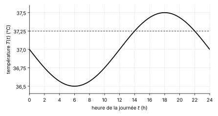

<!-- TRANSFERT : appliquer les savoir-faire du socle à un contexte nouveau (sciences de la vie, données réelles sourcées).
     HIÉRARCHIE DES INDICES : 1 = théorie ; 2 = une QUESTION (pas la réponse) ; 3 = une ÉTAPE.
     Solutions des problèmes : les premières lignes disent ce qui est donné, ce qui est cherché, la relation du cours,
     et l'origine de chaque donnée qui ne figure pas directement dans l'énoncé.
     Numéro AUTOMATIQUE (catégorie Transfert -> T.1, T.2…). Faisable SANS calculatrice.
     Sources : voir les notes de bas de page. -->

::: {.callout-caution .exo title="Exercice|Transfert|2|O3"}
La bactérie *Escherichia coli* se multiplie en se divisant en deux cellules identiques. Dans un bouillon de culture riche à $37$ °C, le temps de doublement mesuré pendant la croissance régulière est de $20$ minutes.[^ecoli-t1] Une culture contient $1000$ bactéries à l'instant $t = 0$. On note $N(t)$ le nombre de bactéries à l'instant $t$, où $t$ est exprimé en heures, et on suppose que la croissance reste régulière.

[^ecoli-t1]: G. Sezonov, D. Joseleau-Petit et R. D'Ari, « *Escherichia coli* Physiology in Luria-Bertani Broth », *Journal of Bacteriology*, 189(23), 2007, p. 8746-8749 : « The doubling time during steady-state growth in Luria-Bertani broth was 20 min. »

(a) Écris $N(t)$ sous la forme $N(t) = 1000 \cdot 2^{ct}$, en donnant la valeur du nombre $c$ avec son unité.
(b) Calcule le nombre de bactéries après $2$ heures. Écris le résultat sous la forme d'un nombre entier.
(c) Écris $N(t)$ sous la forme $1000\,e^{kt}$, en donnant la valeur exacte du nombre $k$ avec son unité.
(d) Écris le temps nécessaire pour que la culture contienne un million de bactéries, sous forme exacte et en heures. Encadre ensuite cette durée entre deux multiples consécutifs du temps de doublement, exprimés en heures et en minutes.
:::

::: {.aides}
::: {.panel-tabset}

## Indice 1

Retourne à la théorie du cours : *Temps de doublement et demi-vie* pour (a), *Exponentielle : facteur multiplicatif constant* pour (b), *Lien entre les formes $a^t$ et $e^{kt}$* pour (c), et *Logarithme comme fonction réciproque* pour (d). La méthode de (d) est la fiche **Résoudre une équation exponentielle**.

## Indice 2

*Question à te poser.*

(a) Quelle est la durée d'un doublement exprimée en heures, et combien de doublements ont lieu en une heure ?
(b) Quel exposant obtient-on en remplaçant $t$ par $2$ ?
(c) Comment écrit-on la puissance $2^{u}$ à l'aide de la base $e$ ?
(d) Par quel nombre la population doit-elle être multipliée pour passer de $1000$ bactéries à un million ?

## Indice 3

*Étape.*

(a) Convertis $20$ minutes en heures, puis écris le nombre $c$ comme l'inverse du temps de doublement.
(b) Remplace $t$ par $2$ dans la formule de (a) et calcule la puissance de $2$.
(c) Écris $2^{3t}$ avec la base $e$, puis identifie le coefficient de $t$ dans l'exposant.
(d) Écris l'équation $1000 \cdot 2^{3t} = 10^6$, divise les deux membres par $1000$, puis écris la puissance de $2$ avec la base $e$ et applique le logarithme népérien.

## Solution

**Données et relation.** On donne le temps de doublement de $20$ minutes, le nombre initial $N(0) = 1000$ et le fait que $t$ est exprimé en heures. On cherche la fréquence des doublements $c$, la valeur de $N(2)$, le coefficient $k$ de la forme $1000\,e^{kt}$, et l'instant où $N(t)$ atteint $10^6$. La relation du cours est $N(t) = b \cdot 2^{ct}$, où $b$ est la valeur initiale, $c$ le nombre de doublements par unité de temps et $\tfrac{1}{c}$ le temps de doublement, avec le lien $2^{u} = e^{u \ln 2}$ entre les deux formes.

**Origine des données qui ne figurent pas directement dans l'énoncé.** Le temps de doublement est exprimé en minutes alors que $t$ est en heures : on le convertit en heures (conversion d'unité). Le nombre $10^6$ est un million, c'est-à-dire $1000$ fois le nombre initial.

(a) On cherche le nombre $c$ de doublements par heure.

    1. On convertit le temps de doublement : $20$ minutes valent $\tfrac{20}{60} = \tfrac{1}{3}$ heure.
    2. Le temps de doublement est l'inverse de $c$, donc $c = \dfrac{1}{1/3} = 3$ par heure.

    On a donc $N(t) = 1000 \cdot 2^{3t}$, avec $c = 3$ doublements par heure.

(b) Pour $t = 2$, l'exposant vaut $3 \cdot 2 = 6$, donc $N(2) = 1000 \cdot 2^{6} = 1000 \cdot 64 = 64\,000$. Il y a donc $64\,000$ bactéries après $2$ heures, ce qui correspond à six doublements successifs de $20$ minutes.

(c) On écrit la puissance de $2$ avec la base $e$.

    1. Le lien entre les deux formes est $2^{u} = e^{u \ln 2}$ pour tout nombre $u$.
    2. Avec $u = 3t$, on obtient $2^{3t} = e^{3t \ln 2} = e^{(3 \ln 2)\,t}$.

    On a donc $N(t) = 1000\,e^{kt}$ avec $k = 3\ln 2$ par heure.

(d) On cherche l'instant $t$ tel que $N(t) = 10^6$.

    1. On remplace $N(t)$ par son expression : $1000 \cdot 2^{3t} = 10^6$.
    2. On isole la puissance de $2$ en divisant les deux membres par $1000$ : $2^{3t} = 1000$.
    3. On écrit la puissance avec la base $e$ : $e^{3t \ln 2} = 1000$.
    4. Les deux membres sont strictement positifs, donc on applique le logarithme népérien aux deux membres : $3t \ln 2 = \ln 1000$.
    5. On divise par $3\ln 2$, qui est strictement positif : $t = \dfrac{\ln 1000}{3\ln 2}$.

    Pour encadrer cette durée, on utilise $2^9 = 512$ et $2^{10} = 1024$, donc $2^9 < 1000 < 2^{10}$. L'égalité de l'étape 2 donne $2^{3t} = 1000$, donc $9 < 3t < 10$, puis $3 < t < \tfrac{10}{3}$. Neuf doublements durent $9 \cdot 20 = 180$ minutes, soit $3$ heures, et dix doublements durent $200$ minutes, soit $3$ heures et $20$ minutes.

    La culture atteint un million de bactéries au bout de $t = \dfrac{\ln 1000}{3\ln 2}$ heures, soit entre $3$ heures et $3$ heures $20$ minutes. Ce résultat est plausible : il faut multiplier la population par $1000$, et un nombre de doublements entre $9$ et $10$ la multiplie par un nombre compris entre $512$ et $1024$.

## Piège

En (a), une erreur fréquente consiste à écrire $c = 20$ ou $c = \tfrac{1}{3}$. Elle est tentante parce que les nombres $20$ et $3$ apparaissent dans l'énoncé et dans le calcul, mais elle est fausse : $c$ est le nombre de doublements par heure, donc l'inverse du temps de doublement exprimé en heures, c'est-à-dire $3$. La valeur $\tfrac{1}{3}$ est le temps de doublement en heures, et non la fréquence des doublements.

En (d), une autre erreur consiste à écrire $2^{3t} = 10^6$ en oubliant de diviser par le nombre initial $1000$. Elle est tentante parce que la valeur $10^6$ est le nombre demandé, mais elle est fausse : le nombre de bactéries est $1000 \cdot 2^{3t}$, et non $2^{3t}$. Le calcul oublié donne un facteur de multiplication de $10^6$ au lieu de $1000$, donc une durée trop longue.

:::
:::

::: {.callout-caution .exo title="Exercice|Transfert|3|O2"}
La température centrale du corps humain varie au cours de la journée avec une période d'environ $24$ heures. Chez une personne en bonne santé, sa valeur moyenne est d'environ $37{,}0$ °C, et elle varie de près de $1$ °C entre son minimum, atteint la nuit, et son maximum, atteint en fin de journée.[^temp-t2] On modélise cette température par la fonction
$$T(t) = 37{,}0 + A\sin(\omega t + \varphi),$$
où $T$ est exprimée en °C, $t$ est l'heure de la journée mesurée en heures depuis minuit, et $A > 0$, $\omega > 0$ et $-\pi < \varphi \leq \pi$ sont des nombres réels. On suppose que la période est de $24$ heures, que la différence entre le maximum et le minimum vaut exactement $1$ °C, et que le maximum est atteint à $18$ heures.

[^temp-t2]: B. Coiffard, A. B. Diallo, S. Mezouar, M. Leone et J.-L. Mege, « A Tangled Threesome: Circadian Rhythm, Body Temperature Variations, and the Immune System », *Biology*, 10(1), 2021, article 65 : valeur physiologique d'environ $37{,}0$ °C, fluctuation sinusoïdale circadienne de près de $1$ °C du minimum au maximum, minimum nocturne et maximum en fin de journée. L'heure du maximum, $18$ h, est une hypothèse du modèle.

{fig-alt="Graphe de la température T en fonction de l'heure t entre 0 et 24 heures : courbe sinusoïdale d'un minimum de 36,5 °C à 6 heures à un maximum de 37,5 °C à 18 heures, avec une ligne en tirets à la hauteur 37,25 °C" width="11cm" fig-align="center"}

(a) Écris la valeur exacte de $A$, en °C, puis la valeur exacte de $\omega$, en radians par heure.
(b) Calcule la valeur du nombre $\varphi$ qui place le maximum à $18$ heures.
(c) Calcule $T(0)$, $T(6)$ et $T(10)$, en °C.
(d) Le graphe de $T$ est dessiné ci-dessus, avec une ligne en tirets à la hauteur $37{,}25$ °C. Lis sur le graphe entre quelles heures la température est supérieure ou égale à $37{,}25$ °C, puis vérifie par un calcul la valeur de $T$ à l'une de ces deux heures.
:::

::: {.aides}
::: {.panel-tabset}

## Indice 1

Retourne à la théorie du cours : *Fonctions trigonométriques comme modèles périodiques*, et plus précisément *Amplitude* et *Périodicité* pour (a), *Déphasage* pour (b), *Graphes, domaine et image* pour (c) et (d).

## Indice 2

*Question à te poser.*

(a) Quelle est la distance entre la valeur moyenne et le maximum, et quelle valeur de $\omega$ donne une période de $24$ heures ?
(b) Quelle valeur doit prendre l'argument $\omega t + \varphi$ du sinus quand le sinus atteint son maximum ?
(c) Quelle est la valeur du sinus pour l'argument obtenu en remplaçant $t$ par chacune des trois heures ?
(d) À quelle hauteur la courbe est-elle située entre les deux points où elle coupe la ligne en tirets ?

## Indice 3

*Étape.*

(a) Calcule la moitié de la différence entre le maximum et le minimum, puis résous l'équation $\tfrac{2\pi}{\omega} = 24$.
(b) Écris que l'argument du sinus vaut $\tfrac{\pi}{2}$ augmenté d'un multiple de $2\pi$ pour $t = 18$, puis isole $\varphi$ et garde la valeur qui appartient à l'intervalle $]-\pi,\,\pi]$.
(c) Remplace $t$ par chaque heure dans $\tfrac{\pi}{12}\,t + \varphi$, puis utilise les valeurs connues du sinus pour les angles remarquables.
(d) Trace sur le graphe la ligne en tirets, repère les deux points d'intersection avec la courbe, lis leurs abscisses, puis calcule $T$ en l'une d'elles.

## Solution

**Données et relation.** On donne la valeur moyenne $37{,}0$ °C, la période de $24$ heures, l'écart de $1$ °C entre le maximum et le minimum, le maximum à $18$ heures et le graphe. On cherche $A$, $\omega$ et $\varphi$ du modèle $T(t) = 37{,}0 + A\sin(\omega t + \varphi)$, trois valeurs de $T$, puis les heures où $T \geq 37{,}25$. La relation du cours est celle d'un modèle périodique : $A$ est l'amplitude, la période vaut $\tfrac{2\pi}{\omega}$, et le sinus atteint son maximum $1$ quand son argument vaut $\tfrac{\pi}{2}$ modulo $2\pi$.

**Origine des données qui ne figurent pas directement dans l'énoncé.** Toutes les valeurs figurent dans l'énoncé ou sur le graphe. L'heure du maximum, $18$ heures, est une hypothèse du modèle, et non une mesure.

(a) On cherche l'amplitude $A$ et le nombre $\omega$.

    1. Le sinus varie entre $-1$ et $1$, donc $T$ varie entre $37{,}0 - A$ et $37{,}0 + A$. La différence entre le maximum et le minimum vaut donc $2A = 1$, ce qui donne $A = \dfrac{1}{2}$ °C.
    2. La période de $\sin(\omega t + \varphi)$ vaut $\tfrac{2\pi}{\omega}$. L'égalité $\tfrac{2\pi}{\omega} = 24$ donne $\omega = \dfrac{2\pi}{24} = \dfrac{\pi}{12}$ radian par heure.

(b) On cherche $\varphi$ pour que le maximum soit atteint à $18$ heures.

    1. Le sinus vaut $1$ quand son argument vaut $\tfrac{\pi}{2} + 2k\pi$, où $k$ est un entier. Pour $t = 18$, l'argument vaut $\tfrac{\pi}{12}\cdot 18 + \varphi = \tfrac{3\pi}{2} + \varphi$.
    2. On écrit l'égalité $\tfrac{3\pi}{2} + \varphi = \tfrac{\pi}{2} + 2k\pi$, donc $\varphi = -\pi + 2k\pi$.
    3. Parmi ces valeurs, une seule appartient à l'intervalle $]-\pi,\,\pi]$ : celle obtenue pour $k = 1$, qui est $\varphi = \pi$.

    On a donc $T(t) = 37{,}0 + 0{,}5\,\sin\!\left(\dfrac{\pi}{12}\,t + \pi\right)$.

(c) On remplace $t$ par chaque heure.

    1. Pour $t = 0$, l'argument vaut $\pi$, et $\sin \pi = 0$, donc $T(0) = 37{,}0$ °C.
    2. Pour $t = 6$, l'argument vaut $\tfrac{\pi}{2} + \pi = \tfrac{3\pi}{2}$, et $\sin\tfrac{3\pi}{2} = -1$, donc $T(6) = 37{,}0 - 0{,}5 = 36{,}5$ °C.
    3. Pour $t = 10$, l'argument vaut $\tfrac{5\pi}{6} + \pi = \tfrac{11\pi}{6}$, et $\sin\tfrac{11\pi}{6} = -\tfrac{1}{2}$, donc $T(10) = 37{,}0 - 0{,}25 = 36{,}75$ °C.

    Contrôle : $T(6) = 36{,}5$ °C est le minimum, atteint $12$ heures avant le maximum, ce qui est cohérent avec une période de $24$ heures et un minimum nocturne.

(d) Sur le graphe, la courbe est au-dessus de la ligne en tirets entre les abscisses $14$ et $22$. La température est donc supérieure ou égale à $37{,}25$ °C entre $14$ heures et $22$ heures, soit pendant $8$ heures. Pour vérifier, on calcule $T(14)$ : l'argument vaut $\tfrac{14\pi}{12} + \pi = \tfrac{7\pi}{6} + \pi = \tfrac{13\pi}{6}$, qui est égal à $\tfrac{\pi}{6} + 2\pi$, donc $\sin\tfrac{13\pi}{6} = \tfrac{1}{2}$ et $T(14) = 37{,}0 + 0{,}25 = 37{,}25$ °C, ce qui correspond à la ligne en tirets.

## Piège

En (a), une erreur fréquente consiste à prendre $A = 1$ parce que la température varie de $1$ °C. Elle est tentante parce que le nombre $1$ est donné dans l'énoncé, mais elle est fausse : l'amplitude est la distance entre la valeur moyenne et le maximum, c'est-à-dire la moitié de l'écart entre le maximum et le minimum, donc $\tfrac{1}{2}$ °C.

En (b), une autre erreur consiste à écrire $\varphi = -18$ ou $\varphi = 18$ pour décaler le maximum de $18$ heures. Elle est tentante parce que le déphasage se lit comme un décalage de l'heure, mais elle est fausse : $\varphi$ est un angle en radians qui s'ajoute à l'argument $\omega t$. La condition est que l'argument vaille $\tfrac{\pi}{2}$ modulo $2\pi$ à l'instant $t = 18$.

:::
:::

::: {.callout-caution .exo title="Exercice|Transfert|2|O3"}
Le niveau sonore $L$, exprimé en décibels (dB), se calcule à partir de l'intensité sonore $I$ par la formule $L = 10\log_{10}\dfrac{I}{I_0}$, où $I_0$ est une intensité de référence fixée. Pour protéger l'audition au travail, l'institut américain NIOSH recommande de ne pas dépasser un niveau de $85$ dB en moyenne sur $8$ heures, et précise que chaque augmentation de $3$ dB divise par deux la durée d'exposition admissible.[^niosh-t3] On modélise donc la durée admissible $D$, en heures, pour un niveau sonore $L$ en dB supérieur ou égal à $85$ dB, par
$$D(L) = 8 \cdot 2^{-(L - 85)/3}.$$

[^niosh-t3]: NIOSH, « Understanding Noise Exposure Limits: Occupational vs. General Environmental Noise », CDC, 2016, https://www.cdc.gov/niosh/bulletin/2016/noise.html : limite recommandée de $85$ dB(A) sur $8$ heures, avec une réduction de moitié de la durée pour chaque augmentation de $3$ dB, soit $2$ heures à $91$ dB(A), $30$ minutes à $97$ dB(A) et $15$ minutes à $100$ dB(A). Le niveau est exprimé en dB(A), c'est-à-dire pondéré pour l'oreille humaine, que l'on note ici simplement dB.

(a) Calcule $D(91)$, $D(97)$ et $D(100)$, en heures, puis compare chaque résultat avec les durées publiées : $2$ heures, $30$ minutes et $15$ minutes.
(b) Calcule le niveau sonore $L$, en dB, pour lequel la durée admissible est de $1$ heure.
(c) On donne $\log_{10} 2 \approx 0{,}30$. Un niveau $L_2$ dépasse un niveau $L_1$ de $3$ dB. Calcule le quotient $\dfrac{I_2}{I_1}$ des intensités correspondantes, puis écris en une phrase ce que ce résultat dit de la relation entre la durée admissible et l'intensité sonore.
:::

::: {.aides}
::: {.panel-tabset}

## Indice 1

Retourne à la théorie du cours : *Exponentielle : facteur multiplicatif constant* pour (a), *Logarithme comme fonction réciproque* pour (b) et (c), et *Échelles logarithmiques : décibels* pour (c).

## Indice 2

*Question à te poser.*

(a) Quelle est la valeur de l'exposant $-\tfrac{L - 85}{3}$ pour chacun des trois niveaux ?
(b) Quelle puissance de $2$ faut-il obtenir pour que $D(L)$ soit égal à $1$ ?
(c) Quelle fonction faut-il appliquer à la formule $L = 10\log_{10}\tfrac{I}{I_0}$ pour exprimer $I$ en fonction de $L$ ?

## Indice 3

*Étape.*

(a) Remplace $L$ par chaque niveau dans l'exposant, calcule la puissance de $2$, multiplie par $8$, puis convertis en minutes.
(b) Écris l'équation $8 \cdot 2^{-(L - 85)/3} = 1$, divise les deux membres par $8$, puis écris le résultat comme une puissance de $2$ et compare les exposants.
(c) Isole $I$ dans la formule du niveau sonore, écris le quotient de deux intensités, puis remplace $L_2 - L_1$ par $3$.

## Solution

**Données et relation.** On donne la formule $L = 10\log_{10}\tfrac{I}{I_0}$, le modèle $D(L) = 8 \cdot 2^{-(L - 85)/3}$, les durées publiées par le NIOSH et la valeur $\log_{10} 2 \approx 0{,}30$. On cherche trois valeurs de $D$, le niveau $L$ pour lequel $D = 1$ heure, et le quotient $\tfrac{I_2}{I_1}$ pour un écart de $3$ dB. On utilise la décroissance exponentielle du cours, car $D$ est divisé par $2$ chaque fois que $L$ augmente de $3$ dB, et le logarithme décimal comme fonction réciproque de la puissance de $10$.

**Origine des données qui ne figurent pas directement dans l'énoncé.** Toutes les valeurs figurent dans l'énoncé. Les durées de comparaison viennent de la référence citée. Le nombre $I_0$ n'est pas donné, mais il disparaît du quotient de la question (c).

(a) On remplace $L$ par chaque niveau.

    1. Pour $L = 91$, l'exposant vaut $-\tfrac{6}{3} = -2$, donc $D(91) = 8 \cdot 2^{-2} = 2$ heures.
    2. Pour $L = 97$, l'exposant vaut $-\tfrac{12}{3} = -4$, donc $D(97) = 8 \cdot 2^{-4} = \tfrac{1}{2}$ heure, soit $30$ minutes.
    3. Pour $L = 100$, l'exposant vaut $-\tfrac{15}{3} = -5$, donc $D(100) = 8 \cdot 2^{-5} = \tfrac{1}{4}$ heure, soit $15$ minutes.

    Les trois résultats coïncident avec les durées publiées de $2$ heures, $30$ minutes et $15$ minutes.

(b) On cherche le niveau $L$ pour lequel $D(L) = 1$.

    1. On écrit l'équation $8 \cdot 2^{-(L - 85)/3} = 1$ et on divise les deux membres par $8$ : $2^{-(L - 85)/3} = \tfrac{1}{8}$.
    2. On écrit $\tfrac{1}{8} = 2^{-3}$, donc $2^{-(L - 85)/3} = 2^{-3}$.
    3. La fonction $2^{x}$ est strictement croissante, donc deux puissances de $2$ égales ont le même exposant : $-\tfrac{L - 85}{3} = -3$, donc $L - 85 = 9$ et $L = 94$.

    La durée admissible est de $1$ heure pour un niveau de $94$ dB. Contrôle : $D(94) = 8 \cdot 2^{-3} = 1$ heure.

(c) On exprime l'intensité en fonction du niveau, puis on forme le quotient.

    1. On divise la formule par $10$ : $\tfrac{L}{10} = \log_{10}\tfrac{I}{I_0}$. Le logarithme décimal est l'exposant de $10$, donc $\tfrac{I}{I_0} = 10^{L/10}$ et $I = I_0 \cdot 10^{L/10}$.
    2. Pour deux niveaux $L_1$ et $L_2$, le quotient vaut $\dfrac{I_2}{I_1} = \dfrac{I_0 \cdot 10^{L_2/10}}{I_0 \cdot 10^{L_1/10}} = 10^{(L_2 - L_1)/10}$, et $I_0$ disparaît.
    3. Avec $L_2 - L_1 = 3$, on obtient $\dfrac{I_2}{I_1} = 10^{0{,}3}$.
    4. Comme $\log_{10} 2 \approx 0{,}30$, on a $2 \approx 10^{0{,}30}$, donc $\dfrac{I_2}{I_1} \approx 2$.

    Une augmentation de $3$ dB multiplie donc l'intensité sonore par un nombre proche de $2$, et divise la durée admissible par $2$ d'après le modèle. La durée admissible est donc inversement proportionnelle à l'intensité sonore : quand l'intensité double, la durée admissible est divisée par deux.

## Piège

En (c), une erreur fréquente consiste à croire qu'une augmentation de $3$ dB augmente l'intensité de $3$ unités, ou la multiplie par $3$. Elle est tentante parce que l'on traite l'échelle des décibels comme une échelle linéaire, mais elle est fausse : le niveau est un logarithme de l'intensité, donc une augmentation fixe du niveau correspond à un facteur fixe sur l'intensité, ici environ $2$.

En (b), une autre erreur consiste à écrire que la durée est de $1$ heure pour un niveau de $85 + 3 = 88$ dB, parce que $3$ dB est le pas qui divise la durée par deux. Elle est tentante parce que l'on ne tient pas compte de la durée de départ, mais elle est fausse : à $88$ dB la durée est $4$ heures, et il faut diviser $8$ heures par $2$ trois fois, donc ajouter $3$ dB trois fois, pour obtenir $1$ heure.

:::
:::

::: {.callout-caution .exo title="Exercice|Transfert|2|O1"}
Dans un vaisseau sanguin, la résistance à l'écoulement du sang est inversement proportionnelle à la puissance quatrième du rayon $r$ du vaisseau.[^poiseuille-t4] À différence de pression constante, le débit $Q$ de sang est donc proportionnel à $r^{4}$ : $Q(r) = k\,r^{4}$, où $k$ est une constante strictement positive. On note $r_0$ le rayon d'un vaisseau au repos et $Q_0 = Q(r_0)$ le débit correspondant, et on pose $x = \dfrac{r}{r_0}$.

[^poiseuille-t4]: R. E. Klabunde, « Determinants of Resistance to Flow (Poiseuille's Equation) », *CV Physiology* : la résistance est inversement proportionnelle à la puissance quatrième du rayon, et « a 2-fold increase in diameter decreases resistance by 16-fold ». https://cvphysiology.com/hemodynamics/h003 (consulté le 15 octobre 2026).

(a) Écris le quotient $\dfrac{Q(r)}{Q_0}$ comme une fonction de $x$.
(b) Calcule la fraction de $Q_0$ qui subsiste quand le rayon est divisé par $2$, puis quand le rayon est réduit de $20\,\%$. Écris chaque résultat sous la forme d'une fraction ou d'un nombre décimal exact.
(c) Écris la valeur exacte de $x$ pour laquelle le débit est égal à $\tfrac{Q_0}{2}$. Encadre ensuite cette valeur entre $0{,}8$ et $0{,}9$ en calculant $0{,}8^4$ et $0{,}9^4$.
(d) Écris en une phrase ce que montrent les résultats de (b) et (c) sur l'effet d'un rétrécissement du vaisseau sur le débit.
:::

::: {.aides}
::: {.panel-tabset}

## Indice 1

Retourne à la théorie du cours : *Polynômes*, et plus précisément les exemples de degré supérieur à $2$, pour (a) et (b), et *Fonctions racines* pour (c).

## Indice 2

*Question à te poser.*

(a) Que devient le quotient $\tfrac{k\,r^4}{k\,r_0^4}$ quand on le regroupe en une seule puissance ?
(b) Quelle valeur de $x$ correspond à un rayon divisé par $2$, et quelle valeur correspond à un rayon réduit de $20\,\%$ ?
(c) Quelle fonction défait la fonction $x \mapsto x^{4}$ sur l'intervalle $[0,\,+\infty[$ ?
(d) Le débit diminue-t-il plus ou moins vite que le rayon ?

## Indice 3

*Étape.*

(a) Simplifie la constante $k$, puis regroupe $r^{4}$ et $r_0^{4}$ en une puissance de $\tfrac{r}{r_0}$.
(b) Remplace $x$ par chacune des deux valeurs dans l'expression de (a) et calcule la puissance.
(c) Écris l'équation $x^{4} = \tfrac{1}{2}$ et applique à ses deux membres la fonction qui défait la puissance quatrième, en gardant la solution positive.
(d) Compare la diminution du rayon à la diminution du débit dans chacun des deux cas de (b).

## Solution

**Données et relation.** On donne le modèle $Q(r) = k\,r^{4}$, le rayon de repos $r_0$ et le débit $Q_0 = Q(r_0)$. On cherche l'expression de $\tfrac{Q(r)}{Q_0}$ en fonction de $x = \tfrac{r}{r_0}$, deux fractions du débit, la valeur de $x$ pour laquelle le débit est divisé par deux, et une interprétation. La relation est un polynôme de degré $4$ en $r$, dont l'inverse sur les nombres positifs est une racine quatrième.

**Origine des données.** Toutes les valeurs figurent dans l'énoncé : la constante $k$ et le rayon $r_0$ ne sont pas donnés, mais ils disparaissent du quotient $\tfrac{Q(r)}{Q_0}$.

(a) On calcule le quotient en simplifiant $k$ : $\dfrac{Q(r)}{Q_0} = \dfrac{k\,r^{4}}{k\,r_0^{4}} = \dfrac{r^{4}}{r_0^{4}} = \left(\dfrac{r}{r_0}\right)^{4} = x^{4}$. Le quotient vaut donc $x^{4}$.

(b) On remplace $x$ par chaque valeur dans l'expression $x^{4}$.

    1. Un rayon divisé par $2$ correspond à $x = \tfrac{1}{2}$, donc $x^{4} = \tfrac{1}{16}$.
    2. Un rayon réduit de $20\,\%$ correspond à $x = 1 - 0{,}2 = 0{,}8$, donc $x^{4} = 0{,}8^{4} = (0{,}64)^2 = 0{,}4096$.

    Quand le rayon est divisé par $2$, il reste donc $\tfrac{1}{16}$ du débit, et quand le rayon est réduit de $20\,\%$, il reste $0{,}4096$ du débit, soit environ $41\,\%$.

(c) On cherche la valeur de $x$ pour laquelle $\dfrac{Q(r)}{Q_0} = \dfrac{1}{2}$.

    1. On écrit l'équation $x^{4} = \dfrac{1}{2}$.
    2. Un rapport de rayons est positif, donc on cherche $x \geq 0$ : la racine quatrième, qui est la fonction réciproque de $x \mapsto x^{4}$ sur $[0,\,+\infty[$, donne $x = \sqrt[4]{\tfrac{1}{2}}$.
    3. On calcule $0{,}8^4 = 0{,}4096$ et $0{,}9^4 = 0{,}6561$. Comme $0{,}4096 < 0{,}5 < 0{,}6561$ et que $x \mapsto x^{4}$ est croissante sur $[0,\,+\infty[$, on a $0{,}8 < x < 0{,}9$.

    Le débit est donc divisé par deux pour un rayon compris entre $80\,\%$ et $90\,\%$ du rayon de repos.

(d) Une réduction du rayon de $20\,\%$ diminue le débit d'environ $59\,\%$, car $1 - 0{,}4096 \approx 0{,}59$. Le débit est donc beaucoup plus sensible au rayon que le rayon lui-même : une réduction du rayon comprise entre $10\,\%$ et $20\,\%$ suffit à diviser le débit par deux.

## Piège

En (b), une erreur fréquente consiste à répondre que le débit est divisé par $2$ quand le rayon est divisé par $2$, ou diminue de $20\,\%$ quand le rayon diminue de $20\,\%$. Elle est tentante parce que le modèle est une proportionnalité, mais elle est fausse : le débit est proportionnel à la puissance quatrième du rayon, donc il est divisé par $2^4 = 16$, et non par $2$.

En (c), une autre erreur consiste à écrire $x = \sqrt{\tfrac{1}{2}}$, c'est-à-dire à prendre une racine carrée. Elle est tentante parce que la racine carrée est la racine que l'on utilise le plus souvent, mais elle est fausse : l'exposant est $4$, donc il faut la racine quatrième. Un contrôle le montre, car $\left(\sqrt{\tfrac{1}{2}}\right)^{4} = \tfrac{1}{4}$ et non $\tfrac{1}{2}$.

:::
:::
