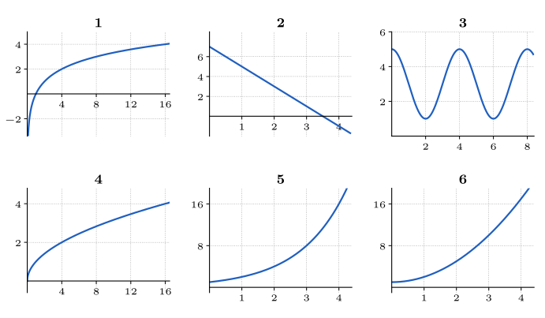

<!-- SOCLE = LE NOYAU, à faire par tous en séance : 35 minutes, puis 15 minutes de correction de S.4 et de méthode 1. VERSION 3 (énoncés seulement ; indices et solutions à écrire).
     Durées visées : S.1 6 min · S.2 4 min · S.3 3 min · S.4 7 min (corrigé en commun) · S.5 4 min · S.6 5 min · S.7 4 min.
     S.4 = l'exercice corrigé ensemble juste après le socle (méthode 1 « Résoudre une équation exponentielle ») : énoncé seul,
     SANS aides en séance ; sa solution complète est dans un fragment séparé, publié après la séance.
     Pour les autres : Indice 1 = théorie, Indice 2 = question, Indice 3 = étape, puis Solution (Réponse + Explication) et Piège.
     Versions précédentes : _archive-v1-socle.qmd. Faisable SANS calculatrice. Numéro AUTOMATIQUE.
     Notations du cours IMSV-6 : N_0 a^x, e^{kx}, \ln, \log_a, T_2, T_{1/2}, M + A\cos(2\pi/T (t - h)).
     Objectifs : voir index.qmd (O1 à O7). -->

::: {.callout-caution .exo title="Exercice|Socle|1|O1"}
Six grandeurs sont données par les tableaux de valeurs A à F ci-dessous.

:::: {layout-ncol="2"}
::: {.tableau}
**Tableau A**

| $x$ | $0$ | $1$ | $2$ | $3$ | $4$ |
|:---:|:---:|:---:|:---:|:---:|:---:|
| $y$ | $7$ | $5$ | $3$ | $1$ | $-1$ |
:::

::: {.tableau}
**Tableau B**

| $x$ | $0$ | $1$ | $2$ | $3$ | $4$ |
|:---:|:---:|:---:|:---:|:---:|:---:|
| $y$ | $1$ | $2$ | $5$ | $10$ | $17$ |
:::

::: {.tableau}
**Tableau C**

| $x$ | $0$ | $1$ | $4$ | $9$ | $16$ |
|:---:|:---:|:---:|:---:|:---:|:---:|
| $y$ | $0$ | $1$ | $2$ | $3$ | $4$ |
:::

::: {.tableau}
**Tableau D**

| $x$ | $1$ | $2$ | $4$ | $8$ | $16$ |
|:---:|:---:|:---:|:---:|:---:|:---:|
| $y$ | $0$ | $1$ | $2$ | $3$ | $4$ |
:::

::: {.tableau}
**Tableau E**

| $x$ | $0$ | $1$ | $2$ | $3$ | $4$ |
|:---:|:---:|:---:|:---:|:---:|:---:|
| $y$ | $1$ | $2$ | $4$ | $8$ | $16$ |
:::

::: {.tableau}
**Tableau F**

| $x$ | $0$ | $1$ | $2$ | $3$ | $4$ | $5$ | $6$ | $7$ | $8$ |
|:---:|:---:|:---:|:---:|:---:|:---:|:---:|:---:|:---:|:---:|
| $y$ | $5$ | $3$ | $1$ | $3$ | $5$ | $3$ | $1$ | $3$ | $5$ |
:::
::::

Les graphiques numérotés de 1 à 6 représentent ces six grandeurs, dans un ordre différent de celui des tableaux.

{fig-alt="Six graphiques numérotés de 1 à 6 : une courbe logarithmique, une droite décroissante, une courbe périodique, une courbe racine, une courbe exponentielle et une parabole." width="100%"}

(a) Associe chaque tableau au graphique qui le représente, en repérant sur le graphique un point qui figure dans le tableau.
(b) Pour chaque tableau, écris le type de modèle : affine, polynomial, racine, exponentiel, logarithmique ou périodique.
(c) Les tableaux C et D contiennent les mêmes valeurs de $y$. Écris ce qui, dans les valeurs de $x$, permet de distinguer le modèle racine du modèle logarithmique.
:::

::: {.aides}
::: {.panel-tabset}

## Indice 1

Retourne à la théorie du cours : *Culture de bactéries* (modèles affine et exponentiel), *Polynômes*, *Puissances et racines*, *Comprendre le logarithme* et *Sinus et cosinus* pour (a) et (b), et *Changement de base* ainsi que *Puissances et racines* pour (c).

## Indice 2

*Question à te poser.*

(a) Quel point de chaque tableau peux-tu repérer facilement sur un graphique, par exemple celui de la première colonne ?
(b) Quand $x$ augmente, comment évoluent les valeurs de $y$ : de la même quantité à chaque pas, du même facteur à chaque pas, de plus en plus lentement, ou en revenant aux mêmes valeurs ?
(c) Par quelle opération passe-t-on d'une valeur de $x$ à la suivante dans le tableau C, puis dans le tableau D ?

## Indice 3

*Étape.*

(a) Pour chaque tableau, cherche le graphique qui passe par le point de la première colonne, puis vérifie ton choix avec un deuxième point du tableau.
(b) Pour les tableaux A, B et E, calcule les différences entre deux valeurs consécutives de $y$, puis les quotients ; pour les tableaux C, D et F, observe comment $y$ évolue quand $x$ grandit.
(c) Écris chaque valeur de $x$ du tableau C en fonction de la valeur de $y$ de la même colonne, puis fais de même pour le tableau D.

## Solution

::: {.reponse}
**Réponse (a).** Le tableau A correspond au graphique 2, B au graphique 6, C au graphique 4, D au graphique 1, E au graphique 5 et F au graphique 3.
:::

::: {.details}
On cherche, pour chaque tableau, le graphique qui passe par ses points : on repère un ou deux points de chaque tableau sur les graphiques.

1. Le tableau A contient le point $(0\,;\,7)$ et ses valeurs diminuent. Seul le graphique 2 passe par $(0\,;\,7)$ ; c'est une droite qui passe aussi par $(2\,;\,3)$, donc A correspond au graphique 2.
2. Le tableau F prend les valeurs $5$, $3$, $1$, $3$, $5$, qui reviennent ensuite. Seul le graphique 3 revient périodiquement aux mêmes valeurs, avec un maximum $5$ en $x = 0$, $4$ et $8$, donc F correspond au graphique 3.
3. Les tableaux C et D vont jusqu'à $x = 16$, comme les graphiques 1 et 4. Le tableau C contient le point $(0\,;\,0)$, et le graphique 4 part de l'origine. Le tableau D commence en $(1\,;\,0)$ et n'a pas de valeur en $x = 0$ ; le graphique 1 coupe l'axe horizontal en $x = 1$ et descend très bas près de $x = 0$. Donc C correspond au graphique 4 et D au graphique 1.
4. Les tableaux B et E contiennent tous deux les points $(0\,;\,1)$ et $(1\,;\,2)$, comme les graphiques 5 et 6. On les distingue en $x = 3$ : E donne $8$ et B donne $10$. Le graphique 5 passe exactement par la ligne $8$ en $x = 3$, alors que le graphique 6 passe au-dessus. Donc E correspond au graphique 5 et B au graphique 6.
:::

::: {.reponse}
**Réponse (b).** Le tableau A est affine, B est polynomial, C est racine, D est logarithmique, E est exponentiel et F est périodique.
:::

::: {.details}
On reconnaît le type de modèle à la façon dont $y$ évolue quand $x$ augmente, comme dans la mise en situation du cours, qui compare un modèle affine et un modèle exponentiel.

1. Dans le tableau A, quand $x$ augmente de $1$, $y$ diminue toujours de $2$ : les différences sont constantes, donc le modèle est affine, avec $y = 7 - 2x$.
2. Dans le tableau E, quand $x$ augmente de $1$, $y$ est toujours multiplié par $2$ : les quotients sont constants, donc le modèle est exponentiel, avec $y = 2^{x}$.
3. Dans le tableau B, les différences valent $1$, $3$, $5$ et $7$, et les quotients valent $2$, $2{,}5$, $2$ et $1{,}7$ : ni les unes ni les autres ne sont constantes. Les valeurs de $y$ sont égales à $x^{2} + 1$, donc le modèle est polynomial, de degré $2$.
4. Dans le tableau C, chaque valeur de $y$ est le nombre positif dont le carré vaut $x$ : $y = \sqrt{x}$, donc le modèle est racine.
5. Dans le tableau D, $y$ augmente de $1$ chaque fois que $x$ est multiplié par $2$ : $y$ est l'exposant $p$ tel que $x = 2^{p}$, donc $y = \log_{2}(x)$ et le modèle est logarithmique.
6. Dans le tableau F, les valeurs $5$, $3$, $1$, $3$ se répètent toutes les $4$ unités : le modèle est périodique.
:::

::: {.reponse}
**Réponse (c).** Dans le tableau C, chaque valeur de $x$ est le carré de la valeur de $y$ ; dans le tableau D, chaque valeur de $x$ est la puissance de $2$ d'exposant $y$, et $x$ double d'une colonne à la suivante.
:::

::: {.details}
Les deux tableaux ont les mêmes valeurs de $y$ : on compare donc la manière dont les valeurs de $x$ sont choisies.

1. Dans le tableau C, les valeurs $0$, $1$, $4$, $9$ et $16$ de $x$ sont les carrés des valeurs $0$, $1$, $2$, $3$ et $4$ de $y$. On a donc $x = y^{2}$, et la racine défait cette puissance : $y = \sqrt{x}$.
2. Dans le tableau D, les valeurs $1$, $2$, $4$, $8$ et $16$ de $x$ sont les puissances $2^{0}$, $2^{1}$, $2^{2}$, $2^{3}$ et $2^{4}$. On a donc $x = 2^{y}$, ce qui s'écrit $y = \log_{2}(x)$ par définition du logarithme en base $2$.
3. Pour faire augmenter $y$ de $1$, il faut ajouter à $x$ les nombres $1$, $3$, $5$, $7$ dans le tableau C, mais multiplier $x$ par $2$ dans le tableau D. Quand $x$ devient très grand, il faut donc des valeurs de $x$ beaucoup plus grandes pour faire augmenter le logarithme que pour faire augmenter la racine : le logarithme croît plus lentement, comme l'indique le classement du cours.
:::

## Piège

En (a), une erreur fréquente consiste à associer les tableaux B et E au hasard entre les graphiques 5 et 6, parce que leurs deux premières colonnes sont identiques. Elle est tentante parce que les deux courbes partent du même point et se ressemblent, mais elle est fausse : il faut comparer un point où les tableaux diffèrent, par exemple $x = 3$, où les valeurs sont $8$ et $10$.

En (b), une autre erreur consiste à dire que le tableau B est exponentiel parce que ses valeurs augmentent de plus en plus vite. Elle est tentante parce que l'exponentielle est le modèle « qui monte de plus en plus vite » du cours, mais elle est fausse : un modèle exponentiel multiplie $y$ par le même facteur à chaque pas, et les quotients de B ne sont pas constants.

:::
:::

::: {.callout-caution .exo title="Exercice|Socle|1|O3"}
(a) Calcule $\ln(1)$, $\ln(e)$, $\ln\left(e^{3}\right)$ et $e^{\ln(5)}$.
(b) Calcule $\log_{10}(10\,000)$, $\log_{10}(0{,}001)$ et $\log_{2}(8)$.
(c) On donne $\ln(2) \approx 0{,}69$ et $\ln(3) \approx 1{,}10$. À l'aide des propriétés du logarithme, calcule des valeurs approchées de $\ln(6)$, de $\ln\left(\tfrac{3}{2}\right)$ et de $\ln(8)$.
(d) Écris $2^{x}$ sous la forme $e^{kx}$, en donnant la valeur exacte du nombre $k$.
:::

::: {.aides}
::: {.panel-tabset}

## Indice 1

Retourne à la théorie du cours : *Comprendre le logarithme* pour (a), *Changement de base* pour (b) et (c), *Le logarithme transforme le produit en somme* pour (c), et *La base naturelle : une autre écriture du même mécanisme* pour (d).

## Indice 2

*Question à te poser.*

(a) Quelle est la fonction réciproque de $e^{x}$, et que donne l'application successive d'une fonction et de sa réciproque ?
(b) À quelle puissance faut-il élever la base pour obtenir le nombre dont on cherche le logarithme ?
(c) Comment écrire $6$, $\tfrac{3}{2}$ et $8$ comme un produit, un quotient ou une puissance des nombres $2$ et $3$ ?
(d) Quel nombre $k$ vérifie $e^{k} = 2$ ?

## Indice 3

*Étape.*

(a) Utilise les relations $\ln\left(e^{x}\right) = x$ et $e^{\ln(y)} = y$, ainsi que les valeurs $\ln(1) = 0$ et $\ln(e) = 1$.
(b) Écris $10\,000$ et $0{,}001$ comme des puissances de $10$, et $8$ comme une puissance de $2$.
(c) Écris $6 = 2 \cdot 3$ et $8 = 2^{3}$, puis applique la propriété du logarithme qui correspond à chaque écriture.
(d) Écris $2 = e^{\ln(2)}$, puis remplace $2$ par cette expression dans $2^{x}$.

## Solution

::: {.reponse}
**Réponse (a).** On a $\ln(1) = 0$, $\ln(e) = 1$, $\ln\left(e^{3}\right) = 3$ et $e^{\ln(5)} = 5$.
:::

::: {.details}
On utilise le fait que le logarithme naturel est la fonction réciproque de l'exponentielle, comme dans *Comprendre le logarithme*.

1. Comme $e^{0} = 1$, le logarithme de $1$ vaut $0$ : $\ln(1) = 0$.
2. Comme $e^{1} = e$, le logarithme de $e$ vaut $1$ : $\ln(e) = 1$.
3. Le logarithme défait l'exponentielle, car $\ln\left(e^{x}\right) = x$ pour tout réel $x$, donc $\ln\left(e^{3}\right) = 3$.
4. L'exponentielle défait le logarithme, car $e^{\ln(y)} = y$ pour tout réel $y$ strictement positif, donc $e^{\ln(5)} = 5$.
:::

::: {.reponse}
**Réponse (b).** On a $\log_{10}(10\,000) = 4$, $\log_{10}(0{,}001) = -3$ et $\log_{2}(8) = 3$.
:::

::: {.details}
On utilise l'intuition du changement de base : $\log_{a}(x) = p$ si et seulement si $x = a^{p}$. Il suffit donc d'écrire chaque nombre comme une puissance de la base.

1. On écrit $10\,000 = 10^{4}$, donc $\log_{10}(10\,000) = 4$.
2. On écrit $0{,}001 = \tfrac{1}{1000} = 10^{-3}$, donc $\log_{10}(0{,}001) = -3$.
3. On écrit $8 = 2^{3}$, donc $\log_{2}(8) = 3$.

Le logarithme de $0{,}001$ est négatif, ce qui est cohérent avec $0{,}001 < 1$.
:::

::: {.reponse}
**Réponse (c).** On a $\ln(6) \approx 1{,}79$, $\ln\left(\tfrac{3}{2}\right) \approx 0{,}41$ et $\ln(8) \approx 2{,}07$.
:::

::: {.details}
On ramène chaque nombre à $2$ et à $3$, puis on applique les propriétés du logarithme d'un produit, d'un quotient et d'une puissance.

1. Comme $6 = 2 \cdot 3$, le logarithme du produit est la somme des logarithmes : $\ln(6) = \ln(2) + \ln(3) \approx 0{,}69 + 1{,}10 = 1{,}79$.
2. Le logarithme d'un quotient est la différence des logarithmes : $\ln\left(\tfrac{3}{2}\right) = \ln(3) - \ln(2) \approx 1{,}10 - 0{,}69 = 0{,}41$.
3. Comme $8 = 2^{3}$, le logarithme d'une puissance est l'exposant multiplié par le logarithme : $\ln(8) = 3\ln(2) \approx 3 \cdot 0{,}69 = 2{,}07$.

Ces valeurs sont plausibles : $6$ est compris entre $e \approx 2{,}7$ et $e^{2} \approx 7{,}4$, donc $\ln(6)$ est compris entre $1$ et $2$.
:::

::: {.reponse}
**Réponse (d).** On a $2^{x} = e^{\ln(2)\,x}$, donc $k = \ln(2)$, soit environ $0{,}69$.
:::

::: {.details}
On écrit la base $2$ comme une puissance de $e$, comme dans *La base naturelle : une autre écriture du même mécanisme*.

1. Comme $e^{\ln(y)} = y$ pour tout $y > 0$, on a $2 = e^{\ln(2)}$.
2. On remplace $2$ par cette expression : $2^{x} = \left(e^{\ln(2)}\right)^{x} = e^{\ln(2)\,x}$, car élever une puissance à la puissance $x$ multiplie les exposants.
3. On lit le coefficient de $x$ dans l'exposant : $k = \ln(2)$.

Le nombre $k$ est positif, ce qui est cohérent avec la croissance de $2^{x}$ : la base naturelle donne une croissance lorsque $k > 0$.
:::

## Piège

En (c), une erreur fréquente consiste à écrire $\ln(6) = \ln(2) \cdot \ln(3)$. Elle est tentante parce que $6$ est le produit de $2$ et de $3$, mais elle est fausse : le logarithme transforme un produit en somme, et non en produit, donc $\ln(6) = \ln(2) + \ln(3)$.

En (b), une autre erreur consiste à écrire $\log_{10}(0{,}001) = 3$ en comptant les zéros. Elle est tentante parce que l'on compte trois chiffres après la virgule, mais elle est fausse : $0{,}001 = 10^{-3}$, donc son logarithme est $-3$ ; un nombre compris entre $0$ et $1$ a un logarithme négatif.

:::
:::

::: {.callout-caution .exo title="Exercice|Socle|1|O2"}
(a) Soient les fonctions $f(t) = 200 \cdot 1{,}5^{t}$ et $g(t) = 64 \cdot \left(\tfrac{1}{2}\right)^{t}$, où $t$ est le temps en heures. Pour chacune, écris la valeur à l'instant $t = 0$ et le nombre par lequel la grandeur est multipliée chaque heure, puis écris si la grandeur augmente ou diminue au cours du temps.
(b) Une grandeur vaut $500$ à l'instant $t = 0$ et perd $20\,\%$ de sa valeur chaque heure. Écris l'expression de cette grandeur sous la forme $N(t) = N_0 \cdot a^{t}$, en donnant les valeurs de $N_0$ et de $a$.
:::

::: {.aides}
::: {.panel-tabset}

## Indice 1

Retourne à la théorie du cours : *Construction de l'exponentielle* et *Croissance et décroissance exponentielles* pour (a), et *Questions d'évaluation illustratives* pour (b).

## Indice 2

*Question à te poser.*

(a) Que vaut $a^{0}$, et par quel nombre la valeur est-elle multipliée quand $t$ augmente de $1$ ?
(b) Si une grandeur perd $20\,\%$ de sa valeur, quelle part de sa valeur lui reste-t-il ?

## Indice 3

*Étape.*

(a) Calcule $f(0)$ et $g(0)$, puis compare la base de chaque puissance au nombre $1$.
(b) Écris la valeur après une heure sous la forme $500 - 0{,}20 \cdot 500$, puis mets $500$ en facteur.

## Solution

::: {.reponse}
**Réponse (a).** La grandeur $f$ vaut $200$ à l'instant $t = 0$ et est multipliée par $1{,}5$ chaque heure : elle augmente. La grandeur $g$ vaut $64$ à l'instant $t = 0$ et est multipliée par $\tfrac{1}{2}$ chaque heure : elle diminue.
:::

::: {.details}
On lit les deux paramètres du modèle exponentiel $N(t) = N_{0} \cdot a^{t}$, comme dans *Construction de l'exponentielle*.

1. En $t = 0$, on a $a^{0} = 1$, donc $N(0) = N_{0}$ : le nombre qui multiplie la puissance est la valeur à l'instant $t = 0$. On lit $f(0) = 200$ et $g(0) = 64$.
2. Quand $t$ augmente de $1$, on a $N(t + 1) = N_{0} \cdot a^{t+1} = N(t) \cdot a$ : la base $a$ est le nombre par lequel la grandeur est multipliée chaque heure. On lit $a = 1{,}5$ pour $f$ et $a = \tfrac{1}{2}$ pour $g$.
3. D'après *Croissance et décroissance exponentielles*, le modèle est strictement croissant si $a > 1$ et strictement décroissant si $0 < a < 1$. Comme $1{,}5 > 1$, la grandeur $f$ augmente ; comme $0 < \tfrac{1}{2} < 1$, la grandeur $g$ diminue.
:::

::: {.reponse}
**Réponse (b).** La grandeur s'écrit $N(t) = 500 \cdot 0{,}8^{t}$, avec $N_{0} = 500$ et $a = 0{,}8$.
:::

::: {.details}
On traduit la perte de $20\,\%$ par heure en un facteur multiplicatif, puis on écrit le modèle exponentiel.

1. La valeur à l'instant $t = 0$ est donnée : $N_{0} = 500$.
2. Perdre $20\,\%$ de sa valeur revient à en garder $80\,\%$. Après une heure, la grandeur vaut donc $500 - 0{,}20 \cdot 500 = 500 \cdot (1 - 0{,}20) = 500 \cdot 0{,}8$.
3. La même perte se répète chaque heure, donc la grandeur est multipliée par $0{,}8$ chaque heure : $a = 0{,}8$ et $N(t) = 500 \cdot 0{,}8^{t}$.

Le facteur $0{,}8$ est compris entre $0$ et $1$, ce qui est cohérent avec une grandeur qui diminue. Contrôle : $N(1) = 400$, soit $500$ diminué de $20\,\%$.
:::

## Piège

En (b), une erreur fréquente consiste à prendre $a = 0{,}2$. Elle est tentante parce que le nombre $20\,\%$ figure dans l'énoncé, mais elle est fausse : $0{,}2$ est la part perdue, alors que $a$ est la part qui reste ; avec $a = 0{,}2$, on aurait $N(1) = 100$, soit une perte de $80\,\%$.

Une autre erreur consiste à écrire $N(t) = 500 \cdot (1 - 0{,}2\,t)$. Elle est tentante parce que l'on retire $20\,\%$ « chaque heure », mais elle est fausse : on retire $20\,\%$ de la valeur du moment, et non de la valeur de départ, donc la grandeur est multipliée par $0{,}8$ chaque heure et le modèle est exponentiel, pas affine.

:::
:::

::: {.callout-caution .exo title="Exercice|Socle|2|O4"}
Résous chacune des équations suivantes et écris chaque solution sous forme exacte. En (b) et en (c), encadre ensuite la solution entre deux nombres entiers consécutifs.

(a) $3 \cdot 2^{x} = 48$
(b) $5 \cdot 2^{x} = 35$
(c) $100 \cdot \left(\tfrac{1}{2}\right)^{t} = 20$
(d) $4\,e^{0{,}5\,x} = 12$. On donne $\ln(3) \approx 1{,}10$ : écris aussi une valeur approchée de la solution.
:::

::: {.callout-note appearance="simple"}
L'exercice **S.4** est corrigé ensemble en séance, juste après le temps consacré au socle : il n'a donc pas de coups de pouce. Cherche-le seul·e et repère l'endroit exact où tu bloques. Sa solution complète sera publiée après la séance.
:::

::: {.callout-caution .exo title="Exercice|Socle|1|O6"}
(a) L'aire de la surface d'une boule de rayon $r$ vaut $S(r) = 4\pi r^{2}$, et son volume vaut $V(r) = \tfrac{4}{3}\pi r^{3}$. Par quels nombres l'aire $S$ et le volume $V$ sont-ils multipliés quand on triple le rayon ?
(b) Une boule a un volume de $36\pi$ cm³. Calcule son rayon.
(c) Sans faire de calcul, range les quatre fonctions $\ln(x)$, $\sqrt{x}$, $x^{3}$ et $1{,}1^{x}$ selon leur croissance quand $x$ devient très grand, de la plus lente à la plus rapide.
:::

::: {.aides}
::: {.panel-tabset}

## Indice 1

Retourne à la théorie du cours : *Puissances et racines* pour (a) et (b), et *Comparer des croissances* pour (c).

## Indice 2

*Question à te poser.*

(a) Que deviennent $r^{2}$ et $r^{3}$ quand on remplace $r$ par $3r$ ?
(b) Quelle opération défait la puissance $3$ ?
(c) Dans quel ordre le cours classe-t-il les logarithmes, les racines, les polynômes et les exponentielles quand $x$ devient très grand ?

## Indice 3

*Étape.*

(a) Calcule $S(3r)$ en remplaçant $r$ par $3r$, puis compare le résultat à $S(r)$ ; fais de même pour $V$.
(b) Écris l'équation $\tfrac{4}{3}\pi r^{3} = 36\pi$, puis isole $r^{3}$.
(c) Écris à quelle famille appartient chacune des quatre fonctions.

## Solution

::: {.reponse}
**Réponse (a).** Quand on triple le rayon, l'aire de la surface est multipliée par $9$ et le volume est multiplié par $27$.
:::

::: {.details}
On remplace $r$ par $3r$ dans les deux formules et on compare au résultat de départ, comme dans *Puissances et racines*.

1. Pour l'aire, on calcule $S(3r) = 4\pi\,(3r)^{2} = 4\pi \cdot 9\,r^{2} = 9 \cdot 4\pi r^{2}$, donc $S(3r) = 9\,S(r)$.
2. Pour le volume, on calcule $V(3r) = \tfrac{4}{3}\pi\,(3r)^{3} = \tfrac{4}{3}\pi \cdot 27\,r^{3}$, donc $V(3r) = 27\,V(r)$.

Le facteur est $3^{2}$ pour l'aire et $3^{3}$ pour le volume : l'exposant de $r$ fixe le facteur, et le volume grandit plus vite que l'aire.
:::

::: {.reponse}
**Réponse (b).** Le rayon de la boule vaut $3$ cm.
:::

::: {.details}
On cherche le rayon $r$, en cm, d'une boule de volume $36\pi$ cm³ : on isole $r^{3}$, puis on défait la puissance $3$ par la racine cubique, comme dans *Puissances et racines*.

1. On écrit l'équation donnée par la formule du volume : $\tfrac{4}{3}\pi r^{3} = 36\pi$.
2. On divise les deux membres par $\pi$, puis on les multiplie par $\tfrac{3}{4}$ : $r^{3} = 36 \cdot \tfrac{3}{4} = 27$.
3. Sur $\mathbb{R}^{+}$, la racine cubique est la réciproque de la puissance $3$, donc $r = \sqrt[3]{27} = 3$, car $3^{3} = 27$.

Vérification : $V(3) = \tfrac{4}{3}\pi \cdot 27 = 36\pi$ cm³.
:::

::: {.reponse}
**Réponse (c).** Quand $x$ devient très grand, du plus lent au plus rapide, on a $\ln(x)$, puis $\sqrt{x}$, puis $x^{3}$, puis $1{,}1^{x}$.
:::

::: {.details}
On utilise le classement des croissances à long terme vu dans *Comparer des croissances* : logarithmes, puis racines, puis polynômes, puis exponentielles.

1. On classe chaque fonction dans sa famille : $\ln(x)$ est un logarithme, $\sqrt{x}$ une racine, $x^{3}$ un polynôme et $1{,}1^{x}$ une exponentielle de base strictement supérieure à $1$.
2. On applique le classement du cours, qui donne $\ln(x)$, $\sqrt{x}$, $x^{3}$ puis $1{,}1^{x}$.

Ce classement porte sur les très grandes valeurs de $x$. Pour $x = 10$, par exemple, $x^{3} = 1000$ dépasse largement $1{,}1^{10}$, qui vaut environ $2{,}6$ ; mais à long terme, l'exponentielle finit par dépasser le polynôme.
:::

## Piège

En (a), une erreur fréquente consiste à dire que l'aire et le volume sont multipliés par $3$, comme le rayon. Elle est tentante parce que l'on pense à une situation de proportionnalité, mais elle est fausse : $S$ dépend de $r^{2}$ et $V$ de $r^{3}$, donc les facteurs sont $3^{2} = 9$ et $3^{3} = 27$.

En (c), une autre erreur consiste à placer $1{,}1^{x}$ avant $x^{3}$, parce que $1{,}1$ est proche de $1$ et que $1{,}1^{x}$ est plus petit que $x^{3}$ pour les petites valeurs de $x$. Elle est tentante parce que l'on compare des valeurs proches de $0$, mais elle est fausse : le classement du cours porte sur les très grandes valeurs de $x$, et une exponentielle de base strictement supérieure à $1$ finit toujours par dépasser un polynôme.

:::
:::

::: {.callout-caution .exo title="Exercice|Socle|2|O2"}
Soit la fonction $f$ définie par
$$f(x) = 3 + 2\cos\left(\dfrac{\pi}{3}(x - 1)\right).$$

(a) Résous l'équation $f(x) = 4$ dans l'intervalle $[0,\,6[$.
(b) Résous l'équation $f(x) = 3$ dans l'intervalle $[0,\,12]$.
:::

::: {.aides}
::: {.panel-tabset}

## Indice 1

Retourne à la théorie du cours : *Sinus et cosinus* (valeurs du cosinus sur le cercle trigonométrique et période $2\pi$) pour (a) et (b).

## Indice 2

*Question à te poser.*

(a) Sur un tour du cercle trigonométrique, pour quels angles le cosinus vaut-il $\tfrac{1}{2}$ ?
(b) Sur un tour du cercle trigonométrique, pour quels angles le cosinus vaut-il $0$ ?

## Indice 3

*Étape.*

(a) Isole le cosinus : soustrais $3$ aux deux membres, puis divise-les par $2$.
(b) Isole le cosinus, puis écris que l'angle $\tfrac{\pi}{3}(x - 1)$ est égal à $\tfrac{\pi}{2}$ augmenté d'un multiple de $\pi$.

## Solution

::: {.reponse}
**Réponse (a).** Dans l'intervalle $[0,\,6[$, l'équation $f(x) = 4$ a deux solutions : $x = 0$ et $x = 2$.
:::

::: {.details}
On cherche les nombres $x$ de $[0,\,6[$ dont l'image par $f$ vaut $4$. On isole le cosinus, puis on utilise les valeurs particulières du cosinus sur le cercle trigonométrique, comme dans *Sinus et cosinus*.

1. On isole le cosinus : on soustrait $3$ aux deux membres de $3 + 2\cos\left(\tfrac{\pi}{3}(x - 1)\right) = 4$, puis on les divise par $2$, donc $\cos\left(\tfrac{\pi}{3}(x - 1)\right) = \tfrac{1}{2}$.
2. Sur un tour du cercle trigonométrique, les angles dont le cosinus vaut $\tfrac{1}{2}$ sont $\tfrac{\pi}{3}$ et $-\tfrac{\pi}{3}$ ; les autres s'obtiennent en ajoutant un multiple de $2\pi$, car le cosinus a pour période $2\pi$. On écrit donc $\tfrac{\pi}{3}(x - 1) = \tfrac{\pi}{3} + 2k\pi$ ou $\tfrac{\pi}{3}(x - 1) = -\tfrac{\pi}{3} + 2k\pi$, avec $k$ entier.
3. On isole $x$ en multipliant les deux membres par $\tfrac{3}{\pi}$, puis en ajoutant $1$ : $x = 2 + 6k$ ou $x = 6k$.
4. On garde les valeurs de $[0,\,6[$ : pour $k = 0$, on obtient $2$ et $0$ ; pour $k = 1$, on obtient $8$ et $6$, qui ne sont pas dans l'intervalle, car il exclut $6$.

Vérification : $f(0) = 3 + 2\cos\left(-\tfrac{\pi}{3}\right) = 3 + 1 = 4$ et $f(2) = 3 + 2\cos\left(\tfrac{\pi}{3}\right) = 4$.
:::

::: {.reponse}
**Réponse (b).** Dans l'intervalle $[0,\,12]$, l'équation $f(x) = 3$ a quatre solutions : $x = \tfrac{5}{2}$, $x = \tfrac{11}{2}$, $x = \tfrac{17}{2}$ et $x = \tfrac{23}{2}$.
:::

::: {.details}
On cherche les nombres $x$ de $[0,\,12]$ dont l'image par $f$ vaut $3$, avec la même méthode qu'en (a).

1. On isole le cosinus : on soustrait $3$ aux deux membres, puis on les divise par $2$, donc $\cos\left(\tfrac{\pi}{3}(x - 1)\right) = 0$.
2. Sur un tour du cercle trigonométrique, les angles dont le cosinus vaut $0$ sont $\tfrac{\pi}{2}$ et $-\tfrac{\pi}{2}$ ; tous les angles dont le cosinus vaut $0$ s'écrivent donc $\tfrac{\pi}{2} + k\pi$, avec $k$ entier. On écrit $\tfrac{\pi}{3}(x - 1) = \tfrac{\pi}{2} + k\pi$.
3. On isole $x$ en multipliant les deux membres par $\tfrac{3}{\pi}$, puis en ajoutant $1$ : $x = \tfrac{5}{2} + 3k$.
4. On garde les valeurs de $[0,\,12]$ : $k = 0$, $1$, $2$ et $3$ donnent $\tfrac{5}{2}$, $\tfrac{11}{2}$, $\tfrac{17}{2}$ et $\tfrac{23}{2}$ ; $k = -1$ donne $-\tfrac{1}{2}$ et $k = 4$ donne $\tfrac{29}{2}$, qui sont hors de l'intervalle.

Ces solutions sont plausibles : la valeur $3$ est la valeur moyenne de $f$, que la fonction atteint deux fois par période de $6$, soit quatre fois sur un intervalle de longueur $12$.
:::

## Piège

Une erreur fréquente consiste à ne garder qu'un seul angle par tour, par exemple seulement $\tfrac{\pi}{3}$ en (a). Elle est tentante parce que l'on pense à la première valeur connue du cosinus, mais elle est fausse : sur un tour du cercle trigonométrique, le cosinus prend la valeur $\tfrac{1}{2}$ en deux angles, $\tfrac{\pi}{3}$ et $-\tfrac{\pi}{3}$, donc on obtient deux familles de solutions.

Une autre erreur consiste à oublier les solutions des tours suivants, ou à ne pas tenir compte du bord de l'intervalle. Elle est tentante parce que les premières solutions trouvées semblent suffire, mais elle est fausse : il faut ajouter les multiples de la période et garder exactement les valeurs de l'intervalle demandé, ce qui exclut $x = 6$ en (a).

:::
:::

::: {.callout-caution .exo title="Exercice|Socle|2|O7"}
Une grandeur $g$ oscille entre $-1$ et $5$. Sa période vaut $8$, et son maximum est atteint à l'instant $t = 2$. On propose quatre modèles :

1. $g(t) = 2 + 3\cos\left(\dfrac{\pi}{4}(t - 2)\right)$
2. $g(t) = 2 + 3\cos\left(\dfrac{\pi}{8}(t - 2)\right)$
3. $g(t) = 2 + 6\cos\left(\dfrac{\pi}{4}(t - 2)\right)$
4. $g(t) = 2 + 3\cos\left(\dfrac{\pi}{4}(t + 2)\right)$

(a) Pour chaque modèle, écris la valeur moyenne $M$, l'amplitude $A$, la période $T$ et un instant $h$ où le maximum est atteint.
(b) Écris quel modèle respecte les trois caractéristiques de la grandeur. Pour chacun des trois autres, écris une caractéristique qu'il ne respecte pas.
:::

::: {.aides}
::: {.panel-tabset}

## Indice 1

Retourne à la théorie du cours : *Adapter une fonction périodique*, et plus précisément le résumé de la méthode, pour (a) et (b), et *Questions d'évaluation illustratives* pour (b).

## Indice 2

*Question à te poser.*

(a) Dans l'écriture $M + A\cos\left(\tfrac{2\pi}{T}(t - h)\right)$, quel nombre multiplie $t - h$, et comment en déduire la période $T$ ?
(b) Quelles valeurs de $M$, de $A$, de $T$ et de $h$ correspondent à une grandeur qui oscille entre $-1$ et $5$, avec une période de $8$ et un maximum en $t = 2$ ?

## Indice 3

*Étape.*

(a) Pour chaque modèle, égale le nombre qui multiplie la parenthèse à $\tfrac{2\pi}{T}$ et calcule $T$ ; pour le modèle 4, écris $t + 2$ sous la forme $t - (-2)$.
(b) Calcule la valeur moyenne $\tfrac{-1 + 5}{2}$ et l'amplitude $\tfrac{5 - (-1)}{2}$, puis compare les quatre paramètres attendus à ceux de chaque modèle.

## Solution

::: {.reponse}
**Réponse (a).** Les quatre modèles ont une valeur moyenne $M = 2$. Le modèle 1 a $A = 3$, $T = 8$ et $h = 2$ ; le modèle 2 a $A = 3$, $T = 16$ et $h = 2$ ; le modèle 3 a $A = 6$, $T = 8$ et $h = 2$ ; le modèle 4 a $A = 3$, $T = 8$ et $h = -2$.
:::

::: {.details}
On compare chaque modèle à l'écriture $M + A\cos\left(\tfrac{2\pi}{T}(t - h)\right)$ du résumé de la méthode du cours.

1. Le nombre ajouté au cosinus est la valeur moyenne $M$ : il vaut $2$ dans les quatre modèles.
2. Le nombre qui multiplie le cosinus est l'amplitude $A$ : il vaut $3$ dans les modèles 1, 2 et 4, et $6$ dans le modèle 3.
3. Le nombre qui multiplie la parenthèse vaut $\tfrac{2\pi}{T}$. Pour $\tfrac{\pi}{4}$, on obtient $T = 8$, car $\tfrac{2\pi}{8} = \tfrac{\pi}{4}$ ; pour $\tfrac{\pi}{8}$, on obtient $T = 16$.
4. Le nombre $h$ est celui que l'on soustrait à $t$ : $h = 2$ dans les modèles 1, 2 et 3. Dans le modèle 4, on écrit $t + 2 = t - (-2)$, donc $h = -2$ : le maximum est atteint en $t = -2$, puis en $t = 6$ une période plus tard.
:::

::: {.reponse}
**Réponse (b).** Seul le modèle 1 respecte les trois caractéristiques. Le modèle 2 a une période de $16$ au lieu de $8$, le modèle 3 oscille entre $-4$ et $8$ au lieu de $-1$ et $5$, et le modèle 4 atteint son maximum en $t = -2$ et $t = 6$, mais pas en $t = 2$.
:::

::: {.details}
On calcule les paramètres attendus, puis on les compare à ceux trouvés en (a).

1. La valeur moyenne attendue est $M = \tfrac{-1 + 5}{2} = 2$, et l'amplitude attendue est $A = \tfrac{5 - (-1)}{2} = 3$.
2. La période attendue est $T = 8$, donc le nombre qui multiplie la parenthèse doit valoir $\tfrac{2\pi}{8} = \tfrac{\pi}{4}$, et le maximum en $t = 2$ impose $h = 2$.
3. Seul le modèle 1 a $M = 2$, $A = 3$, $T = 8$ et $h = 2$.
4. Le modèle 2 a la période $16$. Le modèle 3 a l'amplitude $6$, donc il oscille entre $2 - 6 = -4$ et $2 + 6 = 8$. Le modèle 4 vaut $g(2) = 2 + 3\cos(\pi) = -1$ en $t = 2$ : il y atteint son minimum, et non son maximum.
:::

## Piège

Une erreur fréquente consiste à lire $h = 2$ dans le modèle 4, parce que le nombre $2$ apparaît dans la parenthèse. Elle est tentante parce que l'on repère le nombre sans regarder le signe, mais elle est fausse : $t + 2 = t - (-2)$, donc $h = -2$, et le maximum n'est pas atteint en $t = 2$.

Une autre erreur consiste à lire la période $8$ dans le modèle 2, parce que le nombre $8$ apparaît dans $\tfrac{\pi}{8}$. Elle est tentante parce que la période et ce nombre se ressemblent, mais elle est fausse : le nombre qui multiplie la parenthèse vaut $\tfrac{2\pi}{T}$, donc $\tfrac{\pi}{8}$ correspond à $T = 16$.

:::
:::
