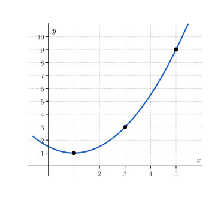
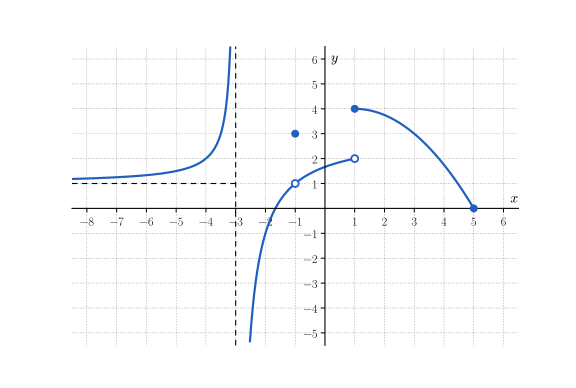
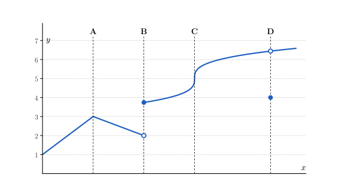

<!-- SOCLE = LE NOYAU, à faire par tous en séance : 35 minutes, puis 15 minutes de correction de S.3 et de méthode 1.
     Durées visées (réalistes, sans calculatrice) : S.1 4 min · S.2 4 min · S.3 6 min (corrigé en commun) · S.4 3 min · S.5 5 min · S.6 6 min · S.7 3 min = 31 min.
     Allègement du 4/11 : S.1 (c), S.4 (b), le point lisse de S.5, S.6 (d) retirés ; p'(t) donné en S.7.
     S.3 = l'exercice corrigé ensemble juste après le socle (méthode 1 « Lire une limite sur un graphique ») : indices et réponses finales
     (sans « Je veux plus de détails ») ; les détails sont donnés lors de la correction.
     Pour les autres : Indice 1 = théorie, Indice 2 = question, Indice 3 = étape, puis Solution (Réponse + Explication) et Piège.
     Faisable SANS calculatrice. Numéro AUTOMATIQUE. Aucune règle de dérivation (vue à la séance 8) : les dérivées viennent
     du quotient différentiel (polynômes de degré 2 au plus) ou d'une lecture graphique.
     Notations du cours IMSV-7 : \Delta_{[a,b]}(f), \Delta^{rel}_{[a,b]}(f), T_{[a,b]}(f), \lim\limits_{x\to a^-}, \lim\limits_{x\to a^+}, Dom(f),
     f'(a) = \lim\limits_{h\to 0} (f(a+h)-f(a))/h, f^{(n)}, p''.
     Objectifs : voir index.qmd (O1 à O9). Figures : img/figs.py. -->

::: {.callout-caution .exo title="Exercice|Socle|1|O1"}
Une grandeur $N$ dépend du temps $t$, exprimé en heures. Le tableau donne quelques valeurs de $N$, en milliers d'individus.

| $t$ (h) | $0$ | $2$ | $4$ | $6$ |
|:---:|:---:|:---:|:---:|:---:|
| $N(t)$ (milliers) | $40$ | $60$ | $90$ | $135$ |

(a) Calcule la variation absolue $\Delta_{[0,2]}(N)$, la variation relative $\Delta^{rel}_{[0,2]}(N)$ et le taux de variation moyen $T_{[0,2]}(N)$, avec leurs unités. Fais de même sur l'intervalle $[4,\,6]$.
(b) Compare les résultats obtenus sur les deux intervalles, et écris en une phrase ce qu'ils signifient pour la grandeur $N$.
:::

::: {.aides}
::: {.panel-tabset}

## Indice 1

Retourne à la théorie du cours : *Variation absolue*, *Variation relative* et *Taux de variation moyen* pour (a), et *Taux de variation moyen vs. variation relative* pour (b).

## Indice 2

*Question à te poser.*

(a) Par quoi divise-t-on la variation absolue pour obtenir la variation relative, et pour obtenir le taux de variation moyen ?
(b) Les deux variations relatives sont-elles différentes, et les deux taux de variation moyens ?

## Indice 3

*Étape.*

(a) Sur $[0,\,2]$, écris $\Delta_{[0,2]}(N) = N(2) - N(0)$, puis divise ce nombre par $N(0)$, puis par la durée $2 - 0$.
(b) Écris chaque variation relative en pourcentage, puis compare les taux de variation moyens.

## Solution

::: {.reponse}
**Réponse (a).** Sur $[0,\,2]$ : $\Delta_{[0,2]}(N) = 20$ milliers, $\Delta^{rel}_{[0,2]}(N) = 0{,}5$ et $T_{[0,2]}(N) = 10$ milliers par heure. Sur $[4,\,6]$ : $\Delta_{[4,6]}(N) = 45$ milliers, $\Delta^{rel}_{[4,6]}(N) = 0{,}5$ et $T_{[4,6]}(N) = 22{,}5$ milliers par heure.
:::

::: {.details}
On applique les trois définitions du cours sur chaque intervalle $[a,\,b]$.

1. La variation absolue est la différence des valeurs aux extrémités : $\Delta_{[0,2]}(N) = 60 - 40 = 20$ milliers et $\Delta_{[4,6]}(N) = 135 - 90 = 45$ milliers. Elle a l'unité de $N$.
2. La variation relative divise la variation absolue par la valeur de départ : $\Delta^{rel}_{[0,2]}(N) = \tfrac{20}{40} = 0{,}5$ et $\Delta^{rel}_{[4,6]}(N) = \tfrac{45}{90} = 0{,}5$. C'est un nombre sans unité.
3. Le taux de variation moyen divise la variation absolue par la durée : $T_{[0,2]}(N) = \tfrac{20}{2} = 10$ et $T_{[4,6]}(N) = \tfrac{45}{2} = 22{,}5$. Il s'exprime en milliers par heure, c'est-à-dire l'unité de $N$ divisée par l'unité de $t$.
:::

::: {.reponse}
**Réponse (b).** Sur les deux intervalles, la grandeur augmente de $50\,\%$, mais elle augmente en moyenne de $10$ milliers par heure sur $[0,\,2]$ et de $22{,}5$ milliers par heure sur $[4,\,6]$.
:::

::: {.details}
On compare séparément les variations relatives et les taux de variation moyens.

1. Une variation relative de $0{,}5$ correspond à un pourcentage d'accroissement de $100 \cdot 0{,}5 = 50\,\%$ : la grandeur est multipliée par le même facteur $1 + 0{,}5 = 1{,}5$ sur chacun des deux intervalles.
2. Les taux de variation moyens sont différents : comme la grandeur est plus grande au début de $[4,\,6]$, la même augmentation de $50\,\%$ représente plus d'individus par heure.

Comme dans le cours, la même variation relative est produite sur deux intervalles différents par des taux différents.
:::

## Piège

En (a), une erreur fréquente consiste à diviser la variation absolue par la valeur d'arrivée, et à écrire $\tfrac{20}{60}$ au lieu de $\tfrac{20}{40}$. 

En (b), une autre erreur consiste à conclure que la grandeur « grandit plus vite » sur $[4,\,6]$ en pourcentage.
:::
:::

::: {.callout-caution .exo title="Exercice|Socle|2|O2"}
Le graphique ci-dessous représente une fonction $f$. Les points marqués ont des coordonnées entières.

{fig-alt="Graphique d'une parabole tournée vers le haut, de minimum en (1 ; 1), passant par les points marqués (1 ; 1), (3 ; 3) et (5 ; 9)." width="8cm" fig-align="center"}

(a) Lis $f(1)$, $f(3)$ et $f(5)$, puis calcule les taux de variation moyens $T_{[1,3]}(f)$, $T_{[3,5]}(f)$ et $T_{[1,5]}(f)$.
(b) Écris l'équation de la sécante à la courbe aux points d'abscisses $1$ et $5$, puis trace-la sur le graphique.
:::

::: {.aides}
::: {.panel-tabset}

## Indice 1

Retourne à la théorie du cours : *Taux de variation moyen* pour (a) et (b), ainsi que la pente d'une droite passant par deux points (séance 3).

## Indice 2

*Question à te poser.*

(a) Quelle droite a pour pente le taux de variation moyen $T_{[a,b]}(f)$ ?
(b) Quelle est la pente de cette droite, et par quel point passe-t-elle ?

## Indice 3

*Étape.*

(a) Calcule $T_{[1,3]}(f) = \dfrac{f(3) - f(1)}{3 - 1}$, puis fais de même sur les deux autres intervalles.
(b) Écris $y = f(1) + T_{[1,5]}(f) \cdot (x - 1)$, puis vérifie que la droite passe aussi par $(5\,;\,f(5))$.

## Solution

::: {.reponse}
**Réponse (a).** On lit $f(1) = 1$, $f(3) = 3$ et $f(5) = 9$, donc $T_{[1,3]}(f) = 1$, $T_{[3,5]}(f) = 3$ et $T_{[1,5]}(f) = 2$.
:::

::: {.details}
On lit les ordonnées des points marqués, puis on applique la définition du taux de variation moyen.

1. $T_{[1,3]}(f) = \dfrac{3 - 1}{3 - 1} = 1$.
2. $T_{[3,5]}(f) = \dfrac{9 - 3}{5 - 3} = 3$.
3. $T_{[1,5]}(f) = \dfrac{9 - 1}{5 - 1} = 2$.
:::

::: {.reponse}
**Réponse (b).** La sécante aux points d'abscisses $1$ et $5$ a pour équation $y = 2x - 1$.
:::

::: {.details}
La sécante est la droite qui relie $(1\,;\,f(1))$ et $(5\,;\,f(5))$ : sa pente est le taux de variation moyen $T_{[1,5]}(f) = 2$.

1. La droite a une équation de la forme $y=2x+p$, où $p$ est à déterminer.
2. La droite passe par $(1\,;\,1)$, donc $1=2\cdot 1+p$. Donc $p=-1$. On obtient donc comme équation $y = 2x - 1$.

On peut vérifier l'équatuon avec le point $(5\,;\, f(5))$ : pour $x = 5$, on obtient $y = 9 = f(5)$.
:::

## Piège

En (a), une erreur fréquente consiste à inverser le quotient, et à écrire $T_{[3,5]}(f) = \tfrac{5 - 3}{9 - 3} = \tfrac{1}{3}$. 

:::
:::

::: {.callout-caution .exo title="Exercice|Socle|2|O3"}
La fonction $f$ est définie sur $]-\infty,\,5] \setminus \{-3\}$. Le graphique ci-dessous la représente. Les droites en pointillés sont des asymptotes au graphe de $f$. Un point plein appartient à la courbe ; un point creux n'en fait pas partie.

{fig-alt="Graphique d'une fonction : à gauche de x = −3, une branche qui se rapproche de la droite y = 1 vers la gauche et monte vers +∞ près de x = −3 ; entre −3 et 1, une branche croissante qui part de −∞ près de x = −3, avec un point creux en (−1 ; 1), un point plein isolé en (−1 ; 3) et un point creux en (1 ; 2) ; à partir de x = 1, une branche qui part du point plein (1 ; 4) et descend jusqu'au point plein (5 ; 0)." width="13cm" fig-align="center"}

(a) Lis $\lim\limits_{x \to -1} f(x)$, puis $f(-1)$.
(b) Lis $\lim\limits_{x \to 1^-} f(x)$, $\lim\limits_{x \to 1^+} f(x)$ et $f(1)$. La fonction $f$ admet-elle une limite en $1$ ?
(c) Lis $\lim\limits_{x \to -3^-} f(x)$ et $\lim\limits_{x \to -3^+} f(x)$.
(d) Lis $\lim\limits_{x \to -\infty} f(x)$, puis $\lim\limits_{x \to 5} f(x)$.
:::

::: {.callout-note appearance="simple"}
L'exercice **S.3** est corrigé ensemble en séance, juste après le temps consacré au socle. Cherche-le seul·e et repère l'endroit exact où tu bloques. Les coups de pouce ci-dessous donnent les indices et les réponses finales ; les détails seront donnés lors de la correction.
:::

::: {.aides}
::: {.panel-tabset}

## Indice 1

Retourne à la théorie du cours : *Limite à l'approche d'un point* pour (a), *Limites à gauche et à droite* pour (b) et (d), et *Asymptotes* pour (c) et (d).

## Indice 2

*Question à te poser.*

(a) Quand $x$ se rapproche de $-1$ sans être égal à $-1$, de quelle valeur les points de la courbe se rapprochent-ils ?
(b) En arrivant en $x = 1$ par la gauche, puis par la droite, la courbe arrive-t-elle à la même hauteur ?
(c) Quand $x$ se rapproche de $-3$, les valeurs de $f(x)$ se rapprochent-elles d'un nombre ?
(d) Peut-on approcher $5$ par la droite en restant dans le domaine de $f$ ?

## Indice 3

*Étape.*

(a) Suis la courbe vers $x = -1$ par la gauche, puis par la droite, en cachant le point d'abscisse $-1$ ; lis ensuite séparément l'ordonnée du point plein.
(b) Lis l'ordonnée du point creux, puis celle du point plein, et compare les deux limites orientées.
(c) Regarde si la courbe monte ou descend le long de la droite verticale, de chaque côté.
(d) Suis la branche de gauche vers $-\infty$, puis la dernière branche jusqu'à $x = 5$, par la gauche seulement.

## Solution

::: {.reponse}
**Réponse (a).** On a $\lim\limits_{x \to -1} f(x) = 1$ et $f(-1) = 3$.
:::

::: {.reponse}
**Réponse (b).** On a $\lim\limits_{x \to 1^-} f(x) = 2$, $\lim\limits_{x \to 1^+} f(x) = 4$ et $f(1) = 4$. Les deux limites orientées sont différentes, donc $f$ n'admet pas de limite en $1$.
:::

::: {.reponse}
**Réponse (c).** On a $\lim\limits_{x \to -3^-} f(x) = +\infty$ et $\lim\limits_{x \to -3^+} f(x) = -\infty$ : la droite d'équation $x = -3$ est une asymptote verticale.
:::

::: {.reponse}
**Réponse (d).** On a $\lim\limits_{x \to -\infty} f(x) = 1$ : la droite d'équation $y = 1$ est une asymptote horizontale. On a $\lim\limits_{x \to 5} f(x) = 0$ : seule l'approche par la gauche est possible.
:::

## Piège

En (a), une erreur fréquente consiste à répondre $\lim\limits_{x \to -1} f(x) = 3$, parce que $f(-1) = 3$. 

En (b), une autre erreur consiste à dire que la limite en $1$ vaut $3$, la moyenne de $2$ et de $4$, ou qu'elle vaut $4$ parce que $f(1) = 4$. 

En (d), une autre erreur consiste à dire que $f$ n'a pas de limite en $5$, parce qu'on ne peut pas approcher $5$ par la droite. 
:::
:::

::: {.callout-caution .exo title="Exercice|Socle|1|O4"}
Soient les fonctions $f(x) = x^{2} - 1$, $g(x) = 3$ et $h(x) = \sqrt{x + 1}$. On admet que $\lim\limits_{x \to a} f(x) = f(a)$ pour tout réel $a$, et que $h$ est continue en tout point $a > -1$. Calcule les limites suivantes en utilisant les propriétés algébriques des limites.

(a) $\lim\limits_{x \to 2} \big(f(x) + 2 \cdot g(x)\big)$
(b) $\lim\limits_{x \to 3} \dfrac{h(x)}{f(x)}$
(c) $\lim\limits_{x \to 2} (h \circ f)(x)$
(d) Explique pourquoi la règle du quotient ne permet pas de calculer $\lim\limits_{x \to 1} \dfrac{g(x)}{f(x)}$.
:::

::: {.aides}
::: {.panel-tabset}

## Indice 1

Retourne à la théorie du cours : *Limites : quelques règles de calcul* (propriétés algébriques et exemples) pour (a) à (d).

## Indice 2

*Question à te poser.*

(a) Vers quels nombres tendent $f(x)$ et $g(x)$ quand $x$ tend vers $2$ ?
(b) La limite du dénominateur est-elle différente de $0$ ?
(c) Vers quel nombre $b$ tend $f(x)$ quand $x$ tend vers $2$, et $h$ est-elle continue en $b$ ?
(d) Vers quel nombre tend le dénominateur quand $x$ tend vers $1$ ?

## Indice 3

*Étape.*

(a) Calcule $\lim\limits_{x \to 2} f(x) = f(2)$ et $\lim\limits_{x \to 2} g(x)$, puis utilise la règle de la somme et la règle du produit par une constante.
(b) Calcule $h(3)$ et $f(3)$, puis divise la première limite par la seconde après avoir vérifié que celle-ci n'est pas nulle.
(c) Calcule $b = f(2)$, puis $h(b)$.
(d) Calcule $f(1)$.

## Solution

::: {.reponse}
**Réponse (a).** $\lim\limits_{x \to 2} \big(f(x) + 2 \cdot g(x)\big) = 9$.
:::

::: {.details}
Les deux limites existent et sont finies : $\lim\limits_{x \to 2} f(x) = f(2) = 2^{2} - 1 = 3$ et $\lim\limits_{x \to 2} g(x) = 3$, car $g$ est constante. Par la règle de la somme et la règle du produit par une constante, la limite vaut $3 + 2 \cdot 3 = 9$.
:::

::: {.reponse}
**Réponse (b).** $\lim\limits_{x \to 3} \dfrac{h(x)}{f(x)} = \dfrac{1}{4}$.
:::

::: {.details}
Comme $h$ est continue en $3$, $\lim\limits_{x \to 3} h(x) = h(3) = \sqrt{4} = 2$, et $\lim\limits_{x \to 3} f(x) = f(3) = 8$. Comme $8 \neq 0$, la règle du quotient s'applique : la limite vaut $\tfrac{2}{8} = \tfrac{1}{4}$.
:::

::: {.reponse}
**Réponse (c).** $\lim\limits_{x \to 2} (h \circ f)(x) = 2$.
:::

::: {.details}
On utilise la règle de la composée.

1. Quand $x$ tend vers $2$, $f(x)$ tend vers $b = f(2) = 3$.
2. La fonction $h$ est continue en $3$, donc $\lim\limits_{x \to 2} h\big(f(x)\big) = \lim\limits_{y \to 3} h(y) = h(3) = \sqrt{4} = 2$.
:::

::: {.reponse}
**Réponse (d).** La règle du quotient exige que la limite du dénominateur soit différente de $0$ ; or $\lim\limits_{x \to 1} f(x) = f(1) = 0$.
:::

::: {.details}
On a $f(1) = 1^{2} - 1 = 0$, donc la limite du dénominateur est nulle. La règle du quotient ne s'applique pas : on ne divise jamais par une limite nulle, et il faut une autre méthode, par exemple lire le graphique.
:::

## Piège

En (c), une erreur fréquente consiste à calculer $h(2)$, c'est-à-dire $\sqrt{3}$, au lieu de $h(f(2))$. 

En (d), une autre erreur consiste à écrire $\tfrac{3}{0} = 0$, ou à appliquer quand même la règle du quotient.

:::
:::

::: {.callout-caution .exo title="Exercice|Socle|2|O6"}
(a) Le graphique ci-dessous représente une fonction $f$ définie sur $[0,\,10]$. En chacun des points d'abscisses A, B, C et D, écris si $f$ est continue, puis si elle est dérivable, en justifiant par ce que tu vois sur le graphique.

{fig-alt="Graphique d'une fonction avec quatre abscisses marquées : en A, deux segments forment une pointe ; en B, la courbe saute d'un point creux (B ; 2) à un point plein plus haut ; en C, la courbe est continue mais devient verticale ; en D, un point creux sur la courbe et un point plein isolé plus bas." width="13cm" fig-align="center"}

(b) Soit la fonction $g$ définie par
$$g(x) = \begin{cases} x + 1 & \text{si } x < 1, \\ 3 - x & \text{si } x \geq 1. \end{cases}$$
Écris si $g$ est continue en $1$, en justifiant par un calcul de limites. Trace ensuite le graphique de $g$. La fonction $g$ est-elle dérivable en en $1$?
:::

::: {.aides}
::: {.panel-tabset}

## Indice 1

Retourne à la théorie du cours : *Continuité* et *Non-dérivabilité* pour (a) et (b), et *Limites à gauche et à droite* pour (b).

## Indice 2

*Question à te poser.*

(a) En chaque point, peut-on tracer la courbe sans lever le crayon, et la courbe y a-t-elle une seule tangente, non verticale ?
(b) Les deux morceaux de $g$ se rejoignent-ils en $x = 1$, et ont-ils la même pente ?

## Indice 3

*Étape.*

(a) Repère en chaque point un trou, un saut, un point anguleux ou une tangente verticale ; rappelle-toi que la continuité est nécessaire à la dérivabilité.
(b) Remplace $x$ par $1$ dans chacune des deux expressions, puis compare les pentes $1$ et $-1$ des deux morceaux.

## Solution

::: {.reponse}
**Réponse (a).** En A, $f$ est continue mais pas dérivable (point anguleux). En B, $f$ n'est pas continue (saut), donc pas dérivable. En C, $f$ est continue mais pas dérivable (tangente verticale). En D, $f$ n'est pas continue (la limite existe mais diffère de l'image), donc pas dérivable.
:::

::: {.details}
On examine d'abord la continuité, puis la dérivabilité, en se rappelant qu'une fonction dérivable en un point y est continue.

1. En A, la courbe se trace sans lever le crayon, mais deux segments de pentes différentes s'y rejoignent : il n'y a pas une seule tangente, donc $f$ n'est pas dérivable.
2. En B, la limite à gauche vaut $2$ (point creux), alors que $f(\text{B})$ est l'ordonnée du point plein, plus haut : les deux limites orientées sont différentes, donc $f$ n'est pas continue en B. Elle est continue à droite, puisque la limite à droite est égale à $f(\text{B})$. Comme elle n'est pas continue, elle n'est pas dérivable.
3. En C, la courbe est continue, mais la tangente est verticale : sa pente n'est pas finie, donc $f$ n'est pas dérivable.
4. En D, la limite existe (la hauteur du point creux), mais $f(\text{D})$ est l'ordonnée du point plein, plus bas : la limite est différente de l'image, donc $f$ n'est pas continue, et pas dérivable.
:::

::: {.reponse}
**Réponse (b).** On a $\lim\limits_{x \to 1^-} g(x) = 2$, $\lim\limits_{x \to 1^+} g(x) = 2$ et $g(1) = 2$, donc $g$ est continue en $1$. Elle n'est pas dérivable en $1$ : le graphe y présente un point anguleux.
:::

::: {.details}
On calcule les deux limites orientées avec l'expression qui convient de chaque côté.

1. Pour $x < 1$, $g(x) = x + 1$, donc $\lim\limits_{x \to 1^-} g(x) = 1 + 1 = 2$.
2. Pour $x > 1$, $g(x) = 3 - x$, donc $\lim\limits_{x \to 1^+} g(x) = 3 - 1 = 2$.
3. Comme $1 \geq 1$, $g(1) = 3 - 1 = 2$. Les deux limites orientées sont égales à $g(1)$, donc $g$ est continue en $1$.
4. À gauche de $1$, le graphe est une droite de pente $1$ ; à droite, une droite de pente $-1$. Les pentes sont différentes : le graphe présente un point anguleux en $(1\,;\,2)$ et $g$ n'est pas dérivable en $1$.
:::

## Piège

Une erreur fréquente consiste à conclure qu'une fonction continue est dérivable, par exemple en A, en C ou pour $g$ en $1$.

En D, une autre erreur consiste à dire que $f$ est continue parce que la limite existe. 

:::
:::

::: {.callout-caution .exo title="Exercice|Socle|2|O7"}
Soit la fonction $f(x) = x^{2} + 2x$.

(a) Montre que, pour tout réel $a$ et tout réel $h \neq 0$, on a $\dfrac{f(a + h) - f(a)}{h} = 2a + 2 + h$. Déduis-en $f'(a)$.
(b) Calcule $f'(1)$, puis écris l'équation de la tangente au graphe de $f$ au point d'abscisse $1$.
(c) À l'aide de l'approximation linéaire au point d'abscisse $1$, donne une valeur approchée de $f(1{,}1)$. Compare-la à la valeur exacte.
:::

::: {.aides}
::: {.panel-tabset}

## Indice 1

Retourne à la théorie du cours : *Retour à la tangente comme limite des sécantes : dérivée* et *Quotient différentiel : exemple* pour (a), *Comprendre la fonction dérivée* pour (b), et *Dérivée : trois interprétations* pour (c).

## Indice 2

*Question à te poser.*

(a) Que vaut $(a + h)^{2}$, et quel facteur commun apparaît au numérateur ?
(b) Par quel point passe la tangente, et quelle est sa pente ?
(c) Quelles valeurs de $a$ et de $h$ faut-il prendre dans $f(a + h) \approx f(a) + f'(a) \cdot h$ ?

## Indice 3

*Étape.*

(a) Développe $f(a + h) = (a + h)^{2} + 2(a + h)$, soustrais $f(a)$, puis divise par $h$ ; fais ensuite tendre $h$ vers $0$.
(b) Calcule $f(1)$ et $f'(1)$, puis écris $y = f(1) + f'(1) \cdot (x - 1)$.
(c) Prends $a = 1$ et $h = 0{,}1$.

## Solution

::: {.reponse}
**Réponse (a).** Le quotient différentiel vaut $2a + 2 + h$, donc $f'(a) = 2a + 2$.
:::

::: {.details}
On développe le numérateur, comme dans *Quotient différentiel : exemple*.

1. $f(a + h) = a^{2} + 2ah + h^{2} + 2a + 2h$.
2. $f(a + h) - f(a) = a^{2} + 2ah + h^{2} + 2a + 2h - a^{2} - 2a = 2ah + h^{2} + 2h = h\,(2a + h + 2)$.
3. Comme $h \neq 0$, on peut diviser par $h$ : $\dfrac{f(a + h) - f(a)}{h} = 2a + 2 + h$.
4. On passe à la limite : $f'(a) = \lim\limits_{h \to 0} (2a + 2 + h) = 2a + 2$.
:::

::: {.reponse}
**Réponse (b).** On a $f'(1) = 4$, et la tangente au point $(1\,;\,3)$ a pour équation $y = 4x - 1$.
:::

::: {.details}
La tangente passe par le point $(1\,;\,f(1))$ et a pour pente $f'(1)$.

1. $f(1) = 1 + 2 = 3$ et $f'(1) = 2 \cdot 1 + 2 = 4$.
2. $y = f(1) + f'(1) \cdot (x - 1) = 3 + 4(x - 1) = 4x - 1$.
:::

::: {.reponse}
**Réponse (c).** L'approximation linéaire donne $f(1{,}1) \approx 3{,}4$ ; la valeur exacte est $f(1{,}1) = 3{,}41$.
:::

::: {.details}
On prend $a = 1$ et $h = 0{,}1$ dans l'approximation linéaire.

1. $f(1{,}1) \approx f(1) + f'(1) \cdot 0{,}1 = 3 + 4 \cdot 0{,}1 = 3{,}4$.
2. Valeur exacte : $f(1{,}1) = 1{,}21 + 2{,}2 = 3{,}41$.

L'erreur vaut $0{,}01$, soit $h^{2}$ : elle est très petite parce que $h$ est petit. La valeur approchée est la valeur prise par la tangente en $x = 1{,}1$.
:::

## Piège

En (a), une erreur fréquente consiste à écrire $(a + h)^{2} = a^{2} + h^{2}$. Elle est tentante parce que l'on « distribue » le carré, mais elle est fausse : $(a + h)^{2} = a^{2} + 2ah + h^{2}$, et c'est le terme $2ah$ qui donne la dérivée.

En (a), une autre erreur consiste à poser $h = 0$ avant de simplifier. Elle est tentante parce que $h$ tend vers $0$, mais elle est fausse : on obtiendrait $\tfrac{0}{0}$, qui n'a pas de sens ; on divise d'abord par $h \neq 0$, puis on passe à la limite.

En (b), une autre erreur consiste à écrire la tangente $y = 4x$, en oubliant le point de passage. Elle est tentante parce que l'on connaît la pente, mais elle est fausse : la tangente doit passer par $(1\,;\,3)$.

:::
:::

::: {.callout-caution .exo title="Exercice|Socle|1|O9"}
Un mobile se déplace sur un axe. Sa position, en mètres, à l'instant $t \geq 0$, en secondes, vaut $p(t) = 3t^{2} + 2t$. On admet que sa vitesse vaut $v(t) = p'(t) = 6t + 2$, en m/s : on l'obtient avec le quotient différentiel, comme dans l'exercice S.6.

(a) En répétant l'opération sur $p'$, calcule l'accélération $a(t) = p''(t)$.
(b) Calcule $p'(1)$ et $p''(1)$, puis interprète ces deux nombres avec leurs unités.
(c) Que valent $p^{(3)}(t)$ et, pour tout $n \geq 3$, $p^{(n)}(t)$ ?
:::

::: {.aides}
::: {.panel-tabset}

## Indice 1

Retourne à la théorie du cours : *Application : accélération d'un mobile* et *Dérivées itérées* pour (a), (b) et (c).

## Indice 2

*Question à te poser.*

(a) La vitesse $p'$ est-elle une fonction de $t$ que l'on peut dériver à son tour ?
(b) Quelle est l'unité d'un taux de variation de la position par rapport au temps, puis de la vitesse par rapport au temps ?
(c) Quelle est la dérivée d'une fonction constante ?

## Indice 3

*Étape.*

(a) Écris le quotient différentiel de $p'$ : $\dfrac{p'(t + h) - p'(t)}{h}$, simplifie-le, puis fais tendre $h$ vers $0$.
(b) Remplace $t$ par $1$ dans $p'(t)$ et dans $p''(t)$.
(c) Applique la définition de la dérivée à la fonction constante $p''$.

## Solution

::: {.reponse}
**Réponse (a).** L'accélération vaut $a(t) = p''(t) = 6$, en m/s².
:::

::: {.details}
La dérivée seconde est la dérivée de la dérivée : $p'' = (p')'$.

1. $\dfrac{p'(t + h) - p'(t)}{h} = \dfrac{6(t + h) + 2 - 6t - 2}{h} = \dfrac{6h}{h} = 6$ pour $h \neq 0$.
2. On passe à la limite : $p''(t) = 6$.
:::

::: {.reponse}
**Réponse (b).** On a $p'(1) = 8$ et $p''(1) = 6$ : à l'instant $t = 1$ s, le mobile avance à $8$ m/s, et sa vitesse augmente de $6$ m/s par seconde.
:::

::: {.details}
1. $p'(1) = 6 + 2 = 8$. La vitesse est le taux de variation instantané de la position par rapport au temps : elle s'exprime en m/s.
2. $p''(1) = 6$. L'accélération est le taux de variation instantané de la vitesse par rapport au temps : elle s'exprime en (m/s)/s, c'est-à-dire en m/s². Comme elle est positive, la vitesse augmente.
:::

::: {.reponse}
**Réponse (c).** On a $p^{(3)}(t) = 0$, et $p^{(n)}(t) = 0$ pour tout $n \geq 3$.
:::

::: {.details}
La fonction $p''$ est constante : son quotient différentiel vaut $\tfrac{6 - 6}{h} = 0$, donc $p^{(3)}(t) = 0$. Toutes les dérivées suivantes sont des dérivées de la fonction nulle, donc elles sont nulles.
:::

## Piège

En (a), une erreur fréquente consiste à dériver à nouveau $p$ au lieu de $p'$, ou à écrire $p''(t) = (6t + 2)^{2}$. Elle est tentante parce que la notation $p''$ fait penser à « $p$ deux fois », mais elle est fausse : $p''$ est la dérivée de la fonction $p'$.

En (b), une autre erreur consiste à donner l'accélération en m/s. Elle est tentante parce que l'accélération est liée à la vitesse, mais elle est fausse : c'est une vitesse divisée par un temps, donc des m/s².

:::
:::
