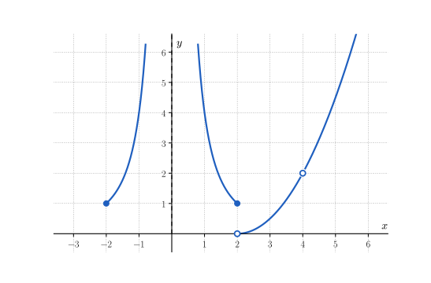
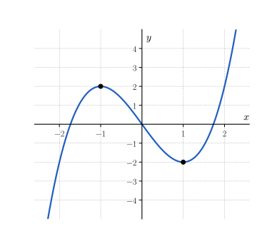
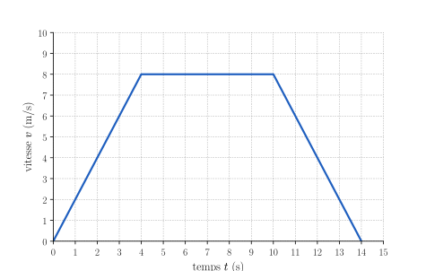

<!-- RENFORCEMENT : variations du socle (même compétence, entraînement en plus).
     Faisable SANS calculatrice ; valeurs différentes du socle.
     Numéro AUTOMATIQUE (catégorie Renforcement -> R.1, R.2…). Mêmes aides que le socle : Indice 1 (théorie), Indice 2 (question),
     Indice 3 (étape), chacun avec une ligne par sous-question, puis Solution (Réponse + détails) et Piège.
     Résultats vérifiés par script (hors dépôt). Figures : img/figs.py. -->

::: {.callout-note appearance="simple"}
Ces exercices restent **dans les objectifs** de la séance : à faire une fois le socle et le transfert
bouclés, à la maison : ils ne sont pas prévus pendant la séance.
:::

::: {.callout-caution .exo title="Exercice|Renforcement|1|O1"}
La concentration $C$ d'une substance dans un liquide, en mg/L, est mesurée toutes les deux heures.

| $t$ (h) | $0$ | $2$ | $4$ | $6$ |
|:---:|:---:|:---:|:---:|:---:|
| $C(t)$ (mg/L) | $16$ | $12$ | $9$ | $6{,}75$ |

(a) Sur $[0,\,2]$, puis sur $[4,\,6]$, calcule la variation absolue, la variation relative et le taux de variation moyen de $C$, avec leurs unités.
(b) Écris en une phrase ce que ces résultats signifient pour la concentration.
(c) Calcule la variation relative sur $[0,\,4]$. Est-elle égale à la somme des variations relatives sur $[0,\,2]$ et sur $[2,\,4]$ ?
:::

::: {.aides}
::: {.panel-tabset}

## Indice 1

Retourne à la théorie du cours : *Variation absolue*, *Variation relative* et *Taux de variation moyen* pour (a) et (c), et *Taux de variation moyen vs. variation relative* pour (b).

## Indice 2

*Question à te poser.*

(a) Par quelle valeur divise-t-on la variation absolue pour obtenir la variation relative ?
(b) Les variations relatives sont-elles égales, et les taux de variation moyens ?
(c) Par quel facteur la concentration est-elle multipliée sur $[0,\,2]$, puis sur $[0,\,4]$ ?

## Indice 3

*Étape.*

(a) Calcule $C(2) - C(0)$, puis divise ce nombre par $C(0)$, puis par $2$.
(b) Écris chaque variation relative en pourcentage.
(c) Calcule $\dfrac{C(4) - C(0)}{C(0)}$, puis compare-le à $-0{,}25 + (-0{,}25)$.

## Solution

::: {.reponse}
**Réponse (a).** Sur $[0,\,2]$ : $\Delta_{[0,2]}(C) = -4$ mg/L, $\Delta^{rel}_{[0,2]}(C) = -0{,}25$ et $T_{[0,2]}(C) = -2$ mg/L/h. Sur $[4,\,6]$ : $\Delta_{[4,6]}(C) = -2{,}25$ mg/L, $\Delta^{rel}_{[4,6]}(C) = -0{,}25$ et $T_{[4,6]}(C) = -1{,}125$ mg/L/h.
:::

::: {.details}
1. Sur $[0,\,2]$ : $\Delta_{[0,2]}(C) = 12 - 16 = -4$, $\Delta^{rel}_{[0,2]}(C) = \tfrac{-4}{16} = -0{,}25$ et $T_{[0,2]}(C) = \tfrac{-4}{2} = -2$.
2. Sur $[4,\,6]$ : $\Delta_{[4,6]}(C) = 6{,}75 - 9 = -2{,}25$, $\Delta^{rel}_{[4,6]}(C) = \tfrac{-2{,}25}{9} = -0{,}25$ et $T_{[4,6]}(C) = \tfrac{-2{,}25}{2} = -1{,}125$.
:::

::: {.reponse}
**Réponse (b).** Sur chaque intervalle de deux heures, la concentration diminue de $25\,\%$, mais elle diminue en moyenne de $2$ mg/L par heure au début et de seulement $1{,}125$ mg/L par heure entre $4$ h et $6$ h.
:::

::: {.details}
Les variations relatives sont égales : la concentration est multipliée par $1 - 0{,}25 = 0{,}75$ toutes les deux heures. Comme la concentration est plus faible au début de $[4,\,6]$, la même diminution de $25\,\%$ représente moins de mg/L par heure : la concentration diminue de moins en moins vite.
:::

::: {.reponse}
**Réponse (c).** La variation relative sur $[0,\,4]$ vaut $-\tfrac{7}{16} = -0{,}4375$, soit environ $-44\,\%$ : elle n'est pas égale à la somme $-0{,}25 + (-0{,}25) = -0{,}5$.
:::

::: {.details}
1. $\Delta^{rel}_{[0,4]}(C) = \dfrac{9 - 16}{16} = -\dfrac{7}{16} = -0{,}4375$.
2. Les variations relatives ne s'additionnent pas : ce sont les facteurs multiplicatifs qui se multiplient. On a $0{,}75 \cdot 0{,}75 = 0{,}5625 = 1 - 0{,}4375$.
:::

## Piège

En (c), une erreur fréquente consiste à additionner deux diminutions de $25\,\%$ pour obtenir une diminution de $50\,\%$. Elle est tentante parce que les pourcentages semblent s'ajouter, mais elle est fausse : la deuxième diminution de $25\,\%$ s'applique à une valeur déjà réduite ; les facteurs $0{,}75$ se multiplient.

:::
:::

::: {.callout-caution .exo title="Exercice|Renforcement|2|O7"}
Soit la fonction $f(x) = 10 - x^{2}$. On cherche la pente de la tangente au graphe de $f$ au point d'abscisse $1$.

(a) Calcule les taux de variation moyens $T_{[1,\,1+h]}(f)$ pour $h = 1$, $h = 0{,}5$ et $h = 0{,}1$.
(b) Montre que, pour tout réel $h \neq 0$, on a $T_{[1,\,1+h]}(f) = -2 - h$. Déduis-en $f'(1)$.
(c) Écris l'équation de la tangente au graphe de $f$ au point d'abscisse $1$.
:::

::: {.aides}
::: {.panel-tabset}

## Indice 1

Retourne à la théorie du cours : *Sécantes successives* pour (a), *Tangente en un point* et *Retour à la tangente comme limite des sécantes : dérivée* pour (b) et (c).

## Indice 2

*Question à te poser.*

(a) Quelles valeurs de $f$ faut-il calculer pour chaque valeur de $h$ ?
(b) Que vaut $(1 + h)^{2}$ ?
(c) Par quel point passe la tangente, et quelle est sa pente ?

## Indice 3

*Étape.*

(a) Calcule $f(1) = 9$, puis $f(2)$, $f(1{,}5)$ et $f(1{,}1)$, et divise chaque variation par $h$.
(b) Développe $f(1 + h) - f(1) = 10 - (1 + h)^{2} - 9$, divise par $h$, puis fais tendre $h$ vers $0$.
(c) Écris $y = f(1) + f'(1) \cdot (x - 1)$.

## Solution

::: {.reponse}
**Réponse (a).** $T_{[1,2]}(f) = -3$, $T_{[1;\,1{,}5]}(f) = -2{,}5$ et $T_{[1;\,1{,}1]}(f) = -2{,}1$.
:::

::: {.details}
1. $f(2) = 6$, donc $T_{[1,2]}(f) = \tfrac{6 - 9}{1} = -3$.
2. $f(1{,}5) = 10 - 2{,}25 = 7{,}75$, donc $T_{[1;\,1{,}5]}(f) = \tfrac{7{,}75 - 9}{0{,}5} = -2{,}5$.
3. $f(1{,}1) = 10 - 1{,}21 = 8{,}79$, donc $T_{[1;\,1{,}1]}(f) = \tfrac{8{,}79 - 9}{0{,}1} = -2{,}1$.

Les pentes des sécantes semblent tendre vers $-2$.
:::

::: {.reponse}
**Réponse (b).** $T_{[1,\,1+h]}(f) = -2 - h$, donc $f'(1) = -2$.
:::

::: {.details}
1. $f(1 + h) - f(1) = 10 - (1 + 2h + h^{2}) - 9 = -2h - h^{2} = h\,(-2 - h)$.
2. Pour $h \neq 0$, on divise par $h$ : $T_{[1,\,1+h]}(f) = -2 - h$. On retrouve $-3$, $-2{,}5$ et $-2{,}1$ pour les valeurs de (a).
3. $f'(1) = \lim\limits_{h \to 0} (-2 - h) = -2$.
:::

::: {.reponse}
**Réponse (c).** La tangente au point $(1\,;\,9)$ a pour équation $y = -2x + 11$.
:::

::: {.details}
$y = 9 + (-2)(x - 1) = -2x + 11$. Vérification : pour $x = 1$, on retrouve $y = 9 = f(1)$.
:::

## Piège

En (b), une erreur fréquente consiste à écrire $f(1 + h) = 10 - 1 + h^{2}$, en oubliant les parenthèses et le terme $2h$. Elle est tentante parce que l'on remplace $x$ par $1 + h$ trop vite, mais elle est fausse : $f(1 + h) = 10 - (1 + h)^{2} = 9 - 2h - h^{2}$.

:::
:::

::: {.callout-caution .exo title="Exercice|Renforcement|2|O3"}
La fonction $f$ est définie sur $[-2,\,+\infty[ \setminus \{0,\,4\}$. Le graphique ci-dessous la représente ; la droite pointillée verticale est l'axe des ordonnées. Vers la droite, la courbe monte sans limite.

{fig-alt="Graphique d'une fonction : une branche qui part du point plein (−2 ; 1) et monte vers +∞ près de x = 0 ; une branche qui descend de +∞ près de x = 0 jusqu'au point plein (2 ; 1) ; une branche qui part du point vide (2 ; 0), passe par un point vide en (4 ; 2) et monte vers +∞." width="11cm" fig-align="center"}

(a) Lis $\lim\limits_{x \to 0^-} f(x)$ et $\lim\limits_{x \to 0^+} f(x)$. La fonction $f$ admet-elle une limite en $0$ ?
(b) Lis $\lim\limits_{x \to 2^-} f(x)$, $\lim\limits_{x \to 2^+} f(x)$ et $f(2)$.
(c) Lis $\lim\limits_{x \to 4} f(x)$. Que vaut $f(4)$ ?
(d) Lis $\lim\limits_{x \to -2} f(x)$ et $\lim\limits_{x \to +\infty} f(x)$.
:::

::: {.aides}
::: {.panel-tabset}

## Indice 1

Retourne à la théorie du cours : *Limites à gauche et à droite* pour (a), (b) et (d), *Limite à l'approche d'un point* pour (c), et *Asymptotes* pour (a), ainsi que la méthode **Lire une limite sur un graphique**.

## Indice 2

*Question à te poser.*

(a) De chaque côté de $0$, la courbe monte-t-elle ou descend-elle le long de l'axe ?
(b) Quel point est plein, et quel point est vide ?
(c) Le nombre $4$ appartient-il au domaine de $f$ ?
(d) De quel côté peut-on approcher $-2$ en restant dans le domaine ?

## Indice 3

*Étape.*

(a) Suis chaque branche jusqu'à l'axe des ordonnées, puis compare les deux limites orientées.
(b) Lis l'ordonnée du point vide et celle du point plein en $x = 2$.
(c) Suis la courbe vers $x = 4$ des deux côtés, en cachant le point vide.
(d) Lis l'ordonnée du point plein en $x = -2$, puis suis la dernière branche vers la droite.

## Solution

::: {.reponse}
**Réponse (a).** $\lim\limits_{x \to 0^-} f(x) = +\infty$ et $\lim\limits_{x \to 0^+} f(x) = +\infty$, donc $\lim\limits_{x \to 0} f(x) = +\infty$ ; la droite $x = 0$ est une asymptote verticale.
:::

::: {.details}
Des deux côtés de $0$, la courbe monte le long de l'axe des ordonnées : $f(x)$ devient aussi grand qu'on veut. Les deux limites orientées sont égales, donc la limite existe et vaut $+\infty$ ; c'est une limite infinie en un point fini, donc une asymptote verticale.
:::

::: {.reponse}
**Réponse (b).** $\lim\limits_{x \to 2^-} f(x) = 1$, $\lim\limits_{x \to 2^+} f(x) = 0$ et $f(2) = 1$.
:::

::: {.details}
En arrivant par la gauche, la courbe arrive au point plein $(2\,;\,1)$ ; en arrivant par la droite, elle arrive au point vide $(2\,;\,0)$. Les deux limites orientées sont différentes : $f$ n'admet pas de limite en $2$. Comme $f(2) = 1$ est égal à la limite à gauche, $f$ est continue à gauche en $2$.
:::

::: {.reponse}
**Réponse (c).** $\lim\limits_{x \to 4} f(x) = 2$, alors que $f(4)$ n'existe pas : $4$ n'appartient pas au domaine de $f$.
:::

::: {.details}
Des deux côtés de $4$, la courbe se rapproche du point vide $(4\,;\,2)$. La définition de la limite ne teste pas $x = 4$ : la limite existe même si $f$ n'est pas définie en $4$, car $4$ est arbitrairement approchable dans le domaine.
:::

::: {.reponse}
**Réponse (d).** $\lim\limits_{x \to -2} f(x) = 1$ et $\lim\limits_{x \to +\infty} f(x) = +\infty$.
:::

::: {.details}
On ne peut approcher $-2$ que par la droite : on se contente de la limite orientée disponible, qui vaut $1$, la hauteur du point plein $(-2\,;\,1)$. Vers la droite, la courbe monte sans limite : $f(x)$ devient aussi grand qu'on veut.
:::

## Piège

En (c), une erreur fréquente consiste à dire que la limite n'existe pas parce que $f(4)$ n'existe pas. Elle est tentante parce que le point est vide, mais elle est fausse : la limite ne dépend que des valeurs de $f(x)$ pour $x$ proche de $4$, avec $x \neq 4$.

En (a), une autre erreur consiste à confondre « la limite vaut $+\infty$ » et « la limite n'existe pas ». Elle est tentante parce que $+\infty$ n'est pas un nombre réel, mais elle est fausse : ici, les deux limites orientées valent $+\infty$, et l'on écrit $\lim\limits_{x \to 0} f(x) = +\infty$.

:::
:::

::: {.callout-caution .exo title="Exercice|Renforcement|1|O4"}
On sait que $\lim\limits_{x \to 2} f(x) = 3$ et $\lim\limits_{x \to 2} g(x) = -1$, et que la fonction $k$ est continue en $3$, avec $k(3) = 5$. Calcule, si c'est possible avec les propriétés algébriques des limites :

(a) $\lim\limits_{x \to 2} \big(f(x) + g(x)\big)$
(b) $\lim\limits_{x \to 2} \big(f(x) \cdot g(x)\big)$
(c) $\lim\limits_{x \to 2} \dfrac{f(x)}{g(x)}$
(d) $\lim\limits_{x \to 2} \big(2f(x) - 4g(x)\big)$
(e) $\lim\limits_{x \to 2} k\big(f(x)\big)$
(f) $\lim\limits_{x \to 2} \dfrac{g(x)}{f(x) - 3}$
:::

::: {.aides}
::: {.panel-tabset}

## Indice 1

Retourne à la théorie du cours : *Limites : quelques règles de calcul* pour (a) à (f).

## Indice 2

*Question à te poser.*

Pour (a) à (d) : les limites de $f$ et de $g$ en $2$ existent-elles et sont-elles finies ?

Pour (e) : vers quel nombre tend $f(x)$, et $k$ est-elle continue en ce nombre ?

Pour (f) : vers quel nombre tend le dénominateur ?

## Indice 3

*Étape.*

Pour (a) à (d) : remplace chaque limite par sa valeur dans la règle qui convient.

Pour (e) : calcule $k(3)$.

Pour (f) : calcule la limite de $f(x) - 3$.

## Solution

::: {.reponse}
**Réponse.** (a) $2$ ; (b) $-3$ ; (c) $-3$ ; (d) $10$ ; (e) $5$ ; (f) la règle du quotient ne s'applique pas.
:::

::: {.details}
1. Somme : $3 + (-1) = 2$.
2. Produit : $3 \cdot (-1) = -3$.
3. Quotient, avec une limite non nulle au dénominateur : $\tfrac{3}{-1} = -3$.
4. Produit par une constante et somme : $2 \cdot 3 - 4 \cdot (-1) = 6 + 4 = 10$.
5. Composée : $f(x)$ tend vers $3$ et $k$ est continue en $3$, donc $k\big(f(x)\big)$ tend vers $k(3) = 5$.
6. Le dénominateur $f(x) - 3$ tend vers $3 - 3 = 0$ : la règle du quotient ne s'applique pas, et les données ne permettent pas de conclure.
:::

## Piège

En (d), une erreur fréquente consiste à écrire $2 \cdot 3 - 4 \cdot 1 = 2$, en oubliant le signe de la limite de $g$. Elle est tentante parce que l'on recopie le nombre $1$, mais elle est fausse : $-4 \cdot (-1) = +4$.

En (f), une autre erreur consiste à répondre $\tfrac{-1}{0} = 0$. Elle est tentante parce que l'on applique la règle mécaniquement, mais elle est fausse : on ne divise jamais par une limite nulle.

:::
:::

::: {.callout-caution .exo title="Exercice|Renforcement|2|O6"}
Soient les fonctions $u$ et $w$ définies par
$$u(x) = \begin{cases} 2x + 1 & \text{si } x < 1, \\ x^{2} + 2 & \text{si } x \geq 1, \end{cases} \qquad w(x) = \begin{cases} x & \text{si } x < 2, \\ x + 1 & \text{si } x \geq 2. \end{cases}$$

(a) Calcule les limites à gauche et à droite de $u$ en $1$, ainsi que $u(1)$. La fonction $u$ est-elle continue en $1$ ?
(b) Mêmes questions pour $w$ en $2$. La fonction $w$ est-elle continue à gauche, à droite en $2$ ?
(c) Que peut-on dire de la dérivabilité de $w$ en $2$ ?
:::

::: {.aides}
::: {.panel-tabset}

## Indice 1

Retourne à la théorie du cours : *Limites à gauche et à droite* et *Continuité* pour (a) et (b), et *Dérivées : observations* pour (c).

## Indice 2

*Question à te poser.*

(a) Quelle expression de $u$ faut-il utiliser à gauche de $1$, à droite de $1$, et en $1$ ?
(b) La limite à gauche et la limite à droite de $w$ en $2$ sont-elles égales à $w(2)$ ?
(c) Une fonction dérivable en un point y est-elle continue ?

## Indice 3

*Étape.*

(a) Remplace $x$ par $1$ dans $2x + 1$, puis dans $x^{2} + 2$.
(b) Remplace $x$ par $2$ dans $x$, puis dans $x + 1$.
(c) Utilise le résultat de (b).

## Solution

::: {.reponse}
**Réponse (a).** $\lim\limits_{x \to 1^-} u(x) = 3$, $\lim\limits_{x \to 1^+} u(x) = 3$ et $u(1) = 3$ : $u$ est continue en $1$.
:::

::: {.details}
À gauche de $1$, $u(x) = 2x + 1$ tend vers $3$ ; à droite, $u(x) = x^{2} + 2$ tend vers $3$ ; et $u(1) = 1 + 2 = 3$. Les deux limites orientées sont égales à $u(1)$.
:::

::: {.reponse}
**Réponse (b).** $\lim\limits_{x \to 2^-} w(x) = 2$, $\lim\limits_{x \to 2^+} w(x) = 3$ et $w(2) = 3$ : $w$ n'est pas continue en $2$ ; elle est continue à droite, mais pas à gauche.
:::

::: {.details}
Les deux limites orientées sont différentes, donc $w$ n'a pas de limite en $2$ et n'y est pas continue : le graphe fait un saut de $2$ à $3$. Comme $w(2) = 3$ est égal à la limite à droite, $w$ est continue à droite en $2$.
:::

::: {.reponse}
**Réponse (c).** $w$ n'est pas dérivable en $2$, puisqu'elle n'y est pas continue.
:::

::: {.details}
Si $w$ était dérivable en $2$, elle y serait continue. Comme elle n'y est pas continue, elle n'y est pas dérivable.
:::

## Piège

En (b), une erreur fréquente consiste à dire que $w$ est continue en $2$ parce que $w(2)$ existe et vaut $3$. Elle est tentante parce que la fonction est bien définie en $2$, mais elle est fausse : la continuité exige que la limite en $2$ existe et soit égale à $w(2)$ ; or les limites à gauche et à droite sont différentes.

:::
:::

::: {.callout-caution .exo title="Exercice|Renforcement|2|O8"}
Le graphique représente la fonction $f(x) = x^{3} - 3x$. Les points marqués sont $(-1\,;\,2)$ et $(1\,;\,-2)$.

{fig-alt="Graphique d'une courbe qui monte jusqu'au point (−1 ; 2), descend jusqu'au point (1 ; −2), puis remonte ; elle passe par l'origine." width="8cm" fig-align="center"}

Quatre étudiants proposent une expression de $f'(x)$ :

1. $f'(x) = 3x^{2} - 3$
2. $f'(x) = 3x^{2}$
3. $f'(x) = 3 - 3x^{2}$
4. $f'(x) = 3x^{2} - 6$

(a) D'après le graphique, que doivent valoir $f'(-1)$ et $f'(1)$ ? Quel doit être le signe de $f'(0)$ ?
(b) Pour chaque proposition, calcule $f'(1)$ et $f'(0)$, puis écris si elle est plausible.
:::

::: {.aides}
::: {.panel-tabset}

## Indice 1

Retourne à la théorie du cours : *Comprendre la fonction dérivée* et *Questions d'évaluation illustratives* pour (a) et (b), et la méthode **Vérifier la plausibilité d'une dérivée**.

## Indice 2

*Question à te poser.*

(a) Comment est la tangente aux points marqués, et la fonction est-elle croissante ou décroissante en $0$ ?
(b) Chaque proposition donne-t-elle une dérivée nulle en $1$ et négative en $0$ ?

## Indice 3

*Étape.*

(a) Repère les tangentes horizontales, puis regarde si $f$ est croissante ou décroissante entre $-1$ et $1$.
(b) Remplace $x$ par $1$, puis par $0$, dans chaque proposition.

## Solution

::: {.reponse}
**Réponse (a).** Les tangentes en $(-1\,;\,2)$ et en $(1\,;\,-2)$ sont horizontales, donc $f'(-1) = f'(1) = 0$ ; $f$ est décroissante en $0$, donc $f'(0) < 0$.
:::

::: {.details}
En $x = -1$, la fonction passe de croissante à décroissante, et en $x = 1$, de décroissante à croissante : la courbe y a une tangente horizontale, de pente nulle. Entre $-1$ et $1$, la fonction décroît : la pente de la tangente en $0$ est négative.
:::

::: {.reponse}
**Réponse (b).** Seule la proposition 1 est plausible : elle donne $f'(1) = 0$ et $f'(0) = -3$. La proposition 2 donne $f'(1) = 3$, la proposition 3 donne $f'(0) = 3 > 0$, et la proposition 4 donne $f'(1) = -3$.
:::

::: {.details}
1. Proposition 1 : $f'(1) = 3 - 3 = 0$ et $f'(0) = -3 < 0$, ainsi que $f'(-1) = 0$ : plausible.
2. Proposition 2 : $f'(1) = 3 \neq 0$ : la tangente en $(1\,;\,-2)$ ne serait pas horizontale.
3. Proposition 3 : $f'(1) = 0$, mais $f'(0) = 3 > 0$ : $f$ serait croissante en $0$.
4. Proposition 4 : $f'(1) = -3 \neq 0$.

Ces contrôles n'établissent pas que la proposition 1 est correcte, mais ils éliminent les trois autres ; la séance 8 donnera les règles pour le confirmer.
:::

## Piège

Une erreur fréquente consiste à ne vérifier qu'un seul critère, par exemple $f'(1) = 0$, ce qui laisse passer la proposition 3. Elle est tentante parce que la première vérification réussit, mais elle est insuffisante : une dérivée plausible doit être compatible avec toutes les tangentes et avec la croissance ou la décroissance de $f$ sur chaque intervalle.

:::
:::

::: {.callout-caution .exo title="Exercice|Renforcement|2|O9"}
Un mobile se déplace sur un axe. Le graphique donne sa vitesse $v(t) = p'(t)$, en m/s, en fonction du temps $t$, en secondes, où $p(t)$ est sa position.

{fig-alt="Graphique de la vitesse : un segment de (0 ; 0) à (4 ; 8), un segment horizontal de (4 ; 8) à (10 ; 8), puis un segment de (10 ; 8) à (14 ; 0)." width="10cm" fig-align="center"}

(a) Calcule l'accélération $p''(t)$ sur chacune des trois phases $]0,\,4[$, $]4,\,10[$ et $]10,\,14[$.
(b) Décris en une phrase le mouvement pendant chaque phase.
(c) Quel est le signe de $p'(t)$ sur $]0,\,14[$ ? Que peut-on en déduire sur la position du mobile ?
:::

::: {.aides}
::: {.panel-tabset}

## Indice 1

Retourne à la théorie du cours : *Application : accélération d'un mobile* et *Dérivées itérées* pour (a) à (c).

## Indice 2

*Question à te poser.*

(a) L'accélération est la dérivée de quelle fonction, et que représente-t-elle sur le graphique de $v$ ?
(b) Sur chaque phase, la vitesse augmente-t-elle, reste-t-elle constante ou diminue-t-elle ?
(c) La vitesse est-elle positive ou négative ?

## Indice 3

*Étape.*

(a) Calcule la pente de chacun des trois segments.
(b) Interprète le signe de chaque pente.
(c) Lis le signe de $v(t)$ sur le graphique.

## Solution

::: {.reponse}
**Réponse (a).** $p''(t) = 2$ m/s² sur $]0,\,4[$, $p''(t) = 0$ m/s² sur $]4,\,10[$ et $p''(t) = -2$ m/s² sur $]10,\,14[$.
:::

::: {.details}
L'accélération est la dérivée de la vitesse : $p'' = (p')' = v'$. Sur chaque phase, le graphe de $v$ est un segment, dont la pente est la dérivée : $\tfrac{8 - 0}{4} = 2$, $\tfrac{8 - 8}{6} = 0$ et $\tfrac{0 - 8}{4} = -2$, en m/s par seconde, c'est-à-dire en m/s².
:::

::: {.reponse}
**Réponse (b).** De $0$ à $4$ s, le mobile accélère ; de $4$ à $10$ s, il avance à vitesse constante, $8$ m/s ; de $10$ à $14$ s, il freine jusqu'à l'arrêt.
:::

::: {.details}
Une accélération positive fait augmenter la vitesse, une accélération nulle la laisse constante, et une accélération négative la fait diminuer, ici jusqu'à $0$.
:::

::: {.reponse}
**Réponse (c).** $p'(t) > 0$ sur $]0,\,14[$ : la position augmente pendant tout le mouvement ; le mobile avance toujours dans le même sens, même lorsqu'il freine.
:::

::: {.details}
La vitesse $p'(t)$ est positive sur tout l'intervalle, donc la fonction $p$ est croissante. Pendant le freinage, $p''(t) < 0$ mais $p'(t) > 0$ : la vitesse diminue sans changer de signe.
:::

## Piège

En (c), une erreur fréquente consiste à dire que le mobile recule pendant le freinage, parce que $p''(t) < 0$. Elle est tentante parce que l'on associe un signe moins à un retour en arrière, mais elle est fausse : le sens du déplacement est donné par le signe de $p'$, et non par celui de $p''$.

:::
:::

::: {.callout-caution .exo title="Exercice|Renforcement|1|O7"}
Reprends les tailles médianes des garçons de l'exercice T.1 : $H(13) = 156{,}0$ cm, $H(16) = 172{,}9$ cm et $H(18) = 176{,}1$ cm, avec $H'(13) \approx 7$ cm/an.

(a) Estime $H'(17)$ par le taux de variation moyen sur $[16,\,18]$, avec son unité.
(b) Compare cette valeur à $H'(13)$, puis écris en une phrase ce que cette comparaison signifie.
:::

::: {.aides}
::: {.panel-tabset}

## Indice 1

Retourne à la théorie du cours : *Taux de variation moyen* pour (a), et *Dérivée : trois interprétations* pour (b), ainsi que la méthode **Interpréter une dérivée dans un contexte**.

## Indice 2

*Question à te poser.*

(a) Quel intervalle, centré en $17$, permet d'estimer la pente de la tangente en $17$ ?
(b) La croissance est-elle plus rapide à $13$ ans ou à $17$ ans ?

## Indice 3

*Étape.*

(a) Calcule $\dfrac{H(18) - H(16)}{18 - 16}$.
(b) Divise $H'(13)$ par la valeur trouvée en (a).

## Solution

::: {.reponse}
**Réponse (a).** $H'(17) \approx 1{,}6$ cm/an.
:::

::: {.details}
Le taux de variation moyen sur l'intervalle $[16,\,18]$, centré en $17$, estime la pente de la tangente en $17$ : $\dfrac{176{,}1 - 172{,}9}{2} = \dfrac{3{,}2}{2} = 1{,}6$ cm/an.
:::

::: {.reponse}
**Réponse (b).** $H'(17)$ est environ quatre fois plus petit que $H'(13)$ : à $17$ ans, la taille augmente encore, mais lentement ; la croissance est presque terminée.
:::

::: {.details}
On a $\tfrac{7}{1{,}6} \approx 4{,}4$. La dérivée reste positive, car la taille augmente, mais elle se rapproche de $0$.
:::

## Piège

Une erreur fréquente consiste à conclure que la dérivée devient négative parce que la croissance ralentit. Elle est tentante parce que l'on pense « ralentir, donc diminuer », mais elle est fausse : c'est la vitesse de croissance qui diminue ; la taille, elle, augmente toujours, donc $H'(17) > 0$.

:::
:::
