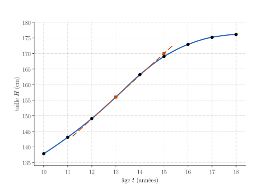
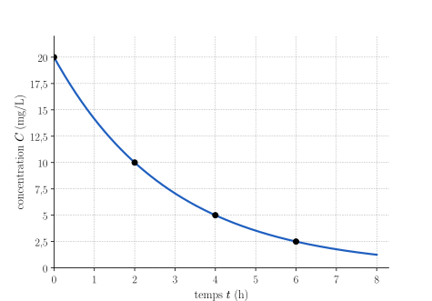
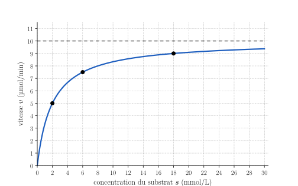

<!-- TRANSFERT : appliquer les savoir-faire du socle à un contexte nouveau (sciences de la vie, données réelles sourcées). 35 minutes, puis 15 minutes de correction de T.1 et de méthode 2.
     Durées visées (réalistes, sans calculatrice) : T.1 7 min (corrigé en commun) · T.2 8 min · T.3 7 min · T.4 8 min = 30 min.
     Allègement du 4/11 : T.1 (d), la proposition 4 et la partie (d) de T.2, T.3 (c) retirés ; h'(t) donné en T.4.
     T.1 = l'exercice corrigé ensemble juste après le transfert (méthode 2 « Interpréter une dérivée dans un contexte », sur la taille des garçons, OMS) :
     en tête, pour que tous l'atteignent ; indices et réponses finales (sans « Je veux plus de détails ») ; les détails sont donnés lors de la correction.
     Numéro AUTOMATIQUE. Faisable SANS calculatrice. Sources : notes de bas de page. Aucune règle de dérivation (séance 8). -->

::: {.callout-caution .exo title="Exercice|Transfert|2|O7"}
L'Organisation mondiale de la santé (OMS) publie des courbes de référence de la taille des enfants et des adolescents. Le tableau donne la taille médiane $H(t)$ des garçons, en cm, à l'âge $t$, en années.[^oms-taille]

| $t$ (années) | $10$ | $11$ | $12$ | $13$ | $14$ | $15$ | $16$ | $17$ | $18$ |
|:---:|:---:|:---:|:---:|:---:|:---:|:---:|:---:|:---:|:---:|
| $H(t)$ (cm) | $137{,}8$ | $143{,}1$ | $149{,}1$ | $156{,}0$ | $163{,}2$ | $169{,}0$ | $172{,}9$ | $175{,}2$ | $176{,}1$ |

Le graphique représente la fonction $H$. La droite pointillée est la tangente à la courbe au point d'abscisse $13$ ; elle passe par les deux points carrés $(13\,;\,156)$ et $(15\,;\,170)$.

{fig-alt="Courbe croissante de la taille médiane des garçons de 10 à 18 ans, qui monte de plus en plus vite jusque vers 13-14 ans puis s'aplatit vers 176 cm ; une tangente pointillée au point (13 ; 156) passe aussi par (15 ; 170)." width="12cm" fig-align="center"}

(a) Calcule le taux de variation moyen $T_{[12,14]}(H)$, avec son unité, et écris en une phrase ce qu'il signifie.
(b) Lis $H'(13)$ sur le graphique, avec son unité, et écris en une phrase ce qu'il signifie.
(c) À l'aide de l'approximation linéaire au point d'abscisse $13$, estime la taille médiane des garçons de $13$ ans et $3$ mois.

[^oms-taille]: Organisation mondiale de la santé, « Height-for-age BOYS 5 to 19 years (percentiles) », *WHO Growth reference data for 5–19 years*, 2007 : colonne de la médiane (P50), aux âges exacts de 10 à 18 ans ; la même table donne $157{,}9$ cm à 13 ans et 3 mois. https://www.who.int/tools/growth-reference-data-for-5to19-years/indicators/height-for-age (consulté le 4 novembre 2026). La courbe tracée relie ces valeurs.

:::

::: {.callout-note appearance="simple"}
L'exercice **T.1** est corrigé ensemble en séance, juste après le temps consacré au transfert. Cherche-le seul·e et repère l'endroit exact où tu bloques. Les coups de pouce ci-dessous donnent les indices et les réponses finales ; les détails seront donnés lors de la correction.
:::

::: {.aides}
::: {.panel-tabset}

## Indice 1

Retourne à la théorie du cours : *Taux de variation moyen* pour (a), *Dérivée : trois interprétations* pour (b) et (c), ainsi que la méthode **Interpréter une dérivée dans un contexte**.

## Indice 2

*Question à te poser.*

(a) Quelles sont les unités de la variation de $H$ et de la durée ?
(b) Quel nombre représente la pente d'une droite, et que mesure la pente de la tangente ?
(c) Combien vaut l'écart $h$, en années, entre $13$ ans et $13$ ans et $3$ mois ?

## Indice 3

*Étape.*

(a) Calcule $\dfrac{H(14) - H(12)}{14 - 12}$.
(b) Calcule la pente de la droite qui passe par $(13\,;\,156)$ et $(15\,;\,170)$.
(c) Prends $h = 0{,}25$ dans $H(13 + h) \approx H(13) + H'(13) \cdot h$.

## Solution

::: {.reponse}
**Réponse (a).** $T_{[12,14]}(H) = 7{,}05$ cm/an : entre $12$ et $14$ ans, la taille médiane augmente en moyenne d'environ $7$ cm par an.
:::

::: {.reponse}
**Réponse (b).** $H'(13) \approx 7$ cm/an : à $13$ ans, la taille médiane augmente à la vitesse d'environ $7$ cm par an.
:::

::: {.reponse}
**Réponse (c).** La taille médiane à $13$ ans et $3$ mois vaut environ $156 + 7 \cdot 0{,}25 \approx 157{,}8$ cm (l'OMS donne $157{,}9$ cm).
:::

## Piège

En (b), une erreur fréquente consiste à répondre $H'(13) = 156$. Elle est tentante parce que $156$ est la valeur lue au point d'abscisse $13$, mais elle est fausse : $156$ cm est la taille $H(13)$, alors que $H'(13)$ est la pente de la tangente, une vitesse en cm/an.

En (c), une autre erreur consiste à prendre $h = 3$, parce que l'on parle de $3$ mois. Elle est tentante parce que le nombre $3$ figure dans l'énoncé, mais elle est fausse : $t$ est en années, donc $h = \tfrac{3}{12} = 0{,}25$.

En (a) et en (b), une autre erreur consiste à oublier l'unité, ou à écrire « cm ». Elle est tentante parce que la taille est en cm, mais elle est fausse : un taux de variation s'exprime en unité de la grandeur par unité de la variable, ici en cm par an.

:::
:::

::: {.callout-caution .exo title="Exercice|Transfert|2|O8"}
À la séance 6 (exercice T.2), on a modélisé la concentration de paracétamol dans le sang d'un patient par
$$C(t) = 20 \cdot \left(\tfrac{1}{2}\right)^{t/2},$$
où $C$ est en mg/L et $t$ est le temps écoulé depuis la prise, en heures.[^para-t2] Les règles de calcul des dérivées seront vues à la séance 8. Trois étudiants proposent une expression de $C'(t)$ ; une seule est correcte.

1. $C'(t) = 10\ln(2) \cdot \left(\tfrac{1}{2}\right)^{t/2}$
2. $C'(t) = -10\ln(2) \cdot \left(\tfrac{1}{2}\right)^{t/2}$
3. $C'(t) = -20\ln(2) \cdot \left(\tfrac{1}{2}\right)^{t/2}$

{fig-alt="Courbe décroissante de la concentration C, de 20 mg/L à t = 0 vers 0, qui décroît de moins en moins vite ; points marqués (0 ; 20), (2 ; 10), (4 ; 5) et (6 ; 2,5)." width="10cm" fig-align="center"}

On donne $\ln(2) \approx 0{,}69$.

(a) Sans calcul, écris le signe de $C'(t)$. Quelle proposition peux-tu éliminer ?
(b) Calcule $T_{[0,2]}(C)$ et $T_{[2,4]}(C)$, avec leur unité. En observant la forme de la courbe, explique pourquoi $C'(2)$ est compris entre ces deux nombres.
(c) Calcule $C'(2)$ selon les propositions 2 et 3. Laquelle est plausible ? Écris en une phrase ce que signifie la valeur retenue.

[^para-t2]: Biomnis, « Paracétamol », in *Précis de biopathologie : analyses médicales spécialisées*, 2013 : « La demi-vie est de l'ordre de 2 heures. » https://www.eurofins-biomnis.com/referentiel/liendoc/precis/PARACETAMOL.pdf (consulté le 15 octobre 2026). Les mesures du patient de la séance 6 sont des valeurs choisies, compatibles avec cette demi-vie.

:::

::: {.aides}
::: {.panel-tabset}

## Indice 1

Retourne à la théorie du cours : *Questions d'évaluation illustratives* et *Comprendre la fonction dérivée* pour (a), *Taux de variation moyen* et *Tangente en un point* pour (b), *Dérivée : trois interprétations* pour (c), et la méthode **Vérifier la plausibilité d'une dérivée** pour (a) à (c).

## Indice 2

*Question à te poser.*

(a) La concentration augmente-t-elle ou diminue-t-elle ?
(b) La courbe descend-elle plus vite au début ou à la fin, et que devient la pente de la tangente quand $t$ augmente ?
(c) Que vaut $\left(\tfrac{1}{2}\right)^{2/2}$ ?

## Indice 3

*Étape.*

(a) Repère le signe de chaque proposition : le facteur $\left(\tfrac{1}{2}\right)^{t/2}$ est strictement positif.
(b) Calcule $\dfrac{C(2) - C(0)}{2 - 0}$ et $\dfrac{C(4) - C(2)}{4 - 2}$ ; trace les deux sécantes et la tangente au point $(2\,;\,10)$.
(c) Remplace $t$ par $2$, puis $\ln(2)$ par $0{,}69$, et compare au résultat de (b).

## Solution

::: {.reponse}
**Réponse (a).** La concentration diminue, donc $C'(t) < 0$ : la proposition 1, toujours positive, est éliminée.
:::

::: {.details}
La fonction $C$ est décroissante : la pente de chaque tangente est négative, donc $C'(t) < 0$ pour tout $t \geq 0$. Comme $\ln(2) > 0$ et $\left(\tfrac{1}{2}\right)^{t/2} > 0$, la proposition 1 donne un nombre strictement positif : elle n'est pas plausible.
:::

::: {.reponse}
**Réponse (b).** $T_{[0,2]}(C) = -5$ mg/L/h et $T_{[2,4]}(C) = -2{,}5$ mg/L/h. La courbe décroît de moins en moins vite, donc la tangente au point $(2\,;\,10)$ est moins raide que la sécante sur $[0,\,2]$ et plus raide que la sécante sur $[2,\,4]$ : $-5 < C'(2) < -2{,}5$.
:::

::: {.details}
1. $T_{[0,2]}(C) = \dfrac{10 - 20}{2} = -5$ et $T_{[2,4]}(C) = \dfrac{5 - 10}{2} = -2{,}5$, en mg/L par heure.
2. Sur le graphique, la courbe descend de moins en moins vite : la pente de la tangente est négative et se rapproche de $0$ quand $t$ augmente.
3. Avant $t = 2$, les tangentes sont plus raides qu'en $t = 2$ ; la sécante sur $[0,\,2]$, qui résume ces pentes, est donc plus raide que la tangente en $t = 2$. Après $t = 2$, c'est l'inverse.
4. Donc $C'(2)$ est compris entre $-5$ et $-2{,}5$.
:::

::: {.reponse}
**Réponse (c).** La proposition 2 donne $C'(2) = -5\ln(2) \approx -3{,}45$, qui est compris entre $-5$ et $-2{,}5$ : elle est plausible. La proposition 3 donne $C'(2) = -10\ln(2) \approx -6{,}9$, hors de cet intervalle : elle ne l'est pas. La dérivée correcte est donc la proposition 2. Deux heures après la prise, la concentration diminue à une vitesse d'environ $3{,}5$ mg/L par heure.
:::

::: {.details}
1. Pour $t = 2$, on a $\left(\tfrac{1}{2}\right)^{2/2} = \tfrac{1}{2}$.
2. Proposition 2 : $C'(2) = -10\ln(2) \cdot \tfrac{1}{2} = -5\ln(2) \approx -5 \cdot 0{,}69 = -3{,}45$.
3. Proposition 3 : $C'(2) = -20\ln(2) \cdot \tfrac{1}{2} = -10\ln(2) \approx -6{,}9$ : la tangente serait plus raide que la sécante sur $[0,\,2]$, ce qui contredit (b).
4. L'unité de $C'(2)$ est celle d'un taux de variation de la concentration par rapport au temps : des mg/L par heure.
:::

## Piège

En (c), une erreur fréquente consiste à garder la proposition 3 parce que sa valeur est négative. 

En (b), une autre erreur consiste à croire que la dérivée devient positive parce que la diminution ralentit. 

:::
:::

::: {.callout-caution .exo title="Exercice|Transfert|2|O5"}
La vitesse $v$ d'une réaction catalysée par une enzyme dépend de la concentration $s$ du substrat. Selon le modèle de Michaelis et Menten,[^mm-t3]
$$v(s) = \dfrac{V_{max}\, s}{K_M + s},$$
où $V_{max}$ et $K_M$ sont des constantes strictement positives propres à l'enzyme. Pour l'enzyme étudiée, on prend $V_{max} = 10$ µmol/min et $K_M = 2$ mmol/L.

{fig-alt="Courbe croissante de la vitesse v en fonction de s, qui part de l'origine, passe par (2 ; 5), (6 ; 7,5) et (18 ; 9), et se rapproche de la droite pointillée horizontale v = 10 sans l'atteindre." width="11cm" fig-align="center"}

(a) Calcule $v(2)$, $v(6)$ et $v(18)$.
(b) D'après le graphique, que vaut $\lim\limits_{s \to +\infty} v(s)$ ? Écris l'équation de l'asymptote correspondante et interprète-la pour la réaction.
(c) Si on considère la fonction $s \mapsto \dfrac{10\,s}{2 + s}$ sur $\mathbb{R} \setminus \{-2\}$, elle admet une asymptote verticale. Écris son équation, puis détermine $\lim\limits_{s \to -2^-} \dfrac{10\,s}{2 + s}$ et $\lim\limits_{s \to -2^+} \dfrac{10\,s}{2 + s}$ en étudiant le signe du numérateur et du dénominateur. Cette asymptote a-t-elle un sens pour la réaction ?

[^mm-t3]: L. Michaelis et M. L. Menten, « Die Kinetik der Invertinwirkung », *Biochemische Zeitschrift*, 49, 1913, p. 333–369 ; traduction anglaise : K. A. Johnson et R. S. Goody, « The Original Michaelis Constant: Translation of the 1913 Michaelis–Menten Paper », *Biochemistry*, 50(39), 2011, p. 8264–8269. https://pmc.ncbi.nlm.nih.gov/articles/PMC3381512/ (consulté le 4 novembre 2026).

:::

::: {.aides}
::: {.panel-tabset}

## Indice 1

Retourne à la théorie du cours : *Asymptotes* pour (b) et (c), et *Limites à gauche et à droite* pour (c).

## Indice 2

*Question à te poser.*

(a) Par quel nombre faut-il remplacer $s$ dans l'expression de $v$ ?
(b) De quelle hauteur la courbe se rapproche-t-elle quand $s$ devient très grand ?
(c) Quand $s$ est proche de $-2$, de quel nombre le numérateur est-il proche, et quel est le signe du dénominateur de chaque côté de $-2$ ?

## Indice 3

*Étape.*

(a) Calcule $\dfrac{10 \cdot 2}{2 + 2}$, puis fais de même pour $6$ et $18$.
(b) Lis la droite pointillée horizontale du graphique.
(c) Pour $s$ un peu plus petit que $-2$, par exemple $s = -2{,}01$, calcule le signe de $2 + s$ ; fais de même pour $s = -1{,}99$.

## Solution

::: {.reponse}
**Réponse (a).** $v(2) = 5$ µmol/min, $v(6) = 7{,}5$ µmol/min et $v(18) = 9$ µmol/min.
:::

::: {.details}
$v(2) = \dfrac{20}{4} = 5$, $v(6) = \dfrac{60}{8} = 7{,}5$ et $v(18) = \dfrac{180}{20} = 9$, en µmol/min.
:::

::: {.reponse}
**Réponse (b).** $\lim\limits_{s \to +\infty} v(s) = 10$ : la droite d'équation $v = 10$ est une asymptote horizontale. Même avec beaucoup de substrat, la vitesse de la réaction se rapproche de $V_{max} = 10$ µmol/min sans la dépasser.
:::

::: {.details}
Quand $s$ devient très grand, la courbe se rapproche de la droite pointillée $v = 10$ : c'est une limite finie à un horizon infini, donc une asymptote horizontale. Les valeurs de (a) le confirment : $5$, puis $7{,}5$, puis $9$. 
:::

::: {.reponse}
**Réponse (c).** L'asymptote verticale a pour équation $s = -2$ ; on a $\lim\limits_{s \to -2^-} \dfrac{10\,s}{2 + s} = +\infty$ et $\lim\limits_{s \to -2^+} \dfrac{10\,s}{2 + s} = -\infty$. Elle n'a pas de sens pour la réaction, car une concentration est positive : le modèle n'est utilisé que pour $s \geq 0$.
:::

::: {.details}
1. Le dénominateur s'annule en $s = -2$, alors que le numérateur y vaut $-20 \neq 0$ : quand $s$ se rapproche de $-2$, on divise un nombre proche de $-20$ par un nombre aussi proche de $0$ qu'on veut, donc la fraction devient aussi grande qu'on veut en valeur absolue.
2. Pour $s < -2$, le dénominateur $2 + s$ est négatif : la fraction est le quotient de deux nombres négatifs, donc positive, et $\lim\limits_{s \to -2^-} \dfrac{10\,s}{2 + s} = +\infty$.
3. Pour $s$ compris entre $-2$ et $0$, le dénominateur est positif et le numérateur négatif : la fraction est négative, et $\lim\limits_{s \to -2^+} \dfrac{10\,s}{2 + s} = -\infty$.
4. Pour la réaction, $s$ est une concentration, donc $s \geq 0$ : la partie du graphe près de $s = -2$ ne correspond à aucune situation réelle.
:::

## Piège

En (b), une erreur fréquente consiste à dire que la limite n'existe pas parce que la courbe n'atteint jamais $10$. Elle est tentante parce que la vitesse ne vaut jamais exactement $V_{max}$, mais elle est fausse : une limite n'a pas besoin d'être atteinte ; il suffit que $v(s)$ se rapproche autant qu'on veut de $10$.

En (c), une autre erreur consiste à donner le même signe aux deux limites. Elle est tentante parce que le numérateur garde le même signe, mais elle est fausse : le dénominateur change de signe en $s = -2$, donc les deux limites orientées sont de signes opposés.

:::
:::
