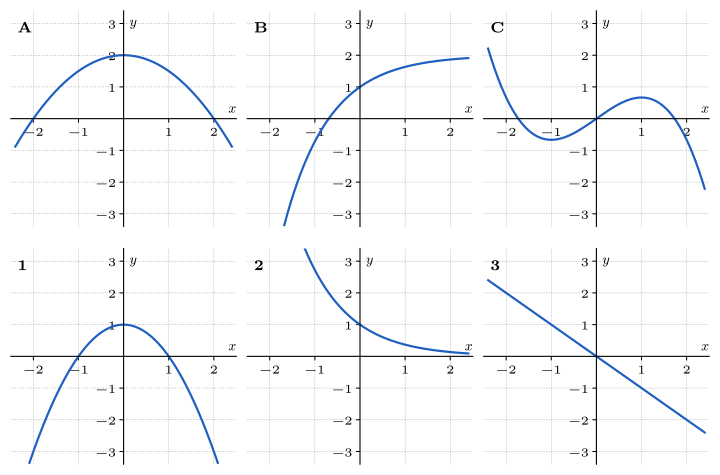
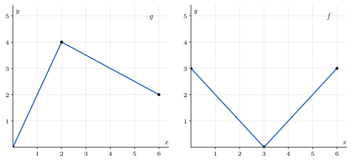

<!-- SOCLE = LE NOYAU, à faire par tous en séance : 35 minutes, puis 15 minutes de correction de S.2 et de méthode 1.
     VERSION 3 (énoncés validés le 19/11/2026 ; indices et solutions rédigés). Retours du 17/11 : S.1 et S.2 fusionnés,
     énoncés moins guidés, deux exercices graphiques ajoutés (S.4, S.5), ancien S.5 (première règle) retiré, contrôle par le modèle (séance 7) retiré de S.6.
     Durées visées (sans calculatrice) : S.1 6 min · S.2 7 min (corrigé en commun) · S.3 6 min · S.4 4 min · S.5 5 min · S.6 3 min · S.7 4 min = 35 min.
     S.2 = l'exercice corrigé ensemble juste après le socle (méthode 1 « Dériver une expression en suivant sa structure ») :
     indices et réponses finales (sans « Je veux plus de détails ») ; les détails sont donnés lors de la correction.
     Pour les autres : Indice 1 = théorie, Indice 2 = question, Indice 3 = étape, puis Solution (Réponse + Explication) et Piège.
     Faisable SANS calculatrice. Numéro AUTOMATIQUE. Résultats vérifiés par script (hors dépôt). Figures : img/figs.py.
     Notations du cours IMSV-8 : f'(x), Dom(f'), règle de Leibniz, règle du quotient, chain rule, fonction intérieure / extérieure.
     Objectifs : voir index.qmd (O1 à O6, AAV d'IMSV-8). -->

::: {.callout-caution .exo title="Exercice|Socle|1|O1"}
(a) Calcule la dérivée de chacune des fonctions suivantes, et donne le domaine de cette dérivée.

$$f_1(x) = 4x^{3} - 5x^{2} + 7 \qquad f_2(x) = \frac{2}{x^{3}} \qquad f_3(x) = 3\sqrt{x} - \frac{1}{x}$$

$$f_4(x) = x\sqrt{x} \qquad f_5(t) = 5e^{t} - 2\ln(t) + 3\cos(t)$$

(b) Calcule $f_3'(4)$.
:::

::: {.aides}
::: {.panel-tabset}

## Indice 1

Retourne à la théorie du cours : *Dérivées élémentaires : table de référence*, *Puissances : une seule règle, des domaines distincts* et *Linéarité*.

## Indice 2

*Question à te poser.*

(a) Chaque terme est-il une puissance de $x$, une exponentielle, un logarithme ou une fonction trigonométrique, multiplié par une constante ? Pour quelles valeurs de la variable la dérivée obtenue est-elle définie ?
(b) Quelle expression de $f_3'$ as-tu obtenue en (a) ?

## Indice 3

*Étape.*

(a) Réécris $f_2(x) = 2x^{-3}$, $f_3(x) = 3x^{1/2} - x^{-1}$ et $f_4(x) = x^{3/2}$, puis applique $(x^{\alpha})' = \alpha \cdot x^{\alpha - 1}$ terme à terme.
(b) Remplace $x$ par $4$ dans $f_3'(x) = \dfrac{3}{2\sqrt{x}} + \dfrac{1}{x^{2}}$, en utilisant $\sqrt{4} = 2$.

## Solution

::: {.reponse}
**Réponse (a).** $f_1'(x) = 12x^{2} - 10x$ sur $\mathbb{R}$ ; $f_2'(x) = -\dfrac{6}{x^{4}}$ sur $\mathbb{R}_0$ ; $f_3'(x) = \dfrac{3}{2\sqrt{x}} + \dfrac{1}{x^{2}}$ sur $\mathbb{R}^+_0$ ; $f_4'(x) = \dfrac{3}{2}\sqrt{x}$ sur $\mathbb{R}^+$ ; $f_5'(t) = 5e^{t} - \dfrac{2}{t} - 3\sin(t)$ sur $\mathbb{R}^+_0$.
:::

::: {.details}
On dérive terme à terme (linéarité), en gardant les coefficients constants, et on lit le domaine dans la table de référence.

1. $f_1'(x) = 4 \cdot 3x^{2} - 5 \cdot 2x + 0 = 12x^{2} - 10x$ ; un polynôme se dérive sur $\mathbb{R}$.
2. $f_2(x) = 2x^{-3}$, donc $f_2'(x) = 2 \cdot (-3)x^{-4} = -\dfrac{6}{x^{4}}$, qui n'existe pas en $0$ : $\mathrm{Dom}(f_2') = \mathbb{R}_0$.
3. $f_3(x) = 3x^{1/2} - x^{-1}$, donc $f_3'(x) = 3 \cdot \dfrac{1}{2}x^{-1/2} + x^{-2} = \dfrac{3}{2\sqrt{x}} + \dfrac{1}{x^{2}}$. Il faut $x \geq 0$ pour la racine et $x \neq 0$ pour les divisions : $\mathrm{Dom}(f_3') = \mathbb{R}^+_0$.
4. $f_4(x) = x \cdot x^{1/2} = x^{3/2}$, donc $f_4'(x) = \dfrac{3}{2}x^{1/2} = \dfrac{3}{2}\sqrt{x}$. Cette expression est définie pour $x \geq 0$ : $\mathrm{Dom}(f_4') = \mathbb{R}^+$. C'est le cas « dépend de $\alpha$ » de la table : pour $\alpha = \tfrac{3}{2}$, le domaine contient $0$.
5. $f_5'(t) = 5e^{t} - 2 \cdot \dfrac{1}{t} + 3 \cdot \big(-\sin(t)\big)$ ; le terme $\ln(t)$ impose $t > 0$ : $\mathrm{Dom}(f_5') = \mathbb{R}^+_0$.
:::

::: {.reponse}
**Réponse (b).** $f_3'(4) = \dfrac{13}{16}$.
:::

::: {.details}
On remplace $x$ par $4$ : $f_3'(4) = \dfrac{3}{2 \cdot 2} + \dfrac{1}{16} = \dfrac{12}{16} + \dfrac{1}{16} = \dfrac{13}{16}$.
:::

## Piège

En (a), une erreur fréquente consiste à écrire $\left(\dfrac{2}{x^{3}}\right)' = \dfrac{2}{3x^{2}}$, en dérivant le dénominateur seul. Il faut d'abord écrire $2x^{-3}$.

Une autre erreur consiste à changer le signe de $-\dfrac{1}{x}$ dans le mauvais sens : $\left(-x^{-1}\right)' = +x^{-2}$.

Pour $f_5$, une autre erreur consiste à oublier que $\big(\cos(t)\big)' = -\sin(t)$, ce qui donne $+3\sin(t)$ au lieu de $-3\sin(t)$.
:::
:::

::: {.callout-caution .exo title="Exercice|Socle|2|O2"}
En identifiant la nature algébrique[^nature-s2] de l'expression analytique de chaque fonction, calcule sa dérivée. Simplifie le résultat.

$$f(x) = \left(x^{2} + 1\right) \cdot e^{x} \qquad g(x) = \frac{2x + 1}{x - 3}$$

$$h(x) = \frac{\sin(x)}{x} \qquad k(x) = \frac{x^{3} - 4x}{x - 2}$$

Pour $k$, précise le domaine de $k$ et celui de $k'$.

[^nature-s2]: La nature algébrique d'une expression est l'opération effectuée en dernier quand on calcule sa valeur : somme, différence, produit, quotient ou composée. Elle détermine la première règle de dérivation à appliquer.
:::

::: {.callout-note appearance="simple"}
L'exercice **S.2** est corrigé ensemble en séance, juste après le temps consacré au socle. Cherche-le seul·e et repère l'endroit exact où tu bloques. Les coups de pouce ci-dessous donnent les indices et les réponses finales ; les détails seront donnés lors de la correction.
:::

::: {.aides}
::: {.panel-tabset}

## Indice 1

Retourne à la théorie du cours : *Choisir la première règle*, *Règle du produit : deux contributions*, *Règle du quotient : application* et *Simplifier pour enlever une difficulté, sans changer le problème*.

## Indice 2

*Question à te poser.*

Quelle est la dernière opération effectuée quand on calcule $f(x)$, $g(x)$, $h(x)$ et $k(x)$ ? Pour $k$, peut-on simplifier la fraction, et pour quelles valeurs de $x$ cette simplification est-elle permise ?

## Indice 3

*Étape.*

Pour $f$, pose $u(x) = x^{2} + 1$ et $v(x) = e^{x}$, puis écris $f' = u' \cdot v + u \cdot v'$. Pour $g$ et $h$, écris $\left(\dfrac{u}{v}\right)' = \dfrac{u' \cdot v - u \cdot v'}{v^{2}}$. Pour $k$, factorise le numérateur : $x^{3} - 4x = x(x - 2)(x + 2)$.

## Solution

::: {.reponse}
**Réponses.** $f'(x) = (x + 1)^{2} \cdot e^{x}$ sur $\mathbb{R}$ ; $g'(x) = -\dfrac{7}{(x - 3)^{2}}$ sur $\mathbb{R} \setminus \{3\}$ ; $h'(x) = \dfrac{x\cos(x) - \sin(x)}{x^{2}}$ sur $\mathbb{R}_0$ ; $\mathrm{Dom}(k) = \mathbb{R} \setminus \{2\}$, $k(x) = x^{2} + 2x$ pour $x \neq 2$, donc $k'(x) = 2x + 2$ sur $\mathbb{R} \setminus \{2\}$.
:::

## Piège

Une erreur fréquente consiste à dériver chaque facteur séparément : $\big((x^{2} + 1) \cdot e^{x}\big)' = 2x \cdot e^{x}$. La dérivée d'un produit a deux contributions.

Une autre erreur consiste à écrire la dérivée d'un quotient comme le quotient des dérivées, par exemple $g'(x) = \dfrac{2}{1}$, ou à inverser l'ordre au numérateur, ce qui donne $+\dfrac{7}{(x - 3)^{2}}$.

Pour $k$, une autre erreur consiste à donner $\mathrm{Dom}(k') = \mathbb{R}$ après la simplification : on a divisé par $x - 2$, donc $2$ reste exclu.
:::
:::

::: {.callout-caution .exo title="Exercice|Socle|2|O3"}
En identifiant la nature algébrique[^nature-s3] de l'expression analytique de chaque fonction, calcule sa dérivée.

$$f_1(x) = (5 - 2x)^{3} \qquad f_2(x) = \sqrt{x^{2} + 9} \qquad f_3(x) = \ln\left(x^{2} + 4\right)$$

$$f_4(x) = 2^{3x} \qquad f_5(x) = x \cdot e^{-2x}$$

[^nature-s3]: La nature algébrique d'une expression est l'opération effectuée en dernier quand on calcule sa valeur : somme, différence, produit, quotient ou composée. Elle détermine la première règle de dérivation à appliquer.
:::

::: {.aides}
::: {.panel-tabset}

## Indice 1

Retourne à la théorie du cours : *Reconnaître des fonctions imbriquées*, *Chain rule : deux transmissions successives* et *Exponentielle en base quelconque*.

## Indice 2

*Question à te poser.*

Pour chaque fonction, quelle opération est effectuée en dernier ? S'il s'agit d'une composée, quelle est la fonction intérieure et quelle est la fonction extérieure ?

## Indice 3

*Étape.*

Pour $f_2$, la fonction intérieure est $g(x) = x^{2} + 9$ et la fonction extérieure est $\sqrt{y}$ : écris $f_2'(x) = \dfrac{1}{2\sqrt{g(x)}} \cdot g'(x)$. Pour $f_4$, la fonction extérieure est $2^{y}$, de dérivée $\ln(2) \cdot 2^{y}$. Pour $f_5$, la dernière opération est un produit.

## Solution

::: {.reponse}
**Réponses.** $f_1'(x) = -6(5 - 2x)^{2}$ ; $f_2'(x) = \dfrac{x}{\sqrt{x^{2} + 9}}$ ; $f_3'(x) = \dfrac{2x}{x^{2} + 4}$ ; $f_4'(x) = 3\ln(2) \cdot 2^{3x}$ ; $f_5'(x) = (1 - 2x) \cdot e^{-2x}$.
:::

::: {.details}
Pour chaque composée, on écrit la fonction intérieure $g$, puis on applique $(f \circ g)'(x) = f'\big(g(x)\big) \cdot g'(x)$.

1. $f_1$ : $g(x) = 5 - 2x$, $g'(x) = -2$, fonction extérieure $y^{3}$. Donc $f_1'(x) = 3(5 - 2x)^{2} \cdot (-2) = -6(5 - 2x)^{2}$.
2. $f_2$ : $g(x) = x^{2} + 9$, $g'(x) = 2x$, fonction extérieure $\sqrt{y}$. Donc $f_2'(x) = \dfrac{2x}{2\sqrt{x^{2} + 9}} = \dfrac{x}{\sqrt{x^{2} + 9}}$.
3. $f_3$ : $g(x) = x^{2} + 4$, $g'(x) = 2x$, fonction extérieure $\ln(y)$. Donc $f_3'(x) = \dfrac{1}{x^{2} + 4} \cdot 2x = \dfrac{2x}{x^{2} + 4}$. Comme $x^{2} + 4 > 0$, $f_3$ et $f_3'$ sont définies sur $\mathbb{R}$.
4. $f_4$ : $g(x) = 3x$, $g'(x) = 3$, fonction extérieure $2^{y}$. Donc $f_4'(x) = \ln(2) \cdot 2^{3x} \cdot 3$.
5. $f_5$ est le produit de $x$ par $e^{-2x}$ : la règle de Leibniz donne $f_5'(x) = 1 \cdot e^{-2x} + x \cdot \big(e^{-2x}\big)'$. Par la chain rule, $\big(e^{-2x}\big)' = -2e^{-2x}$, donc $f_5'(x) = e^{-2x} - 2x \cdot e^{-2x} = (1 - 2x) \cdot e^{-2x}$.
:::

## Piège

Une erreur fréquente consiste à oublier de multiplier par la dérivée de la fonction intérieure, par exemple à écrire $f_1'(x) = 3(5 - 2x)^{2}$ ou $f_3'(x) = \dfrac{1}{x^{2} + 4}$.

Pour $f_4$, une autre erreur consiste à appliquer la règle des puissances, $(3x) \cdot 2^{3x - 1}$ : la variable est dans l'exposant, la règle à utiliser est celle de l'exponentielle en base quelconque.

Pour $f_5$, une autre erreur consiste à traiter toute l'expression comme une composée, et à oublier le terme $1 \cdot e^{-2x}$ du produit.
:::
:::

::: {.callout-caution .exo title="Exercice|Socle|2|O5"}
La première ligne représente trois fonctions A, B et C. La seconde ligne représente leurs dérivées, dans le désordre. Associe chaque fonction à sa dérivée, et justifie chaque association par ce que tu lis sur les graphiques.

{fig-alt="Six graphiques. Première ligne : A, une parabole tournée vers le bas de sommet (0 ; 2) ; B, une courbe croissante qui monte de plus en plus lentement et se rapproche de y = 2 ; C, une courbe qui descend, remonte entre x = −1 et x = 1, puis redescend. Seconde ligne : 1, une parabole tournée vers le bas de sommet (0 ; 1), qui coupe l'axe horizontal en −1 et en 1 ; 2, une courbe positive décroissante qui se rapproche de 0 ; 3, une droite décroissante qui passe par l'origine." width="15cm" fig-align="center"}
:::

::: {.aides}
::: {.panel-tabset}

## Indice 1

Retourne à la théorie du cours : *Associer une fonction à sa dérivée, sans formule* et *Cinq contrôles systématiques*.

## Indice 2

*Question à te poser.*

Sur quels intervalles chaque fonction est-elle croissante ou décroissante, et en quels points sa tangente est-elle horizontale ? Quel graphe de la seconde ligne est positif, négatif et nul aux mêmes endroits ?

## Indice 3

*Étape.*

Pour A, note que la tangente est horizontale en $x = 0$, que A monte à gauche de $0$ et descend à droite. Cherche le graphe de la seconde ligne qui s'annule seulement en $0$, positif à gauche et négatif à droite.

## Solution

::: {.reponse}
**Réponse.** A–3, B–2, C–1.
:::

::: {.details}
On compare le signe des pentes de chaque fonction au signe de chaque dérivée proposée.

1. A est croissante sur $]-\infty,\,0]$, décroissante sur $[0,\,+\infty[$, avec une tangente horizontale en $x = 0$. Sa dérivée est positive, nulle en $0$, puis négative : c'est le graphe 3.
2. B est croissante partout, et ses tangentes sont de moins en moins inclinées quand $x$ augmente. Sa dérivée est positive et décroît vers $0$ : c'est le graphe 2.
3. C est décroissante, puis croissante entre $x = -1$ et $x = 1$, puis décroissante, avec des tangentes horizontales en $x = -1$ et en $x = 1$. Sa dérivée est négative, positive sur $]-1,\,1[$, puis négative, et elle s'annule en $-1$ et en $1$ : c'est le graphe 1.
:::

## Piège

Une erreur fréquente consiste à associer A au graphe 1, parce que les deux graphes ont la forme d'une parabole tournée vers le bas. La dérivée ne reproduit pas la forme de la fonction : elle donne le signe et la valeur des pentes.

Une autre erreur consiste à lire la hauteur de la courbe au lieu de sa pente, par exemple à dire que la dérivée de B est négative pour $x < -1$, parce que B est négative à cet endroit.
:::
:::

::: {.callout-caution .exo title="Exercice|Socle|2|O3"}
Les graphes des fonctions $g$ (à gauche) et $f$ (à droite) sont formés de segments de droite.

{fig-alt="Deux graphiques côte à côte. À gauche, le graphe de g relie les points (0 ; 0), (2 ; 4) et (6 ; 2). À droite, le graphe de f relie les points (0 ; 3), (3 ; 0) et (6 ; 3)." width="15cm" fig-align="center"}

(a) On pose $p(x) = f(x) \cdot g(x)$. Calcule $p'(1)$.
(b) On pose $h(x) = f\big(g(x)\big)$. Calcule $h'(1)$.
(c) On pose $k(x) = g\big(f(x)\big)$. Calcule $k'(4)$.
:::

::: {.aides}
::: {.panel-tabset}

## Indice 1

Retourne à la théorie du cours : *Règle du produit : deux contributions* pour (a), et *Chain rule : deux transmissions successives* pour (b) et (c).

## Indice 2

*Question à te poser.*

(a) Quelles valeurs et quelles pentes de $f$ et de $g$ faut-il lire, et en quel point ?
(b) En quel point faut-il lire la pente de $f$ : en $1$ ou en $g(1)$ ?
(c) En quel point faut-il lire la pente de $g$ ?

## Indice 3

*Étape.*

(a) Lis $f(1)$ et $g(1)$, puis calcule les pentes des segments qui passent par $x = 1$ : $f'(1)$ et $g'(1)$.
(b) Lis $g(1) = 2$, puis la pente du segment de $f$ au point d'abscisse $2$.
(c) Lis $f(4)$, puis la pente du segment de $g$ au point d'abscisse $f(4)$.

## Solution

::: {.reponse}
**Réponse (a).** $p'(1) = 2$.
:::

::: {.details}
Par la règle de Leibniz, $p'(1) = f'(1) \cdot g(1) + f(1) \cdot g'(1)$.

On lit $f(1) = 2$ et $g(1) = 2$. Le segment de $f$ qui relie $(0\,;\,3)$ à $(3\,;\,0)$ a une pente de $\tfrac{0 - 3}{3 - 0} = -1$, donc $f'(1) = -1$. Le segment de $g$ qui relie $(0\,;\,0)$ à $(2\,;\,4)$ a une pente de $\tfrac{4}{2} = 2$, donc $g'(1) = 2$.

Donc $p'(1) = (-1) \cdot 2 + 2 \cdot 2 = 2$.
:::

::: {.reponse}
**Réponse (b).** $h'(1) = -2$.
:::

::: {.details}
Par la chain rule, $h'(1) = f'\big(g(1)\big) \cdot g'(1)$.

On lit $g(1) = 2$ et $g'(1) = 2$. Au point d'abscisse $2$, $f$ suit le segment de pente $-1$, donc $f'(2) = -1$. Donc $h'(1) = (-1) \cdot 2 = -2$.
:::

::: {.reponse}
**Réponse (c).** $k'(4) = 2$.
:::

::: {.details}
Par la chain rule, $k'(4) = g'\big(f(4)\big) \cdot f'(4)$.

Le segment de $f$ qui relie $(3\,;\,0)$ à $(6\,;\,3)$ a une pente de $1$ : on lit $f(4) = 1$ et $f'(4) = 1$. Au point d'abscisse $1$, $g$ suit le segment de pente $2$, donc $g'(1) = 2$. Donc $k'(4) = 2 \cdot 1 = 2$.
:::

## Piège

En (a), une erreur fréquente consiste à multiplier les pentes, $f'(1) \cdot g'(1) = -2$ : la dérivée d'un produit n'est pas le produit des dérivées.

En (b) et (c), une autre erreur consiste à lire la pente de la fonction extérieure au même point que la fonction intérieure, par exemple $f'(1)$ au lieu de $f'\big(g(1)\big) = f'(2)$. Ici, $f'(1) = f'(2)$, ce qui cache l'erreur en (b) ; en (c), lire $g'(4) = -\tfrac{1}{2}$ au lieu de $g'(1) = 2$ donne une réponse fausse.

Une autre erreur consiste à lire une valeur au lieu d'une pente, par exemple $f(2) = 1$ au lieu de $f'(2) = -1$.
:::
:::

::: {.callout-caution .exo title="Exercice|Socle|2|O5"}
Un étudiant a calculé les dérivées suivantes. Pour chacune, écris si elle est correcte. Si elle est fausse, nomme la règle qui n'a pas été respectée et corrige le calcul.

(a) $\big(x \cdot e^{x}\big)' = e^{x}$
(b) $\big(e^{x^{2}}\big)' = e^{x^{2}}$
(c) $\left(\dfrac{1}{x^{2}}\right)' = -\dfrac{2}{x^{3}}$
(d) $\big(\sin(3x)\big)' = 3\cos(3x)$
:::

::: {.aides}
::: {.panel-tabset}

## Indice 1

Retourne à la théorie du cours : *Règle du produit : deux contributions*, *Chain rule : deux transmissions successives* et *Puissances : une seule règle, des domaines distincts*.

## Indice 2

*Question à te poser.*

Quelle est la nature algébrique de chaque expression, et donc quelle règle l'étudiant aurait-il dû appliquer ?

## Indice 3

*Étape.*

Refais chaque dérivée avec la règle qui correspond à la dernière opération, puis compare ton résultat à celui de l'étudiant.

## Solution

::: {.reponse}
**Réponse.** (a) Faux ; (b) faux ; (c) correct ; (d) correct.
:::

::: {.details}
On identifie la dernière opération de chaque expression, puis on refait le calcul.

(a) $x \cdot e^{x}$ est un produit, et la règle de Leibniz n'a pas été respectée : l'étudiant a dérivé $x$ en $1$ et multiplié par $e^{x}$, sans le second terme. Correction : $\big(x \cdot e^{x}\big)' = 1 \cdot e^{x} + x \cdot e^{x} = (1 + x) \cdot e^{x}$.

(b) $e^{x^{2}}$ est une composée, et la chain rule n'a pas été respectée : il manque la dérivée de la fonction intérieure $x^{2}$. Correction : $\big(e^{x^{2}}\big)' = e^{x^{2}} \cdot 2x$.

(c) $\dfrac{1}{x^{2}} = x^{-2}$, donc $\left(x^{-2}\right)' = -2x^{-3} = -\dfrac{2}{x^{3}}$ : le calcul est correct.

(d) $\sin(3x)$ est une composée de fonction intérieure $3x$ : $\big(\sin(3x)\big)' = \cos(3x) \cdot 3$. Le calcul est correct.
:::

## Piège

Une erreur fréquente consiste à vérifier un résultat en refaisant la même erreur, par exemple à juger (b) correct parce que « l'exponentielle est sa propre dérivée ». Cette propriété vaut pour $e^{x}$, pas pour $e^{g(x)}$.

Une autre erreur consiste à juger (c) faux parce que le signe est négatif : une fonction décroissante sur $\mathbb{R}^+_0$, comme $\dfrac{1}{x^{2}}$, a une dérivée négative sur cet intervalle.
:::
:::

::: {.callout-caution .exo title="Exercice|Socle|2|O6"}
Après une injection intramusculaire, la concentration d'un médicament dans le sang est modélisée par $C(t) = 10\,t \cdot e^{-t/2}$, où $t$ est le temps écoulé depuis l'injection, en heures, et $C(t)$ la concentration, en mg/L.

(a) Calcule $C'(t)$, et écris son unité.
(b) Calcule $C'(0)$ et $C'(2)$, puis écris le signe de $C'(4)$. Écris en une phrase ce que chacun de ces résultats signifie pour la concentration.
:::

::: {.aides}
::: {.panel-tabset}

## Indice 1

Retourne à la théorie du cours : *Règle du produit : deux contributions*, *Exponentielle composée : un taux proportionnel à la quantité* et *Retour à la réponse biologique*.

## Indice 2

*Question à te poser.*

(a) Quelle est la nature algébrique de $C(t)$ ? Quelle est l'unité d'une dérivée par rapport au temps ?
(b) Que signifie une dérivée positive, nulle ou négative pour la concentration ?

## Indice 3

*Étape.*

(a) Pose $u(t) = 10t$ et $v(t) = e^{-t/2}$, avec $v'(t) = -\dfrac{1}{2}e^{-t/2}$, puis mets $e^{-t/2}$ en évidence.
(b) Remplace $t$ par $0$, $2$ et $4$ dans le facteur $(2 - t)$, en sachant que $e^{-t/2} > 0$.

## Solution

::: {.reponse}
**Réponse (a).** $C'(t) = 5(2 - t) \cdot e^{-t/2}$, en mg/L par heure.
:::

::: {.details}
$C(t)$ est le produit de $u(t) = 10t$ par $v(t) = e^{-t/2}$.

1. $u'(t) = 10$ et, par la chain rule, $v'(t) = e^{-t/2} \cdot \left(-\dfrac{1}{2}\right)$.
2. Par la règle de Leibniz, $C'(t) = 10 \cdot e^{-t/2} + 10t \cdot \left(-\dfrac{1}{2}\right)e^{-t/2} = (10 - 5t) \cdot e^{-t/2} = 5(2 - t) \cdot e^{-t/2}$.
3. $C'(t)$ s'exprime dans l'unité de $C$ divisée par l'unité de $t$ : en mg/L par heure.
:::

::: {.reponse}
**Réponse (b).** $C'(0) = 10$ mg/L par heure, $C'(2) = 0$ mg/L par heure et $C'(4) < 0$. Juste après l'injection, la concentration augmente de $10$ mg/L par heure ; à $t = 2$ h, elle cesse d'augmenter ; à $t = 4$ h, elle diminue.
:::

::: {.details}
On utilise $C'(t) = 5(2 - t) \cdot e^{-t/2}$, où $e^{-t/2} > 0$ : le signe de $C'(t)$ est celui de $2 - t$.

1. $C'(0) = 5 \cdot 2 \cdot e^{0} = 10$ : au moment de l'injection, la concentration augmente à la vitesse de $10$ mg/L par heure.
2. $C'(2) = 5 \cdot 0 \cdot e^{-1} = 0$ : à $t = 2$ h, la tangente est horizontale ; la concentration passe d'une phase de hausse à une phase de baisse.
3. $C'(4) = 5 \cdot (-2) \cdot e^{-2} = -10e^{-2} < 0$ : à $t = 4$ h, la concentration diminue.
:::

## Piège

En (a), une erreur fréquente consiste à oublier le facteur $-\dfrac{1}{2}$ de la chain rule, ce qui donne $C'(t) = (10 + 10t) \cdot e^{-t/2}$, toujours positive : une concentration qui ne diminue jamais après une injection est un résultat à contrôler.

En (b), une autre erreur consiste à interpréter $C'(2) = 0$ comme « la concentration est nulle ». C'est la vitesse de variation qui est nulle ; la concentration vaut $C(2) = 20e^{-1}$ mg/L.
:::
:::
