# Rappel {.divider background-color="#14304a"}

## Où trouver l'aide pendant la séance

[1]{.step} **Cherche d'abord seul·e** : bloquer fait partie de l'apprentissage.

[2]{.step} **Bloqué·e ?** Ouvre les **coups de pouce** du site, un à un et dans l'ordre : la référence théorique, la question à te poser, une étape, et seulement en dernier la solution.

[3]{.step} **Besoin d'une méthode type ?** La **boîte à outils** et les **fiches méthode** sont sur le site.

[4]{.step} **Toujours bloqué·e après les coups de pouce ?** Lève la main : quelqu'un passe t'aider.

::: aretenir
Le site est accessible tout le temps, en séance comme à la maison.
:::

::: notes
C'est normal de bloquer : ça fait partie de l'apprentissage. Quand ça t'arrive, cherche l'aide dans cet ordre : d'abord les coups de pouce du site, un à un, puis la boîte à outils et les fiches méthode, et si tu bloques encore, lève la main et quelqu'un viendra t'aider. Le site reste disponible tout le temps, en séance comme chez toi.
:::


## Retour sur le sondage d'octobre

[1]{.step} **Merci** d'avoir répondu au sondage.

[2]{.step} J'ai revu les **indices**, les **énoncés** et les **solutions** pour les rendre encore plus explicites.

[3]{.step} Aujourd'hui, on **teste ensemble la correction d'un exercice du socle**. Tu me diras si tu veux la garder à chaque séance.

[4]{.step} Certains retours demandent plus d'éclaircissements : à la fin de la séance, je te demanderai plus de détails sur ton avis sur le dispositif.

::: notes
Cinq à dix minutes pour ce retour, avec la diapositive suivante.
:::

## Ce que je veux garder

Je suis ouvert au changement. Je veux garder un principe : sur les deux heures d'exercices, **tu es actif·ve la majorité du temps**.

| | Temps actif | Part du temps de travail |
|:---|:---:|:---:|
| Avant | $30 + 30 + 15 = 75$ min sur $110$ | environ $70\,\%$ |
| À garder | au moins $65$ min sur $110$ | au moins $60\,\%$ |

::: aretenir
Tout changement du dispositif doit respecter ce seuil.
:::

::: notes
Temps de travail : 120 minutes moins la pause de 10 minutes, soit 110 minutes. Avec le déroulé du jour : socle 30 min, transfert 25 min, méthodes 15 min d'activité, soit 70 minutes sur 110 (environ 64 %), au-dessus du seuil de 60 %. Laisser les étudiant·es réagir, sans ouvrir de discussion longue : le sondage de fin de séance recueillera le détail.
:::

## Le déroulé de la séance

| Moment | Durée |
|:---|:---:|
| Retour sur le sondage d'octobre | 5 min |
| Échauffement | 10 min |
| Socle, en autonomie | 30 min |
| Exercice S.4 : confrontation et correction | 10 min |
| Pause | 10 min |
| Transfert, en autonomie | 25 min |
| Méthodes de la séance | 20 min |
| Sondage sur les séances | 10 min |

::: aretenir
Les défis peuvent être faits en séance par celles et ceux qui maîtrisent déjà le socle. Les exercices supplémentaires se font à la maison.
:::

::: notes
Total prévu : 120 minutes, sans battement. Le retour sur le sondage peut aller jusqu'à 10 minutes en prenant sur l'échauffement, qui ne compte plus que deux questions. L'échauffement doit tenir en 10 minutes, et le vote sur la correction de S.4 (1 minute) se fait dans les 10 minutes de S.4. Si la séance prend du retard, raccourcir la fiche « Calculer une réciproque » (les deux diapositives facultatives : registres et diagramme sagittal ; si besoin, passer l'étape 6), jamais le sondage final.
:::

# Échauffement {.divider background-color="#14304a"}

## Les questions

::::::::::::::: columns
::::: {.column width="62%"}
:::: {style="font-size:.85em"}
**Q1** [[O3]{.obj}]{style="float:right"} — pour chacun des trois graphes, la fonction est-elle croissante, décroissante, ou ni l'une ni l'autre ?

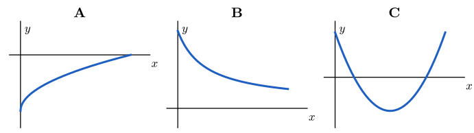{fig-alt="Trois graphes, nommés A, B et C, représentant chacun une fonction sur un intervalle, lus de gauche à droite" width="100%"}

**Q2** [[Rappel]{.obj}]{style="float:right"} — quelles sont les solutions de l'équation $x^2 - 5 = 11$ ?
::::
:::::

::::::::::: {.column width="38%"}
::::: wooclap
:::: wc-body
**Vote sur Wooclap**

::: wc-lien
Code : À COMPLÉTER
:::
::::

<!--
::: {.wc-qr}

:::
-->


:::::

::::::: et-timer
```{=html}
<style>
@keyframes et-pulse { 0%, 100% { opacity: 1; } 50% { opacity: .35; } }
</style>
```

:::::: {#et-timer-box data-default="300"}
:::: et-row
<button id="et-minus" class="et-btn" type="button" aria-label="Retirer une minute">

−1 min

</button>

::: {#et-display .et-display}
05:00
:::

<button id="et-plus" class="et-btn" type="button" aria-label="Ajouter une minute">

+1 min

</button>
::::

::: et-row
<button id="et-toggle" class="et-btn et-primary" type="button">

Démarrer

</button>

<button id="et-reset" class="et-btn" type="button" aria-label="Réinitialiser">

↺ Réinitialiser

</button>
:::
::::::
:::::::
:::::::::::
:::::::::::::::

```{=html}
<script>
(function () {
  var box = document.getElementById('et-timer-box');
  if (!box) return;
  var DEFAULT = parseInt(box.getAttribute('data-default'), 10) || 300;
  var display = document.getElementById('et-display');
  var btnToggle = document.getElementById('et-toggle');
  var btnMinus = document.getElementById('et-minus');
  var btnPlus = document.getElementById('et-plus');
  var btnReset = document.getElementById('et-reset');

  var remaining = DEFAULT;
  var running = false;
  var intervalId = null;
  var audioCtx = null;

  function fmt(s) {
    s = Math.max(0, s);
    var m = Math.floor(s / 60);
    var sec = s % 60;
    return (m < 10 ? '0' : '') + m + ':' + (sec < 10 ? '0' : '') + sec;
  }

  function render() {
    display.textContent = fmt(remaining);
    display.classList.toggle('et-warn', running && remaining <= 30 && remaining > 0);
    display.classList.toggle('et-done', remaining === 0);
  }

  function beep() {
    try {
      if (!audioCtx) audioCtx = new (window.AudioContext || window.webkitAudioContext)();
      var t0 = audioCtx.currentTime;
      [0, 0.35].forEach(function (offset) {
        var osc = audioCtx.createOscillator();
        var gain = audioCtx.createGain();
        osc.type = 'sine';
        osc.frequency.value = 880;
        gain.gain.setValueAtTime(0.0001, t0 + offset);
        gain.gain.exponentialRampToValueAtTime(0.3, t0 + offset + 0.02);
        gain.gain.exponentialRampToValueAtTime(0.0001, t0 + offset + 0.28);
        osc.connect(gain);
        gain.connect(audioCtx.destination);
        osc.start(t0 + offset);
        osc.stop(t0 + offset + 0.3);
      });
    } catch (e) {}
  }

  function stop() {
    running = false;
    btnToggle.textContent = remaining > 0 ? 'Reprendre' : 'Démarrer';
    if (intervalId) { clearInterval(intervalId); intervalId = null; }
  }

  function tick() {
    remaining -= 1;
    if (remaining <= 0) {
      remaining = 0;
      stop();
      beep();
    }
    render();
  }

  function start() {
    if (running) return;
    try {
      if (!audioCtx) audioCtx = new (window.AudioContext || window.webkitAudioContext)();
      if (audioCtx.state === 'suspended') audioCtx.resume();
    } catch (e) {}
    if (remaining <= 0) remaining = DEFAULT;
    render();
    running = true;
    btnToggle.textContent = 'Pause';
    intervalId = setInterval(tick, 1000);
  }

  btnToggle.addEventListener('click', function () { running ? stop() : start(); });
  btnMinus.addEventListener('click', function () {
    remaining = Math.max(0, remaining - 60);
    render();
    if (remaining === 0) stop();
  });
  btnPlus.addEventListener('click', function () {
    remaining = remaining + 60;
    render();
  });
  btnReset.addEventListener('click', function () {
    stop();
    remaining = DEFAULT;
    btnToggle.textContent = 'Démarrer';
    render();
  });

  render();
})();
</script>
```

## Q1 [[O3]{.obj}]{style="float:right"}

Pour chacun des trois graphes, la fonction est-elle croissante, décroissante, ou ni l'une ni l'autre ?

{fig-alt="Trois graphes, nommés A, B et C, représentant chacun une fonction sur un intervalle, lus de gauche à droite" width="95%" fig-align="center"}

::: notes
Faire lire chaque graphe de gauche à droite à voix haute avant de donner la réponse. Cette question prépare la question (a) de l'exercice S.3 et la définition de la croissance.
:::

## Q1 : réponse [[O3]{.obj}]{style="float:right"}

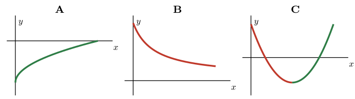{fig-alt="Les trois graphes A, B et C. Le graphe A est entièrement en vert : la fonction est croissante. Le graphe B est entièrement en rouge : la fonction est décroissante. Le graphe C est en rouge jusqu'à son point le plus bas, puis en vert : la fonction décroît d'abord, puis croît." width="95%" fig-align="center"}

::: notes
Vert : partie croissante ; rouge : partie décroissante. A : croissante, même si ses valeurs restent négatives. B : décroissante, même si ses valeurs restent positives. C : ni croissante ni décroissante, car elle descend d'abord puis monte. Confondre le sens de variation avec le signe des valeurs est l'erreur classique : être au-dessus ou en dessous de l'axe horizontal ne dit rien sur la croissance.
:::

## Q2 [[Rappel]{.obj}]{style="float:right"}

Quelles sont les solutions de l'équation $x^2 - 5 = 11$ ?

. . .

::: aretenir
On ajoute $5$ : $x^2 = 16$. Il y a **deux** nombres dont le carré vaut $16$ : $x = 4$ et $x = -4$.

Oublier la solution négative est l'erreur classique. Elle explique pourquoi une même sortie peut avoir deux antécédents.
:::

::: notes
Cette question prépare la notion d'antécédents multiples, rencontrée dans le socle (S.1) et dans le renforcement (R.2).
:::

# Socle — 30 minutes {.divider background-color="#14304a"}

::: notes
Lancer le socle. Annoncer que l'exercice S.4 sera confronté puis corrigé ensemble à la fin du socle : chacun doit l'avoir cherché.
:::

## Au travail {.travail data-minutes="30"}



# Exercice S.4 : confrontation et correction {.divider background-color="#1f5fbf"}

::: notes
Dix minutes, juste après les 30 minutes de socle. Rappeler que cette correction en commun répond au sondage d'octobre, et qu'on demandera à la fin si elle est utile. Les étudiant·es ont cherché S.4 pendant le socle : on confronte d'abord leurs réponses, puis on corrige.
:::

## L'énoncé

:::::: columns
::::: {.column width="58%"}
::: {style="font-size:.8em"}
Soit $f(x) = x^2 - 4x + 3$. Pour chaque intervalle, $f$ admet-elle sur cet intervalle :

**A.** un maximum et un minimum ; **B.** uniquement un maximum ; **C.** uniquement un minimum ; **D.** ni maximum ni minimum ?

(a) $[0,\,5]$ (b) $[0,\,5[$ (c) $]2,\,5]$ (d) $[0,\,4[$

(e) Pourquoi exclure $5$ fait-il disparaître le maximum en (b), alors qu'exclure $4$ ne le fait pas disparaître en (d) ?
:::
:::::
::::: {.column width="42%"}
{fig-alt="Parabole y = x² − 4x + 3, de point le plus bas (2 ; −1), qui passe par (0 ; 3), (4 ; 3) et (5 ; 8)." width="100%"}
:::::
::::::

## Confrontation des réponses

Pour chaque intervalle, vote **A**, **B**, **C** ou **D** sur Wooclap, puis compare ta réponse avec celle de ton voisin ou de ta voisine.

| Intervalle | (a) $[0,\,5]$ | (b) $[0,\,5[$ | (c) $]2,\,5]$ | (d) $[0,\,4[$ |
|:---:|:---:|:---:|:---:|:---:|
| Votre réponse | | | | |

::::::: wooclap
::: wc-play
▶
:::

:::: wc-body
**Vote sur Wooclap**

::: wc-lien
Code : À COMPLÉTER
:::
::::

<!--
::: {.wc-qr}


Confrontation de S.4
:::
-->

:::::::

::: notes
Faire voter intervalle par intervalle sur Wooclap (les choix sont dans wooclap-confrontation.md), puis laisser 2 minutes de discussion entre voisins avant la correction. Les intervalles (b) et (d) devraient diviser la classe.
:::

## (a) Sur $[0,\,5]$

:::::: columns
::::: {.column width="42%"}
. . .

::: aretenir
Le minimum vaut $-1$, atteint en $2$. Le maximum vaut $8$, atteint en $5$.

**Réponse A.**
:::
:::::
::::: {.column width="58%"}
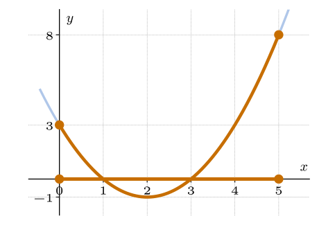{fig-alt="Parabole y = x² − 4x + 3 en trait pâle. La portion au-dessus de l'intervalle [0 ; 5] est en couleur, avec un point plein en (0 ; 3) et un point plein en (5 ; 8). Le segment [0 ; 5] est marqué sur l'axe des abscisses, avec deux points pleins." width="100%"}
:::::
::::::

::: notes
Un extremum doit être atteint en une abscisse qui appartient à l'intervalle : c'est la définition du cours. Les étapes de la méthode seront reprises avec la fiche méthode.
:::

## (b) Sur $[0,\,5[$

:::::: columns
::::: {.column width="42%"}
. . .

::: aretenir
Le minimum vaut $-1$, atteint en $2$.

Les valeurs s'approchent de $8$ quand $x$ s'approche de $5$, mais $5$ est exclu : une abscisse plus proche de $5$ donne toujours une valeur plus grande. Il n'y a pas de maximum.

**Réponse C.**
:::
:::::
::::: {.column width="58%"}
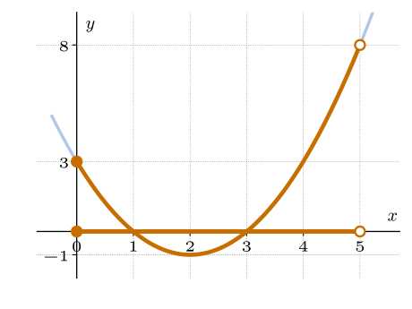{fig-alt="Parabole y = x² − 4x + 3 en trait pâle. La portion au-dessus de l'intervalle [0 ; 5[ est en couleur, avec un point plein en (0 ; 3) et un point creux en (5 ; 8). Le segment [0 ; 5[ est marqué sur l'axe des abscisses, avec un point plein en 0 et un point creux en 5." width="100%"}
:::::
::::::

## (c) Sur $]2,\,5]$

:::::: columns
::::: {.column width="42%"}
. . .

::: aretenir
Le maximum vaut $8$, atteint en $5$.

Les valeurs s'approchent de $-1$ quand $x$ s'approche de $2$, mais $2$ est exclu. Il n'y a pas de minimum.

**Réponse B.**
:::
:::::
::::: {.column width="58%"}
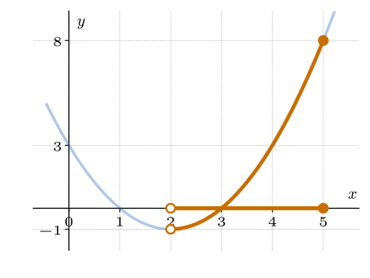{fig-alt="Parabole y = x² − 4x + 3 en trait pâle. La portion au-dessus de l'intervalle ]2 ; 5] est en couleur, avec un point creux en (2 ; −1) et un point plein en (5 ; 8). Le segment ]2 ; 5] est marqué sur l'axe des abscisses, avec un point creux en 2 et un point plein en 5." width="100%"}
:::::
::::::

## (d) Sur $[0,\,4[$

:::::: columns
::::: {.column width="42%"}
. . .

::: aretenir
Le minimum vaut $-1$, atteint en $2$.

Près de la borne exclue $4$, les valeurs s'approchent de $3$ sans l'atteindre, mais la valeur $3$ est **déjà atteinte en $0$**. Aucune valeur ne dépasse $3$ : le maximum vaut $3$, atteint en $0$.

**Réponse A.**
:::
:::::
::::: {.column width="58%"}
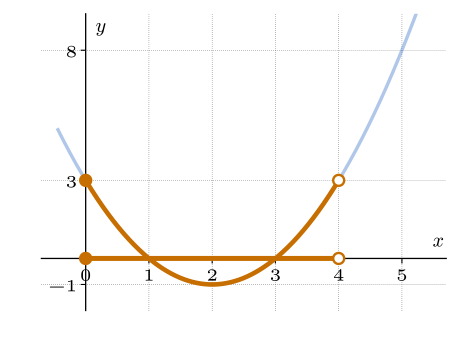{fig-alt="Parabole y = x² − 4x + 3 en trait pâle. La portion au-dessus de l'intervalle [0 ; 4[ est en couleur, avec un point plein en (0 ; 3) et un point creux en (4 ; 3). Le segment [0 ; 4[ est marqué sur l'axe des abscisses, avec un point plein en 0 et un point creux en 4." width="100%"}
:::::
::::::

## (e) Pourquoi exclure $5$ change tout, et pas exclure $4$ ?

:::::: columns
::::: {.column width="50%"}
**(b)** $[0,\,5[$

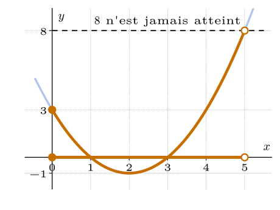{fig-alt="Parabole y = x² − 4x + 3 en trait pâle ; portion au-dessus de [0 ; 5[ en orange, point plein en (0 ; 3), point creux en (5 ; 8). Une droite en pointillés à la hauteur 8 passe par le point creux : la valeur 8 n'est jamais atteinte." width="100%"}
:::::
::::: {.column width="50%"}
**(d)** $[0,\,4[$

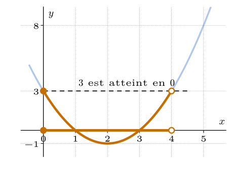{fig-alt="Parabole y = x² − 4x + 3 en trait pâle ; portion au-dessus de [0 ; 4[ en orange, point plein en (0 ; 3), point creux en (4 ; 3). Une droite en pointillés à la hauteur 3 passe par les deux points : la valeur 3 est atteinte en 0." width="100%"}
:::::
::::::

. . .

::: aretenir
En (b), la valeur dont $f$ s'approche près de la borne exclue, $8$, est plus grande que toutes les valeurs atteintes. En (d), la valeur dont elle s'approche, $3$, est déjà atteinte ailleurs dans l'intervalle.
:::

## Le piège à connaître

:::: piege
::: pg-titre
Piège
:::

Donner comme maximum la valeur en une borne exclue, par exemple $8$ sur $[0,\,5[$ : un maximum doit être atteint en une abscisse de l'intervalle. À l'inverse, croire qu'une borne exclue supprime **toujours** un extremum : sur $[0,\,4[$, le maximum existe.
::::

## Ton avis : faut-il garder cette correction en commun ?

Suite au sondage d'octobre, on a testé aujourd'hui la correction d'un exercice du socle, ensemble, après confrontation de vos réponses.

**Cette correction en commun t'a-t-elle été utile ? Faut-il la garder aux prochaines séances ?**

::::::: wooclap
::: wc-play
▶
:::

:::: wc-body
**Vote sur Wooclap**

::: wc-lien
Code : À COMPLÉTER
:::
::::

<!--
::: {.wc-qr}


Correction en commun
:::
-->

:::::::

::: notes
Une minute de vote. Les choix sont dans wooclap-sondage.md (question 1). Annoncer le résultat en une phrase, puis lancer la pause.
:::

# Pause — 10 minutes {.divider background-color="#14304a"}

# Transfert — 25 minutes {.divider background-color="#14304a"}

::: notes
Les étudiant·es travaillent le transfert (T.1 à T.3) avec les coups de pouce du site.
:::

## Au travail {.travail data-minutes="25"}



# Méthodes de la séance — 20 minutes {.divider background-color="#1f5fbf"}

::: notes
Deux fiches : environ 5 minutes pour la carte « Extrema » (la méthode vient d'être vue avec S.4), puis environ 15 minutes pour « Calculer une réciproque ».
:::

## Pour se rafraîchir la mémoire : les extrema

:::::: columns
::::: {.column width="50%"}
**Sur $[-3,\,3]$**

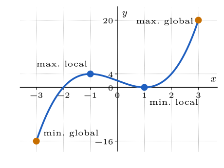{fig-alt="Graphe de f(x) = (x + 2)(x − 1)² sur [−3 ; 3]. Points orange aux extrémités : minimum global en (−3 ; −16) et maximum global en (3 ; 20). Points bleus : maximum local en (−1 ; 4) et minimum local en (1 ; 0)." width="100%"}
:::::
::::: {.column width="50%"}
**Sur $[0,\,3[$**

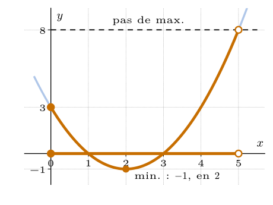{fig-alt="Droite y = 2x − 1 sur [0 ; 3[. Point plein en (0 ; −1) : c'est le minimum. Point creux en (3 ; 5) : cette valeur n'est pas atteinte, donc il n'y a pas de maximum." width="100%"}
:::::
::::::

::: notes
Rafraîchir avant la fiche : un extremum est local (valeurs voisines) ou global (sur tout l'intervalle) ; il doit être atteint en une abscisse de l'intervalle. À gauche, orange : extremum global ; bleu : extremum local seulement. À droite : une borne exclue ne donne pas d'extremum (c'est l'exemple de la fiche).
:::

## La carte « Extrema sur un intervalle » {.smaller}

:::::::::::::: fiche
::: fiche-head
Déterminer les extrema d'une fonction sur un intervalle [[O3]{.obj}]{style="float:right"}
:::

:::::::::::: fiche-body
:::::: fiche-col
::: {.fiche-field .empty}
Exercices associés (numéros)

*à noter toi-même*
:::

::: {.fiche-field .empty}
Théorie associée (chapitre / slide)

*à noter toi-même*
:::

::: {.fiche-field .fragment}
Quand l'utiliser ?

Il faut savoir si une fonction admet un maximum ou un minimum sur un intervalle, surtout quand une borne est exclue.
:::
::::::

::::::: fiche-col
:::: fiche-field
Étapes

::: incremental
1.  **Repérer** où la fonction croît et où elle décroît sur l'intervalle.
2.  **Lister** les candidats : changements de variation et bornes.
3.  **Regarder** si chaque borne est incluse ou exclue.
4.  **Comparer** les valeurs atteintes avec les valeurs approchées près des bornes exclues.
5.  **Conclure** : abscisse et valeur de chaque extremum, ou absence.
:::
::::

::: {.fiche-field .fragment}
Exemple

Une autre fonction que celle de S.4, par exemple $g(x) = 2x - 1$ sur $[0,\,3[$.
:::

::: {.fiche-field .fragment}
Le piège

Prendre la valeur en une borne exclue comme extremum ; croire qu'une borne exclue supprime toujours l'extremum.
:::
:::::::
::::::::::::
::::::::::::::

::: footer-note
Cette fiche rejoint ta **boîte à outils** sur le site.
:::

# Méthode 2 : calculer une fonction réciproque {.divider background-color="#1f5fbf"}

## Avant de commencer

Avec tes mots : comment obtiens-tu la formule de la fonction qui « défait » une fonction donnée ?

::::::: wooclap
::: wc-play
▶
:::

:::: wc-body
**Ouvre le Wooclap**

::: wc-lien
Code : À COMPLÉTER
:::
::::

<!--
::: {.wc-qr}


Entrée et sortie
:::
-->

:::::::

## Notre fil rouge

:::::: columns
::::: {.column width="46%"}
Soit la fonction $h(x) = x^2 - 4$, où $x$ est une longueur en cm.

On cherche la fonction qui « défait » $h$ : à une sortie, elle associe l'entrée de départ.

**Quelles entrées donnent la sortie $5$ ?**

. . .

::: aretenir
$x^2 - 4 = 5$ donne $x^2 = 9$, donc $x = 3$ ou $x = -3$.
:::
:::::
::::: {.column width="54%"}
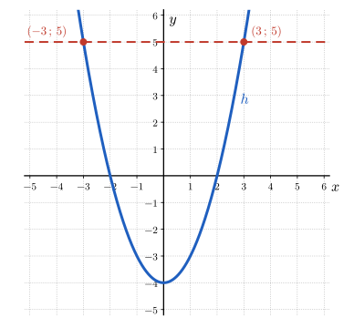{fig-alt="Parabole y = x² − 4. Une droite horizontale en pointillés à la hauteur 5 coupe la parabole aux points (−3 ; 5) et (3 ; 5)." width="100%"}
:::::
::::::

## Étape 1 : la réciproque existe-t-elle ?

[1]{.step} **Chaque sortie vient-elle d'une seule entrée ?**

. . .

::: aretenir
Non : $h(3) = h(-3) = 5$. Deux entrées différentes donnent la même sortie, donc $h$ **n'est pas injective** sur $\mathbb{R}$.

Pour une sortie $5$, la « fonction qui défait $h$ » devrait répondre $3$ **et** $-3$ : ce ne serait plus une fonction.
:::

## Étape 2 : le symétrique par rapport à $y = x$

[2]{.step} **Que donne le symétrique du graphe de $h$ par rapport à la droite $y = x$ ?**

:::::: columns
::::: {.column width="46%"}
. . .

::: aretenir
Échanger entrée et sortie, c'est tracer le **symétrique** du graphe par rapport à $y = x$.

Une droite verticale, par exemple $x = 5$, coupe cette courbe en **deux points**, $(5\,;\,3)$ et $(5\,;\,-3)$ : une même entrée aurait deux sorties.

**Cette courbe n'est pas le graphe d'une fonction.**
:::
:::::
::::: {.column width="54%"}
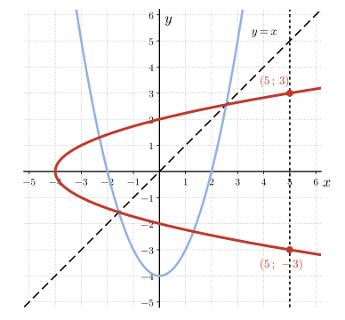{fig-alt="La parabole y = x² − 4 en bleu clair, la droite y = x en pointillés, et le symétrique de la parabole en rouge, une parabole couchée qui s'ouvre vers la droite. La droite verticale x = 5 la coupe en (5 ; 3) et en (5 ; −3)." width="100%"}
:::::
::::::

## Étape 3 : restreindre le domaine

[3]{.step} **Comment rendre $h$ injective ?**

:::::: columns
::::: {.column width="46%"}
. . .

::: aretenir
Une longueur n'est pas négative : on garde seulement les entrées de $[0,\,+\infty[$.

Sur cet intervalle, deux entrées différentes ont des carrés différents : la **restriction** de $h$ à $[0,\,+\infty[$ est injective.
:::
:::::
::::: {.column width="54%"}
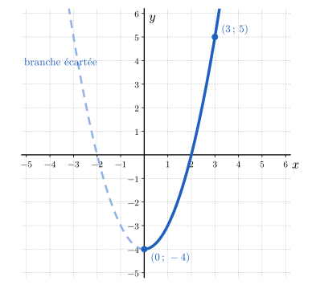{fig-alt="Parabole y = x² − 4 : la branche de droite (x ≥ 0), de (0 ; −4) à (3 ; 5), est en trait plein ; la branche de gauche est en pointillés clairs." width="100%"}
:::::
::::::

## Étape 4 : le symétrique de la restriction

[4]{.step} **Que donne maintenant le symétrique par rapport à $y = x$ ?**

:::::: columns
::::: {.column width="46%"}
. . .

::: aretenir
Le symétrique de la branche $x \geq 0$ est **le graphe d'une fonction** : chaque droite verticale le coupe en un seul point.

C'est la fonction réciproque $h^{-1}$. Le point $(0\,;\,-4)$ de $h$ devient le point $(-4\,;\,0)$ de $h^{-1}$.
:::
:::::
::::: {.column width="54%"}
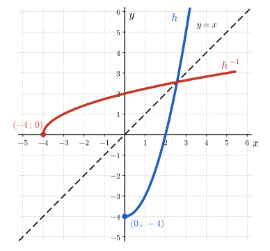{fig-alt="La branche x ≥ 0 de la parabole y = x² − 4 en bleu, la droite y = x en pointillés, et son symétrique en rouge : la courbe de la racine carrée qui part du point (−4 ; 0). Le point (0 ; −4) devient le point (−4 ; 0)." width="100%"}
:::::
::::::

## Étape 5 : calculer la formule

[5]{.step} **Comment obtenir l'expression de $h^{-1}$ ?**

. . .

::: aretenir
On pose $y = x^2 - 4$, donc $x^2 = y + 4$. Comme $x \geq 0$, on a $x = \sqrt{y + 4}$.

On échange les noms $x$ et $y$ pour écrire la réciproque comme une fonction de $x$ :
$$h^{-1}(x) = \sqrt{x + 4}, \qquad \mathit{Dom}(h^{-1}) = [-4,\,+\infty[.$$

Le domaine est l'image de la restriction de $h$ : pour $x \geq 0$, on a $h(x) \geq -4$.
:::

## Étape 6 : vérifier

[6]{.step} **Comment s'assurer du résultat ?**

. . .

::: aretenir
On a $h(3) = 5$ et $h^{-1}(5) = \sqrt{5 + 4} = 3$ : la réciproque redonne l'entrée de départ, et non $-3$.

Le résultat est cohérent avec le graphe : le point $(0\,;\,-4)$ de $h$ correspond au point $(-4\,;\,0)$ de $h^{-1}$, car $h^{-1}(-4) = \sqrt{0} = 0$.
:::

## Un cas déjà injectif : la conversion

La conversion des degrés Celsius en degrés Fahrenheit est la fonction $f(x) = 1{,}8\,x + 32$. Elle est injective sur $\mathbb{R}$ : il n'y a rien à restreindre.

. . .

::: aretenir
On pose $y = 1{,}8\,x + 32$. On défait d'abord l'addition, puis la multiplication : $x = \dfrac{y - 32}{1{,}8}$. On échange les noms :
$$f^{-1}(x) = \frac{x - 32}{1{,}8}, \qquad \mathit{Dom}(f^{-1}) = \mathbb{R}.$$
Vérification : $f(40) = 104$ et $f^{-1}(104) = \dfrac{72}{1{,}8} = 40$.
:::

## Une conversion, quatre registres

La même fonction s'écrit de quatre façons. Passer de l'une à l'autre fait partie du travail.

:::::: columns
::::: {.column width="50%"}
::: {.aretenir .smaller}
**Texte.** On multiplie la température en °C par $1{,}8$, puis on ajoute $32$.

**Formule.** $F = 1{,}8\,C + 32$.

| $C$ (°C) | $20$ | $37$ | $40$ |
|:---:|:---:|:---:|:---:|
| $F$ (°F) | $68$ | $98{,}6$ | $104$ |
:::
:::::
::::: {.column width="50%"}
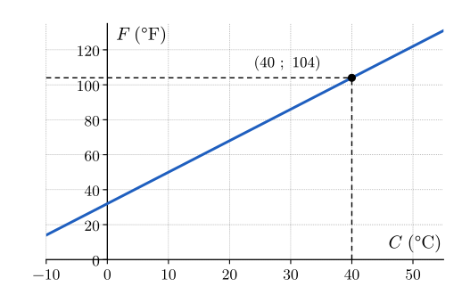{fig-alt="Droite F = 1,8 C + 32 ; le point (40 ; 104) est repéré par des pointillés." width="100%"}
:::::
::::::

::: notes
Diapositive facultative : à passer si les 20 minutes de méthodes sont serrées.
:::

## En diagramme sagittal

Chaque flèche relie une entrée à sa sortie. La fonction réciproque fait le chemin inverse : elle **remonte chaque flèche**.

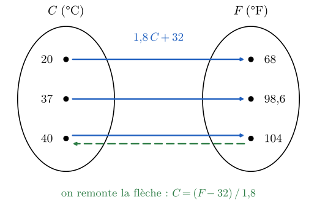{fig-alt="Diagramme sagittal de la conversion : 20 vers 68, 37 vers 98,6 et 40 vers 104. Une flèche en pointillés remonte de 104 vers 40." width="55%"}

::: {.aretenir .smaller}
Comme chaque entrée a une seule sortie et que chaque sortie vient d'une seule entrée, on peut remonter les flèches sans ambiguïté : c'est exactement la condition pour que la fonction réciproque existe.
:::

::: notes
Diapositive facultative : à passer si les 20 minutes de méthodes sont serrées.
:::

## Le piège à connaître

:::: piege
::: pg-titre
Piège
:::

Calculer la formule sans se demander si la fonction est injective : pour $h(x) = x^2 - 4$, $x^2 = y + 4$ donne $x = \pm\sqrt{y + 4}$, et la « réciproque » aurait deux valeurs. On choisit le signe de la racine d'après la restriction : $+\sqrt{x + 4}$ sur $[0,\,+\infty[$, $-\sqrt{x + 4}$ sur $]-\infty,\,0]$. On oublie aussi parfois d'échanger $x$ et $y$ à la fin.
::::

## La carte « Calculer une réciproque » {.smaller}

C'est la page qui t'attend sur ta **feuille de méthode** : même squelette, tu la remplis en même temps.

:::::::::::::: fiche
::: fiche-head
Calculer la fonction réciproque d'une fonction [[O6]{.obj}]{style="float:right"}
:::

:::::::::::: fiche-body
:::::: fiche-col
::: {.fiche-field .empty}
Exercices associés (numéros)

*à noter toi-même*
:::

::: {.fiche-field .empty}
Théorie associée (chapitre / slide)

*à noter toi-même*
:::

::: {.fiche-field .fragment}
Quand l'utiliser ?

On veut la formule de la fonction qui « défait » $f$, pour retrouver l'entrée à partir de n'importe quelle sortie.
:::
::::::

::::::: fiche-col
:::: fiche-field
Étapes

::: incremental
1.  **Vérifier** que $f$ est injective ; sinon, **restreindre** le domaine.
2.  **Poser** $y = f(x)$.
3.  **Isoler** $x$ en défaisant les opérations dans l'ordre inverse ; le signe d'une racine suit la restriction.
4.  **Échanger** les noms $x$ et $y$ : on obtient $f^{-1}(x)$.
5.  **Écrire** le domaine : $\mathit{Dom}(f^{-1}) = \mathit{Im}(f)$.
6.  **Vérifier** sur une valeur, $f^{-1}(f(a)) = a$, ou sur le graphe : symétrie par rapport à $y = x$.
:::
::::

::: {.fiche-field .fragment}
Exemple

Reprendre $h(x) = x^2 - 4$ sur $[0,\,+\infty[$, puis $f(x) = 1{,}8\,x + 32$.
:::

::: {.fiche-field .fragment}
Le piège

Ne pas se demander si $f$ est injective ; choisir le mauvais signe de la racine ; oublier d'échanger $x$ et $y$.
:::
:::::::
::::::::::::
::::::::::::::

::: footer-note
Cette fiche rejoint ta **boîte à outils** sur le site.
:::

# Sondage sur les séances — 10 minutes {.divider background-color="#14304a"}

## Ton avis sur les séances d'exercices

Ce sondage prolonge celui sur le cours théorique. Il porte cette fois sur les **séances d'exercices** : les exercices, les coups de pouce, les solutions, le déroulé.

Il est anonyme et prend environ 10 minutes.

::::::: wooclap
::: wc-play
▶
:::

:::: wc-body
**Ouvre le sondage**

::: wc-lien
Lien : À COMPLÉTER
:::
::::

<!--
::: {.wc-qr}


Sondage sur les séances
:::
-->

:::::::

::: notes
Les dix dernières minutes de la séance. Une proposition de questions se trouve dans wooclap-sondage.md (partie 2), à adapter au sondage sur la théorie.
:::
