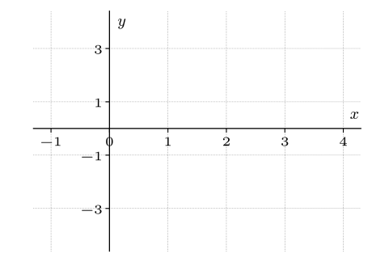
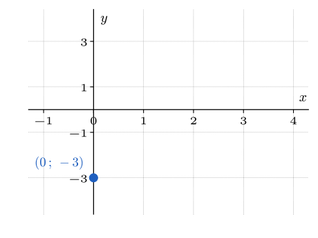
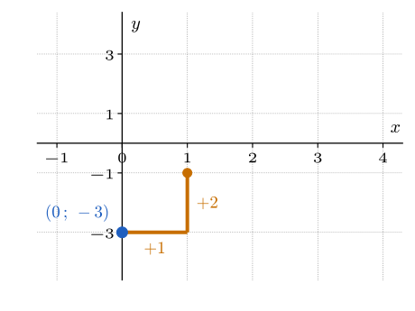
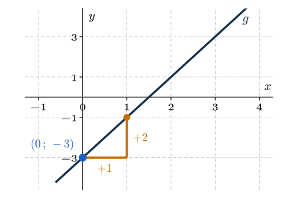
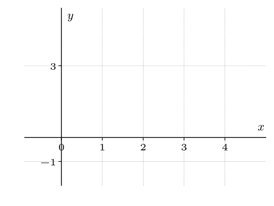
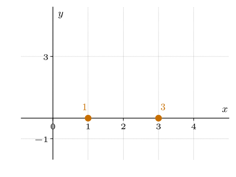
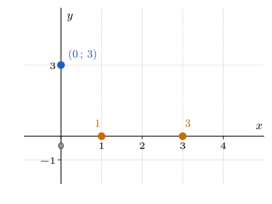
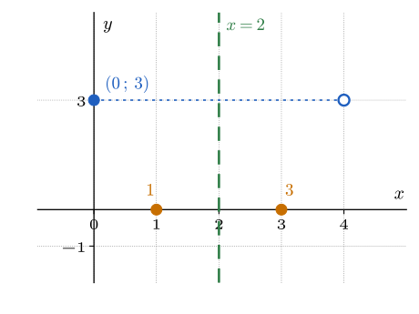
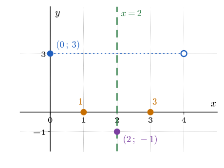
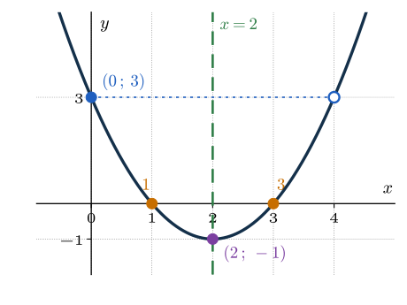

# Rappel {.divider background-color="#14304a"}

## Où trouver l'aide pendant la séance

[1]{.step} **Cherche d'abord seul·e** : bloquer fait partie de l'apprentissage.

[2]{.step} **Bloqué·e ?** Ouvre les **coups de pouce** du site, un à un et dans l'ordre : la référence théorique, la question à te poser, une étape, et seulement en dernier la solution.

[3]{.step} **Besoin d'une méthode type ?** La **boîte à outils** et les **fiches méthode** sont sur le site.

[4]{.step} **Toujours bloqué·e après les coups de pouce ?** Lève la main : quelqu'un passe t'aider.

::: aretenir
Le site est accessible tout le temps, en séance comme à la maison.
:::

::: notes
C'est normal de bloquer : ça fait partie de l'apprentissage. Quand ça t'arrive, cherche l'aide dans cet ordre : d'abord les coups de pouce du site, un à un, puis la boîte à outils et les fiches méthode, et si tu bloques encore, lève la main et quelqu'un viendra t'aider. Le site reste disponible tout le temps, en séance comme chez toi.
:::


## Retour sur le sondage d'octobre

[1]{.step} **Merci** d'avoir répondu au sondage.

[2]{.step} J'ai revu les **indices**, les **énoncés** et les **solutions** pour les rendre encore plus explicites.

[3]{.step} Aujourd'hui, on **teste ensemble la correction d'un exercice du socle**. Tu me diras si tu veux la garder à chaque séance.

[4]{.step} Certains retours demandent plus d'éclaircissements : à la fin de la séance, je te demanderai plus de détails sur ton avis sur le dispositif.

::: notes
Cinq à dix minutes pour ce retour, avec la diapositive suivante.
:::

## Ce que je veux garder

Je suis ouvert au changement. Je veux garder un principe : sur les deux heures d'exercices, **tu es actif·ve la majorité du temps**.

| | Temps actif | Part du temps de travail |
|:---|:---:|:---:|
| Avant | $30 + 30 + 15 = 75$ min sur $110$ | environ $70\,\%$ |
| À garder | au moins $65$ min sur $110$ | au moins $60\,\%$ |

::: aretenir
Tout changement du dispositif doit respecter ce seuil.
:::

::: notes
Temps de travail : 120 minutes moins la pause de 10 minutes, soit 110 minutes. Avec le déroulé du jour : socle 30 min, transfert 30 min et environ 5 min pour remplir la carte « Extrema », soit environ 65 minutes sur 110 (environ 59 %), à la limite du seuil de 60 %. Laisser les étudiant·es réagir, sans ouvrir de discussion longue : le sondage de fin de séance recueillera le détail.
:::

## Le déroulé de la séance

| Moment | Durée |
|:---|:---:|
| Retour sur le sondage d'octobre | 5 min |
| Échauffement | 10 min |
| Socle, en autonomie | 30 min |
| Exercice S.4 : confrontation et correction | 10 min |
| Pause | 10 min |
| Transfert, en autonomie | 30 min |
| Méthodes de la séance | 10 min |
| Sondage sur les séances | 10 min |

::: notes
Total prévu : 115 minutes, avec 5 minutes de battement. Le retour sur le sondage peut aller jusqu'à 10 minutes en prenant sur ce battement ou sur l'échauffement, qui ne compte plus que deux questions. L'échauffement doit tenir en 10 minutes, et le vote sur la correction de S.4 (1 minute) se fait dans les 10 minutes de S.4. Si la séance prend du retard, raccourcir la diapositive de rappel sur les extrema ou les rappels de tracé, jamais le sondage final. La méthode « Calculer une réciproque » a été retirée de la séance (archivée en commentaire dans ce fichier).
:::

## Et si tu avances vite ?

[1]{.step} **Le socle est maîtrisé ?** Passe au **transfert**, ou aux **défis**.

[2]{.step} Les **exercices supplémentaires** se font **à la maison**.

# Échauffement {.divider background-color="#14304a"}

## Les questions

::::::::::::::: columns
::::: {.column width="62%"}
:::: {style="font-size:.85em"}
**Q1** [[O3]{.obj}]{style="float:right"} — pour chacun des trois graphes, la fonction est-elle croissante, décroissante, ou ni l'une ni l'autre ?

{fig-alt="Trois graphes, nommés A, B et C, représentant chacun une fonction sur un intervalle, lus de gauche à droite" width="100%"}

**Q2** [[Rappel]{.obj}]{style="float:right"} — la relation $A = 2C + 1$ donne $A$ à partir de $C$. Quelle valeur de $C$ donne $A = 7$ ?
::::
:::::

::::::::::: {.column width="38%"}
::::: wooclap
:::: wc-body
**Vote sur Wooclap**

::: wc-lien
Code : DGFDDZN
:::
::::


::: {.wc-qr}

:::


:::::

::::::: et-timer
```{=html}
<style>
@keyframes et-pulse { 0%, 100% { opacity: 1; } 50% { opacity: .35; } }
</style>
```

:::::: {#et-timer-box data-default="300"}
:::: et-row
<button id="et-minus" class="et-btn" type="button" aria-label="Retirer une minute">

−1 min

</button>

::: {#et-display .et-display}
05:00
:::

<button id="et-plus" class="et-btn" type="button" aria-label="Ajouter une minute">

+1 min

</button>
::::

::: et-row
<button id="et-toggle" class="et-btn et-primary" type="button">

Démarrer

</button>

<button id="et-reset" class="et-btn" type="button" aria-label="Réinitialiser">

↺ Réinitialiser

</button>
:::
::::::
:::::::
:::::::::::
:::::::::::::::

```{=html}
<script>
(function () {
  var box = document.getElementById('et-timer-box');
  if (!box) return;
  var DEFAULT = parseInt(box.getAttribute('data-default'), 10) || 300;
  var display = document.getElementById('et-display');
  var btnToggle = document.getElementById('et-toggle');
  var btnMinus = document.getElementById('et-minus');
  var btnPlus = document.getElementById('et-plus');
  var btnReset = document.getElementById('et-reset');

  var remaining = DEFAULT;
  var running = false;
  var intervalId = null;
  var audioCtx = null;

  function fmt(s) {
    s = Math.max(0, s);
    var m = Math.floor(s / 60);
    var sec = s % 60;
    return (m < 10 ? '0' : '') + m + ':' + (sec < 10 ? '0' : '') + sec;
  }

  function render() {
    display.textContent = fmt(remaining);
    display.classList.toggle('et-warn', running && remaining <= 30 && remaining > 0);
    display.classList.toggle('et-done', remaining === 0);
  }

  function beep() {
    try {
      if (!audioCtx) audioCtx = new (window.AudioContext || window.webkitAudioContext)();
      var t0 = audioCtx.currentTime;
      [0, 0.35].forEach(function (offset) {
        var osc = audioCtx.createOscillator();
        var gain = audioCtx.createGain();
        osc.type = 'sine';
        osc.frequency.value = 880;
        gain.gain.setValueAtTime(0.0001, t0 + offset);
        gain.gain.exponentialRampToValueAtTime(0.3, t0 + offset + 0.02);
        gain.gain.exponentialRampToValueAtTime(0.0001, t0 + offset + 0.28);
        osc.connect(gain);
        gain.connect(audioCtx.destination);
        osc.start(t0 + offset);
        osc.stop(t0 + offset + 0.3);
      });
    } catch (e) {}
  }

  function stop() {
    running = false;
    btnToggle.textContent = remaining > 0 ? 'Reprendre' : 'Démarrer';
    if (intervalId) { clearInterval(intervalId); intervalId = null; }
  }

  function tick() {
    remaining -= 1;
    if (remaining <= 0) {
      remaining = 0;
      stop();
      beep();
    }
    render();
  }

  function start() {
    if (running) return;
    try {
      if (!audioCtx) audioCtx = new (window.AudioContext || window.webkitAudioContext)();
      if (audioCtx.state === 'suspended') audioCtx.resume();
    } catch (e) {}
    if (remaining <= 0) remaining = DEFAULT;
    render();
    running = true;
    btnToggle.textContent = 'Pause';
    intervalId = setInterval(tick, 1000);
  }

  btnToggle.addEventListener('click', function () { running ? stop() : start(); });
  btnMinus.addEventListener('click', function () {
    remaining = Math.max(0, remaining - 60);
    render();
    if (remaining === 0) stop();
  });
  btnPlus.addEventListener('click', function () {
    remaining = remaining + 60;
    render();
  });
  btnReset.addEventListener('click', function () {
    stop();
    remaining = DEFAULT;
    btnToggle.textContent = 'Démarrer';
    render();
  });

  render();
})();
</script>
```

## Q1 [[O3]{.obj}]{style="float:right"}

Pour chacun des trois graphes, la fonction est-elle croissante, décroissante, ou ni l'une ni l'autre ?

{fig-alt="Trois graphes, nommés A, B et C, représentant chacun une fonction sur un intervalle, lus de gauche à droite" width="95%" fig-align="center"}

::: notes
Faire lire chaque graphe de gauche à droite à voix haute avant de donner la réponse. Cette question prépare la question (a) de l'exercice S.3 et la définition de la croissance.
:::

## Q1 : réponse [[O3]{.obj}]{style="float:right"}

{fig-alt="Les trois graphes A, B et C. Le graphe A est entièrement en vert : la fonction est croissante. Le graphe B est entièrement en rouge : la fonction est décroissante. Le graphe C est en rouge jusqu'à son point le plus bas, puis en vert : la fonction décroît d'abord, puis croît." width="95%" fig-align="center"}

::: notes
Vert : partie croissante ; rouge : partie décroissante. A : croissante, même si ses valeurs restent négatives. B : décroissante, même si ses valeurs restent positives. C : ni croissante ni décroissante, car elle descend d'abord puis monte. Confondre le sens de variation avec le signe des valeurs est l'erreur classique : être au-dessus ou en dessous de l'axe horizontal ne dit rien sur la croissance.
:::

## Q2 [[Rappel]{.obj}]{style="float:right"}

La relation $A = 2C + 1$ donne $A$ à partir de $C$. Quelle valeur de $C$ donne $A = 7$ ?

. . .

::: aretenir
On remplace $A$ par $7$ : $7 = 2C + 1$. On soustrait $1$ : $6 = 2C$. On divise par $2$ : $C = 3$.

Vérification : $2 \cdot 3 + 1 = 7$, ce qui redonne bien la sortie.

Ici, on connaissait la **sortie** et on cherchait l'**entrée** : c'est la situation des exercices de transfert.
:::

::: notes
On défait les opérations dans l'ordre inverse. L'erreur typique est de diviser par $2$ avant de soustraire $1$, ce qui donne $2{,}5$ au lieu de $3$.
:::

# Socle — 30 minutes {.divider background-color="#14304a"}

::: notes
Lancer le socle. Annoncer que l'exercice S.4 sera confronté puis corrigé ensemble à la fin du socle : chacun doit l'avoir cherché.
:::

## Au travail {.travail data-minutes="30"}



# Exercice S.4 : confrontation et correction {.divider background-color="#1f5fbf"}

::: notes
Dix minutes, juste après les 30 minutes de socle. Rappeler que cette correction en commun répond au sondage d'octobre, et qu'on demandera à la fin si elle est utile. Les étudiant·es ont cherché S.4 pendant le socle : on confronte d'abord leurs réponses, puis on corrige.
:::

## L'énoncé

:::::: columns
::::: {.column width="58%"}
::: {style="font-size:.8em"}
Soit $f(x) = x^2 - 4x + 3$. Pour chaque intervalle, $f$ admet-elle sur cet intervalle :

**A.** un maximum et un minimum ; **B.** uniquement un maximum ; **C.** uniquement un minimum ; **D.** ni maximum ni minimum ?

(a) $[0,\,5]$ (b) $[0,\,5[$ (c) $]2,\,5]$ (d) $[0,\,4[$

(e) Pourquoi exclure $5$ fait-il disparaître le maximum en (b), alors qu'exclure $4$ ne le fait pas disparaître en (d) ?
:::
:::::
::::: {.column width="42%"}
{fig-alt="Parabole y = x² − 4x + 3, de point le plus bas (2 ; −1), qui passe par (0 ; 3), (4 ; 3) et (5 ; 8)." width="100%"}
:::::
::::::

## Confrontation des réponses

Pour chaque intervalle, vote **A**, **B**, **C** ou **D** sur Wooclap, puis compare ta réponse avec celle de ton voisin ou de ta voisine.

| Intervalle | (a) $[0,\,5]$ | (b) $[0,\,5[$ | (c) $]2,\,5]$ | (d) $[0,\,4[$ |
|:---:|:---:|:---:|:---:|:---:|
| Votre réponse | | | | |

::::::::: columns
::::: {.column width="62%"}
::::::: wooclap
::: wc-play
▶
:::

:::: wc-body
**Vote sur Wooclap**

::: wc-lien
Code : INZSBAI
:::
::::


::: {.wc-qr}


Confrontation de S.4
:::

:::::::
:::::
::::: {.column width="38%"}
::: {.minuteur data-minutes="2"}

:::
:::::
:::::::::

::: notes
Faire voter intervalle par intervalle sur Wooclap (les choix sont dans wooclap-confrontation.md), puis laisser 2 minutes de discussion entre voisins avant la correction (minuteur à droite de l'encadré Wooclap). Les intervalles (b) et (d) devraient diviser la classe.
:::

## (a) Sur $[0,\,5]$

:::::: columns
::::: {.column width="42%"}
. . .

::: aretenir
Le minimum vaut $-1$, atteint en $2$. Le maximum vaut $8$, atteint en $5$.

**Réponse A.**
:::
:::::
::::: {.column width="58%"}
{fig-alt="Parabole y = x² − 4x + 3 en trait pâle. La portion au-dessus de l'intervalle [0 ; 5] est en couleur, avec un point plein en (0 ; 3) et un point plein en (5 ; 8). Le segment [0 ; 5] est marqué sur l'axe des abscisses, avec deux points pleins." width="100%"}
:::::
::::::

::: notes
Un extremum doit être atteint en une abscisse qui appartient à l'intervalle : c'est la définition du cours. Les étapes de la méthode seront reprises avec la fiche méthode.
:::

## (b) Sur $[0,\,5[$

:::::: columns
::::: {.column width="42%"}
. . .

::: aretenir
Le minimum vaut $-1$, atteint en $2$.

Les valeurs s'approchent de $8$ quand $x$ s'approche de $5$, mais $5$ est exclu : une abscisse plus proche de $5$ donne toujours une valeur plus grande. Il n'y a pas de maximum.

**Réponse C.**
:::
:::::
::::: {.column width="58%"}
{fig-alt="Parabole y = x² − 4x + 3 en trait pâle. La portion au-dessus de l'intervalle [0 ; 5[ est en couleur, avec un point plein en (0 ; 3) et un point creux en (5 ; 8). Le segment [0 ; 5[ est marqué sur l'axe des abscisses, avec un point plein en 0 et un point creux en 5." width="100%"}
:::::
::::::

## (c) Sur $]2,\,5]$

:::::: columns
::::: {.column width="42%"}
. . .

::: aretenir
Le maximum vaut $8$, atteint en $5$.

Les valeurs s'approchent de $-1$ quand $x$ s'approche de $2$, mais $2$ est exclu. Il n'y a pas de minimum.

**Réponse B.**
:::
:::::
::::: {.column width="58%"}
{fig-alt="Parabole y = x² − 4x + 3 en trait pâle. La portion au-dessus de l'intervalle ]2 ; 5] est en couleur, avec un point creux en (2 ; −1) et un point plein en (5 ; 8). Le segment ]2 ; 5] est marqué sur l'axe des abscisses, avec un point creux en 2 et un point plein en 5." width="100%"}
:::::
::::::

## (d) Sur $[0,\,4[$

:::::: columns
::::: {.column width="42%"}
. . .

::: aretenir
Le minimum vaut $-1$, atteint en $2$.

Près de la borne exclue $4$, les valeurs s'approchent de $3$ sans l'atteindre, mais la valeur $3$ est **déjà atteinte en $0$**. Aucune valeur ne dépasse $3$ : le maximum vaut $3$, atteint en $0$.

**Réponse A.**
:::
:::::
::::: {.column width="58%"}
{fig-alt="Parabole y = x² − 4x + 3 en trait pâle. La portion au-dessus de l'intervalle [0 ; 4[ est en couleur, avec un point plein en (0 ; 3) et un point creux en (4 ; 3). Le segment [0 ; 4[ est marqué sur l'axe des abscisses, avec un point plein en 0 et un point creux en 4." width="100%"}
:::::
::::::

## (e) Pourquoi $5$ et pas $4$ ?

:::::: columns
::::: {.column width="50%"}
**(b)** $[0,\,5[$

{fig-alt="Parabole y = x² − 4x + 3 en trait pâle ; portion au-dessus de [0 ; 5[ en orange, point plein en (0 ; 3), point creux en (5 ; 8). Une droite en pointillés à la hauteur 8 passe par le point creux : la valeur 8 n'est jamais atteinte." width="100%"}
:::::
::::: {.column width="50%"}
**(d)** $[0,\,4[$

{fig-alt="Parabole y = x² − 4x + 3 en trait pâle ; portion au-dessus de [0 ; 4[ en orange, point plein en (0 ; 3), point creux en (4 ; 3). Une droite en pointillés à la hauteur 3 passe par les deux points : la valeur 3 est atteinte en 0." width="100%"}
:::::
::::::

::: notes
En (b), la valeur dont f s'approche près de la borne exclue, 8, est plus grande que toutes les valeurs atteintes : pas de maximum. En (d), la valeur dont elle s'approche, 3, est déjà atteinte en 0 : le maximum existe.
:::

## Le piège à connaître

:::: piege
::: pg-titre
Piège
:::

Donner comme maximum la valeur en une borne exclue, par exemple $8$ sur $[0,\,5[$ : un maximum doit être atteint en une abscisse de l'intervalle. À l'inverse, croire qu'une borne exclue supprime **toujours** un extremum : sur $[0,\,4[$, le maximum existe.
::::

## Rappel : tracer une fonction du 1er degré {.smaller}

:::::: columns
::::: {.column width="44%"}
$$g(x) = \textcolor{#c76e00}{2}\,x \;\textcolor{#1f5fbf}{-\,3}$$

::: {.fragment data-fragment-index=1}
[1]{.step} [L'ordonnée à l'origine]{style="color:#1f5fbf;font-weight:600"} $-3$ donne le point $(0\,;\,-3)$ : le graphe coupe l'axe vertical en ce point.
:::

::: {.fragment data-fragment-index=2}
[2]{.step} [La pente]{style="color:#c76e00;font-weight:600"} $2$ dit comment monter : quand $x$ augmente de $1$, $g(x)$ augmente de $2$.
:::

::: {.fragment data-fragment-index=3}
[3]{.step} On trace la droite par le point $(0\,;\,-3)$ et le point obtenu en avançant de $1$ et en montant de $2$.
:::
:::::
::::: {.column width="56%"}
:::: r-stack
::: {.fragment .fade-out data-fragment-index=1}
{width="100%"}
:::
::: {.fragment .fade-in-then-out data-fragment-index=1}
{width="100%"}
:::
::: {.fragment .fade-in-then-out data-fragment-index=2}
{width="100%"}
:::
::: {.fragment data-fragment-index=3}
{width="100%" fig-alt="Droite y = 2x − 3 construite en trois étapes : le point (0 ; −3) en bleu, l'escalier orange d'un pas de 1 vers la droite et d'une montée de 2, puis la droite elle-même."}
:::
::::
:::::
::::::

## Rappel : tracer une fonction du 2e degré {.smaller}

:::::: columns
::::: {.column width="44%"}
$$f(x) = x^2 - 4x + 3 $$

::: {.fragment data-fragment-index=1}
[1]{.step} [Les racines]{style="color:#c76e00;font-weight:600"} : $f(x) = 0$ donne $x = 1$ et $x = 3$.
:::

::: {.fragment data-fragment-index=2}
[2]{.step} [L'ordonnée à l'origine]{style="color:#1f5fbf;font-weight:600"} : $f(0) = 3$, point $(0\,;\,3)$.
:::

::: {.fragment data-fragment-index=3}
[3]{.step} [L'axe de symétrie]{style="color:#2e7d46;font-weight:600"} passe au milieu des racines : $x = \dfrac{1 + 3}{2} = 2$. Le symétrique de $(0\,;\,3)$ est $(4\,;\,3)$.
:::

::: {.fragment data-fragment-index=4}
[4]{.step} [Le sommet]{style="color:#7b3fa0;font-weight:600"} est sur l'axe : $f(2) = -1$, point $(2\,;\,-1)$.
:::

::: {.fragment data-fragment-index=5}
[5]{.step} On trace la parabole par tous ces points.
:::
:::::
::::: {.column width="56%"}
:::: r-stack
::: {.fragment .fade-out data-fragment-index=1}
{width="100%"}
:::
::: {.fragment .fade-in-then-out data-fragment-index=1}
{width="100%"}
:::
::: {.fragment .fade-in-then-out data-fragment-index=2}
{width="100%"}
:::
::: {.fragment .fade-in-then-out data-fragment-index=3}
{width="100%"}
:::
::: {.fragment .fade-in-then-out data-fragment-index=4}
{width="100%"}
:::
::: {.fragment data-fragment-index=5}
{width="100%" fig-alt="Parabole y = x² − 4x + 3 construite en cinq étapes : racines 1 et 3 en orange, point (0 ; 3) en bleu, axe de symétrie x = 2 en vert avec le symétrique (4 ; 3), sommet (2 ; −1) en violet, puis la parabole."}
:::
::::
:::::
::::::

## La fonction du 2e degré : comment la tracer ? {.smaller}

:::::: columns
::::: {.column width="48%"}

**Forme développée** $\quad f(x) = ax^2 + bx + c$

| | |
|:---|:---|
| [Ordonnée à l'origine]{style="color:#1f5fbf;font-weight:600"} | $f(0) = c$ |
| [Axe de symétrie]{style="color:#2e7d46;font-weight:600"} | $x = -\dfrac{b}{2a}$ |
| [Sommet]{style="color:#7b3fa0;font-weight:600"} | $\left(-\dfrac{b}{2a}\ ;\ f\!\left(-\dfrac{b}{2a}\right)\right)$ |
| [Racines]{style="color:#c76e00;font-weight:600"} | $x = \dfrac{-b \pm \sqrt{b^2 - 4ac}}{2a}$, si $b^2 - 4ac \geq 0$ |

Si $a > 0$, la parabole est ouverte vers le haut et le sommet est son point le plus bas ; si $a < 0$, elle est ouverte vers le bas et le sommet est son point le plus haut.
:::::
::::: {.column width="52%"}
{width="100%" fig-alt="Parabole y = x² − 4x + 3 avec ses racines en orange, son ordonnée à l'origine en bleu, son axe de symétrie en vert et son sommet en violet."}
:::::
::::::

## La fonction du 2e degré : comment la tracer ? {.smaller}

:::::: columns
::::: {.column width="48%"}

**Forme canonique** $\quad f(x) = a(x - \alpha)^2 + \beta$

| | |
|:---|:---|
| [Ordonnée à l'origine]{style="color:#1f5fbf;font-weight:600"} | $f(0) = a\alpha^2 + \beta$ |
| [Axe de symétrie]{style="color:#2e7d46;font-weight:600"} | $x = \alpha$ |
| [Sommet]{style="color:#7b3fa0;font-weight:600"} | $(\alpha\ ;\ \beta)$ |
| [Racines]{style="color:#c76e00;font-weight:600"} | $x = \alpha \pm \sqrt{-\dfrac{\beta}{a}}$, si $-\dfrac{\beta}{a} \geq 0$ |
:::::
::::: {.column width="52%"}
{width="100%" fig-alt="Parabole y = x² − 4x + 3 avec ses racines en orange, son ordonnée à l'origine en bleu, son axe de symétrie en vert et son sommet en violet."}
:::::
::::::

## La fonction du 2e degré : comment la tracer ? {.smaller}

:::::: columns
::::: {.column width="48%"}

**Forme factorisée** $\quad f(x) = a(x - x_1)(x - x_2)$

| | |
|:---|:---|
| [Ordonnée à l'origine]{style="color:#1f5fbf;font-weight:600"} | $f(0) = a\,x_1 x_2$ |
| [Axe de symétrie]{style="color:#2e7d46;font-weight:600"} | $x = \dfrac{x_1 + x_2}{2}$ |
| [Sommet]{style="color:#7b3fa0;font-weight:600"} | $\left(\dfrac{x_1 + x_2}{2}\ ;\ f\!\left(\dfrac{x_1 + x_2}{2}\right)\right)$ |
| [Racines]{style="color:#c76e00;font-weight:600"} | $x_1$ et $x_2$ |

Cette forme existe seulement si $f$ a des racines.
:::::
::::: {.column width="52%"}
{width="100%" fig-alt="Parabole y = x² − 4x + 3 avec ses racines en orange, son ordonnée à l'origine en bleu, son axe de symétrie en vert et son sommet en violet."}
:::::
::::::

## Ton avis : faut-il garder cette correction en commun ?

Suite au sondage d'octobre, on a testé aujourd'hui la correction d'un exercice du socle, ensemble, après confrontation de vos réponses.

**Cette correction en commun t'a-t-elle été utile ? Faut-il la garder aux prochaines séances ?**

::::::: wooclap
::: wc-play
▶
:::

:::: wc-body
**Vote sur Wooclap**

::: wc-lien
Code : XXFLAMP
:::
::::


::: {.wc-qr}


Correction en commun
:::


:::::::

::: notes
Une minute de vote. Les choix sont dans wooclap-sondage.md (question 1). Annoncer le résultat en une phrase, puis lancer la pause.
:::

# Pause — 10 minutes {.divider background-color="#14304a"}

# Transfert — 30 minutes {.divider background-color="#14304a"}

::: notes
Les étudiant·es travaillent le transfert (T.1 à T.3) avec les coups de pouce du site.
:::

## Au travail {.travail data-minutes="30"}



# Méthodes de la séance — 10 minutes {.divider background-color="#1f5fbf"}

::: notes
Une seule fiche : la carte « Extrema » (la méthode vient d'être vue avec S.4), environ 10 minutes avec le rappel. La méthode « Calculer une réciproque » est retirée.
:::

## Pour se rafraîchir la mémoire : les extrema

:::::: columns
::::: {.column width="50%"}
**S.3 : $f(x) = (x+2)(x-1)^2$ sur $[-3,\,3]$**

{fig-alt="Graphe de f(x) = (x + 2)(x − 1)² sur [−3 ; 3]. Points orange aux extrémités : minimum global en (−3 ; −16) et maximum global en (3 ; 20). Points bleus : maximum local en (−1 ; 4) et minimum local en (1 ; 0)." width="100%"}
:::::
::::: {.column width="50%"}
**S.4 : $f(x) = x^2 - 4x + 3$ sur $[0,\,5[$**

{fig-alt="Parabole y = x² − 4x + 3 ; portion au-dessus de [0 ; 5[ en orange. Point plein en (2 ; −1) : c'est le minimum. Point creux en (5 ; 8) : la valeur 8 n'est pas atteinte, donc il n'y a pas de maximum." width="100%"}
:::::
::::::

::: notes
Les graphes des exercices S.3 et S.4. À gauche, orange : extremum global ; bleu : extremum local seulement. À droite : la borne exclue 5 supprime le maximum.
:::

## La carte « Extrema sur un intervalle » {.smaller}

:::::::::::::: fiche
::: fiche-head
Déterminer les extrema d'une fonction sur un intervalle [[O3]{.obj}]{style="float:right"}
:::

:::::::::::: fiche-body
:::::: fiche-col
::: {.fiche-field .empty}
Exercices associés (numéros)

*à noter toi-même*
:::

::: {.fiche-field .empty}
Théorie associée (chapitre / slide)

*à noter toi-même*
:::

::: {.fiche-field .fragment}
Quand l'utiliser ?

Il faut savoir si une fonction admet un maximum ou un minimum sur un intervalle, surtout quand une borne est exclue.
:::
::::::

::::::: fiche-col
:::: fiche-field
Étapes

::: incremental
1.  **Repérer** où la fonction croît et où elle décroît sur l'intervalle.
2.  **Lister** les candidats : changements de variation et bornes.
3.  **Regarder** si chaque borne est incluse ou exclue.
4.  **Comparer** les valeurs atteintes avec les valeurs approchées près des bornes exclues.
5.  **Conclure** : abscisse et valeur de chaque extremum, ou absence.
:::
::::

::: {.fiche-field .fragment}
Exemple

Une autre fonction que celle de S.4, par exemple $g(x) = 2x - 1$ sur $[0,\,3[$.
:::

::: {.fiche-field .fragment}
Le piège

Prendre la valeur en une borne exclue comme extremum ; croire qu'une borne exclue supprime toujours l'extremum.
:::
:::::::
::::::::::::
::::::::::::::

::: footer-note
Cette fiche rejoint ta **boîte à outils** sur le site.
:::

# Sondage sur les séances — 10 minutes {.divider background-color="#14304a"}

## Ton avis sur les séances d'exercices

Ce sondage prolonge celui sur le cours théorique. Il porte cette fois sur les **séances d'exercices** : les exercices, les coups de pouce, les solutions, le déroulé.

Il est anonyme et prend environ 10 minutes.

::::::: wooclap
::: wc-play
▶
:::

:::: wc-body
**Ouvre le sondage**

::: wc-lien
Lien :XXFLAMP
:::
::::


::: {.wc-qr}


Sondage sur les séances
:::


:::::::

::: notes
Les dix dernières minutes de la séance. Une proposition de questions se trouve dans wooclap-sondage.md (partie 2), à adapter au sondage sur la théorie.
:::
