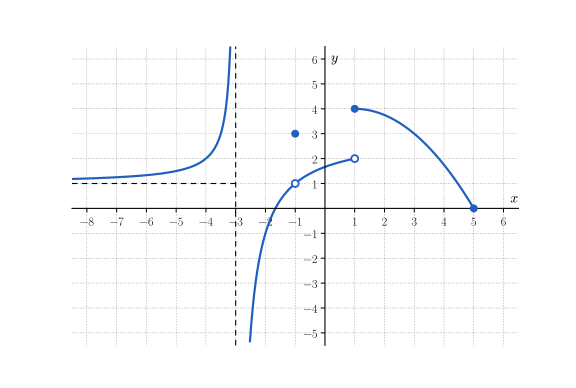
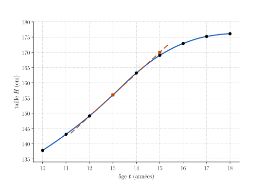

# Échauffement {.divider background-color="#14304a"}

## Les questions

::::::::::::::: columns
::::: {.column width="62%"}
:::: {style="font-size:.9em"}
**Q1** [[Rappel]{.obj}]{style="float:right"} — quelle est la pente de la droite qui passe par $(1\,;\,5)$ et $(4\,;\,-1)$ ?

**Q2** [[Rappel]{.obj}]{style="float:right"} — quelle est l'équation de la droite de pente $3$ qui passe par $(1\,;\,2)$ ?

**Q3** [[Rappel]{.obj}]{style="float:right"} — pour $h \neq 0$, simplifie $\dfrac{(2 + h)^{2} - 4}{h}$.
::::
:::::

::::::::::: {.column .outils-serres width="38%"}
::::: wooclap
:::: wc-body
**Vote sur Wooclap**

::: wc-lien
Code : À COMPLÉTER
:::
::::

<!-- Décommenter après python3 make-qr.py :
::: {.wc-qr}

:::
-->

:::::

::: {.minuteur data-minutes="5"}

:::
:::::::::::
:::::::::::::::

```{=html}
<style>
.outils-serres { display: flex; flex-direction: column; gap: .35em; }
.outils-serres .wooclap { margin: 0; }
.outils-serres .et-timer { margin-top: 0; }
.outils-serres .et-timer, .outils-serres .et-box { width: 100%; box-sizing: border-box; }
</style>
```

::: notes
Cinq minutes sur papier, puis le vote (les choix sont dans wooclap-echauffement.md). Les trois questions portent sur des prérequis de la séance : la pente d'une droite (taux moyen et sécante, S.1 et S.2), l'équation d'une droite (tangente, S.6) et une simplification par $h$ (quotient différentiel, S.6 et S.7).
:::

## Q1 [[Rappel]{.obj}]{style="float:right"}

Quelle est la pente de la droite qui passe par $(1\,;\,5)$ et $(4\,;\,-1)$ ?

. . .

::: aretenir
La pente est la variation de $y$ divisée par la variation de $x$ : $m = \dfrac{-1 - 5}{4 - 1} = \dfrac{-6}{3} = -2$.

C'est exactement le calcul d'un **taux de variation moyen** : la pente de la sécante.
:::

::: notes
Erreurs classiques : le quotient inversé ($-\tfrac12$), le signe ($2$), l'oubli du dénominateur ($-6$).
:::

## Q2 [[Rappel]{.obj}]{style="float:right"}

Quelle est l'équation de la droite de pente $3$ qui passe par $(1\,;\,2)$ ?

. . .

::: aretenir
On écrit $y = 2 + 3(x - 1)$, c'est-à-dire $y = 3x - 1$. Vérification : pour $x = 1$, on obtient $y = 2$.

C'est la forme de la **tangente** : $y = f(a) + f'(a) \cdot (x - a)$.
:::

::: notes
Erreurs classiques : prendre l'ordonnée du point comme ordonnée à l'origine ($y = 3x + 2$), une erreur de signe dans $x - 1$ ($y = 3x + 5$), échanger pente et ordonnée ($y = 2x + 1$).
:::

## Q3 [[Rappel]{.obj}]{style="float:right"}

Pour $h \neq 0$, simplifie $\dfrac{(2 + h)^{2} - 4}{h}$.

. . .

::: aretenir
$(2 + h)^{2} - 4 = 4 + 4h + h^{2} - 4 = h\,(4 + h)$, donc, comme $h \neq 0$, $\dfrac{(2 + h)^{2} - 4}{h} = 4 + h$.

C'est le **quotient différentiel** de $x^{2}$ en $2$ : quand $h$ tend vers $0$, il tend vers $4$.
:::

::: notes
Erreurs classiques : $(2 + h)^{2} = 4 + h^{2}$, ce qui donne $h$ ; remplacer $h$ par $0$ trop tôt, ce qui donne $\tfrac00$ ; garder $4 + h$ mais « oublier » le $h$, ce qui donne $4$ (c'est la limite, pas le quotient).
:::

# Socle — 35 minutes {.divider background-color="#14304a"}

::: notes
Lancer le socle. Annoncer que l'exercice S.3 sera corrigé ensemble juste après le socle : chacun doit l'avoir cherché seul et repérer l'endroit exact où il bloque.
:::

## Au travail {.travail .sans-jauge data-minutes="35"}



# Exercice S.3 : correction, puis méthode 1 {.divider background-color="#1f5fbf"}

::: notes
Quinze minutes : environ 8 minutes de correction, puis 7 minutes pour la carte « Lire une limite sur un graphique ».
:::

## Quelles limites as-tu lues ? [[O3]{.obj}]{style="float:right"}

::::::::::::::: columns
::::: {.column width="58%"}
{width="100%" fig-alt="Graphique de la fonction f de l'exercice S.3."}
:::::

::::::::::: {.column .outils-serres width="42%"}
::::: wooclap
:::: wc-body
**Vote sur Wooclap**.

::: wc-lien
Code : À COMPLÉTER
:::
::::

<!-- Décommenter après python3 make-qr.py :
::: {.wc-qr}

:::
-->
:::::
:::::::::::
:::::::::::::::

::: notes
Une question Wooclap par sous-question (les choix sont dans wooclap-S3.md). On corrige d'abord la sous-question où les votes sont les plus partagés, probablement (a) ou (b) : limite confondue avec l'image, moyenne des limites orientées.
:::

## S.3 (a) [[O3]{.obj}]{style="float:right"} {.smaller}

:::::: columns
::::: {.column width="55%"}
Lis $\lim_{x \to -1} f(x)$, puis $f(-1)$.

. . .

[1]{.step} On cache le point d'abscisse $-1$ et on suit la courbe des deux côtés : elle se rapproche du point vide $(-1\,;\,1)$.

. . .

[2]{.step} Donc $\lim_{x \to -1} f(x) = 1$.

. . .

[3]{.step} Le point plein donne l'image : $f(-1) = 3$.

. . .

::: aretenir
**Piège : lire la limite sur le point plein.** La limite ne teste pas $x = -1$ : $\lim_{x \to -1} f(x) = 1 \neq 3 = f(-1)$. Il peut y avoir un « trou ».
:::
:::::
::::: {.column width="45%"}
{width="100%" fig-alt="Graphique de la fonction f de l'exercice S.3."}
:::::
::::::

## S.3 (b) [[O3]{.obj}]{style="float:right"} {.smaller}

:::::: columns
::::: {.column width="55%"}
Lis $\lim_{x \to 1^-} f(x)$, $\lim_{x \to 1^+} f(x)$ et $f(1)$. La fonction $f$ admet-elle une limite en $1$ ?

. . .

[1]{.step} Par la gauche, la courbe arrive au point vide $(1\,;\,2)$ : $\lim_{x \to 1^-} f(x) = 2$.

. . .

[2]{.step} Par la droite, elle part du point plein $(1\,;\,4)$ : $\lim_{x \to 1^+} f(x) = 4$, et $f(1) = 4$.

. . .

[3]{.step} Les deux limites orientées sont différentes : $f$ n'admet **pas** de limite en $1$.

. . .

::: aretenir
**Piège : faire la moyenne, ou prendre l'image.** Ni $3$, ni $4$ : la limite n'existe que si les limites à gauche et à droite sont égales.
:::
:::::
::::: {.column width="45%"}
{width="100%" fig-alt="Graphique de la fonction f de l'exercice S.3."}
:::::
::::::

## S.3 (c) [[O3]{.obj}]{style="float:right"} {.smaller}

:::::: columns
::::: {.column width="55%"}
Lis $\lim_{x \to -3^-} f(x)$ et $\lim_{x \to -3^+} f(x)$.

. . .

[1]{.step} À gauche de $-3$, la courbe monte le long de la droite verticale : $\lim_{x \to -3^-} f(x) = +\infty$.

. . .

[2]{.step} À droite de $-3$, elle descend le long de cette droite : $\lim_{x \to -3^+} f(x) = -\infty$.

. . .

::: aretenir
Une **limite infinie en un point fini** donne une **asymptote verticale** : ici, la droite d'équation $x = -3$.
:::
:::::
::::: {.column width="45%"}
{width="100%" fig-alt="Graphique de la fonction f de l'exercice S.3."}
:::::
::::::

## S.3 (d) [[O3]{.obj}]{style="float:right"} {.smaller}

:::::: columns
::::: {.column width="55%"}
Lis $\lim_{x \to -\infty} f(x)$, puis $\lim_{x \to 5} f(x)$.

. . .

[1]{.step} Vers la gauche, la courbe se rapproche de la droite horizontale $y = 1$ : $\lim_{x \to -\infty} f(x) = 1$, une **asymptote horizontale**.

. . .

[2]{.step} Le domaine s'arrête en $5$ : on ne peut approcher $5$ que par la gauche, et la courbe arrive en $(5\,;\,0)$.

. . .

[3]{.step} On se contente de la limite orientée disponible : $\lim_{x \to 5} f(x) = 0$.

. . .

::: aretenir
**Piège : « il manque un côté, donc pas de limite ».** Lorsqu'une seule approche est possible, la limite orientée disponible suffit.
:::
:::::
::::: {.column width="45%"}
{width="100%" fig-alt="Graphique de la fonction f de l'exercice S.3."}
:::::
::::::

## La carte « Lire une limite sur un graphique » {.smaller}

:::::::::::::: fiche
::: fiche-head
Lire une limite sur un graphique [[O3]{.obj}]{style="float:right"}
:::

:::::::::::: fiche-body
:::::: fiche-col
::: {.fiche-field .empty}
Exercices associés (numéros)

*à noter toi-même*
:::

::: {.fiche-field .empty}
Théorie associée (chapitre / slide)

*à noter toi-même*
:::

::: {.fiche-field .fragment}
Quand l'utiliser ?

Une fonction est donnée par son graphique et il faut sa limite en un point $a$, à gauche ou à droite de $a$, ou en $\pm\infty$.
:::
::::::

::::::: {.fiche-col style="font-size:.82em"}
:::: fiche-field
Étapes

::: incremental
1.  **Repère** $a$ (ou $\pm\infty$) et vérifie qu'on peut l'approcher dans le domaine.
2.  **Suis** la courbe par la gauche, **sans regarder** le point d'abscisse $a$ : lis la valeur, ou $\pm\infty$.
3.  **Fais de même** par la droite.
4.  **Conclus** : limites orientées égales, la limite existe ; différentes, pas de limite ; une seule approche possible, elle suffit.
5.  **Écris** l'asymptote si la limite est infinie en un point fini ou finie en $\pm\infty$ ; **compare** à $f(a)$ pour la continuité.
:::
::::

::: {.fiche-field .fragment}
Exemple

Graphe proche de $(0\,;\,-1)$ des deux côtés, point plein en $(0\,;\,2)$ : $\lim_{x \to 0} g(x) = -1$, et $g$ n'est pas continue en $0$.
:::

::: {.fiche-field .fragment}
Le piège

Reprends les pièges des slides de correction.
:::
:::::::
::::::::::::
::::::::::::::

::: footer-note
Cette fiche rejoint ta **boîte à outils** sur le site.
:::

# Pause — 10 minutes {.divider background-color="#14304a"}

::: {.minuteur data-minutes="10" data-auto="oui"}

:::

# Transfert — 35 minutes {.divider background-color="#14304a"}

::: notes
Commencer par T.1, qui sera corrigé ensemble à la fin du transfert : chacun doit l'avoir cherché seul. Les autres exercices (T.2 à T.4) se font avec les coups de pouce du site.
:::

## Au travail {.travail .sans-jauge data-minutes="35"}



# Exercice T.1 : correction, puis méthode 2 {.divider background-color="#1f5fbf"}

::: notes
Quinze minutes : environ 8 minutes de correction, puis 7 minutes pour la carte « Interpréter une dérivée dans un contexte ».
:::

## Quelles réponses as-tu trouvées ? [[O7]{.obj}]{style="float:right"}

::::::::::::::: columns
::::: {.column width="58%"}
Taille médiane $H(t)$ des garçons (OMS), en cm, à l'âge $t$, en années.

| $t$ | $12$ | $13$ | $14$ |
|:---:|:---:|:---:|:---:|
| $H(t)$ | $149{,}1$ | $156{,}0$ | $163{,}2$ |

La tangente en $t = 13$ passe par $(13\,;\,156)$ et $(15\,;\,170)$.
:::::

::::::::::: {.column .outils-serres width="42%"}
::::: wooclap
:::: wc-body
**Vote sur Wooclap**.

::: wc-lien
Code : À COMPLÉTER
:::
::::

<!-- Décommenter après python3 make-qr.py :
::: {.wc-qr}

:::
-->
:::::
:::::::::::
:::::::::::::::

::: notes
Source dans l'énoncé de T.1 (OMS, référence de croissance 5-19 ans, médiane). Une question Wooclap par sous-question (les choix sont dans wooclap-T1.md). Erreurs attendues : oublier de diviser par la durée en (a), confondre $H(13)$ et $H'(13)$ en (b), prendre $h = 3$ en (c).
:::

## T.1 (a) [[O7]{.obj}]{style="float:right"}

Calcule le taux de variation moyen $T_{[12,14]}(H)$, avec son unité, et écris ce qu'il signifie.

. . .

[1]{.step} Variation de la taille : $H(14) - H(12) = 163{,}2 - 149{,}1 = 14{,}1$ cm.

. . .

[2]{.step} On divise par la durée, $2$ ans : $T_{[12,14]}(H) = \dfrac{14{,}1}{2} = 7{,}05$ cm/an.

. . .

::: aretenir
Entre $12$ et $14$ ans, la taille médiane augmente **en moyenne** d'environ $7$ cm **par an**. L'unité d'un taux : unité de la grandeur **par** unité de la variable.
:::

## T.1 (b) [[O7]{.obj}]{style="float:right"} {.smaller}

:::::: columns
::::: {.column width="52%"}
Lis $H'(13)$ sur le graphique, avec son unité, et écris ce qu'il signifie.

. . .

[1]{.step} $H'(13)$ est la pente de la tangente au point $(13\,;\,156)$.

. . .

[2]{.step} La tangente passe par $(13\,;\,156)$ et $(15\,;\,170)$ : sa pente vaut $\dfrac{170 - 156}{15 - 13} = 7$.

. . .

[3]{.step} $H'(13) \approx 7$ cm/an : à $13$ ans, la taille augmente à la **vitesse** de $7$ cm par an.

. . .

::: aretenir
**Piège : $H'(13) = 156$.** $156$ cm est la taille $H(13)$ ; $H'(13)$ est une vitesse, en cm/an. Le taux moyen sur $[12,\,14]$, centré en $13$, en est une bonne estimation.
:::
:::::
::::: {.column width="48%"}
{width="100%" fig-alt="Courbe de la taille médiane des garçons de 10 à 18 ans, avec la tangente au point (13 ; 156)."}
:::::
::::::

## T.1 (c) [[O7]{.obj}]{style="float:right"}

À l'aide de l'approximation linéaire au point d'abscisse $13$, estime la taille médiane à $13$ ans et $3$ mois.

. . .

[1]{.step} $t$ est en années : $3$ mois $= \tfrac{3}{12} = 0{,}25$ an, donc $h = 0{,}25$.

. . .

[2]{.step} $H(13{,}25) \approx H(13) + H'(13) \cdot 0{,}25 = 156 + 7 \cdot 0{,}25 = 157{,}75$ cm.

. . .

::: aretenir
Environ $157{,}8$ cm ; l'OMS donne $157{,}9$ cm. **Piège : $h = 3$** donnerait $177$ cm : $h$ s'exprime dans l'unité de la variable.
:::

## La carte « Interpréter une dérivée dans un contexte » {.smaller}

:::::::::::::: fiche
::: fiche-head
Interpréter une dérivée dans un contexte [[O7]{.obj}]{style="float:right"}
:::

:::::::::::: fiche-body
:::::: fiche-col
::: {.fiche-field .empty}
Exercices associés (numéros)

*à noter toi-même*
:::

::: {.fiche-field .empty}
Théorie associée (chapitre / slide)

*à noter toi-même*
:::

::: {.fiche-field .fragment}
Quand l'utiliser ?

Une grandeur dépend d'une variable, souvent le temps, et il faut donner ou utiliser sa vitesse de variation à un instant précis.
:::
::::::

::::::: {.fiche-col style="font-size:.82em"}
:::: fiche-field
Étapes

::: incremental
1.  **Repère** la grandeur, la variable et leurs unités.
2.  **Distingue** le taux moyen $T_{[a,b]}(f)$, entre deux instants, du taux instantané $f'(a)$, pente de la tangente.
3.  **Obtiens** $f'(a)$ : pente de la tangente, quotient différentiel, ou taux moyen sur un petit intervalle autour de $a$.
4.  **Écris** l'unité (grandeur par variable) ; **interprète** le signe et la valeur.
5.  **Estime** une valeur proche : $f(a + h) \approx f(a) + f'(a) \cdot h$, avec $h$ dans l'unité de la variable.
:::
::::

::: {.fiche-field .fragment}
Exemple

$M(5) = 40$ g et $M'(5) = 6$ g/h : à $5$ h, la masse augmente de $6$ g par heure, et $M(5{,}5) \approx 40 + 6 \cdot 0{,}5 = 43$ g.
:::

::: {.fiche-field .fragment}
Le piège

Confondre $f(a)$, une valeur, et $f'(a)$, une vitesse de variation.
:::
:::::::
::::::::::::
::::::::::::::

::: footer-note
Cette fiche rejoint ta **boîte à outils** sur le site.
:::
