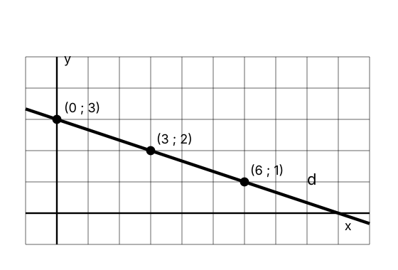

<style>
.qrow{display:flex;gap:.8em;border-bottom:1px solid #e5e9ef;padding:.28em .2em;font-size:.6em;line-height:1.35;align-items:flex-start}
.qrow .qans{flex:0 0 27%;font-weight:600}
.qrow .qwhy{flex:1 1 auto}
.qrow .qans p,.qrow .qwhy p{margin:0}
.qrow.ok{background:#f2f7ff}
.qrow.ok .qans::before{content:"✓ ";color:#276a2e;font-weight:700}
.qstem{font-size:.78em}
.qflex{display:flex;gap:1em;align-items:center}
.qflex img{max-width:330px;height:auto}
.reveal table.deroule a{font-weight:600}
.et-box{display:flex;flex-direction:column;align-items:center;gap:.5em;padding:.6em 1.4em;background:#f2f7ff;border:1px solid #dbe7fb;border-radius:.6em}
.et-timer{margin-top:.8em;display:flex;justify-content:center}
@keyframes et-pulse{0%,100%{opacity:1}50%{opacity:.35}}
.back{margin-top:.5em}
.back-btn{display:inline-block;font-size:.5em;font-weight:600;padding:.3em .8em;border:1.5px solid #1f5fbf;border-radius:.5em;color:#1f5fbf;background:#fff}
.back-btn:hover{background:#1f5fbf;color:#fff;text-decoration:none!important}
.exo-foot{margin-top:.8em;font-size:.55em}
.sol{font-size:.78em}
.sol.long{font-size:.62em}
.sol.xlong{font-size:.55em}
</style>


# Ouverture {.divider background-color="#14304a"}

## Déroulé

<table class="deroule">
<thead><tr><th>Temps</th><th>Durée</th><th>Contenu</th></tr></thead>
<tbody>
<tr><td class="ph">Ouverture</td><td class="du">5 min</td><td>Principe de la séance, mur de questions</td></tr>
<tr><td class="ph">Thème 1</td><td class="du">55 min</td><td>Calcul fiable et trigonométrie</td></tr>
<tr><td class="ph">Pause</td><td class="du">10 min</td><td></td></tr>
<tr><td class="ph">Thème 2</td><td class="du">55 min</td><td>Équations, proportions et géométrie analytique</td></tr>
<tr><td class="ph">Clôture</td><td class="du">5 min</td><td></td></tr>
</tbody>
</table>

## Un thème en quatre temps

<table class="deroule">
<thead><tr><th>Temps</th><th>Durée</th><th>Ce que tu fais</th></tr></thead>
<tbody>
<tr><td class="ph">1 · QCM Wooclap</td><td class="du">10 min</td><td>Tu réponds seul·e, sans discuter.</td></tr>
<tr><td class="ph">2 · Corrections ciblées</td><td class="du">15–18 min</td><td>Seules les questions les moins réussies sont reprises.</td></tr>
<tr><td class="ph">3 · Exercices</td><td class="du">10 + 10 min</td><td>Recherche sur papier, puis correction. Les exercices sont choisis d'après les résultats du QCM.</td></tr>
<tr><td class="ph">4 · Questions</td><td class="du">5–7 min</td><td>Questions du mur restantes.</td></tr>
</tbody>
</table>

## Le mur de questions

::: wooclap
::: wc-play
▶
:::

:::: wc-body
**Pose tes questions, anonymement**

::: wc-lien
Code : XELAEPI
:::
::::

::: {.wc-qr}

:::
:::

- **2 à 3 questions au maximum** par personne.
- **Vote** pour les questions des autres : celles qui reçoivent le plus de votes passent en premier.
- Je ne répondrai pas à toutes les questions.
- Les réponses se donnent en séance : il n'y aura pas de réponse écrite ensuite.


# Thème 1 — Calcul fiable et trigonométrie {.divider background-color="#14304a"}

## QCM — Wooclap (10 min)

::: wooclap
::: wc-play
▶
:::

:::: wc-body
**Ouvre le Wooclap, réponds seul·e**

::: wc-lien
Code : CKFEYZG
:::
::::

::: {.wc-qr}

:::
:::

6 questions, une seule réponse correcte par question.

<div class="et-timer"><div class="et-box" data-default="600">
<div class="et-row"><button class="et-btn et-minus" type="button">−1 min</button><div class="et-display">10:00</div><button class="et-btn et-plus" type="button">+1 min</button></div>
<div class="et-row"><button class="et-btn et-primary et-toggle" type="button">Démarrer</button><button class="et-btn et-reset" type="button">↺ Réinitialiser</button></div>
</div></div>

```{=html}
<script>
(function () {
  var audioCtx = null;
  function beep() {
    try {
      if (!audioCtx) audioCtx = new (window.AudioContext || window.webkitAudioContext)();
      var t0 = audioCtx.currentTime;
      [0, 0.35].forEach(function (o) {
        var osc = audioCtx.createOscillator(), g = audioCtx.createGain();
        osc.type = 'sine'; osc.frequency.value = 880;
        g.gain.setValueAtTime(0.0001, t0 + o);
        g.gain.exponentialRampToValueAtTime(0.3, t0 + o + 0.02);
        g.gain.exponentialRampToValueAtTime(0.0001, t0 + o + 0.28);
        osc.connect(g); g.connect(audioCtx.destination);
        osc.start(t0 + o); osc.stop(t0 + o + 0.3);
      });
    } catch (e) {}
  }
  function fmt(s) { s = Math.max(0, s); var m = Math.floor(s / 60), r = s % 60; return (m < 10 ? '0' : '') + m + ':' + (r < 10 ? '0' : '') + r; }
  function init() {
  Array.prototype.forEach.call(document.querySelectorAll('.et-box'), function (box) {
    var DEFAULT = parseInt(box.getAttribute('data-default'), 10) || 600;
    var display = box.querySelector('.et-display'), btn = box.querySelector('.et-toggle');
    var remaining = DEFAULT, running = false, id = null;
    function render() {
      display.textContent = fmt(remaining);
      display.classList.toggle('et-warn', running && remaining <= 60 && remaining > 0);
      display.classList.toggle('et-done', remaining === 0);
    }
    function stop() { running = false; btn.textContent = remaining > 0 ? 'Reprendre' : 'Démarrer'; if (id) { clearInterval(id); id = null; } }
    function tick() { remaining -= 1; if (remaining <= 0) { remaining = 0; stop(); beep(); } render(); }
    function start() {
      if (running) return;
      try { if (!audioCtx) audioCtx = new (window.AudioContext || window.webkitAudioContext)(); if (audioCtx.state === 'suspended') audioCtx.resume(); } catch (e) {}
      if (remaining <= 0) remaining = DEFAULT;
      render(); running = true; btn.textContent = 'Pause'; id = setInterval(tick, 1000);
    }
    btn.addEventListener('click', function () { running ? stop() : start(); });
    box.querySelector('.et-minus').addEventListener('click', function () { remaining = Math.max(0, remaining - 60); render(); if (remaining === 0) stop(); });
    box.querySelector('.et-plus').addEventListener('click', function () { remaining += 60; render(); });
    box.querySelector('.et-reset').addEventListener('click', function () { stop(); remaining = DEFAULT; btn.textContent = 'Démarrer'; render(); });
    render();
  });
  }
  if (document.readyState === 'loading') document.addEventListener('DOMContentLoaded', init); else init();
})();
</script>
```

## Où aller selon les résultats {#nav-t1}

<table class="deroule" style="font-size:.7em"><thead><tr><th>QCM</th><th>Correction</th><th>Exercices</th></tr></thead><tbody>
<tr><td class="ph">Q1</td><td><a href="#/q1-P2">Simplification d'une fraction algébrique</a></td><td><a href="#/t1-R2">R.2(c)(d)</a> · <a href="#/t1-R3">R.3(b)</a></td></tr>
<tr><td class="ph">Q2</td><td><a href="#/q1-P3">Pourcentages</a></td><td><a href="#/t1-R6">R.6(c)</a></td></tr>
<tr><td class="ph">Q3</td><td><a href="#/q1-Q3">Racine carrée et valeur absolue</a></td><td><a href="#/t1-R5">R.5</a></td></tr>
<tr><td class="ph">Q4</td><td><a href="#/q1-Q4">Ordre de grandeur</a></td><td><a href="#/t1-R7">R.7(a)(b)</a></td></tr>
<tr><td class="ph">Q5</td><td><a href="#/q1-Q5">Sinus et cosinus</a></td><td><a href="#/t1-R8">R.8(b)</a> · <a href="#/t1-R10">R.10(a)</a></td></tr>
<tr><td class="ph">Q6</td><td><a href="#/q1-Q6">Sinus d'un angle remarquable</a></td><td><a href="#/t1-R8">R.8(a)</a> · <a href="#/t1-R10">R.10(a)</a></td></tr>
</tbody></table>

## Q1 · Simplification d'une fraction algébrique {#q1-P2}

::: {.qstem}
Simplifie la fraction algébrique suivante : 

$$\frac{x^2+4x+4}{x^2+2x}$$
:::

::::: {.qrow .ok}
::: qans
$\displaystyle \frac{x+2}{x}$
:::
::: qwhy
$\dfrac{x^2+4x+4}{x^2+2x}=\dfrac{(x+2)^2}{x\,(x+2)}=\dfrac{x+2}{x}$, pour $x\neq 0$ et $x\neq -2$.
:::
:::::

::::: qrow
::: qans
$\displaystyle 2x+4$
:::
::: qwhy
L'opération de division a ici été traitée comme une soustraction entre le numérateur et le dénominateur. Une fraction algébrique se simplifie en recherchant des facteurs communs au numérateur et au dénominateur.
:::
:::::

::::: qrow
::: qans
$\displaystyle 2x+3$
:::
::: qwhy
La simplification a été effectuée terme à terme. Or, les termes d'une somme ne peuvent pas être simplifiés séparément dans une fraction. Il faut d'abord factoriser le numérateur et le dénominateur afin d'identifier d'éventuels facteurs communs.
:::
:::::

::::: qrow
::: qans
$\displaystyle 6$
:::
::: qwhy
La simplification conduit ici à tort à une valeur numérique constante. L'expression dépend de $x$ et doit être simplifiée en factorisant le numérateur et le dénominateur, puis en simplifiant uniquement les facteurs communs.
:::
:::::

<div class="back"><a class="back-btn" href="#/nav-t1">← Où aller selon les résultats</a></div>

<div class="exo-foot muted">Exercices : <a href="#/t1-R2">R.2(c)(d)</a> · <a href="#/t1-R3">R.3(b)</a></div>

## Q2 · Pourcentages {#q1-P3}

::: {.qstem}
Parmi les propositions suivantes, laquelle correspond au prix final d'un objet coûtant initialement 10 euros, après une diminution de 25 % suivie d'une augmentation de 10 % ?
:::

::::: {.qrow .ok}
::: qans
8,25 euros
:::
::: qwhy
$10\cdot 0{,}75\cdot 1{,}10=8{,}25$ €.
:::
:::::

::::: qrow
::: qans
8,50 euros
:::
::: qwhy
Les deux pourcentages ont ici été calculés à partir du prix initial. Or, la seconde variation doit être appliquée au prix obtenu après la première diminution.
:::
:::::

::::: qrow
::: qans
2,75 euros
:::
::: qwhy
Une diminution de 25 % a ici été interprétée comme le fait de conserver 25 % du prix initial. Diminuer une valeur de 25 % signifie conserver 75 % de cette valeur, c'est-à-dire multiplier par $0{,}75$.
:::
:::::

::::: qrow
::: qans
6,75 euros
:::
::: qwhy
La seconde variation a été appliquée dans le mauvais sens : une augmentation de 10 % ne correspond pas à une nouvelle diminution de 10 %. Il fallait donc multiplier par $1+0{,}10=1{,}10$ et non par $1-0{,}10=0{,}90$.
:::
:::::

<div class="back"><a class="back-btn" href="#/nav-t1">← Où aller selon les résultats</a></div>

<div class="exo-foot muted">Exercices : <a href="#/t1-R6">R.6(c)</a></div>

## Q3 · Racine carrée et valeur absolue {#q1-Q3}

::: {.qstem}
Calcule : 

$$\sqrt{(10-35)^2}.$$
:::

::::: {.qrow .ok}
::: qans
$25$
:::
::: qwhy
$\sqrt{(10-35)^2}=\sqrt{(-25)^2}=|-25|=25$.
:::
:::::

::::: qrow
::: qans
$-25$
:::
::: qwhy
Une racine carrée est toujours positive ou nulle : elle ne peut donc jamais être négative.
:::
:::::

::::: qrow
::: qans
$625$
:::
::: qwhy
Le carré a bien été calculé, mais le calcul n'est pas terminé : il faut encore appliquer la racine carrée au résultat obtenu.
:::
:::::

::::: qrow
::: qans
$45$
:::
::: qwhy
La soustraction $10-35$ a été remplacée par une addition. Il faut respecter l'opération indiquée avant d'élever le résultat au carré.
:::
:::::

<div class="back"><a class="back-btn" href="#/nav-t1">← Où aller selon les résultats</a></div>

<div class="exo-foot muted">Exercices : <a href="#/t1-R5">R.5</a></div>

## Q4 · Ordre de grandeur {#q1-Q4}

::: {.qstem}
Parmi les propositions suivantes, laquelle donne une estimation correcte de 

$$3{,}2\times10^7\times4{,}6\times10^{-5}\, ?$$
:::

::::: {.qrow .ok}
::: qans
$\approx 10^3$
:::
::: qwhy
$3{,}2\cdot 4{,}6\approx 10$ et $10^7\cdot 10^{-5}=10^2$, donc le produit vaut environ $10\cdot 10^2=10^3$.
:::
:::::

::::: qrow
::: qans
$\approx 10^2$
:::
::: qwhy
Cette réponse tient compte de la combinaison des puissances de dix, mais pas du fait que le produit des deux coefficients est supérieur à $10$. Cela ajoute une puissance de dix à l'estimation finale.
:::
:::::

::::: qrow
::: qans
$\approx 10^{12}$
:::
::: qwhy
Le signe de l'exposant $-5$ n'a pas été pris en compte correctement. Lorsqu'on multiplie des puissances de $10$, on additionne leurs exposants en conservant leur signe.
:::
:::::

::::: qrow
::: qans
$\approx 10^{-35}$
:::
::: qwhy
Les exposants ont ici été multipliés entre eux. Pour un produit de puissances de même base, les exposants s'additionnent.
:::
:::::

<div class="back"><a class="back-btn" href="#/nav-t1">← Où aller selon les résultats</a></div>

<div class="exo-foot muted">Exercices : <a href="#/t1-R7">R.7(a)(b)</a></div>

## Q5 · Sinus et cosinus {#q1-Q5}

::: {.qstem}
On sait que 

$$\cos(\theta)=\frac{1}{10}$$

 et que $\theta$ appartient au quatrième quadrant. Que vaut $\sin(\theta)$ ?
:::

::::: {.qrow .ok}
::: qans
$\displaystyle -\frac{\sqrt{99}}{10}$
:::
::: qwhy
$\sin^2\theta=1-\cos^2\theta=1-\dfrac1{100}=\dfrac{99}{100}$, donc $\sin\theta=\pm\dfrac{\sqrt{99}}{10}$. Au quatrième quadrant $\sin\theta<0$ : $\sin\theta=-\dfrac{\sqrt{99}}{10}$.
:::
:::::

::::: qrow
::: qans
$\displaystyle \frac{\sqrt{99}}{10}$
:::
::: qwhy
La valeur absolue obtenue est cohérente, mais le signe ne l'est pas. Il faut utiliser la position de l'angle sur le cercle trigonométrique pour déterminer le signe du sinus dans le quatrième quadrant.
:::
:::::

::::: qrow
::: qans
$\displaystyle -\frac{99}{100}$
:::
::: qwhy
L'identité fondamentale permet d'abord de déterminer $\sin^2(\theta)$. Il faut encore passer de $\sin^2(\theta)$ à $\sin(\theta)$, puis déterminer le signe à l'aide du quadrant.
:::
:::::

::::: qrow
::: qans
$\displaystyle -\frac{9}{10}$
:::
::: qwhy
Cette réponse correspond à un raisonnement du type $\sin(\theta)+\cos(\theta)=1$. Ce n'est pas l'identité fondamentale reliant le sinus et le cosinus : celle-ci fait intervenir leurs carrés.
:::
:::::

<div class="back"><a class="back-btn" href="#/nav-t1">← Où aller selon les résultats</a></div>

<div class="exo-foot muted">Exercices : <a href="#/t1-R8">R.8(b)</a> · <a href="#/t1-R10">R.10(a)</a></div>

## Q6 · Sinus d'un angle remarquable {#q1-Q6}

::: {.qstem}
Parmi les propositions suivantes, laquelle est correcte ?
:::

::::: {.qrow .ok}
::: qans
$\displaystyle
\sin\left(\frac{7\pi}{6}\right)
=
-\sin\left(\frac{\pi}{6}\right)$
:::
::: qwhy
$\dfrac{7\pi}{6}=\pi+\dfrac{\pi}{6}$ : troisième quadrant, où le sinus est négatif. $\sin\dfrac{7\pi}{6}=-\sin\dfrac{\pi}{6}=-\dfrac12$.
:::
:::::

::::: qrow
::: qans
$\displaystyle
\sin\left(\frac{7\pi}{6}\right)
=
\sin\left(\frac{\pi}{6}\right)$
:::
::: qwhy
L'angle $\frac{7\pi}{6}$ est bien associé à un angle de référence $\frac{\pi}{6}$, mais il se situe dans le troisième quadrant. Il faut donc tenir compte du signe du sinus dans ce quadrant.
:::
:::::

::::: qrow
::: qans
$\displaystyle
\sin\left(\frac{7\pi}{6}\right)
=
\sin\left(\frac{5\pi}{6}\right)$
:::
::: qwhy
Les angles $\frac{7\pi}{6}$ et $\frac{5\pi}{6}$ ont la même abscisse sur le cercle trigonométrique : leurs cosinus sont donc égaux. Mais ici, on s'intéresse au sinus, qui correspond à l'ordonnée.
:::
:::::

::::: qrow
::: qans
$\displaystyle
\sin\left(\frac{7\pi}{6}\right)
=
\sin\left(\frac{-7\pi}{6}\right)$
:::
::: qwhy
Cette égalité n'est pas correcte. Les angles $\frac{7\pi}{6}$ et $-\frac{7\pi}{6}$ sont opposés. Or, pour deux angles opposés, le sinus change de signe : $\sin(-\theta)=-\sin(\theta)$.
:::
:::::

<div class="back"><a class="back-btn" href="#/nav-t1">← Où aller selon les résultats</a></div>

<div class="exo-foot muted">Exercices : <a href="#/t1-R8">R.8(a)</a> · <a href="#/t1-R10">R.10(a)</a></div>


# Thème 1 — exercices de renforcement {.divider background-color="#14304a"}

## Exercices à réaliser pour consolider {#ex-t1}

<table class="deroule" style="font-size:.72em"><thead><tr><th>QCM</th><th>Sujet</th><th>Exercices</th></tr></thead><tbody>
<tr><td class="ph">Q1</td><td>Simplification d'une fraction algébrique</td><td><a href="#/t1-R2">R.2(c)(d)</a> · <a href="#/t1-R3">R.3(b)</a></td></tr>
<tr><td class="ph">Q2</td><td>Pourcentages</td><td><a href="#/t1-R6">R.6(c)</a></td></tr>
<tr><td class="ph">Q3</td><td>Racine carrée et valeur absolue</td><td><a href="#/t1-R5">R.5</a></td></tr>
<tr><td class="ph">Q4</td><td>Ordre de grandeur</td><td><a href="#/t1-R7">R.7(a)(b)</a></td></tr>
<tr><td class="ph">Q5</td><td>Sinus et cosinus</td><td><a href="#/t1-R8">R.8(b)</a> · <a href="#/t1-R10">R.10(a)</a></td></tr>
<tr><td class="ph">Q6</td><td>Sinus d'un angle remarquable</td><td><a href="#/t1-R8">R.8(a)</a> · <a href="#/t1-R10">R.10(a)</a></td></tr>
</tbody></table>

## Exercice R.1 <span class="obj">O1</span> {#t1-R1}

Pour chaque égalité, dis si elle est **vraie** ou **fausse**, et nomme
la propriété (ou son absence) en jeu.

(a) $(20 - 8) - 5 = 20 - (8 - 5)$

(b) $10 - 4 = 4 - 10$

(c) $3 \cdot (6 + 4) = 3 \cdot 6 + 3 \cdot 4$

(d) $(30 + 12) : 6 = 30 : 6 + 12 : 6$

(e) $48 : (8 : 2) = (48 : 8) : 2$

(f) $60 : (4 + 6) = 60 : 4 + 60 : 6$

<div class="back"><a class="back-btn" href="#/ex-t1">← Exercices à réaliser pour consolider</a></div>

<div class="exo-foot muted">Solution rédigée : <a href="02-annexe.html#/sol-t1-R1">annexe — R.1</a></div>

## Exercice R.2 <span class="obj">O1</span> {#t1-R2}

(a) Développer $(2x - 3)^2$.

(b) Développer $(5 + 2b)(5 - 2b)$.

(c) Factoriser $7a^2 - 28$.

(d) Factoriser $6x^2 + 15x$.

<div class="back"><a class="back-btn" href="#/ex-t1">← Exercices à réaliser pour consolider</a></div>

<div class="exo-foot muted">Solution rédigée : <a href="02-annexe.html#/sol-t1-R2">annexe — R.2</a></div>

## Exercice R.3 <span class="obj">O1</span> {#t1-R3}

Réduis au même dénominateur, puis simplifie si possible.

(a) $\dfrac{3}{x + 2} - \dfrac{6}{x - 2}$

(b) $\dfrac{3}{x + 2} : \dfrac{6}{x - 2}$

<div class="back"><a class="back-btn" href="#/ex-t1">← Exercices à réaliser pour consolider</a></div>

<div class="exo-foot muted">Solution rédigée : <a href="02-annexe.html#/sol-t1-R3">annexe — R.3</a></div>

## Exercice R.5 <span class="obj">O3</span> ★★★ {#t1-R5}

(a) Montre qu'on **ne peut pas** avoir $\sqrt{x^2} = x$ pour tout $x$, en testant $x = -3$.

(b) Énonce la règle correcte, puis calcule $\sqrt{(5 - 9)^2}$.

<div class="back"><a class="back-btn" href="#/ex-t1">← Exercices à réaliser pour consolider</a></div>

<div class="exo-foot muted">Solution rédigée : <a href="02-annexe.html#/sol-t1-R5">annexe — R.5</a></div>

## Exercice R.6 <span class="obj">O2</span> {#t1-R6}

(a) Écris $\dfrac{5}{8}$ en décimal et en pourcentage ; écris $0{,}45$ en fraction irréductible et en
pourcentage.

(b) Prendre $\dfrac{2}{5}$ de $35$ mL : combien de mL ?

(c) Après une hausse de $25\,\%$, une population de bactéries atteint $500$. Quel était l'effectif
**initial** ?

<div class="back"><a class="back-btn" href="#/ex-t1">← Exercices à réaliser pour consolider</a></div>

<div class="exo-foot muted">Solution rédigée : <a href="02-annexe.html#/sol-t1-R6">annexe — R.6</a></div>

## Exercice R.7 <span class="obj">O3</span> {#t1-R7}

(a) Calcule, en notation scientifique : $(4 \times 10^{7}) \cdot (2{,}5 \times 10^{-3})$.

(b) **Estime** (sans calculatrice) $\dfrac{5{,}1 \times 10^{6}}{2{,}05 \times 10^{2}}$.

(c) Une longueur est mesurée au dixième de millimètre près. Est-il justifié d'annoncer le résultat
final d'un calcul au **nanomètre** près ? Explique.

<div class="back"><a class="back-btn" href="#/ex-t1">← Exercices à réaliser pour consolider</a></div>

<div class="exo-foot muted">Solution rédigée : <a href="02-annexe.html#/sol-t1-R7">annexe — R.7</a></div>

## Exercice R.8 <span class="obj">O4</span> {#t1-R8}

(a) Ramène-toi à un angle du premier quandrant : $\cos(420°)$ et $\sin\!\left(\dfrac{7\pi}{3}\right)$.

(b) On sait que $\cos\theta = \dfrac{3}{5}$ et que $\theta \in \left[0,\ \tfrac{\pi}{2}\right]$. Calcule
$\sin\theta$, puis $\tan\theta$.

<div class="back"><a class="back-btn" href="#/ex-t1">← Exercices à réaliser pour consolider</a></div>

<div class="exo-foot muted">Solution rédigée : <a href="02-annexe.html#/sol-t1-R8">annexe — R.8</a></div>

## Exercice R.10 <span class="obj">O4</span> ★★★ {#t1-R10}

On sait que $\cos\theta = -\dfrac{1}{2}$ et que $\theta \in \left[\dfrac{\pi}{2},\ \pi\right]$.

(a) Calcule $\sin\theta$.

(b) Donne la valeur exacte de $\theta$.

(c) Déduis-en $\cos(-\theta)$ et $\sin(\pi - \theta)$.

<div class="back"><a class="back-btn" href="#/ex-t1">← Exercices à réaliser pour consolider</a></div>

<div class="exo-foot muted">Solution rédigée : <a href="02-annexe.html#/sol-t1-R10">annexe — R.10</a></div>

## Questions restantes — thème 1

À remplir pendant la recherche d'exercices (tri du mur).


# Thème 2 — Équations, proportions et géométrie analytique {.divider background-color="#14304a"}

## QCM — Wooclap (10 min)

::: wooclap
::: wc-play
▶
:::

:::: wc-body
**Ouvre le Wooclap, réponds seul·e**

::: wc-lien
Code : SJDJDYG
:::
::::

::: {.wc-qr}

:::
:::

6 questions, une seule réponse correcte par question.

<div class="et-timer"><div class="et-box" data-default="600">
<div class="et-row"><button class="et-btn et-minus" type="button">−1 min</button><div class="et-display">10:00</div><button class="et-btn et-plus" type="button">+1 min</button></div>
<div class="et-row"><button class="et-btn et-primary et-toggle" type="button">Démarrer</button><button class="et-btn et-reset" type="button">↺ Réinitialiser</button></div>
</div></div>

## Où aller selon les résultats {#nav-t2}

<table class="deroule" style="font-size:.7em"><thead><tr><th>QCM</th><th>Correction</th><th>Exercices</th></tr></thead><tbody>
<tr><td class="ph">Q1</td><td><a href="#/q2-P1">Modélisation linéaire</a></td><td><a href="#/t2-R6">R.6(a)</a> · <a href="#/t2-R3">R.3</a></td></tr>
<tr><td class="ph">Q2</td><td><a href="#/q2-Q4">Résolution d'une inéquation</a></td><td><a href="#/t2-R2">R.2</a></td></tr>
<tr><td class="ph">Q3</td><td><a href="#/q2-Q2">Système non linéaire</a></td><td><a href="#/t2-R14">R.14(a)</a> · <a href="#/t2-R8">R.8</a></td></tr>
<tr><td class="ph">Q4</td><td><a href="#/q2-P4">Lecture graphique de la pente</a></td><td><a href="#/t2-R4">R.4</a></td></tr>
<tr><td class="ph">Q5</td><td><a href="#/q2-Q5">Équation d'une droite</a></td><td><a href="#/t2-R5">R.5</a> · <a href="#/t2-R4">R.4</a> · <a href="#/t2-R6">R.6(a)</a></td></tr>
<tr><td class="ph">Q6</td><td><a href="#/q2-Q3">Position relative de deux droites</a></td><td><a href="#/t2-R7">R.7</a> · <a href="#/t2-R9">R.9</a></td></tr>
</tbody></table>

## Q1 · Modélisation linéaire {#q2-P1}

::: {.qstem}
Une entreprise de location de vélos propose un tarif composé d'un montant fixe de 5 euros auquel s'ajoutent 2 euros par heure de location. On note $x$ le nombre d'heures de location et $y$ le prix total payé, en euros. Parmi les propositions suivantes, laquelle modélise correctement cette situation ?
:::

::::: {.qrow .ok}
::: qans
$y=2x+5$
:::
::: qwhy
Partie fixe $5$ € (ordonnée à l'origine), $2$ € par heure (pente) : $y=2x+5$.
:::
:::::

::::: qrow
::: qans
$y=2x$
:::
::: qwhy
Cette expression ne convient pas : elle ne tient pas compte du montant fixe de 5 euros. Le prix total doit comporter une constante en plus du coût horaire.
:::
:::::

::::: qrow
::: qans
$y=5x+2$
:::
::: qwhy
Le coefficient 5 ne correspond pas au coût horaire, qui est de 2 euros. De plus, le montant fixe de 2 euros n'est pas celui indiqué dans l'énoncé.
:::
:::::

::::: qrow
::: qans
$y=5$
:::
::: qwhy
Cette relation est incorrecte car le prix augmente de 2 euros par heure. Il ne peut donc pas être égal à une constante indépendante du nombre d'heures.
:::
:::::

<div class="back"><a class="back-btn" href="#/nav-t2">← Où aller selon les résultats</a></div>

<div class="exo-foot muted">Exercices : <a href="#/t2-R6">R.6(a)</a> · <a href="#/t2-R3">R.3</a></div>

## Q2 · Résolution d'une inéquation {#q2-Q4}

::: {.qstem}
Résoudre dans $\mathbb{R}$ l'inéquation suivante : 

$$3(1-2x)>x+10.$$
:::

::::: {.qrow .ok}
::: qans
$x < -1$
:::
::: qwhy
$3-6x>x+10\iff -7x>7\iff x<-1$ (division par $-7<0$ : le sens s'inverse).
:::
:::::

::::: qrow
::: qans
$x > -1$
:::
::: qwhy
Lorsqu'on divise les deux membres d'une inéquation par un nombre négatif, le sens de l'inégalité doit être inversé.
:::
:::::

::::: qrow
::: qans
$x < 1$
:::
::: qwhy
Le signe de la constante a été mal traité lors du regroupement des termes. Il faut conserver les signes à chaque étape du calcul.
:::
:::::

::::: qrow
::: qans
$x > 1$
:::
::: qwhy
Il faut à la fois tenir compte correctement des signes lors du regroupement des termes et inverser le sens de l'inégalité lorsqu'on divise par un nombre négatif.
:::
:::::

<div class="back"><a class="back-btn" href="#/nav-t2">← Où aller selon les résultats</a></div>

<div class="exo-foot muted">Exercices : <a href="#/t2-R2">R.2</a></div>

## Q3 · Système non linéaire {#q2-Q2}

::: {.qstem}
Résoudre dans $\mathbb{R}^2$ le système suivant : 

$$\left\{ \begin{aligned} x^2-2x-y &= 0,\\ 3x-3y &= -12. \end{aligned} \right.$$
:::

::::: {.qrow .ok}
::: qans
$\mathrm{Sol}=\{(-1,3),(4,8)\}$
:::
::: qwhy
La seconde équation donne $y=x+4$. Substitution : $x^2-2x-(x+4)=0$, soit $x^2-3x-4=0$. $\Delta=9+16=25$, $x=\dfrac{3\pm5}{2}$ : $x=4$ ou $x=-1$. Alors $y=8$ ou $y=3$. $\mathrm{Sol}=\{(-1,3),(4,8)\}$.
:::
:::::

::::: qrow
::: qans
$\mathrm{Sol}=\{(4,8)\}$
:::
::: qwhy
L'équation du second degré obtenue possède deux solutions réelles. Il faut conserver les deux valeurs de $x$, puis déterminer la valeur de $y$ associée à chacune d'elles.
:::
:::::

::::: qrow
::: qans
$\mathrm{Sol}=\{(-1,-1),(4,4)\}$
:::
::: qwhy
Après avoir déterminé les valeurs de $x$, il faut les remplacer dans l'une des équations du système pour calculer les valeurs correspondantes de $y$.
:::
:::::

::::: qrow
::: qans
$\mathrm{Sol}=\varnothing$
:::
::: qwhy
Le système possède bien des solutions. Il faut d'abord simplifier la seconde équation, puis substituer l'expression obtenue dans la première avant de conclure.
:::
:::::

<div class="back"><a class="back-btn" href="#/nav-t2">← Où aller selon les résultats</a></div>

<div class="exo-foot muted">Exercices : <a href="#/t2-R14">R.14(a)</a> · <a href="#/t2-R8">R.8</a></div>

## Q4 · Lecture graphique de la pente {#q2-P4}

::: {.qflex}
::: {.qstem}
Dans le dessin suivant, $d$ représente une droite.    Quelle est la pente de la droite $d$ ?
:::


:::

::::: {.qrow .ok}
::: qans
$-\dfrac{1}{3}$
:::
::: qwhy
Pente $=\dfrac{\Delta y}{\Delta x}$ : quand $x$ augmente de $3$, $y$ diminue de $1$, donc $m=-\dfrac13$.
:::
:::::

::::: qrow
::: qans
$3$
:::
::: qwhy
La valeur $3$ représente l'ordonnée à l'origine de la droite, c'est-à-dire sa hauteur lorsque $x=0$. Elle ne correspond pas à la pente.
:::
:::::

::::: qrow
::: qans
$\dfrac{1}{3}$
:::
::: qwhy
La pente est négative car la droite descend lorsque l'on se déplace vers la droite. Il faut donc tenir compte du signe négatif et de la variation horizontale de 3 unités.
:::
:::::

::::: qrow
::: qans
$-1$
:::
::: qwhy
La pente n'est pas égale à $-1$. La variation verticale est bien de $-1$, mais elle correspond à une variation horizontale de $+3$. Il faut donc calculer $-1/3$.
:::
:::::

<div class="back"><a class="back-btn" href="#/nav-t2">← Où aller selon les résultats</a></div>

<div class="exo-foot muted">Exercices : <a href="#/t2-R4">R.4</a></div>

## Q5 · Équation d'une droite {#q2-Q5}

::: {.qstem}
On considère la droite $d$ passant par les deux points 

$$A=(-2,1) \qquad\text{et}\qquad B=(4,10).$$

 Parmi les propositions suivantes, laquelle donne une équation de la droite $d$ ?
:::

::::: {.qrow .ok}
::: qans
$\displaystyle y=\frac{3}{2}x+4$
:::
::: qwhy
$m=\dfrac{10-1}{4-(-2)}=\dfrac96=\dfrac32$. Avec $A$ : $1=\dfrac32\cdot(-2)+p$, donc $p=4$ : $y=\dfrac32x+4$.
:::
:::::

::::: qrow
::: qans
$\displaystyle y=\frac{2}{3}x+\frac{7}{3}$
:::
::: qwhy
La pente se calcule par $m=\frac{y_2-y_1}{x_2-x_1}$, et non en inversant le rapport. Ici, il faut donc calculer $\frac{10-1}{4-(-2)}$ et non $\frac{4-(-2)}{10-1}$.
:::
:::::

::::: qrow
::: qans
$\displaystyle y=\frac{3}{2}x+1$
:::
::: qwhy
La valeur $1$ est l'ordonnée du point $A$, mais elle ne correspond pas à l'ordonnée à l'origine. Une fois la pente déterminée, il faut utiliser l'équation $y=mx+p$ avec les coordonnées d'un des deux points pour calculer $p$.
:::
:::::

::::: qrow
::: qans
$\displaystyle y=-\frac{3}{2}x-2$
:::
::: qwhy
Entre les points $A$ et $B$, on a $y_2-y_1=10-1=9$ et $x_2-x_1=4-(-2)=6$. La pente vaut donc $\frac{9}{6}=\frac{3}{2}$ et est positive.
:::
:::::

<div class="back"><a class="back-btn" href="#/nav-t2">← Où aller selon les résultats</a></div>

<div class="exo-foot muted">Exercices : <a href="#/t2-R5">R.5</a> · <a href="#/t2-R4">R.4</a> · <a href="#/t2-R6">R.6(a)</a></div>

## Q6 · Position relative de deux droites {#q2-Q3}

::: {.qstem}
Voici les équations de deux droites : 

$$d_1 \equiv y=\frac{3}{2}x-1 \qquad\text{et}\qquad d_2 \equiv y=-\frac{2}{3}x+4.$$

 Quelle est leur position relative ?
:::

::::: {.qrow .ok}
::: qans
Les droites sont orthogonales.
:::
::: qwhy
$m_1=\dfrac32$ et $m_2=-\dfrac23$ : $m_1\cdot m_2=-1$, donc les droites sont orthogonales.
:::
:::::

::::: qrow
::: qans
Les droites sont différentes mais parallèles.
:::
::: qwhy
Deux droites sont parallèles lorsque leurs pentes sont égales. Ici, $\frac{3}{2}\neq-\frac{2}{3}$ : les droites ne sont donc pas parallèles.
:::
:::::

::::: qrow
::: qans
Les deux équations représentent la même droite.
:::
::: qwhy
Pour représenter la même droite, deux équations sous la forme $y=mx+p$ doivent avoir la même pente $m$ et la même ordonnée à l'origine $p$. Ici, les pentes sont différentes : il ne peut donc pas s'agir de la même droite.
:::
:::::

::::: qrow
::: qans
Les droites ne sont ni parallèles ni orthogonales.
:::
::: qwhy
Les pentes sont $m_1=\frac{3}{2}$ et $m_2=-\frac{2}{3}$. Elles ne sont pas égales, donc les droites ne sont pas parallèles. De plus, on a $-\frac{1}{m_2}=-\frac{1}{-\frac{2}{3}}=\frac{3}{2}=m_1$. Les droites sont donc orthogonales.
:::
:::::

<div class="back"><a class="back-btn" href="#/nav-t2">← Où aller selon les résultats</a></div>

<div class="exo-foot muted">Exercices : <a href="#/t2-R7">R.7</a> · <a href="#/t2-R9">R.9</a></div>


# Thème 2 — exercices de renforcement {.divider background-color="#14304a"}

## Exercices à réaliser pour consolider {#ex-t2}

<table class="deroule" style="font-size:.72em"><thead><tr><th>QCM</th><th>Sujet</th><th>Exercices</th></tr></thead><tbody>
<tr><td class="ph">Q1</td><td>Modélisation linéaire</td><td><a href="#/t2-R6">R.6(a)</a> · <a href="#/t2-R3">R.3</a></td></tr>
<tr><td class="ph">Q2</td><td>Résolution d'une inéquation</td><td><a href="#/t2-R2">R.2</a></td></tr>
<tr><td class="ph">Q3</td><td>Système non linéaire</td><td><a href="#/t2-R14">R.14(a)</a> · <a href="#/t2-R8">R.8</a></td></tr>
<tr><td class="ph">Q4</td><td>Lecture graphique de la pente</td><td><a href="#/t2-R4">R.4</a></td></tr>
<tr><td class="ph">Q5</td><td>Équation d'une droite</td><td><a href="#/t2-R5">R.5</a> · <a href="#/t2-R4">R.4</a> · <a href="#/t2-R6">R.6(a)</a></td></tr>
<tr><td class="ph">Q6</td><td>Position relative de deux droites</td><td><a href="#/t2-R7">R.7</a> · <a href="#/t2-R9">R.9</a></td></tr>
</tbody></table>

## Exercice R.2 <span class="obj">O2</span> {#t2-R2}

Résous chaque inéquation, et donne l'ensemble solution en intervalle.

(a) $5 - 2x < 1$

(b) $-3x + 2 \ge -7$

<div class="back"><a class="back-btn" href="#/ex-t2">← Exercices à réaliser pour consolider</a></div>

<div class="exo-foot muted">Solution rédigée : <a href="02-annexe.html#/sol-t2-R2">annexe — R.2</a></div>

## Exercice R.3 <span class="obj">O1</span> {#t2-R3}

Un rectangle a un périmètre de $26$ cm ; sa longueur dépasse sa largeur de $3$ cm. Trouve ses
dimensions (mise en équation, résolution, réponse).

<div class="back"><a class="back-btn" href="#/ex-t2">← Exercices à réaliser pour consolider</a></div>

<div class="exo-foot muted">Solution rédigée : <a href="02-annexe.html#/sol-t2-R3">annexe — R.3</a></div>

## Exercice R.4 <span class="obj">O4</span> {#t2-R4}

Calcule la pente de la droite passant par chaque paire de points.

(a) $(0,\, 1)$ et $(2,\, 5)$

(b) $(-1,\, 4)$ et $(1,\, 0)$

(c) $(2,\, 3)$ et $(5,\, 3)$

<div class="back"><a class="back-btn" href="#/ex-t2">← Exercices à réaliser pour consolider</a></div>

<div class="exo-foot muted">Solution rédigée : <a href="02-annexe.html#/sol-t2-R4">annexe — R.4</a></div>

## Exercice R.5 <span class="obj">O4</span> {#t2-R5}

Détermine l'équation de la droite passant par les points $(1,\, 3)$ et $(3,\, 7)$.

<div class="back"><a class="back-btn" href="#/ex-t2">← Exercices à réaliser pour consolider</a></div>

<div class="exo-foot muted">Solution rédigée : <a href="02-annexe.html#/sol-t2-R5">annexe — R.5</a></div>

## Exercice R.6 <span class="obj">O4</span> {#t2-R6}

Un spectrophotomètre relie l'absorbance $A$ à la concentration $C$ (en mmol/L) par une **droite**.
Deux étalons donnent $(C,\, A) = (1\, ;\, 0{,}20)$ et $(5\, ;\, 0{,}60)$.

(a) Détermine la droite d'étalonnage $A(C) = m\, C + p$.

(b) Un échantillon inconnu donne $A = 0{,}50$. Quelle est sa concentration ?

(c) Que représente concrètement l'ordonnée à l'origine $p$ ?

<div class="back"><a class="back-btn" href="#/ex-t2">← Exercices à réaliser pour consolider</a></div>

<div class="exo-foot muted">Solution rédigée : <a href="02-annexe.html#/sol-t2-R6">annexe — R.6</a></div>

## Exercice R.7 <span class="obj">O4</span> {#t2-R7}

On considère la droite $d : y = 2x + 1$.

(a) Écris l'équation de la droite **parallèle** à $d$ passant par $(0,\, 4)$.

(b) Quelle est la pente d'une droite **orthogonale** à $d$ ?

<div class="back"><a class="back-btn" href="#/ex-t2">← Exercices à réaliser pour consolider</a></div>

<div class="exo-foot muted">Solution rédigée : <a href="02-annexe.html#/sol-t2-R7">annexe — R.7</a></div>

## Exercice R.8 <span class="obj">O2</span> {#t2-R8}

Résous chaque système ; indique clairement la méthode utilisée.

(a) $\begin{cases} 2x + y = 8, \\ x - y = 1. \end{cases}$

(b) $\begin{cases} x + 2y = 5, \\ 3x - 2y = 7. \end{cases}$

<div class="back"><a class="back-btn" href="#/ex-t2">← Exercices à réaliser pour consolider</a></div>

<div class="exo-foot muted">Solution rédigée : <a href="02-annexe.html#/sol-t2-R8">annexe — R.8</a></div>

## Exercice R.9 <span class="obj">O4</span> ★★★ {#t2-R9}

Pour chaque système, dis s'il admet une **solution unique**, **aucune** solution, ou une **infinité**
de solutions — et justifie.

(a) $\begin{cases} x + y = 4, \\ x + y = 6. \end{cases}$

(b) $\begin{cases} x + y = 4, \\ 2x + 2y = 8. \end{cases}$

(c) $\begin{cases} x + y = 4, \\ x - y = 0. \end{cases}$

<div class="back"><a class="back-btn" href="#/ex-t2">← Exercices à réaliser pour consolider</a></div>

<div class="exo-foot muted">Solution rédigée : <a href="02-annexe.html#/sol-t2-R9">annexe — R.9</a></div>

## Exercice R.10 <span class="obj">O5</span> {#t2-R10}

Résous chaque équation du second degré (calcule d'abord le discriminant).

(a) $x^2 - 4x + 3 = 0$

(b) $x^2 - 6x + 9 = 0$

(c) $x^2 + x + 1 = 0$

<div class="back"><a class="back-btn" href="#/ex-t2">← Exercices à réaliser pour consolider</a></div>

<div class="exo-foot muted">Solution rédigée : <a href="02-annexe.html#/sol-t2-R10">annexe — R.10</a></div>

## Exercice R.12 <span class="obj">O1</span> {#t2-R12}

Le carré d'un nombre vaut $25$.

(a) Quelles sont les valeurs possibles si ce nombre peut être quelconque ?

(b) Et si ce nombre représente la longueur d'un segment ?

<div class="back"><a class="back-btn" href="#/ex-t2">← Exercices à réaliser pour consolider</a></div>

<div class="exo-foot muted">Solution rédigée : <a href="02-annexe.html#/sol-t2-R12">annexe — R.12</a></div>

## Exercice R.13 <span class="obj">O1</span> {#t2-R13}

L'aire d'un carré vaut $36$ m². Quelle est la longueur (en mètres) de son côté ?

<div class="back"><a class="back-btn" href="#/ex-t2">← Exercices à réaliser pour consolider</a></div>

<div class="exo-foot muted">Solution rédigée : <a href="02-annexe.html#/sol-t2-R13">annexe — R.13</a></div>

## Exercice R.14 <span class="obj">O5</span> ★★★ {#t2-R14}

Un projectile suit la trajectoire $y = -x^2 + 6x$, où $y$ est la hauteur et $x$ la distance
horizontale (toutes deux en mètres).

(a) À quelle(s) distance(s) le projectile est-il à la hauteur $y = 5$ m ?

(b) À quelle distance retombe-t-il au sol ($y = 0$) ?

<div class="back"><a class="back-btn" href="#/ex-t2">← Exercices à réaliser pour consolider</a></div>

<div class="exo-foot muted">Solution rédigée : <a href="02-annexe.html#/sol-t2-R14">annexe — R.14</a></div>

## Questions restantes — thème 2

À remplir pendant la recherche d'exercices (tri du mur).


# Clôture {.divider background-color="#14304a"}

## Pour la suite

- Les **solutions rédigées** des exercices et les corrections des questions de réserve sont dans le deck « Annexe » (page des slides, rubrique Remédiations).
- Les questions du mur qui n'ont pas été traitées en séance n'auront pas de réponse écrite.

