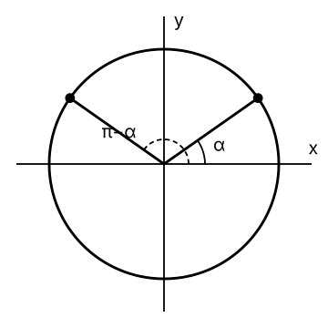

# Thème 1 — Calcul fiable et trigonométrie {.divider background-color="#14304a"}

# Questions de réserve {.divider background-color="#14304a"}

## Réserve 1 · Addition de fractions {#q1-P1}

::: {.qstem}
Calcule la somme des fractions suivantes : 

$$\frac{1}{2}+\frac{1}{3}$$
:::

::::: {.qrow .ok}
::: qans
$\displaystyle \frac{5}{6}$
:::
::: qwhy
$\dfrac12+\dfrac13=\dfrac36+\dfrac26=\dfrac56$.
:::
:::::

::::: qrow
::: qans
$\displaystyle \frac{2}{5}$
:::
::: qwhy
Les numérateurs et les dénominateurs ont été additionnés directement. Pour additionner deux fractions, il faut d'abord les exprimer avec un même dénominateur.
:::
:::::

::::: qrow
::: qans
$\displaystyle \frac{5}{12}$
:::
::: qwhy
Les fractions ont bien été mises au même dénominateur, mais les dénominateurs ont ensuite été additionnés. Une fois le dénominateur commun obtenu, seuls les numérateurs doivent être additionnés.
:::
:::::

::::: qrow
::: qans
$\displaystyle \frac{1}{6}$
:::
::: qwhy
Une erreur d'opération a été commise : il s'agit ici d'une addition de fractions, et non d'une multiplication. Les deux fractions doivent d'abord être exprimées avec un même dénominateur avant d'effectuer l'addition.
:::
:::::

<a class="back-btn" href="01-remediation.html#/nav-t1">← Où aller selon les résultats</a>Exercices : <a href="01-remediation.html#/t1-R3">R.3</a>

## Réserve 2 · Estimer une longueur {#q1-P4}

::: {.qstem}
Parmi les propositions suivantes, laquelle donne une estimation raisonnable du nombre de feuilles A4, placées bout à bout dans le sens de la longueur, nécessaires pour atteindre la hauteur d'une porte intérieure classique ?
:::

::::: {.qrow .ok}
::: qans
$7$ feuilles
:::
::: qwhy
Feuille A4 : environ $30$ cm. Porte : environ $2$ m $=200$ cm. $200:30\approx 7$.
:::
:::::

::::: qrow
::: qans
$2$ feuilles
:::
::: qwhy
Cette estimation est bien trop basse. Une feuille A4 mesure environ $30$ cm de long, tandis qu'une porte intérieure mesure environ $2$ m de haut. Deux feuilles ne représentent qu'environ $60$ cm.
:::
:::::

::::: qrow
::: qans
$14$ feuilles
:::
::: qwhy
Cette estimation est trop élevée. Une feuille A4 mesure environ $30$ cm de long : $14$ feuilles représentent donc une longueur de plusieurs mètres, nettement supérieure à la hauteur d'une porte.
:::
:::::

::::: qrow
::: qans
$50$ feuilles
:::
::: qwhy
Cette estimation est beaucoup trop élevée. Une feuille A4 mesure environ $30$ cm de long : $50$ feuilles représenteraient une longueur d'environs $15$ mètres, soit une longueur très largement supérieure à la hauteur d'une porte intérieure.
:::
:::::

<a class="back-btn" href="01-remediation.html#/nav-t1">← Où aller selon les résultats</a>Exercices : <a href="01-remediation.html#/t1-R7">R.7(b)</a>

## Réserve 3 · Relations trigonométriques {#q1-P5}

::: {.qflex}
::: {.qstem}
Parmi les relations trigonométriques suivantes, laquelle est correcte pour les angles $\alpha$ et $\pi-\alpha$ représentés sur le cercle ci-dessous ? 
:::

:::

::::: {.qrow .ok}
::: qans
$\sin(\pi-\alpha)=\sin(\alpha)$
:::
::: qwhy
Les points d'angles $\alpha$ et $\pi-\alpha$ ont la même ordonnée : $\sin(\pi-\alpha)=\sin\alpha$.
:::
:::::

::::: qrow
::: qans
$\sin(\pi-\alpha)=-\sin(\alpha)$
:::
::: qwhy
Les deux points ont la même ordonnée, et non des ordonnées opposées.
:::
:::::

::::: qrow
::: qans
$\sin(\pi-\alpha)=\cos(\alpha)$
:::
::: qwhy
Le sinus correspond à l'ordonnée d'un point du cercle trigonométrique, tandis que le cosinus correspond à son abscisse. Ces deux valeurs ne sont donc pas identiques ici.
:::
:::::

::::: qrow
::: qans
$\cos(\pi-\alpha)=\cos(\alpha)$
:::
::: qwhy
Les deux angles correspondent à des points symétriques par rapport à l'axe des ordonnées. Leurs abscisses sont donc opposées, et non identiques.
:::
:::::

<a class="back-btn" href="01-remediation.html#/nav-t1">← Où aller selon les résultats</a>Exercices : <a href="01-remediation.html#/t1-R10">R.10(c)</a>

## Réserve 4 · Dépréciation successive {#q1-Q1}

::: {.qstem}
Une voiture coûte initialement $30\,000$ euros. Elle perd $20\,\%$ de sa valeur chaque année. Quelle est sa valeur après $4$ ans ?
:::

::::: {.qrow .ok}
::: qans
$12\,288$ euros
:::
::: qwhy
$30\,000\cdot 0{,}8^4=30\,000\cdot 0{,}4096=12\,288$ €.
:::
:::::

::::: qrow
::: qans
$6\,000$ euros
:::
::: qwhy
Cette réponse revient à retirer chaque année $20\,\%$ de la valeur initiale de la voiture. Or, après la première année, la diminution de $20\,\%$ s'applique à la nouvelle valeur de la voiture, et non plus à sa valeur initiale.
:::
:::::

::::: qrow
::: qans
$24\,000$ euros
:::
::: qwhy
Cette réponse correspond à une seule diminution de $20\,\%$. La voiture perd cependant $20\,\%$ de sa valeur chaque année : il faut donc tenir compte des quatre diminutions successives.
:::
:::::

::::: qrow
::: qans
$15\,360$ euros
:::
::: qwhy
Cette réponse correspond à la valeur obtenue après seulement trois diminutions successives de $20\,\%$.
:::
:::::

<a class="back-btn" href="01-remediation.html#/nav-t1">← Où aller selon les résultats</a>Exercices : <a href="01-remediation.html#/t1-R6">R.6(c)</a>

## Réserve 5 · Priorités des opérations {#q1-Q2}

::: {.qstem}
Calcule l'expression suivante : 

$$10:\left(\sqrt{(3-2)^2+6(3+1)}\right).$$
:::

::::: {.qrow .ok}
::: qans
$2$
:::
::: qwhy
$(3-2)^2+6(3+1)=1+24=25$ ; $\sqrt{25}=5$ ; $10:5=2$.
:::
:::::

::::: qrow
::: qans
$50$
:::
::: qwhy
La valeur de la racine a bien été déterminée, mais la dernière opération n'a pas été effectuée correctement : $10:5$ signifie $10$ divisé par $5$, et non $10$ multiplié par $5$.
:::
:::::

::::: qrow
::: qans
$\displaystyle \frac{2}{5}$
:::
::: qwhy
Dans ce raisonnement, la racine carrée n'a pas été prise en compte. Elle porte sur toute l'expression située entre parenthèses.
:::
:::::

::::: qrow
::: qans
$\sqrt{5}$
:::
::: qwhy
Cette réponse peut être obtenue en interprétant $6(3+1)$ comme $6\cdot3+1$. Or, le facteur $6$ multiplie toute la parenthèse $(3+1)$.
:::
:::::

<a class="back-btn" href="01-remediation.html#/nav-t1">← Où aller selon les résultats</a>Exercices : <a href="01-remediation.html#/t1-R1">R.1</a>

# Solutions des exercices de renforcement {.divider background-color="#14304a"}

## Énoncé R.1 O1 {#st-t1-R1}

Pour chaque égalité, dis si elle est **vraie** ou **fausse**, et nomme
la propriété (ou son absence) en jeu.

\(a) $(20 - 8) - 5 = 20 - (8 - 5)$

\(b) $10 - 4 = 4 - 10$

\(c) $3 \cdot (6 + 4) = 3 \cdot 6 + 3 \cdot 4$

\(d) $(30 + 12) : 6 = 30 : 6 + 12 : 6$

\(e) $48 : (8 : 2) = (48 : 8) : 2$

\(f) $60 : (4 + 6) = 60 : 4 + 60 : 6$

## Solution R.1 {#sol-t1-R1}

::: {.sol}
\(a) Faux : à gauche $(20 - 8) - 5 = 7$, à droite $20 - (8 - 5) = 17$. Déplacer les parenthèses change le résultat : la soustraction n'est pas associative.

\(b) Faux : $10 - 4 = 6$ tandis que $4 - 10 = -6$. L'ordre des termes compte : la soustraction n'est pas commutative.

\(c) Vrai : $3 \cdot (6 + 4) = 3 \cdot 10 = 30$ et $3 \cdot 6 + 3 \cdot 4 = 18 + 12 = 30$. C'est la distributivité de la multiplication sur l'addition.

\(d) Vrai : $(30 + 12) : 6 = 42 : 6 = 7$ et $30 : 6 + 12 : 6 = 5 + 2 = 7$. La division est distributive à droite, c'est-à-dire quand la somme est au numérateur.

\(e) Faux : $48 : (8 : 2) = 48 : 4 = 12$ mais $(48 : 8) : 2 = 6 : 2 = 3$. La division n'est pas associative.

\(f) Faux : $60 : (4 + 6) = 60 : 10 = 6$ mais $60 : 4 + 60 : 6 = 15 + 10 = 25$. La division n'est pas distributive à gauche (somme au dénominateur) : c'est le piège classique.
:::

## Énoncé R.2 O1 {#st-t1-R2}

\(a) Développer $(2x - 3)^2$.

\(b) Développer $(5 + 2b)(5 - 2b)$.

\(c) Factoriser $7a^2 - 28$.

\(d) Factoriser $6x^2 + 15x$.

## Solution R.2 {#sol-t1-R2}

::: {.sol}
\(a) $4x^2 - 12x + 9$.

\(b) $25 - 4b^2$.

\(c) $7(a^2 - 4) = 7(a - 2)(a + 2)$.

\(d) $3x(2x + 5)$.
:::

## Énoncé R.3 O1 {#st-t1-R3}

Réduis au même dénominateur, puis simplifie si possible.

\(a) $\dfrac{3}{x + 2} - \dfrac{6}{x - 2}$

\(b) $\dfrac{3}{x + 2} : \dfrac{6}{x - 2}$

## Solution R.3 {#sol-t1-R3}

::: {.sol}
\(a) $\dfrac{3(x - 2) - 6(x + 2)}{(x + 2)(x - 2)} = \dfrac{-3x - 18}{x^2 - 4}$.

\(b) $\dfrac{3}{x + 2} \cdot \dfrac{x - 2}{6} = \dfrac{x - 2}{2(x + 2)}$.
:::

## Énoncé R.5 O3 ★★★ {#st-t1-R5}

\(a) Montre qu'on **ne peut pas** avoir $\sqrt{x^2} = x$ pour tout $x$, en testant $x = -3$.

\(b) Énonce la règle correcte, puis calcule $\sqrt{(5 - 9)^2}$.

## Solution R.5 {#sol-t1-R5}

::: {.sol}
\(a) Pour $x = -3$ : d'un côté $\sqrt{(-3)^2} = \sqrt{9} = 3$ ; de l'autre, l'hypothèse donnerait $-3$. On
aurait $3 = -3$, ce qui est absurde. L'égalité $\sqrt{x^2} = x$ est donc fausse dès que $x < 0$.

\(b) La règle correcte est $\sqrt{x^2} = |x|$. Donc $\sqrt{(5 - 9)^2} = |5 - 9| = |-4| = 4$.
:::

## Énoncé R.6 O2 {#st-t1-R6}

\(a) Écris $\dfrac{5}{8}$ en décimal et en pourcentage ; écris $0{,}45$ en fraction irréductible et en
pourcentage.

\(b) Prendre $\dfrac{2}{5}$ de $35$ mL : combien de mL ?

\(c) Après une hausse de $25\,\%$, une population de bactéries atteint $500$. Quel était l'effectif
**initial** ?

## Solution R.6 {#sol-t1-R6}

::: {.sol}
\(a) $\dfrac{5}{8} = 0{,}625 = 62{,}5\,\%$ ; $0{,}45 = \dfrac{9}{20} = 45\,\%$.

\(b) $\dfrac{2}{5} \cdot 35 = 14$ mL.

\(c) $1{,}25 \cdot x = 500$, d'où $x = 500 : 1{,}25 = 400$.
:::

## Énoncé R.7 O3 {#st-t1-R7}

\(a) Calcule, en notation scientifique : $(4 \times 10^{7}) \cdot (2{,}5 \times 10^{-3})$.

\(b) **Estime** (sans calculatrice) $\dfrac{5{,}1 \times 10^{6}}{2{,}05 \times 10^{2}}$.

\(c) Une longueur est mesurée au dixième de millimètre près. Est-il justifié d'annoncer le résultat
final d'un calcul au **nanomètre** près ? Explique.

## Solution R.7 {#sol-t1-R7}

::: {.sol}
\(a) $4 \cdot 2{,}5 \times 10^{7 - 3} = 10 \times 10^{4} = 1 \times 10^{5}$.

\(b) $\approx \dfrac{5 \times 10^{6}}{2 \times 10^{2}} = 2{,}5 \times 10^{4}$.

\(c) Non : un résultat calculé ne peut pas être plus précis que les données qui l'alimentent (règle des chiffres significatifs). Le dixième de millimètre ($10^{-4}$ m) est un million de fois plus grossier que le nanomètre ($10^{-9}$ m) ; annoncer le résultat « au nanomètre près » afficherait des décimales que la mesure ne garantit pas — c'est une fausse précision.
:::

## Énoncé R.8 O4 {#st-t1-R8}

\(a) Ramène-toi à un angle du premier quandrant : $\cos(420°)$ et $\sin\!\left(\dfrac{7\pi}{3}\right)$.

\(b) On sait que $\cos\theta = \dfrac{3}{5}$ et que $\theta \in \left[0,\ \tfrac{\pi}{2}\right]$. Calcule
$\sin\theta$, puis $\tan\theta$.

## Solution R.8 {#sol-t1-R8}

::: {.sol}
\(a) $\cos(420°) = \cos(420° - 360°) = \cos(60°) = \dfrac{1}{2}$ ;
$\sin\!\left(\dfrac{7\pi}{3}\right) = \sin\!\left(\dfrac{7\pi}{3} - 2\pi\right) = \sin\dfrac{\pi}{3} = \dfrac{\sqrt3}{2}$.

\(b) $\sin\theta = \sqrt{1 - \tfrac{9}{25}} = \sqrt{\tfrac{16}{25}} = \dfrac{4}{5}$ (positif au quadrant I) ;
$\tan\theta = \dfrac{\sin\theta}{\cos\theta} = \dfrac{4/5}{3/5} = \dfrac{4}{3}$.
:::

## Énoncé R.10 O4 ★★★ {#st-t1-R10}

On sait que $\cos\theta = -\dfrac{1}{2}$ et que $\theta \in \left[\dfrac{\pi}{2},\ \pi\right]$.

\(a) Calcule $\sin\theta$.

\(b) Donne la valeur exacte de $\theta$.

\(c) Déduis-en $\cos(-\theta)$ et $\sin(\pi - \theta)$.

## Solution R.10 {#sol-t1-R10}

::: {.sol}
\(a) $\sin^2\theta = 1 - \dfrac{1}{4} = \dfrac{3}{4}$, donc $\sin\theta = \pm\dfrac{\sqrt3}{2}$. Au
quadrant II, $\sin\theta > 0$ : $\sin\theta = \dfrac{\sqrt3}{2}$.

\(b) L'angle du quadrant II dont le cosinus vaut $-\dfrac{1}{2}$ est $\theta = \dfrac{2\pi}{3}$ ($= 120°$).

\(c) $\cos(-\theta) = \cos\theta = -\dfrac{1}{2}$ (angles opposés) ; $\sin(\pi - \theta) = \sin\theta = \dfrac{\sqrt3}{2}$ (angles supplémentaires).
:::

# Thème 2 — Équations, proportions et géométrie analytique {.divider background-color="#14304a"}

# Questions de réserve {.divider background-color="#14304a"}

## Réserve 1 · Résolution d'une inéquation {#q2-P2}

::: {.qstem}
Résoudre dans $\mathbb{R}$ l'inéquation suivante : 

$$2x+3<0.$$
:::

::::: {.qrow .ok}
::: qans
$x<-\dfrac{3}{2}$
:::
::: qwhy
$2x+3<0\iff 2x<-3\iff x<-\dfrac32$ (division par $2>0$ : le sens est conservé). $\mathrm{Sol}=\left]-\infty,\,-\dfrac32\right[$.
:::
:::::

::::: qrow
::: qans
$x>-\dfrac{3}{2}$
:::
::: qwhy
L'erreur vient probablement du fait que le signe « inférieur à » a été inversé. Comme on divise par un nombre positif, le sens de l'inégalité ne change pas.
:::
:::::

::::: qrow
::: qans
$x<-3$
:::
::: qwhy
Le nombre $-3$ doit encore être divisé par 2 après avoir isolé le terme $2x$. La solution n'est donc pas $x<-3$.
:::
:::::

::::: qrow
::: qans
$x<\dfrac{3}{2}$
:::
::: qwhy
Le nombre 3 est déplacé de l'autre côté en soustrayant 3, puis il faut diviser par 2. La valeur $3/2$ n'est donc pas la bonne : le signe négatif a été oublié.
:::
:::::

<a class="back-btn" href="01-remediation.html#/nav-t2">← Où aller selon les résultats</a>Exercices : <a href="01-remediation.html#/t2-R2">R.2</a>

## Réserve 2 · Résolution d'un système linéaire {#q2-P3}

::: {.qstem}
Résoudre dans $\mathbb{R}^2$ le système suivant : 

$$\left\{ \begin{aligned} 2x+y&=0,\\ -3x+2y&=0. \end{aligned} \right.$$
:::

::::: {.qrow .ok}
::: qans
$(x,y)=(0,0)$
:::
::: qwhy
La première équation donne $y=-2x$. Dans la seconde : $-3x+2(-2x)=-7x=0$, donc $x=0$ et $y=0$. $\mathrm{Sol}=\{(0,0)\}$.
:::
:::::

::::: qrow
::: qans
$(x,y)=(1,0)$
:::
::: qwhy
Le point $(1,0)$ ne vérifie pas la première équation, puisque $2\cdot1+0=2\neq0$. Il ne peut donc pas être solution du système.
:::
:::::

::::: qrow
::: qans
$(x,y)=(0,1)$
:::
::: qwhy
Le point $(0,1)$ ne vérifie pas la première équation, puisque $2\cdot0+1=1\neq0$. Il ne peut donc pas être solution du système.
:::
:::::

::::: qrow
::: qans
$(x,y)=(1,-2)$
:::
::: qwhy
Le point $(1,-2)$ ne vérifie pas la deuxième équation, puisque $-3\cdot1+2\cdot (-2)=-3-4=-7\neq0$. Il ne peut donc pas être solution du système.
:::
:::::

<a class="back-btn" href="01-remediation.html#/nav-t2">← Où aller selon les résultats</a>Exercices : <a href="01-remediation.html#/t2-R8">R.8</a> · <a href="01-remediation.html#/t2-R9">R.9(c)</a>

## Réserve 3 · Équation du second degré avec un paramètre {#q2-P5 .smaller}

::: {.qstem}
Considérons l'équation 

$$x^2+mx-1=0,$$

 où $x$ est l'inconnue et $m$ un paramètre réel. Parmi les affirmations suivantes, laquelle est correcte ?
:::

::::: {.qrow .ok}
::: qans
L'équation n'a jamais aucune solution.
:::
::: qwhy
$\Delta=m^2-4\cdot 1\cdot(-1)=m^2+4$. Comme $m^2\ge 0$, $\Delta>0$ pour tout $m$ : l'équation a toujours deux solutions distinctes, donc jamais aucune.
:::
:::::

::::: qrow
::: qans
L'équation a toujours au plus une solution.
:::
::: qwhy
Cette affirmation est fausse. Le discriminant vaut $\Delta=m^2+4$, qui est strictement positif pour tout réel $m$. L'équation possède donc toujours deux solutions réelles distinctes, et jamais une seule solution.
:::
:::::

::::: qrow
::: qans
Pour certaines valeurs de $m$, l'équation a exactement une solution. Pour d'autres valeurs de $m$, elle a deux solutions distinctes.
:::
::: qwhy
Cette affirmation est fausse. Comme $\Delta=m^2+4>0$ pour tout réel $m$, l'équation possède toujours deux solutions réelles distinctes. Elle ne possède jamais exactement une seule solution.
:::
:::::

::::: qrow
::: qans
L'équation n'a jamais deux solutions distinctes.
:::
::: qwhy
Cette affirmation est fausse. Le discriminant est $\Delta=m^2+4$, et il est strictement positif quel que soit le réel $m$. L'équation admet donc toujours deux solutions réelles distinctes.
:::
:::::

<a class="back-btn" href="01-remediation.html#/nav-t2">← Où aller selon les résultats</a>Exercices : <a href="01-remediation.html#/t2-R10">R.10</a>

## Réserve 4 · Production de légumes {#q2-Q1}

::: {.qstem}
Une exploitation agricole suit sa production de légumes. Au début du suivi, $10$ tonnes ont déjà été produites. La production cumulée augmente ensuite de $5$ tonnes chaque semaine. La quantité totale $q$ de légumes produite, en tonnes, est donc modélisée par la relation 

$$q=5t+10,$$

 où $t$ représente le nombre de semaines écoulées. Parmi les couples suivants, lequel serait une solution possible de cette équation dans le contexte de l'énoncé ?
:::

::::: {.qrow .ok}
::: qans
$(t,q)=(2,20)$
:::
::: qwhy
$t=2$ : $q=5\cdot 2+10=20$, le couple vérifie la relation. Contexte : $t\ge 0$ (nombre de semaines). $(2,20)$ convient ; $(-1,5)$ vérifie la relation mais $t<0$.
:::
:::::

::::: qrow
::: qans
$(t,q)=(-1,5)$
:::
::: qwhy
En remplaçant $t$ par $-1$, on obtient $q=5(-1)+10=5$. Le couple vérifie donc bien l'équation. Cependant, $t=-1$ ne peut pas représenter un nombre de semaines écoulées.
:::
:::::

::::: qrow
::: qans
$(t,q)=(3,20)$
:::
::: qwhy
En remplaçant $t$ par $3$, on obtient $q=5\cdot3+10=25$. Le couple $(3,20)$ ne vérifie donc pas l'équation.
:::
:::::

::::: qrow
::: qans
$(t,q)=(-5,-3)$
:::
::: qwhy
En remplaçant $t$ par $-5$, on obtient $q=5(-5)+10=-15$. Le couple $(-5,-3)$ ne vérifie donc pas l'équation. De plus, un nombre de semaines écoulées et une quantité produite ne peuvent pas être négatifs dans ce contexte.
:::
:::::

<a class="back-btn" href="01-remediation.html#/nav-t2">← Où aller selon les résultats</a>Exercices : <a href="01-remediation.html#/t2-R12">R.12(b)</a> · <a href="01-remediation.html#/t2-R13">R.13</a>

# Solutions des exercices de renforcement {.divider background-color="#14304a"}

## Énoncé R.2 O2 {#st-t2-R2}

Résous chaque inéquation, et donne l'ensemble solution en intervalle.

\(a) $5 - 2x < 1$

\(b) $-3x + 2 \ge -7$

## Solution R.2 {#sol-t2-R2}

::: {.sol}
\(a) $5 - 2x < 1 \;\Leftrightarrow\; -2x < -4 \;\Leftrightarrow\; x > 2$ (division par $-2$, négatif : le sens s'inverse). $\mathrm{Sol} = \,]2,\, +\infty[$.

\(b) $-3x + 2 \ge -7 \;\Leftrightarrow\; -3x \ge -9 \;\Leftrightarrow\; x \le 3$ (division par $-3$, négatif : le sens s'inverse). $\mathrm{Sol} = \,]{-}\infty,\, 3]$.
:::

## Énoncé R.3 O1 {#st-t2-R3}

Un rectangle a un périmètre de $26$ cm ; sa longueur dépasse sa largeur de $3$ cm. Trouve ses
dimensions (mise en équation, résolution, réponse).

## Solution R.3 {#sol-t2-R3}

::: {.sol}
- Inconnue : soit $x$ la largeur (en cm) ; la longueur vaut alors $x + 3$ (en cm).

- Équation : le périmètre vaut $2 \cdot (\text{longueur} + \text{largeur})$, donc $2\big(x + (x + 3)\big) = 26$.

- Résolution : $2(2x + 3) = 26 \;\Leftrightarrow\; 4x + 6 = 26 \;\Leftrightarrow\; 4x = 20 \;\Leftrightarrow\; x = 5$. $\mathrm{Sol} = \{5\}$.

- Vérification : $x = 5 > 0$ est admissible, et $2(5 + 8) = 26$ .

- Réponse : le rectangle mesure $5$ cm de large et $8$ cm de long.
:::

## Énoncé R.4 O4 {#st-t2-R4}

Calcule la pente de la droite passant par chaque paire de points.

\(a) $(0,\, 1)$ et $(2,\, 5)$

\(b) $(-1,\, 4)$ et $(1,\, 0)$

\(c) $(2,\, 3)$ et $(5,\, 3)$

## Solution R.4 {#sol-t2-R4}

::: {.sol}
\(a) $m = \dfrac{5 - 1}{2 - 0} = \dfrac{4}{2} = 2$.

\(b) $m = \dfrac{0 - 4}{1 - (-1)} = \dfrac{-4}{2} = -2$.

\(c) $m = \dfrac{3 - 3}{5 - 2} = 0$ : la droite est horizontale ($y = 3$).
:::

## Énoncé R.5 O4 {#st-t2-R5}

Détermine l'équation de la droite passant par les points $(1,\, 3)$ et $(3,\, 7)$.

## Solution R.5 {#sol-t2-R5}

::: {.sol}
$m = \dfrac{7 - 3}{3 - 1} = \dfrac{4}{2} = 2$ ; $p = 3 - 2 \cdot 1 = 1$. Donc $y = 2x + 1$.
Vérification avec $(3,7)$ : $2 \cdot 3 + 1 = 7$.
:::

## Énoncé R.6 O4 {#st-t2-R6}

Un spectrophotomètre relie l'absorbance $A$ à la concentration $C$ (en mmol/L) par une **droite**.
Deux étalons donnent $(C,\, A) = (1\, ;\, 0{,}20)$ et $(5\, ;\, 0{,}60)$.

\(a) Détermine la droite d'étalonnage $A(C) = m\, C + p$.

\(b) Un échantillon inconnu donne $A = 0{,}50$. Quelle est sa concentration ?

\(c) Que représente concrètement l'ordonnée à l'origine $p$ ?

## Solution R.6 {#sol-t2-R6}

::: {.sol}
\(a) $m = \dfrac{0{,}60 - 0{,}20}{5 - 1} = \dfrac{0{,}40}{4} = 0{,}10$ ; $p = 0{,}20 - 0{,}10 \cdot 1 = 0{,}10$.
Donc $A(C) = 0{,}10\, C + 0{,}10$. Vérification avec $(5\, ;\, 0{,}60)$ : $0{,}10 \cdot 5 + 0{,}10 = 0{,}60$. 

\(b) On résout $0{,}50 = 0{,}10\, C + 0{,}10 \;\Leftrightarrow\; 0{,}10\, C = 0{,}40 \;\Leftrightarrow\; C = 4$. L'échantillon a une concentration de $4$ mmol/L.

\(c) $p = 0{,}10$ est l'absorbance mesurée pour une concentration nulle : c'est le biais instrumental (le signal résiduel de l'appareil).
:::

## Énoncé R.7 O4 {#st-t2-R7}

On considère la droite $d : y = 2x + 1$.

\(a) Écris l'équation de la droite **parallèle** à $d$ passant par $(0,\, 4)$.

\(b) Quelle est la pente d'une droite **orthogonale** à $d$ ?

## Solution R.7 {#sol-t2-R7}

::: {.sol}
\(a) La pente de $d$ vaut $2$. Une droite parallèle à $d$ a la même pente, donc elle s'écrit $y = 2x + p$.
Elle passe par $(0,\, 4)$ : $4 = 2 \cdot 0 + p$, donc $p = 4$. La droite cherchée est $y = 2x + 4$.

\(b) Deux droites de pentes $m_1$ et $m_2$ sont orthogonales si $m_1 \cdot m_2 = -1$. Ici $2 \cdot m = -1$, donc
une droite orthogonale à $d$ a pour pente $m = -\dfrac{1}{2}$.
:::

## Énoncé R.8 O2 {#st-t2-R8}

Résous chaque système ; indique clairement la méthode utilisée.

\(a) $\begin{cases} 2x + y = 8, \\ x - y = 1. \end{cases}$

\(b) $\begin{cases} x + 2y = 5, \\ 3x - 2y = 7. \end{cases}$

## Solution R.8 {#sol-t2-R8}

::: {.sol}
\(a) Par élimination : les coefficients de $y$ sont opposés. En additionnant les deux équations terme à terme,
$(2x + y) + (x - y) = 8 + 1$, soit $3x = 9$, donc $x = 3$. On reporte dans $x - y = 1$ : $3 - y = 1$, donc $y = 2$.
Vérification : $2 \cdot 3 + 2 = 8$  et $3 - 2 = 1$ . $\mathrm{Sol} = \{(3,\, 2)\}$.

\(b) Par élimination : les coefficients de $y$ sont opposés. En additionnant les deux équations terme à terme,
$(x + 2y) + (3x - 2y) = 5 + 7$, soit $4x = 12$, donc $x = 3$. On reporte dans $x + 2y = 5$ : $3 + 2y = 5$, donc $y = 1$.
Vérification : $3 + 2 \cdot 1 = 5$  et $3 \cdot 3 - 2 \cdot 1 = 7$ . $\mathrm{Sol} = \{(3,\, 1)\}$.
:::

## Énoncé R.9 O4 ★★★ {#st-t2-R9}

Pour chaque système, dis s'il admet une **solution unique**, **aucune** solution, ou une **infinité**
de solutions — et justifie.

\(a) $\begin{cases} x + y = 4, \\ x + y = 6. \end{cases}$

\(b) $\begin{cases} x + y = 4, \\ 2x + 2y = 8. \end{cases}$

\(c) $\begin{cases} x + y = 4, \\ x - y = 0. \end{cases}$

## Solution R.9 {#sol-t2-R9}

::: {.sol}
\(a) En soustrayant la première équation de la seconde, on obtient $0 = 2$ : cette égalité est toujours fausse.
Le système n'a aucune solution : les deux droites sont parallèles et distinctes ($x + y$ ne peut valoir à la fois $4$ et $6$). $\mathrm{Sol} = \varnothing$.

\(b) La seconde équation est le double de la première : en retranchant deux fois la première, on obtient $0 = 0$, toujours vrai.
Le système a une infinité de solutions : les deux droites sont confondues. $\mathrm{Sol} = \{(x, y) \mid x + y = 4\}$.

\(c) En additionnant les deux équations terme à terme, $2x = 4$, donc $x = 2$ ; on reporte dans $x - y = 0$ : $y = 2$.
Le système a une solution unique : les deux droites sont sécantes. $\mathrm{Sol} = \{(2,\, 2)\}$.
:::

## Énoncé R.10 O5 {#st-t2-R10}

Résous chaque équation du second degré (calcule d'abord le discriminant).

\(a) $x^2 - 4x + 3 = 0$

\(b) $x^2 - 6x + 9 = 0$

\(c) $x^2 + x + 1 = 0$

## Solution R.10 {#sol-t2-R10}

::: {.sol}
\(a) $a = 1$, $b = -4$, $c = 3$ : $\Delta = (-4)^2 - 4 \cdot 1 \cdot 3 = 16 - 12 = 4 > 0$, deux solutions.
$x_{1,2} = \dfrac{4 \pm 2}{2}$, donc $x_1 = 1$ et $x_2 = 3$. $\mathrm{Sol} = \{1,\, 3\}$.

\(b) $a = 1$, $b = -6$, $c = 9$ : $\Delta = (-6)^2 - 4 \cdot 1 \cdot 9 = 36 - 36 = 0$, une seule solution,
$x = \dfrac{6}{2} = 3$. $\mathrm{Sol} = \{3\}$.

\(c) $a = 1$, $b = 1$, $c = 1$ : $\Delta = 1^2 - 4 \cdot 1 \cdot 1 = 1 - 4 = -3 < 0$, aucune solution réelle. $\mathrm{Sol} = \varnothing$.
:::

## Énoncé R.12 O1 {#st-t2-R12}

Le carré d'un nombre vaut $25$.

\(a) Quelles sont les valeurs possibles si ce nombre peut être quelconque ?

\(b) Et si ce nombre représente la longueur d'un segment ?

## Solution R.12 {#sol-t2-R12}

::: {.sol}
Soit $x$ le nombre cherché. Mise en équation : $x^2 = 25 \;\Leftrightarrow\; x = -5$ ou $x = 5$, donc $\mathrm{Sol} = \{-5,\, 5\}$.

\(a) Le nombre peut être quelconque : les deux valeurs conviennent, $x = -5$ ou $x = 5$.

\(b) Une longueur est positive : $-5$ n'est pas admissible, seule $x = 5$ convient.
:::

## Énoncé R.13 O1 {#st-t2-R13}

L'aire d'un carré vaut $36$ m². Quelle est la longueur (en mètres) de son côté ?

## Solution R.13 {#sol-t2-R13}

::: {.sol}
Soit $c$ le côté (en m). Mise en équation : $c^2 = 36$, donc $\mathrm{Sol} = \{-6,\, 6\}$.
Une longueur est positive : la seule solution admissible dans le contexte est $c = 6$ m.
:::

## Énoncé R.14 O5 ★★★ {#st-t2-R14}

Un projectile suit la trajectoire $y = -x^2 + 6x$, où $y$ est la hauteur et $x$ la distance
horizontale (toutes deux en mètres).

\(a) À quelle(s) distance(s) le projectile est-il à la hauteur $y = 5$ m ?

\(b) À quelle distance retombe-t-il au sol ($y = 0$) ?

## Solution R.14 {#sol-t2-R14}

::: {.sol}
\(a) $-x^2 + 6x = 5 \;\Leftrightarrow\; x^2 - 6x + 5 = 0$. On a $\Delta = (-6)^2 - 4 \cdot 1 \cdot 5 = 36 - 20 = 16 > 0$ : deux solutions,
$$x_1 = \dfrac{6 - 4}{2} = 1, \qquad x_2 = \dfrac{6 + 4}{2} = 5.$$
$\mathrm{Sol} = \{1,\, 5\}$. Le projectile est à $5$ m de haut à $x = 1$ m (en montant) et à $x = 5$ m (en descendant).

\(b) $-x^2 + 6x = 0 \;\Leftrightarrow\; x(6 - x) = 0 \;\Leftrightarrow\; x = 0$ ou $x = 6$, donc $\mathrm{Sol} = \{0,\, 6\}$.
$x = 0$ est le point de départ : le projectile retombe au sol à $x = 6$ m.
:::

