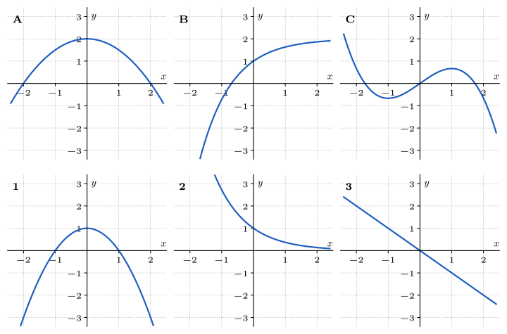
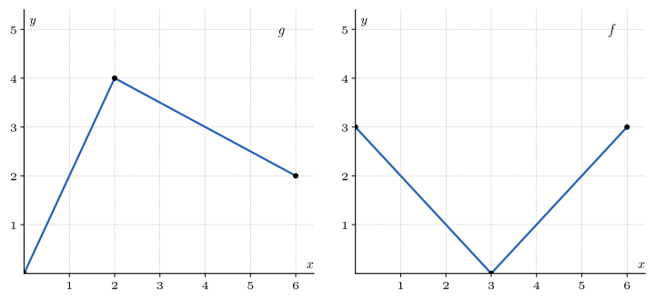

## Par où commencer ? {#start .smaller}

<style>
.qrow{display:flex;gap:.8em;border-bottom:1px solid #e5e9ef;padding:.28em .2em;font-size:.6em;line-height:1.35;align-items:flex-start}
.qrow .qans{flex:0 0 36%;font-weight:600}
.qrow .qwhy{flex:1 1 auto}
.qrow .qans p,.qrow .qwhy p{margin:0}
.qrow.ok{background:#f2f7ff}
.qrow.ok .qans::before{content:"✓ ";color:#276a2e;font-weight:700}
.qstem{font-size:.78em}
.qflex{display:flex;gap:1em;align-items:center}
.qflex img{max-width:330px;max-height:230px;width:auto;height:auto}
.reveal table.deroule a{font-weight:600}
.et-box{display:flex;flex-direction:column;align-items:center;gap:.5em;padding:.6em 1.4em;background:#f2f7ff;border:1px solid #dbe7fb;border-radius:.6em}
.et-timer{margin-top:.8em;display:flex;justify-content:center}
@keyframes et-pulse{0%,100%{opacity:1}50%{opacity:.35}}
.back{margin-top:.5em}
.qfoot{display:flex;gap:1.2em;align-items:center;margin-top:.45em;font-size:.55em}
.qfoot .back-btn{font-size:1em}
.qfoot .muted{color:#5a6b7b}
.back-btn{display:inline-block;font-size:.5em;font-weight:600;padding:.3em .8em;border:1.5px solid #1f5fbf;border-radius:.5em;color:#1f5fbf;background:#fff}
.back-btn:hover{background:#1f5fbf;color:#fff;text-decoration:none!important}
.exo-foot{margin-top:.8em;font-size:.55em}
.sol{font-size:.8em}
.sol.long{font-size:.68em}
.sol.xlong{font-size:.6em}
.tv table{margin:.3em auto;border-collapse:collapse;font-size:.8em}
.tv th,.tv td{border:1px solid #cfd8e3;padding:.22em .9em;text-align:center}
.tv th{background:#f4f7fa;color:#14304a}
.tv .f{color:#b5381f;font-weight:700}
.sit table{font-size:.72em;margin:.3em auto;border-collapse:collapse}
.sit th,.sit td{border:1px solid #cfd8e3;padding:.25em .7em}
.sit th{background:#f4f7fa;color:#14304a}
.sit .f{color:#b5381f;font-weight:700}
.promesse{border:2px solid #1f5fbf;border-radius:14px;background:#f2f7ff;padding:.6em 1em;text-align:center;font-size:1.05em;margin:.5em 0}
.xs { font-size: .7em; }
.fig{display:block;margin:.3em auto;max-height:340px;width:auto}
</style>
<style>
.cle-cols{display:flex;gap:1.2em;align-items:center}
.reveal .columns{align-items:center}
</style>

Tu as fait le QCM. Va directement à ce dont tu as besoin.

:::: {.columns}
::: {.column width="52%"}
**Va là pour le correctif du QCM :**

<ul>
<li><a href="#/q-C1">Q1 · Dérivée élémentaire et domaine</a></li>
<li><a href="#/q-C2">Q2 · Règle de Leibniz</a></li>
<li><a href="#/q-C3">Q3 · Règle du quotient</a></li>
<li><a href="#/q-C4">Q4 · Chain rule et exponentielle</a></li>
<li><a href="#/q-C5">Q5 · Chain rule et logarithme</a></li>
<li><a href="#/q-C6">Q6 · Simplifier sans élargir le domaine</a></li>
<li><a href="#/q-C7">Q7 · Contrôler une dérivée</a></li>
<li><a href="#/q-C8">Q8 · Interpréter un taux</a></li>
<li><a href="#/q-C9">Q9 · Chain rule à partir de valeurs</a></li>
<li><a href="#/nav-c">Tout le correctif, avec les exercices de renforcement</a></li>
</ul>
:::
::: {.column width="48%"}
**Va là pour un rappel théorique sur :**

<ul>
<li><a href="#/cle-c1">Dérivées élémentaires et domaines</a></li>
<li><a href="#/cle-c2">Linéarité, produit et quotient</a></li>
<li><a href="#/cle-c3">Composition et chain rule</a></li>
<li><a href="#/cle-c4">Choisir la première règle, simplifier sans changer le domaine</a></li>
<li><a href="#/cle-c5">Cinq contrôles d'une dérivée</a></li>
<li><a href="#/cle-c6">Interpréter un taux composé</a></li>
<li><a href="#/cle-app">Joue avec la chain rule (appli)</a></li>
</ul>
:::
::::

**Va là pour t'entraîner :** <a href="#/ex-c">exercices de renforcement</a> · **Pas encore fait le QCM ?** <a href="#/qcm-c">par ici</a>

# Corrections ciblées {.divider background-color="#14304a"}

## Où aller selon les résultats {#nav-c}

<table class="deroule" style="font-size:.6em"><thead><tr><th>QCM</th><th>Correction</th><th>Exercices</th></tr></thead><tbody>
<tr><td class="ph">C1</td><td><a href="#/q-C1">Dérivée élémentaire et domaine</a></td><td><a href="#/ex-c-S1">S.1</a> · <a href="#/ex-c-R1">R.1</a> · <a href="#/ex-c-R2">R.2</a></td></tr>
<tr><td class="ph">C2</td><td><a href="#/q-C2">Règle de Leibniz</a></td><td><a href="#/ex-c-S2">S.2</a> · <a href="#/ex-c-R3">R.3</a></td></tr>
<tr><td class="ph">C3</td><td><a href="#/q-C3">Règle du quotient</a></td><td><a href="#/ex-c-S2">S.2</a> · <a href="#/ex-c-R3">R.3(c)(d)</a> · <a href="#/ex-c-R7">R.7(a)</a></td></tr>
<tr><td class="ph">C4</td><td><a href="#/q-C4">Chain rule et exponentielle</a></td><td><a href="#/ex-c-S3">S.3</a> · <a href="#/ex-c-R4">R.4</a></td></tr>
<tr><td class="ph">C5</td><td><a href="#/q-C5">Chain rule et logarithme</a></td><td><a href="#/ex-c-S3">S.3</a> · <a href="#/ex-c-R4">R.4(d)</a> · <a href="#/ex-c-R5">R.5(b)</a></td></tr>
<tr><td class="ph">C6</td><td><a href="#/q-C6">Simplifier sans élargir le domaine</a></td><td><a href="#/ex-c-S2">S.2 (k)</a> · <a href="#/ex-c-R6">R.6</a></td></tr>
<tr><td class="ph">C7</td><td><a href="#/q-C7">Contrôler une dérivée</a></td><td><a href="#/ex-c-S4">S.4</a> · <a href="#/ex-c-S6">S.6</a> · <a href="#/ex-c-R7">R.7</a></td></tr>
<tr><td class="ph">C8</td><td><a href="#/q-C8">Interpréter un taux</a></td><td><a href="#/ex-c-S7">S.7</a> · <a href="#/ex-c-R8">R.8</a> · <a href="#/ex-c-R9">R.9</a></td></tr>
<tr><td class="ph">C9</td><td><a href="#/q-C9">Chain rule à partir de valeurs</a></td><td><a href="#/ex-c-S5">S.5</a> · <a href="#/ex-c-R5">R.5</a></td></tr>
</tbody></table>

## Q1 · Dérivée élémentaire et domaine {#q-C1}

::: {.qstem}
Soit $f(x) = 4\sqrt{x} - \dfrac{3}{x}$. Quelle proposition donne $f'(x)$ et le domaine de $f'$ ?
:::

::::: {.qrow .ok}
::: qans
$f'(x) = \dfrac{2}{\sqrt{x}} + \dfrac{3}{x^{2}}$, sur $\mathbb{R}^+_0$
:::
::: qwhy
$4\sqrt{x} = 4x^{1/2}$ a pour dérivée $2x^{-1/2} = \dfrac{2}{\sqrt{x}}$, et $-3x^{-1}$ a pour dérivée $3x^{-2}$. Il faut $x > 0$ pour la racine au dénominateur.
:::
:::::

::::: {.qrow}
::: qans
$f'(x) = \dfrac{2}{\sqrt{x}} - \dfrac{3}{x^{2}}$, sur $\mathbb{R}^+_0$
:::
::: qwhy
Erreur de signe : $\left(-3x^{-1}\right)' = -3 \cdot (-1)x^{-2} = +\dfrac{3}{x^{2}}$.
:::
:::::

::::: {.qrow}
::: qans
$f'(x) = \dfrac{2}{\sqrt{x}} + \dfrac{3}{x^{2}}$, sur $\mathbb{R}^+$
:::
::: qwhy
La formule n'est pas définie en $0$ : on divise par $\sqrt{x}$ et par $x^{2}$.
:::
:::::

::::: {.qrow}
::: qans
$f'(x) = 2\sqrt{x} + \dfrac{3}{x^{2}}$, sur $\mathbb{R}^+_0$
:::
::: qwhy
On a multiplié par l'exposant sans le diminuer de $1$ : $\left(x^{1/2}\right)' = \dfrac{1}{2}x^{-1/2}$.
:::
:::::

<div class="qfoot"><a class="back-btn" href="#/nav-c">← Où aller selon les résultats</a> <span class="muted">Exercices : <a href="#/ex-c-S1">S.1</a> · <a href="#/ex-c-R1">R.1</a> · <a href="#/ex-c-R2">R.2</a></span></div>

## Q2 · Règle de Leibniz {#q-C2}

::: {.qstem}
Que vaut la dérivée de $f(x) = x^{3} \cdot e^{x}$ ?
:::

::::: {.qrow .ok}
::: qans
$(3x^{2} + x^{3}) \cdot e^{x}$
:::
::: qwhy
Par la règle de Leibniz : $3x^{2} \cdot e^{x} + x^{3} \cdot e^{x}$.
:::
:::::

::::: {.qrow}
::: qans
$3x^{2} \cdot e^{x}$
:::
::: qwhy
On a dérivé chaque facteur et multiplié les dérivées. Il manque la contribution $x^{3} \cdot e^{x}$.
:::
:::::

::::: {.qrow}
::: qans
$3x^{2} + e^{x}$
:::
::: qwhy
On a dérivé comme une somme : $f$ est un produit.
:::
:::::

::::: {.qrow}
::: qans
$x^{3} \cdot e^{x}$
:::
::: qwhy
Le facteur $e^{x}$ est égal à sa dérivée, mais le facteur $x^{3}$ change aussi.
:::
:::::

<div class="qfoot"><a class="back-btn" href="#/nav-c">← Où aller selon les résultats</a> <span class="muted">Exercices : <a href="#/ex-c-S2">S.2</a> · <a href="#/ex-c-R3">R.3</a></span></div>

## Q3 · Règle du quotient {#q-C3}

::: {.qstem}
Que vaut la dérivée de $f(x) = \dfrac{x + 1}{x - 1}$, pour $x \neq 1$ ?
:::

::::: {.qrow .ok}
::: qans
$-\dfrac{2}{(x - 1)^{2}}$
:::
::: qwhy
$\dfrac{1 \cdot (x - 1) - (x + 1) \cdot 1}{(x - 1)^{2}} = \dfrac{-2}{(x - 1)^{2}}$.
:::
:::::

::::: {.qrow}
::: qans
$\dfrac{2}{(x - 1)^{2}}$
:::
::: qwhy
L'ordre du numérateur est inversé : c'est $u' \cdot v - u \cdot v'$.
:::
:::::

::::: {.qrow}
::: qans
$1$
:::
::: qwhy
C'est le quotient des dérivées $\dfrac{1}{1}$ : la dérivée d'un quotient n'est pas le quotient des dérivées.
:::
:::::

::::: {.qrow}
::: qans
$\dfrac{2x}{(x - 1)^{2}}$
:::
::: qwhy
Erreur de calcul au numérateur : $(x - 1) - (x + 1) = -2$, et non $2x$.
:::
:::::

<div class="qfoot"><a class="back-btn" href="#/nav-c">← Où aller selon les résultats</a> <span class="muted">Exercices : <a href="#/ex-c-S2">S.2</a> · <a href="#/ex-c-R3">R.3(c)(d)</a> · <a href="#/ex-c-R7">R.7(a)</a></span></div>

## Q4 · Chain rule et exponentielle {#q-C4}

::: {.qstem}
Que vaut la dérivée de $f(x) = e^{x^{2} + 1}$ ?
:::

::::: {.qrow .ok}
::: qans
$2x \cdot e^{x^{2} + 1}$
:::
::: qwhy
Fonction intérieure $g(x) = x^{2} + 1$, de dérivée $2x$ ; fonction extérieure $e^{y}$, de dérivée $e^{y}$. Donc $f'(x) = e^{x^{2} + 1} \cdot 2x$.
:::
:::::

::::: {.qrow}
::: qans
$e^{x^{2} + 1}$
:::
::: qwhy
Il manque la multiplication par la dérivée de la fonction intérieure.
:::
:::::

::::: {.qrow}
::: qans
$(x^{2} + 1) \cdot e^{x^{2}}$
:::
::: qwhy
On a appliqué la règle des puissances à l'exposant : la variable est dans l'exposant, c'est une composée.
:::
:::::

::::: {.qrow}
::: qans
$2x \cdot e^{2x}$
:::
::: qwhy
On a remplacé l'exposant par sa dérivée : l'exponentielle garde la fonction intérieure, $e^{x^{2} + 1}$.
:::
:::::

<div class="qfoot"><a class="back-btn" href="#/nav-c">← Où aller selon les résultats</a> <span class="muted">Exercices : <a href="#/ex-c-S3">S.3</a> · <a href="#/ex-c-R4">R.4</a></span></div>

## Q5 · Chain rule et logarithme {#q-C5}

::: {.qstem}
Que vaut la dérivée de $f(x) = \ln(3x + 1)$, pour $x > -\tfrac{1}{3}$ ?
:::

::::: {.qrow .ok}
::: qans
$\dfrac{3}{3x + 1}$
:::
::: qwhy
Fonction intérieure $3x + 1$, de dérivée $3$ ; fonction extérieure $\ln(y)$, de dérivée $\dfrac{1}{y}$.
:::
:::::

::::: {.qrow}
::: qans
$\dfrac{1}{3x + 1}$
:::
::: qwhy
Il manque la dérivée de la fonction intérieure, $3$.
:::
:::::

::::: {.qrow}
::: qans
$\dfrac{3}{x}$
:::
::: qwhy
On a mélangé la dérivée de $\ln(x)$ et celle de la fonction intérieure : $\ln$ reçoit $3x + 1$, pas $x$.
:::
:::::

::::: {.qrow}
::: qans
$\dfrac{1}{3x}$
:::
::: qwhy
On a oublié le terme $+1$ et la dérivée de la fonction intérieure.
:::
:::::

<div class="qfoot"><a class="back-btn" href="#/nav-c">← Où aller selon les résultats</a> <span class="muted">Exercices : <a href="#/ex-c-S3">S.3</a> · <a href="#/ex-c-R4">R.4(d)</a> · <a href="#/ex-c-R5">R.5(b)</a></span></div>

## Q6 · Simplifier sans élargir le domaine {#q-C6}

::: {.qstem}
Soit $f(x) = \dfrac{x^{2} - 9}{x - 3}$. Quelle proposition est correcte ?
:::

::::: {.qrow .ok}
::: qans
$f'(x) = 1$, pour $x \neq 3$
:::
::: qwhy
$x^{2} - 9 = (x - 3)(x + 3)$, donc $f(x) = x + 3$ pour $x \neq 3$ : la simplification divise par $x - 3$, et $3$ reste exclu.
:::
:::::

::::: {.qrow}
::: qans
$f'(x) = 1$, sur $\mathbb{R}$
:::
::: qwhy
La simplification a élargi le domaine : $f$ n'est pas définie en $3$, donc $f'$ non plus.
:::
:::::

::::: {.qrow}
::: qans
$f'(x) = 2x$, pour $x \neq 3$
:::
::: qwhy
C'est le quotient des dérivées, $\dfrac{2x}{1}$.
:::
:::::

::::: {.qrow}
::: qans
$f'(x) = 0$, pour $x \neq 3$
:::
::: qwhy
On a dérivé $x + 3$ comme une constante : seul le terme $3$ a une dérivée nulle.
:::
:::::

<div class="qfoot"><a class="back-btn" href="#/nav-c">← Où aller selon les résultats</a> <span class="muted">Exercices : <a href="#/ex-c-S2">S.2 (k)</a> · <a href="#/ex-c-R6">R.6</a></span></div>

## Q7 · Contrôler une dérivée {#q-C7}

::: {.qstem}
Le volume d'air inspiré vaut $V(t) = 2\left(1 - e^{-3t}\right)$, en L, avec $t$ en secondes. Une étudiante obtient $V'(t) = -6e^{-3t}$. Quel contrôle montre que ce résultat est faux ?
:::

::::: {.qrow .ok}
::: qans
Le signe des pentes
:::
::: qwhy
$V$ est croissante, car $e^{-3t}$ diminue ; ses tangentes montent, donc $V'(t) > 0$. Or $-6e^{-3t} < 0$. La dérivée correcte est $V'(t) = 6e^{-3t}$.
:::
:::::

::::: {.qrow}
::: qans
Le domaine
:::
::: qwhy
$V$ et la proposition sont définies pour tout $t$ : le domaine ne détecte rien ici.
:::
:::::

::::: {.qrow}
::: qans
L'unité
:::
::: qwhy
$6$ est en L/s (le facteur $3$ est en s$^{-1}$) : l'unité est correcte, c'est le signe qui est faux.
:::
:::::

::::: {.qrow}
::: qans
Aucun : le résultat est correct.
:::
::: qwhy
La chain rule donne $\left(e^{-3t}\right)' = -3e^{-3t}$, donc $V'(t) = 2 \cdot \left(0 - (-3e^{-3t})\right) = 6e^{-3t}$.
:::
:::::

<div class="qfoot"><a class="back-btn" href="#/nav-c">← Où aller selon les résultats</a> <span class="muted">Exercices : <a href="#/ex-c-S4">S.4</a> · <a href="#/ex-c-S6">S.6</a> · <a href="#/ex-c-R7">R.7</a></span></div>

## Q8 · Interpréter un taux {#q-C8}

::: {.qstem}
La concentration d'un médicament vaut $C(t) = 20 \cdot e^{-0{,}1 t}$, en mg/L, avec $t$ en heures. Que vaut $C'(0)$ ?
:::

::::: {.qrow .ok}
::: qans
$-2$ mg/L par heure
:::
::: qwhy
$C'(t) = 20 \cdot (-0{,}1) \cdot e^{-0{,}1 t}$, donc $C'(0) = -2$ : juste après la prise, la concentration diminue de $2$ mg/L par heure.
:::
:::::

::::: {.qrow}
::: qans
$-2$ mg/L
:::
::: qwhy
La valeur est correcte, mais l'unité d'une dérivée par rapport au temps est l'unité de $C$ divisée par celle de $t$.
:::
:::::

::::: {.qrow}
::: qans
$20$ mg/L par heure
:::
::: qwhy
$20$ mg/L est la valeur $C(0)$, une concentration, pas une vitesse de variation.
:::
:::::

::::: {.qrow}
::: qans
$-0{,}1$ par heure
:::
::: qwhy
$-0{,}1$ est le taux relatif $\dfrac{C'(t)}{C(t)}$, pas la dérivée.
:::
:::::

<div class="qfoot"><a class="back-btn" href="#/nav-c">← Où aller selon les résultats</a> <span class="muted">Exercices : <a href="#/ex-c-S7">S.7</a> · <a href="#/ex-c-R8">R.8</a> · <a href="#/ex-c-R9">R.9</a></span></div>

## Q9 · Chain rule à partir de valeurs {#q-C9}

::: {.qstem}
On sait que $g(2) = 5$, $g'(2) = 3$, $f'(2) = 4$ et $f'(5) = -1$. On pose $h(x) = f\big(g(x)\big)$. Que vaut $h'(2)$ ?
:::

::::: {.qrow .ok}
::: qans
$-3$
:::
::: qwhy
$h'(2) = f'\big(g(2)\big) \cdot g'(2) = f'(5) \cdot 3 = -3$.
:::
:::::

::::: {.qrow}
::: qans
$12$
:::
::: qwhy
On a évalué $f'$ en $2$ au lieu de $g(2) = 5$ : $f'(2) \cdot g'(2) = 12$.
:::
:::::

::::: {.qrow}
::: qans
$-1$
:::
::: qwhy
$f'(5)$ est la bonne pente de la fonction extérieure, mais il manque le facteur $g'(2) = 3$.
:::
:::::

::::: {.qrow}
::: qans
$3$
:::
::: qwhy
$g'(2)$ seul ne tient pas compte de la fonction extérieure.
:::
:::::

<div class="qfoot"><a class="back-btn" href="#/nav-c">← Où aller selon les résultats</a> <span class="muted">Exercices : <a href="#/ex-c-S5">S.5</a> · <a href="#/ex-c-R5">R.5</a></span></div>

# Notions clés {.divider background-color="#14304a"}

## Dérivées élémentaires et domaines {#cle-c1 .smaller}

::: {.tv}
| $f(x)$ | $f'(x)$ | $\mathrm{Dom}(f')$ |
|:---:|:---:|:---:|
| $x^{n}$, $n \in \mathbb{N}_0$ | $n \cdot x^{n-1}$ | $\mathbb{R}$ |
| $x^{-n}$, $n \in \mathbb{N}_0$ | $-n \cdot x^{-n-1}$ | $\mathbb{R}_0$ |
| $x^{\alpha}$, $\alpha \in \mathbb{R}_0$ | $\alpha \cdot x^{\alpha - 1}$ | au moins $\mathbb{R}^+_0$ |
| $e^{x}$ et $a^{x}$ | $e^{x}$ et $\ln(a) \cdot a^{x}$ | $\mathbb{R}$ |
| $\ln(x)$ | $\dfrac{1}{x}$ | $\mathbb{R}^+_0$ |
| $\sin(x)$ et $\cos(x)$ | $\cos(x)$ et $-\sin(x)$ | $\mathbb{R}$ (radians) |
:::

. . .

Exemple : $\sqrt{x} = x^{1/2}$, donc $\left(\sqrt{x}\right)' = \dfrac{1}{2}x^{-1/2} = \dfrac{1}{2\sqrt{x}}$, sur $\mathbb{R}^+_0$ : la racine est définie en $0$, sa dérivée ne l'est pas.

. . .

::: {.aretenir .smaller}
Réécris racines et fractions comme des puissances **avant** de dériver, et lis le domaine de la dérivée : il n'est jamais plus grand que celui de la fonction.
:::

## Linéarité, produit et quotient {#cle-c2 .smaller}

::: {.tv}
| Opération extérieure | Règle |
|:---:|:---:|
| Somme, multiple | $(f + g)' = f' + g'$ et $(c \cdot f)' = c \cdot f'$ |
| Produit (Leibniz) | $(f \cdot g)' = f' \cdot g + f \cdot g'$ |
| Quotient | $\left(\dfrac{f}{g}\right)' = \dfrac{f' \cdot g - f \cdot g'}{g^{2}}$, là où $g \neq 0$ |
:::

. . .

Exemple : $\left(x^{2} \cdot \ln(x)\right)' = 2x \cdot \ln(x) + x^{2} \cdot \dfrac{1}{x} = x\big(2\ln(x) + 1\big)$, pour $x > 0$.

. . .

::: {.aretenir .smaller}
La dérivée d'un produit n'est pas le produit des dérivées : chaque facteur change, et sa variation est pondérée par la valeur de l'autre. Pour un quotient, l'ordre du numérateur compte : $f' \cdot g$ **moins** $f \cdot g'$.
:::

## Composition et chain rule {#cle-c3 .smaller}

Pour $h(x) = f\big(g(x)\big)$ : $\quad h'(x) = f'\big(g(x)\big) \cdot g'(x)$.

1. Écris la **fonction intérieure** $g(x)$ et la **fonction extérieure** $f(y)$.
2. Dérive $f$, puis remplace $y$ par $g(x)$.
3. Multiplie par $g'(x)$.

. . .

Exemple : $\big(\sin(x^{2})\big)' = \cos(x^{2}) \cdot 2x$. Sur des graphes ou dans un tableau : $h'(a) = f'\big(g(a)\big) \cdot g'(a)$, la pente de $f$ se lit en $g(a)$.

. . .

::: {.aretenir .smaller}
Les taux se multiplient : si $g$ varie de $3$ unités quand $x$ varie de $1$, et si $f$ varie de $-1$ unité quand $g$ varie de $1$, alors $h$ varie de $3 \cdot (-1) = -3$ unités quand $x$ varie de $1$.
:::

## Choisir la première règle, simplifier sans changer le domaine {#cle-c4 .smaller}

L'**opération extérieure**, effectuée en dernier quand on calcule $f(x)$, donne la première règle.

::: {.tv}
| Expression | Première règle | Étapes intérieures |
|:---:|:---:|:---:|
| $x^{3} + \sin(x)$ | Linéarité | puissance, sinus |
| $(x^{2} + 1)^{3} \cdot e^{x}$ | Produit | chain rule pour le premier facteur |
| $\sqrt{x^{2} + 4}$ | Chain rule | linéarité, puissance |
:::

. . .

Simplifier peut enlever une difficulté : $\dfrac{x^{2} - 9}{x - 3} = x + 3$, **pour $x \neq 3$**, donc la dérivée vaut $1$ sur $\mathbb{R} \setminus \{3\}$.

. . .

::: {.aretenir .smaller}
On a divisé par $x - 3$ : la valeur $3$ reste exclue. Une simplification ne change pas le problème, donc pas le domaine.
:::

## Cinq contrôles d'une dérivée {#cle-c5 .smaller}

::: {.tv}
| Contrôle | Question à se poser |
|:---:|:---|
| Domaine | La dérivée est-elle définie seulement là où $f$ l'est ? |
| Unité | Unité de la grandeur divisée par unité de la variable ? |
| Signe des pentes | Positive là où $f$ monte, négative là où $f$ descend ? |
| Valeur simple | En $x = 0$ ou $x = 1$, la valeur correspond-elle à la pente ? |
| Graphe | Nulle là où la tangente est horizontale ? |
:::

. . .

Exemple : pour $f(x) = \ln(x^{2} + 1)$, la proposition $f'(x) = \dfrac{1}{x^{2} + 1}$ est positive en $x = -1$, alors que $f$ descend sur $]-\infty,\,0]$ : elle est fausse. La bonne dérivée est $\dfrac{2x}{x^{2} + 1}$.

. . .

::: {.aretenir .smaller}
Un contrôle réussi ne prouve rien ; un contrôle raté prouve que la dérivée est fausse.
:::

## Interpréter un taux composé {#cle-c6 .smaller}

Pour un modèle $Q(t)$, la dérivée $Q'(t)$ est une **vitesse de variation** : unité de $Q$ par unité de $t$.

. . .

Exemple : $C(t) = 20 \cdot e^{-0{,}1t}$, en mg/L, avec $t$ en heures. On a $C'(t) = -2 \cdot e^{-0{,}1t}$ et $C'(0) = -2$ mg/L par heure : juste après la prise, la concentration diminue de $2$ mg/L par heure.

. . .

Pour une composée $Q(t) = R\big(C(t)\big)$, les unités se composent aussi : $R'(C)$ en unité de $R$ par mg/L, multiplié par $C'(t)$ en mg/L par heure, donne $Q'(t)$ en unité de $R$ par heure.

. . .

::: {.aretenir .smaller}
Une phrase d'interprétation contient l'instant, le sens (augmente ou diminue), la valeur et l'unité. Ne confonds pas $C(0)$, une valeur, et $C'(0)$, une vitesse.
:::

## Joue avec la chain rule {#cle-app}

<div class="app8" id="app8">
<div class="app-tabs"><button type="button" data-m="gau" class="on">e^(−x²)</button><button type="button" data-m="sin">sin(2x)</button><button type="button" data-m="rac">√(x² + 1)</button></div>
<div class="app-body">
<svg class="app-svg" viewBox="0 0 640 420" role="img" aria-label="Graphe de la composée et tangente"></svg>
<div class="app-ctrl">
<div class="app-formula"></div>
<div class="app-sliders"></div>
<div class="app-note"></div>
</div>
</div>
</div>

```{=html}
<style>
.app8{font-size:.5em;line-height:1.35}
.app8 .app-tabs{display:flex;gap:.5em;margin-bottom:.5em}
.app8 .app-tabs button{font:inherit;font-weight:600;padding:.3em .9em;border:1.5px solid #1f5fbf;border-radius:.5em;background:#fff;color:#1f5fbf;cursor:pointer}
.app8 .app-tabs button.on{background:#1f5fbf;color:#fff}
.app8 .app-body{display:flex;gap:1em;align-items:flex-start}
.app8 .app-svg{flex:0 0 62%;width:62%;height:auto;border:1px solid #dbe7fb;border-radius:.4em;background:#fff}
.app8 .app-ctrl{flex:1 1 auto}
.app8 .app-formula{font-size:1.35em;font-weight:600;color:#14304a;margin-bottom:.6em}
.app8 .app-sl{margin:.45em 0}
.app8 .app-sl label{display:flex;justify-content:space-between;font-weight:600}
.app8 .app-sl input{width:100%}
.app8 .app-note{margin-top:.7em;padding:.5em .7em;background:#f2f7ff;border:1px solid #dbe7fb;border-radius:.5em}
.app8 .app-note p{margin:.2em 0}
</style>
<script>
(function () {
  function fr(x, d) { if (d === undefined) d = 2; var s = (Math.round(x * Math.pow(10, d)) / Math.pow(10, d)).toString(); return s.replace('-', '−').replace('.', ','); }
  var M = {
    gau: { x: [-2.5, 2.5], y: [-0.5, 1.5], xt: 0.5, yt: 0.5, a: 0.5,
      g: function (x) { return -x * x; }, gp: function (x) { return -2 * x; },
      f: function (y) { return Math.exp(y); }, fp: function (y) { return Math.exp(y); },
      formula: 'h(x) = e<sup>−x²</sup>', gtxt: 'g(x) = −x²', ftxt: 'f(y) = e<sup>y</sup>' },
    sin: { x: [-3.2, 3.2], y: [-1.5, 1.5], xt: 1, yt: 0.5, a: 0.5,
      g: function (x) { return 2 * x; }, gp: function () { return 2; },
      f: function (y) { return Math.sin(y); }, fp: function (y) { return Math.cos(y); },
      formula: 'h(x) = sin(2x)', gtxt: 'g(x) = 2x', ftxt: 'f(y) = sin(y)' },
    rac: { x: [-3, 3], y: [0, 3.5], xt: 1, yt: 0.5, a: 1,
      g: function (x) { return x * x + 1; }, gp: function (x) { return 2 * x; },
      f: function (y) { return Math.sqrt(y); }, fp: function (y) { return 1 / (2 * Math.sqrt(y)); },
      formula: 'h(x) = √(x² + 1)', gtxt: 'g(x) = x² + 1', ftxt: 'f(y) = √y' }
  };
  function init() {
    var root = document.getElementById('app8');
    if (!root || root.__ok) return; root.__ok = true;
    var svg = root.querySelector('.app-svg'), box = root.querySelector('.app-sliders');
    var fbox = root.querySelector('.app-formula'), nbox = root.querySelector('.app-note');
    var cur = 'gau', vals = {};
    Object.keys(M).forEach(function (k) { vals[k] = M[k].a; });
    var W = 640, H = 420, L = 50, R = 15, T = 15, B = 35;
    function draw() {
      var m = M[cur], a = vals[cur];
      var X = function (x) { return L + (x - m.x[0]) / (m.x[1] - m.x[0]) * (W - L - R); };
      var Y = function (y) { return T + (m.y[1] - y) / (m.y[1] - m.y[0]) * (H - T - B); };
      var h = function (x) { return m.f(m.g(x)); };
      var s = '', x, y, i;
      for (x = Math.ceil(m.x[0] / m.xt) * m.xt; x <= m.x[1] + 1e-9; x += m.xt) s += '<line x1="' + X(x) + '" y1="' + T + '" x2="' + X(x) + '" y2="' + (H - B) + '" stroke="#eef2f7"/>' +
        '<text x="' + X(x) + '" y="' + (H - B + 18) + '" font-size="13" text-anchor="middle" fill="#5a6b7b">' + fr(x) + '</text>';
      for (y = Math.ceil(m.y[0] / m.yt) * m.yt; y <= m.y[1] + 1e-9; y += m.yt) s += '<line x1="' + L + '" y1="' + Y(y) + '" x2="' + (W - R) + '" y2="' + Y(y) + '" stroke="#eef2f7"/>' +
        '<text x="' + (L - 8) + '" y="' + (Y(y) + 4) + '" font-size="13" text-anchor="end" fill="#5a6b7b">' + fr(y) + '</text>';
      var y0 = Math.min(Math.max(0, m.y[0]), m.y[1]), x0 = Math.min(Math.max(0, m.x[0]), m.x[1]);
      s += '<line x1="' + L + '" y1="' + Y(y0) + '" x2="' + (W - R) + '" y2="' + Y(y0) + '" stroke="#24313d" stroke-width="1.5"/>';
      s += '<line x1="' + X(x0) + '" y1="' + T + '" x2="' + X(x0) + '" y2="' + (H - B) + '" stroke="#24313d" stroke-width="1.5"/>';
      s += '<clipPath id="app8clip"><rect x="' + L + '" y="' + T + '" width="' + (W - L - R) + '" height="' + (H - T - B) + '"/></clipPath><g clip-path="url(#app8clip)">';
      var d = '', N = 400;
      for (i = 0; i <= N; i++) { x = m.x[0] + (m.x[1] - m.x[0]) * i / N; d += (i ? 'L' : 'M') + X(x).toFixed(1) + ' ' + Y(h(x)).toFixed(1); }
      s += '<path d="' + d + '" fill="none" stroke="#1f5fbf" stroke-width="3"/>';
      var ga = m.g(a), gpa = m.gp(a), fpg = m.fp(ga), hp = fpg * gpa, ha = h(a);
      s += '<line x1="' + X(m.x[0]) + '" y1="' + Y(ha + hp * (m.x[0] - a)) + '" x2="' + X(m.x[1]) + '" y2="' + Y(ha + hp * (m.x[1] - a)) + '" stroke="#c76e00" stroke-width="2" stroke-dasharray="7 5"/>';
      s += '<circle cx="' + X(a) + '" cy="' + Y(ha) + '" r="6" fill="#c76e00"/></g>';
      svg.innerHTML = s;
      fbox.innerHTML = m.formula + '<br><span style="font-weight:400;font-size:.8em">intérieure ' + m.gtxt + ' · extérieure ' + m.ftxt + '</span>';
      nbox.innerHTML = '<p><b>a</b> = ' + fr(a) + '</p>' +
        '<p>Fonction intérieure : g(a) = ' + fr(ga) + ' et g\'(a) = ' + fr(gpa) + '.</p>' +
        '<p>Pente de f lue en g(a), et non en a : f\'(g(a)) = ' + fr(fpg) + '.</p>' +
        '<p>Chain rule : h\'(a) = f\'(g(a)) · g\'(a) = ' + fr(fpg) + ' · ' + fr(gpa) + ' = <b>' + fr(hp) + '</b>, la pente de la tangente (pointillés).</p>';
    }
    function build() {
      var m = M[cur];
      box.innerHTML = '';
      var div = document.createElement('div'); div.className = 'app-sl';
      div.innerHTML = '<label><span>a</span><span class="v"></span></label><input type="range" min="' + m.x[0] + '" max="' + m.x[1] + '" step="0.1" value="' + vals[cur] + '">';
      var inp = div.querySelector('input'), out = div.querySelector('.v');
      out.textContent = fr(vals[cur]);
      inp.addEventListener('input', function () { vals[cur] = parseFloat(inp.value); out.textContent = fr(vals[cur]); draw(); });
      inp.addEventListener('keydown', function (e) { e.stopPropagation(); });
      box.appendChild(div);
      draw();
    }
    Array.prototype.forEach.call(root.querySelectorAll('.app-tabs button'), function (b) {
      b.addEventListener('click', function () {
        cur = b.getAttribute('data-m');
        Array.prototype.forEach.call(root.querySelectorAll('.app-tabs button'), function (c) { c.classList.toggle('on', c === b); });
        build();
      });
    });
    build();
  }
  if (document.readyState === 'loading') document.addEventListener('DOMContentLoaded', init); else init();
  setTimeout(init, 500);
})();
</script>
```

::: notes
Choisir une composée, fixer a, et demander avant de lire la note : que vaut g(a) ? où faut-il lire la pente de f ? Pour e^(−x²), observer que h'(a) s'annule en a = 0 parce que g'(0) = 0, alors que f'(g(0)) = 1. Pour sin(2x), comparer avec sin(x) : le facteur 2 de la fonction intérieure double toutes les pentes. Pour √(x² + 1), la pente tend vers ±1 quand |a| grandit.
:::

# Exercices de renforcement {.divider background-color="#14304a"}

## Exercices à réaliser pour consolider {#ex-c}

<table class="deroule" style="font-size:.5em"><thead><tr><th>QCM</th><th>Sujet</th><th>Exercices</th></tr></thead><tbody>
<tr><td class="ph">C1</td><td>Dérivée élémentaire et domaine</td><td><a href="#/ex-c-S1">S.1</a> · <a href="#/ex-c-R1">R.1</a> · <a href="#/ex-c-R2">R.2</a></td></tr>
<tr><td class="ph">C2</td><td>Règle de Leibniz</td><td><a href="#/ex-c-S2">S.2</a> · <a href="#/ex-c-R3">R.3</a></td></tr>
<tr><td class="ph">C3</td><td>Règle du quotient</td><td><a href="#/ex-c-S2">S.2</a> · <a href="#/ex-c-R3">R.3(c)(d)</a> · <a href="#/ex-c-R7">R.7(a)</a></td></tr>
<tr><td class="ph">C4</td><td>Chain rule et exponentielle</td><td><a href="#/ex-c-S3">S.3</a> · <a href="#/ex-c-R4">R.4</a></td></tr>
<tr><td class="ph">C5</td><td>Chain rule et logarithme</td><td><a href="#/ex-c-S3">S.3</a> · <a href="#/ex-c-R4">R.4(d)</a> · <a href="#/ex-c-R5">R.5(b)</a></td></tr>
<tr><td class="ph">C6</td><td>Simplifier sans élargir le domaine</td><td><a href="#/ex-c-S2">S.2 (k)</a> · <a href="#/ex-c-R6">R.6</a></td></tr>
<tr><td class="ph">C7</td><td>Contrôler une dérivée</td><td><a href="#/ex-c-S4">S.4</a> · <a href="#/ex-c-S6">S.6</a> · <a href="#/ex-c-R7">R.7</a></td></tr>
<tr><td class="ph">C8</td><td>Interpréter un taux</td><td><a href="#/ex-c-S7">S.7</a> · <a href="#/ex-c-R8">R.8</a> · <a href="#/ex-c-R9">R.9</a></td></tr>
<tr><td class="ph">C9</td><td>Chain rule à partir de valeurs</td><td><a href="#/ex-c-S5">S.5</a> · <a href="#/ex-c-R5">R.5</a></td></tr>
</tbody></table>

<p style="font-size:.5em">Les exercices R.n sont les exercices de renforcement de la séance 8 ; les exercices S.n sont ceux du socle de la séance 8.</p>

<div class="et-timer"><div class="et-box" data-default="1200">
<div class="et-row"><button class="et-btn et-minus" type="button">−1 min</button><div class="et-display">20:00</div><button class="et-btn et-plus" type="button">+1 min</button></div>
<div class="et-row"><button class="et-btn et-primary et-toggle" type="button">Démarrer</button><button class="et-btn et-reset" type="button">↺ Réinitialiser</button></div>
</div></div>

## Exercice R.1 (séance 8) <span class="obj">O1</span> {#ex-c-R1 .smaller}

Écris chacune des fonctions suivantes sous la forme d'une puissance de $x$, puis calcule sa dérivée.

$$f_1(x) = x^{10} \qquad f_2(x) = \frac{1}{x} \qquad f_3(x) = \frac{1}{x^{5}}$$

$$f_4(x) = x^{2}\sqrt{x} \qquad f_5(x) = \frac{\sqrt{x}}{x^{2}}$$

<div class="qfoot"><a class="back-btn" href="#/ex-c">← Exercices à réaliser</a><span class="muted">Solution rédigée : <a href="02-annexe.html#/sol-c-R1">annexe — R.1 (séance 8)</a></span></div>

## Exercice R.2 (séance 8) <span class="obj">O1</span> {#ex-c-R2 .smaller}

\(a) Calcule la dérivée de chacune des fonctions suivantes.

$$f(x) = 2x^{5} - 3x^{3} + x - 7 \qquad g(x) = \frac{4}{x} - 6\sqrt{x} \qquad h(t) = 2\sin(t) - 5\cos(t) + e^{t}$$

\(b) Calcule $f'(-1)$ et $g'(1)$.

<div class="qfoot"><a class="back-btn" href="#/ex-c">← Exercices à réaliser</a><span class="muted">Solution rédigée : <a href="02-annexe.html#/sol-c-R2">annexe — R.2 (séance 8)</a></span></div>

## Exercice R.3 (séance 8) <span class="obj">O2</span> {#ex-c-R3 .smaller}

Calcule la dérivée de chacune des fonctions suivantes, et simplifie le résultat.

\(a) $f(x) = x^{3} \cdot \ln(x)$, pour $x > 0$

\(b) $g(x) = e^{x} \cdot \sin(x)$

\(c) $h(x) = \dfrac{x^{2} - 1}{x^{2} + 1}$

\(d) $k(x) = \dfrac{e^{x}}{x + 1}$, pour $x \neq -1$

<div class="qfoot"><a class="back-btn" href="#/ex-c">← Exercices à réaliser</a><span class="muted">Solution rédigée : <a href="02-annexe.html#/sol-c-R3">annexe — R.3 (séance 8)</a></span></div>

## Exercice R.4 (séance 8) <span class="obj">O3</span> {#ex-c-R4 .smaller}

Calcule la dérivée de chacune des fonctions suivantes.

\(a) $f_1(x) = (1 - 2x)^{5}$

\(b) $f_2(x) = e^{3x + 1}$

\(c) $f_3(x) = \sqrt{4 - x}$, pour $x < 4$

\(d) $f_4(x) = \ln(2x + 5)$, pour $x > -\tfrac{5}{2}$

\(e) $f_5(t) = \cos\left(\dfrac{\pi t}{12}\right)$

<div class="qfoot"><a class="back-btn" href="#/ex-c">← Exercices à réaliser</a><span class="muted">Solution rédigée : <a href="02-annexe.html#/sol-c-R4">annexe — R.4 (séance 8)</a></span></div>

## Exercice R.5 (séance 8) <span class="obj">O3</span> {#ex-c-R5 .smaller}

Calcule la dérivée de chacune des fonctions suivantes. Chacune demande d'enchaîner deux règles.

\(a) $f(x) = x \cdot e^{-x^{2}}$

\(b) $g(x) = \ln\left(\sqrt{x^{2} + 1}\right)$

\(c) $h(x) = \big(\sin(x)\big)^{2}$

<div class="qfoot"><a class="back-btn" href="#/ex-c">← Exercices à réaliser</a><span class="muted">Solution rédigée : <a href="02-annexe.html#/sol-c-R5">annexe — R.5 (séance 8)</a></span></div>

## Exercice R.6 (séance 8) <span class="obj">O4</span> {#ex-c-R6 .smaller}

Pour chacune des fonctions suivantes, écris la règle de dérivation que l'expression semble imposer. Simplifie ensuite l'expression, puis calcule la dérivée sans cette règle.

\(a) $f_1(x) = \dfrac{x^{3} - x}{x}$, pour $x \neq 0$

\(b) $f_2(x) = e^{2\ln(x)}$, pour $x > 0$

\(c) $f_3(x) = \ln\left(e^{3x}\right)$

\(d) $f_4(x) = \sqrt{x} \cdot \sqrt{x^{3}}$, pour $x \geq 0$

<div class="qfoot"><a class="back-btn" href="#/ex-c">← Exercices à réaliser</a><span class="muted">Solution rédigée : <a href="02-annexe.html#/sol-c-R6">annexe — R.6 (séance 8)</a></span></div>

## Exercice R.7 (séance 8) <span class="obj">O5</span> {#ex-c-R7 .smaller}

Une étudiante a calculé les dérivées suivantes. Pour chacune, écris si elle est correcte. Si elle est fausse, nomme la règle qui n'a pas été respectée et corrige le calcul.

\(a) $\left(\dfrac{x^{2} + 1}{x}\right)' = \dfrac{2x}{1} = 2x$

\(b) $\left(\sqrt{2x}\right)' = \dfrac{1}{2\sqrt{2x}}$

\(c) $\big(\ln(3x)\big)' = \dfrac{1}{x}$

\(d) $\big(x \cdot e^{2x}\big)' = e^{2x} + 2x\,e^{2x}$

<div class="qfoot"><a class="back-btn" href="#/ex-c">← Exercices à réaliser</a><span class="muted">Solution rédigée : <a href="02-annexe.html#/sol-c-R7">annexe — R.7 (séance 8)</a></span></div>

## Exercice R.8 (séance 8) <span class="obj">O6</span> {#ex-c-R8 .smaller}

Le métabolisme de base d'un mammifère, c'est-à-dire l'énergie qu'il dépense au repos, dépend de sa masse. La loi de Kleiber le modélise par
$$B(m) = 70 \cdot m^{3/4},$$
où $m$ est la masse, en kg, et $B(m)$ le métabolisme de base, en kcal par jour.

\(a) Calcule $B'(m)$.

\(b) Calcule $B(16)$, $B'(16)$, $B(81)$ et $B'(81)$, avec leur unité. Écris en une phrase ce que signifie $B'(81)$.

\(c) Montre que $B'(m) = \dfrac{3}{4} \cdot \dfrac{B(m)}{m}$. Pour un mammifère donné, un kilogramme de plus coûte-t-il plus ou moins d'énergie que la moyenne de ses kilogrammes ?

::: {.xs}
Source : M. Kleiber, *The Fire of Life: An Introduction to Animal Energetics*, Wiley, 1961 : métabolisme de base de $70\,m^{0{,}75}$ kcal par jour. Voir aussi M. Kleiber, « Body size and metabolic rate », *Physiological Reviews*, 27(4), 1947, p. 511–541. https://doi.org/10.1152/physrev.1947.27.4.511 (consulté le 17 novembre 2026).
:::

<div class="qfoot"><a class="back-btn" href="#/ex-c">← Exercices à réaliser</a><span class="muted">Solution rédigée : <a href="02-annexe.html#/sol-c-R8">annexe — R.8 (séance 8)</a></span></div>

## Exercice R.9 (séance 8) <span class="obj">O2</span> {#ex-c-R9 .smaller}

Soit la fonction $f(x) = x^{2} \cdot e^{-x}$.

\(a) Calcule $f'(x)$, et écris-la sous forme factorisée.

\(b) En quels points du graphe de $f$ la tangente est-elle horizontale ?

\(c) Écris l'équation de la tangente au graphe de $f$ au point d'abscisse $1$.

<div class="qfoot"><a class="back-btn" href="#/ex-c">← Exercices à réaliser</a><span class="muted">Solution rédigée : <a href="02-annexe.html#/sol-c-R9">annexe — R.9 (séance 8)</a></span></div>

## Exercice S.1 (séance 8, socle) <span class="obj">O1</span> {#ex-c-S1 .smaller}

\(a) Calcule la dérivée de chacune des fonctions suivantes, et donne le domaine de cette dérivée.

$$f_1(x) = 4x^{3} - 5x^{2} + 7 \qquad f_2(x) = \frac{2}{x^{3}} \qquad f_3(x) = 3\sqrt{x} - \frac{1}{x}$$

$$f_4(x) = x\sqrt{x} \qquad f_5(t) = 5e^{t} - 2\ln(t) + 3\cos(t)$$

\(b) Calcule $f_3'(4)$.

<div class="qfoot"><a class="back-btn" href="#/ex-c">← Exercices à réaliser</a><span class="muted">Solution rédigée : <a href="02-annexe.html#/sol-c-S1">annexe — S.1 (séance 8, socle)</a></span></div>

## Exercice S.2 (séance 8, socle) <span class="obj">O2</span> {#ex-c-S2 .smaller}

En identifiant la nature algébrique de l'expression analytique de chaque fonction, calcule sa dérivée. Simplifie le résultat.

$$f(x) = \left(x^{2} + 1\right) \cdot e^{x} \qquad g(x) = \frac{2x + 1}{x - 3}$$

$$h(x) = \frac{\sin(x)}{x} \qquad k(x) = \frac{x^{3} - 4x}{x - 2}$$

Pour $k$, précise le domaine de $k$ et celui de $k'$.

::: {.xs}
Source : La nature algébrique d'une expression est l'opération effectuée en dernier quand on calcule sa valeur : somme, différence, produit, quotient ou composée. Elle détermine la première règle de dérivation à appliquer.
:::

<div class="qfoot"><a class="back-btn" href="#/ex-c">← Exercices à réaliser</a><span class="muted">Solution rédigée : <a href="02-annexe.html#/sol-c-S2">annexe — S.2 (séance 8, socle)</a></span></div>

## Exercice S.3 (séance 8, socle) <span class="obj">O3</span> {#ex-c-S3 .smaller}

En identifiant la nature algébrique de l'expression analytique de chaque fonction, calcule sa dérivée.

$$f_1(x) = (5 - 2x)^{3} \qquad f_2(x) = \sqrt{x^{2} + 9} \qquad f_3(x) = \ln\left(x^{2} + 4\right)$$

$$f_4(x) = 2^{3x} \qquad f_5(x) = x \cdot e^{-2x}$$

::: {.xs}
Source : La nature algébrique d'une expression est l'opération effectuée en dernier quand on calcule sa valeur : somme, différence, produit, quotient ou composée. Elle détermine la première règle de dérivation à appliquer.
:::

<div class="qfoot"><a class="back-btn" href="#/ex-c">← Exercices à réaliser</a><span class="muted">Solution rédigée : <a href="02-annexe.html#/sol-c-S3">annexe — S.3 (séance 8, socle)</a></span></div>

## Exercice S.4 (séance 8, socle) <span class="obj">O5</span> {#ex-c-S4 .smaller}

La première ligne représente trois fonctions A, B et C. La seconde ligne représente leurs dérivées, dans le désordre. Associe chaque fonction à sa dérivée, et justifie chaque association par ce que tu lis sur les graphiques.

{.fig fig-alt="Six graphiques. Première ligne : A, une parabole tournée vers le bas de sommet (0 ; 2) ; B, une courbe croissante qui monte de plus en plus lentement et se rapproche de y = 2 ; C, une courbe qui descend, remonte entre x = −1 et x = 1, puis redescend. Seconde ligne : 1, une parabole tournée vers le bas de sommet (0 ; 1), qui coupe l'axe horizontal en −1 et en 1 ; 2, une courbe positive décroissante qui se rapproche de 0 ; 3, une droite décroissante qui passe par l'origine."}

<div class="qfoot"><a class="back-btn" href="#/ex-c">← Exercices à réaliser</a><span class="muted">Solution rédigée : <a href="02-annexe.html#/sol-c-S4">annexe — S.4 (séance 8, socle)</a></span></div>

## Exercice S.5 (séance 8, socle) <span class="obj">O3</span> {#ex-c-S5 .smaller}

Les graphes des fonctions $g$ (à gauche) et $f$ (à droite) sont formés de segments de droite.

{.fig fig-alt="Deux graphiques côte à côte. À gauche, le graphe de g relie les points (0 ; 0), (2 ; 4) et (6 ; 2). À droite, le graphe de f relie les points (0 ; 3), (3 ; 0) et (6 ; 3)."}

\(a) On pose $p(x) = f(x) \cdot g(x)$. Calcule $p'(1)$.

\(b) On pose $h(x) = f\big(g(x)\big)$. Calcule $h'(1)$.

\(c) On pose $k(x) = g\big(f(x)\big)$. Calcule $k'(4)$.

<div class="qfoot"><a class="back-btn" href="#/ex-c">← Exercices à réaliser</a><span class="muted">Solution rédigée : <a href="02-annexe.html#/sol-c-S5">annexe — S.5 (séance 8, socle)</a></span></div>

## Exercice S.6 (séance 8, socle) <span class="obj">O5</span> {#ex-c-S6 .smaller}

Un étudiant a calculé les dérivées suivantes. Pour chacune, écris si elle est correcte. Si elle est fausse, nomme la règle qui n'a pas été respectée et corrige le calcul.

\(a) $\big(x \cdot e^{x}\big)' = e^{x}$

\(b) $\big(e^{x^{2}}\big)' = e^{x^{2}}$

\(c) $\left(\dfrac{1}{x^{2}}\right)' = -\dfrac{2}{x^{3}}$

\(d) $\big(\sin(3x)\big)' = 3\cos(3x)$

<div class="qfoot"><a class="back-btn" href="#/ex-c">← Exercices à réaliser</a><span class="muted">Solution rédigée : <a href="02-annexe.html#/sol-c-S6">annexe — S.6 (séance 8, socle)</a></span></div>

## Exercice S.7 (séance 8, socle) <span class="obj">O6</span> {#ex-c-S7 .smaller}

Après une injection intramusculaire, la concentration d'un médicament dans le sang est modélisée par $C(t) = 10\,t \cdot e^{-t/2}$, où $t$ est le temps écoulé depuis l'injection, en heures, et $C(t)$ la concentration, en mg/L.

\(a) Calcule $C'(t)$, et écris son unité.

\(b) Calcule $C'(0)$ et $C'(2)$, puis écris le signe de $C'(4)$. Écris en une phrase ce que chacun de ces résultats signifie pour la concentration.

<div class="qfoot"><a class="back-btn" href="#/ex-c">← Exercices à réaliser</a><span class="muted">Solution rédigée : <a href="02-annexe.html#/sol-c-S7">annexe — S.7 (séance 8, socle)</a></span></div>

## Pour la suite

- Les **solutions rédigées** des exercices et les corrections des questions de réserve sont dans le deck « Annexe » ([ouvrir l'annexe](02-annexe.html)).
- L'**appli** reste disponible : <a href="#/cle-app">Joue avec la chain rule</a>.
- Les **cartes de méthode** de la séance 8 sont dans la boîte à outils du site.

## Pas encore fait le QCM ? {#qcm-c}

::: wooclap
::: wc-play
▶
:::

:::: wc-body
**Ouvre le Wooclap, réponds seul·e**

::: wc-lien
Code : OBMKFUU
:::
::::

::: {.wc-qr}

:::
:::

9 questions, une seule réponse correcte par question. Le Wooclap contient tous les thèmes : ouvre celui-ci, « Le calcul différentiel ».

<div class="et-timer"><div class="et-box" data-default="720">
<div class="et-row"><button class="et-btn et-minus" type="button">−1 min</button><div class="et-display">12:00</div><button class="et-btn et-plus" type="button">+1 min</button></div>
<div class="et-row"><button class="et-btn et-primary et-toggle" type="button">Démarrer</button><button class="et-btn et-reset" type="button">↺ Réinitialiser</button></div>
</div></div>

```{=html}
<script>
(function () {
  var audioCtx = null;
  function beep() {
    try {
      if (!audioCtx) audioCtx = new (window.AudioContext || window.webkitAudioContext)();
      var t0 = audioCtx.currentTime;
      [0, 0.35].forEach(function (o) {
        var osc = audioCtx.createOscillator(), g = audioCtx.createGain();
        osc.type = 'sine'; osc.frequency.value = 880;
        g.gain.setValueAtTime(0.0001, t0 + o);
        g.gain.exponentialRampToValueAtTime(0.3, t0 + o + 0.02);
        g.gain.exponentialRampToValueAtTime(0.0001, t0 + o + 0.28);
        osc.connect(g); g.connect(audioCtx.destination);
        osc.start(t0 + o); osc.stop(t0 + o + 0.3);
      });
    } catch (e) {}
  }
  function fmt(s) { s = Math.max(0, s); var m = Math.floor(s / 60), r = s % 60; return (m < 10 ? '0' : '') + m + ':' + (r < 10 ? '0' : '') + r; }
  function init() {
  Array.prototype.forEach.call(document.querySelectorAll('.et-box'), function (box) {
    var DEFAULT = parseInt(box.getAttribute('data-default'), 10) || 600;
    var display = box.querySelector('.et-display'), btn = box.querySelector('.et-toggle');
    var remaining = DEFAULT, running = false, id = null;
    function render() {
      display.textContent = fmt(remaining);
      display.classList.toggle('et-warn', running && remaining <= 60 && remaining > 0);
      display.classList.toggle('et-done', remaining === 0);
    }
    function stop() { running = false; btn.textContent = remaining > 0 ? 'Reprendre' : 'Démarrer'; if (id) { clearInterval(id); id = null; } }
    function tick() { remaining -= 1; if (remaining <= 0) { remaining = 0; stop(); beep(); } render(); }
    function start() {
      if (running) return;
      try { if (!audioCtx) audioCtx = new (window.AudioContext || window.webkitAudioContext)(); if (audioCtx.state === 'suspended') audioCtx.resume(); } catch (e) {}
      if (remaining <= 0) remaining = DEFAULT;
      render(); running = true; btn.textContent = 'Pause'; id = setInterval(tick, 1000);
    }
    btn.addEventListener('click', function () { running ? stop() : start(); });
    box.querySelector('.et-minus').addEventListener('click', function () { remaining = Math.max(0, remaining - 60); render(); if (remaining === 0) stop(); });
    box.querySelector('.et-plus').addEventListener('click', function () { remaining += 60; render(); });
    box.querySelector('.et-reset').addEventListener('click', function () { stop(); remaining = DEFAULT; btn.textContent = 'Démarrer'; render(); });
    render();
  });
  }
  if (document.readyState === 'loading') document.addEventListener('DOMContentLoaded', init); else init();
})();
</script>
```
