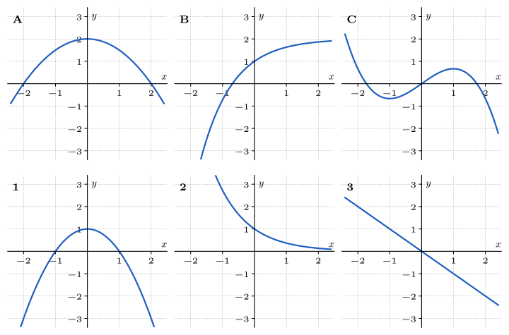
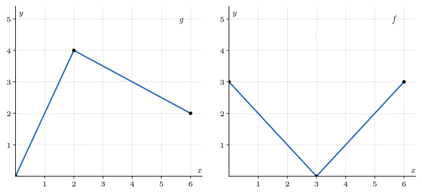

# Questions de réserve {.divider background-color="#14304a"}

## Réserve 1 · Chain rule et cosinus {#q-CR1}

::: {.qstem}
Que vaut la dérivée de $f(x) = \cos(2x)$ ?
:::

::::: {.qrow .ok}
::: qans
$-2\sin(2x)$
:::
::: qwhy
$\big(\cos(y)\big)' = -\sin(y)$, multiplié par la dérivée de $2x$, qui vaut $2$.
:::
:::::

::::: {.qrow}
::: qans
$-\sin(2x)$
:::
::: qwhy
Il manque la dérivée de la fonction intérieure.
:::
:::::

::::: {.qrow}
::: qans
$2\sin(2x)$
:::
::: qwhy
Le signe est faux : la dérivée du cosinus est $-\sin$.
:::
:::::

::::: {.qrow}
::: qans
$-\sin(2)$
:::
::: qwhy
On a dérivé la fonction intérieure à la place de la variable : le sinus reçoit $2x$.
:::
:::::

<a class="back-btn" href="01-remediation.html#/nav-c">← Où aller selon les résultats</a> Exercices : <a href="01-remediation.html#/ex-c-S3">S.3</a> · <a href="01-remediation.html#/ex-c-R4">R.4(e)</a>

## Réserve 2 · Exponentielle en base quelconque {#q-CR2}

::: {.qstem}
Que vaut la dérivée de $f(x) = 3^{x}$ ?
:::

::::: {.qrow .ok}
::: qans
$\ln(3) \cdot 3^{x}$
:::
::: qwhy
Pour $a > 0$, $(a^{x})' = \ln(a) \cdot a^{x}$.
:::
:::::

::::: {.qrow}
::: qans
$x \cdot 3^{x - 1}$
:::
::: qwhy
La règle des puissances ne s'applique pas : la variable est dans l'exposant.
:::
:::::

::::: {.qrow}
::: qans
$3^{x}$
:::
::: qwhy
Seule l'exponentielle de base $e$ est égale à sa dérivée, car $\ln(e) = 1$.
:::
:::::

::::: {.qrow}
::: qans
$\dfrac{3^{x}}{\ln(3)}$
:::
::: qwhy
Le facteur $\ln(3)$ multiplie, il ne divise pas.
:::
:::::

<a class="back-btn" href="01-remediation.html#/nav-c">← Où aller selon les résultats</a> Exercices : <a href="01-remediation.html#/ex-c-S3">S.3 (f₄)</a> · <a href="01-remediation.html#/ex-c-R1">R.1</a>

## Réserve 3 · Valeur et pente lues sur un graphe {#q-CR3}

::: {.qstem}
Le graphe de $f$ passe par $(1\,;\,4)$, et la tangente en ce point passe aussi par $(3\,;\,0)$. Que vaut $f'(1)$ ?
:::

::::: {.qrow .ok}
::: qans
$-2$
:::
::: qwhy
La pente de la tangente vaut $\dfrac{0 - 4}{3 - 1} = -2$.
:::
:::::

::::: {.qrow}
::: qans
$4$
:::
::: qwhy
$4$ est la valeur $f(1)$, pas la pente.
:::
:::::

::::: {.qrow}
::: qans
$2$
:::
::: qwhy
Le signe est faux : la tangente descend de $(1\,;\,4)$ à $(3\,;\,0)$.
:::
:::::

::::: {.qrow}
::: qans
$-\dfrac{1}{2}$
:::
::: qwhy
Le quotient est inversé : la pente est la variation de $y$ divisée par la variation de $x$.
:::
:::::

<a class="back-btn" href="01-remediation.html#/nav-c">← Où aller selon les résultats</a> Exercices : <a href="01-remediation.html#/ex-c-S4">S.4</a> · <a href="01-remediation.html#/ex-c-S5">S.5</a>

# Solutions des exercices {.divider background-color="#14304a"}

## Énoncé R.1 (séance 8) O1 {#st-c-R1 .smaller}

Écris chacune des fonctions suivantes sous la forme d'une puissance de $x$, puis calcule sa dérivée.

$$f_1(x) = x^{10} \qquad f_2(x) = \frac{1}{x} \qquad f_3(x) = \frac{1}{x^{5}}$$

$$f_4(x) = x^{2}\sqrt{x} \qquad f_5(x) = \frac{\sqrt{x}}{x^{2}}$$

## Solution R.1 (séance 8) {#sol-c-R1}

::: {.sol .long}
$f_1'(x) = 10x^{9}$ ; $f_2'(x) = -\dfrac{1}{x^{2}}$ ; $f_3'(x) = -\dfrac{5}{x^{6}}$ ; $f_4'(x) = \dfrac{5}{2}x\sqrt{x}$ ; $f_5'(x) = -\dfrac{3}{2x^{2}\sqrt{x}}$.

On écrit chaque fonction comme une puissance, puis on applique la règle des puissances.

1. $f_1'(x) = 10x^{9}$.
2. $f_2(x) = x^{-1}$, donc $f_2'(x) = -x^{-2} = -\dfrac{1}{x^{2}}$.
3. $f_3(x) = x^{-5}$, donc $f_3'(x) = -5x^{-6} = -\dfrac{5}{x^{6}}$.
4. $f_4(x) = x^{5/2}$, donc $f_4'(x) = \dfrac{5}{2}x^{3/2} = \dfrac{5}{2}x\sqrt{x}$.
5. $f_5(x) = x^{-3/2}$, donc $f_5'(x) = -\dfrac{3}{2}x^{-5/2} = -\dfrac{3}{2x^{2}\sqrt{x}}$.
:::

<a class="back-btn" href="01-remediation.html#/ex-c">← Exercices à réaliser</a>

## Énoncé R.2 (séance 8) O1 {#st-c-R2 .smaller}

\(a) Calcule la dérivée de chacune des fonctions suivantes.

$$f(x) = 2x^{5} - 3x^{3} + x - 7 \qquad g(x) = \frac{4}{x} - 6\sqrt{x} \qquad h(t) = 2\sin(t) - 5\cos(t) + e^{t}$$

\(b) Calcule $f'(-1)$ et $g'(1)$.

## Solution R.2 (séance 8) {#sol-c-R2}

::: {.sol .long}
\(a) $f'(x) = 10x^{4} - 9x^{2} + 1$ ; $g'(x) = -\dfrac{4}{x^{2}} - \dfrac{3}{\sqrt{x}}$ ; $h'(t) = 2\cos(t) + 5\sin(t) + e^{t}$.

On dérive terme à terme.

1. $f'(x) = 2 \cdot 5x^{4} - 3 \cdot 3x^{2} + 1 - 0 = 10x^{4} - 9x^{2} + 1$.
2. $g(x) = 4x^{-1} - 6x^{1/2}$, donc $g'(x) = -4x^{-2} - 6 \cdot \dfrac{1}{2}x^{-1/2} = -\dfrac{4}{x^{2}} - \dfrac{3}{\sqrt{x}}$.
3. $h'(t) = 2\cos(t) - 5 \cdot \big(-\sin(t)\big) + e^{t} = 2\cos(t) + 5\sin(t) + e^{t}$.

\(b) $f'(-1) = 2$ et $g'(1) = -7$.

$f'(-1) = 10 \cdot 1 - 9 \cdot 1 + 1 = 2$, car $(-1)^{4} = (-1)^{2} = 1$. $g'(1) = -4 - 3 = -7$.
:::

<a class="back-btn" href="01-remediation.html#/ex-c">← Exercices à réaliser</a>

## Énoncé R.3 (séance 8) O2 {#st-c-R3 .smaller}

Calcule la dérivée de chacune des fonctions suivantes, et simplifie le résultat.

\(a) $f(x) = x^{3} \cdot \ln(x)$, pour $x > 0$

\(b) $g(x) = e^{x} \cdot \sin(x)$

\(c) $h(x) = \dfrac{x^{2} - 1}{x^{2} + 1}$

\(d) $k(x) = \dfrac{e^{x}}{x + 1}$, pour $x \neq -1$

## Solution R.3 (séance 8) {#sol-c-R3}

::: {.sol .long}
(a) $f'(x) = x^{2}\big(3\ln(x) + 1\big)$ ; (b) $g'(x) = e^{x}\big(\sin(x) + \cos(x)\big)$ ; (c) $h'(x) = \dfrac{4x}{(x^{2} + 1)^{2}}$ ; (d) $k'(x) = \dfrac{x \cdot e^{x}}{(x + 1)^{2}}$.

(a) $f'(x) = 3x^{2} \cdot \ln(x) + x^{3} \cdot \dfrac{1}{x} = 3x^{2}\ln(x) + x^{2} = x^{2}\big(3\ln(x) + 1\big)$.

(b) $g'(x) = e^{x} \cdot \sin(x) + e^{x} \cdot \cos(x) = e^{x}\big(\sin(x) + \cos(x)\big)$.

(c) $h'(x) = \dfrac{2x(x^{2} + 1) - (x^{2} - 1) \cdot 2x}{(x^{2} + 1)^{2}} = \dfrac{2x^{3} + 2x - 2x^{3} + 2x}{(x^{2} + 1)^{2}} = \dfrac{4x}{(x^{2} + 1)^{2}}$.

(d) $k'(x) = \dfrac{e^{x}(x + 1) - e^{x} \cdot 1}{(x + 1)^{2}} = \dfrac{x \cdot e^{x}}{(x + 1)^{2}}$, pour $x \neq -1$.
:::

<a class="back-btn" href="01-remediation.html#/ex-c">← Exercices à réaliser</a>

## Énoncé R.4 (séance 8) O3 {#st-c-R4 .smaller}

Calcule la dérivée de chacune des fonctions suivantes.

\(a) $f_1(x) = (1 - 2x)^{5}$

\(b) $f_2(x) = e^{3x + 1}$

\(c) $f_3(x) = \sqrt{4 - x}$, pour $x < 4$

\(d) $f_4(x) = \ln(2x + 5)$, pour $x > -\tfrac{5}{2}$

\(e) $f_5(t) = \cos\left(\dfrac{\pi t}{12}\right)$

## Solution R.4 (séance 8) {#sol-c-R4}

::: {.sol}
(a) $f_1'(x) = -10(1 - 2x)^{4}$ ; (b) $f_2'(x) = 3e^{3x + 1}$ ; (c) $f_3'(x) = -\dfrac{1}{2\sqrt{4 - x}}$ ; (d) $f_4'(x) = \dfrac{2}{2x + 5}$ ; (e) $f_5'(t) = -\dfrac{\pi}{12}\sin\left(\dfrac{\pi t}{12}\right)$.

(a) $f_1'(x) = 5(1 - 2x)^{4} \cdot (-2) = -10(1 - 2x)^{4}$.

(b) $f_2'(x) = e^{3x + 1} \cdot 3$.

(c) $f_3'(x) = \dfrac{1}{2\sqrt{4 - x}} \cdot (-1)$.

(d) $f_4'(x) = \dfrac{1}{2x + 5} \cdot 2$.

(e) $f_5'(t) = -\sin\left(\dfrac{\pi t}{12}\right) \cdot \dfrac{\pi}{12}$.
:::

<a class="back-btn" href="01-remediation.html#/ex-c">← Exercices à réaliser</a>

## Énoncé R.5 (séance 8) O3 {#st-c-R5 .smaller}

Calcule la dérivée de chacune des fonctions suivantes. Chacune demande d'enchaîner deux règles.

\(a) $f(x) = x \cdot e^{-x^{2}}$

\(b) $g(x) = \ln\left(\sqrt{x^{2} + 1}\right)$

\(c) $h(x) = \big(\sin(x)\big)^{2}$

## Solution R.5 (séance 8) {#sol-c-R5}

::: {.sol}
(a) $f'(x) = (1 - 2x^{2}) \cdot e^{-x^{2}}$ ; (b) $g'(x) = \dfrac{x}{x^{2} + 1}$ ; (c) $h'(x) = 2\sin(x)\cos(x)$.

(a) $f'(x) = 1 \cdot e^{-x^{2}} + x \cdot e^{-x^{2}} \cdot (-2x) = (1 - 2x^{2}) \cdot e^{-x^{2}}$.

(b) Comme $x^{2} + 1 > 0$, $g(x) = \dfrac{1}{2}\ln\left(x^{2} + 1\right)$ sur $\mathbb{R}$, donc $g'(x) = \dfrac{1}{2} \cdot \dfrac{2x}{x^{2} + 1} = \dfrac{x}{x^{2} + 1}$.

(c) $h'(x) = 2\sin(x) \cdot \cos(x)$.
:::

<a class="back-btn" href="01-remediation.html#/ex-c">← Exercices à réaliser</a>

## Énoncé R.6 (séance 8) O4 {#st-c-R6 .smaller}

Pour chacune des fonctions suivantes, écris la règle de dérivation que l'expression semble imposer. Simplifie ensuite l'expression, puis calcule la dérivée sans cette règle.

\(a) $f_1(x) = \dfrac{x^{3} - x}{x}$, pour $x \neq 0$

\(b) $f_2(x) = e^{2\ln(x)}$, pour $x > 0$

\(c) $f_3(x) = \ln\left(e^{3x}\right)$

\(d) $f_4(x) = \sqrt{x} \cdot \sqrt{x^{3}}$, pour $x \geq 0$

## Solution R.6 (séance 8) {#sol-c-R6}

::: {.sol .long}
(a) Règle du quotient ; $f_1(x) = x^{2} - 1$ et $f_1'(x) = 2x$, pour $x \neq 0$. (b) Chain rule ; $f_2(x) = x^{2}$ et $f_2'(x) = 2x$, pour $x > 0$. (c) Chain rule ; $f_3(x) = 3x$ et $f_3'(x) = 3$, sur $\mathbb{R}$. (d) Règle de Leibniz ; $f_4(x) = x^{2}$ et $f_4'(x) = 2x$, pour $x \geq 0$.

Chaque simplification est valable seulement sur le domaine initial de la fonction.

(a) $\dfrac{x^{3} - x}{x} = x^{2} - 1$ pour $x \neq 0$ : on a divisé par $x$, donc $0$ reste exclu.

(b) $e^{2\ln(x)} = x^{2}$ n'a de sens que pour $x > 0$, car $\ln(x)$ n'est défini que pour $x > 0$.

(c) $\ln\left(e^{3x}\right) = 3x$ pour tout réel $x$, car $e^{3x} > 0$.

(d) $\sqrt{x} \cdot \sqrt{x^{3}} = x^{2}$ pour $x \geq 0$, car les racines imposent $x \geq 0$.
:::

<a class="back-btn" href="01-remediation.html#/ex-c">← Exercices à réaliser</a>

## Énoncé R.7 (séance 8) O5 {#st-c-R7 .smaller}

Une étudiante a calculé les dérivées suivantes. Pour chacune, écris si elle est correcte. Si elle est fausse, nomme la règle qui n'a pas été respectée et corrige le calcul.

\(a) $\left(\dfrac{x^{2} + 1}{x}\right)' = \dfrac{2x}{1} = 2x$

\(b) $\left(\sqrt{2x}\right)' = \dfrac{1}{2\sqrt{2x}}$

\(c) $\big(\ln(3x)\big)' = \dfrac{1}{x}$

\(d) $\big(x \cdot e^{2x}\big)' = e^{2x} + 2x\,e^{2x}$

## Solution R.7 (séance 8) {#sol-c-R7}

::: {.sol .long}
(a) Faux ; (b) faux ; (c) correct ; (d) correct.

(a) La règle du quotient n'a pas été respectée : l'étudiante a écrit le quotient des dérivées. Correction : $\left(\dfrac{x^{2} + 1}{x}\right)' = \dfrac{2x \cdot x - (x^{2} + 1)}{x^{2}} = \dfrac{x^{2} - 1}{x^{2}}$. On peut aussi simplifier d'abord : $x + \dfrac{1}{x}$, de dérivée $1 - \dfrac{1}{x^{2}}$.

(b) La chain rule n'a pas été respectée : il manque la dérivée de la fonction intérieure $2x$. Correction : $\left(\sqrt{2x}\right)' = \dfrac{2}{2\sqrt{2x}} = \dfrac{1}{\sqrt{2x}}$.

(c) $\big(\ln(3x)\big)' = \dfrac{1}{3x} \cdot 3 = \dfrac{1}{x}$ : le calcul est correct.

(d) Par la règle de Leibniz et la chain rule, $\big(x \cdot e^{2x}\big)' = e^{2x} + x \cdot 2e^{2x}$ : le calcul est correct.
:::

<a class="back-btn" href="01-remediation.html#/ex-c">← Exercices à réaliser</a>

## Énoncé R.8 (séance 8) O6 {#st-c-R8 .smaller}

Le métabolisme de base d'un mammifère, c'est-à-dire l'énergie qu'il dépense au repos, dépend de sa masse. La loi de Kleiber le modélise par
$$B(m) = 70 \cdot m^{3/4},$$
où $m$ est la masse, en kg, et $B(m)$ le métabolisme de base, en kcal par jour.

\(a) Calcule $B'(m)$.

\(b) Calcule $B(16)$, $B'(16)$, $B(81)$ et $B'(81)$, avec leur unité. Écris en une phrase ce que signifie $B'(81)$.

\(c) Montre que $B'(m) = \dfrac{3}{4} \cdot \dfrac{B(m)}{m}$. Pour un mammifère donné, un kilogramme de plus coûte-t-il plus ou moins d'énergie que la moyenne de ses kilogrammes ?

::: {.xs}
Source : M. Kleiber, *The Fire of Life: An Introduction to Animal Energetics*, Wiley, 1961 : métabolisme de base de $70\,m^{0{,}75}$ kcal par jour. Voir aussi M. Kleiber, « Body size and metabolic rate », *Physiological Reviews*, 27(4), 1947, p. 511–541. https://doi.org/10.1152/physrev.1947.27.4.511 (consulté le 17 novembre 2026).
:::

## Solution R.8 (séance 8) {#sol-c-R8}

::: {.sol .long}
\(a) $B'(m) = 52{,}5 \cdot m^{-1/4} = \dfrac{52{,}5}{m^{1/4}}$.

$B'(m) = 70 \cdot \dfrac{3}{4} \cdot m^{3/4 - 1} = 52{,}5 \cdot m^{-1/4}$.

\(b) $B(16) = 560$ kcal par jour, $B'(16) = 26{,}25$ kcal par jour et par kg, $B(81) = 1890$ kcal par jour et $B'(81) = 17{,}5$ kcal par jour et par kg. Pour un mammifère de $81$ kg, chaque kilogramme supplémentaire augmente le métabolisme de base d'environ $17{,}5$ kcal par jour.

$B(16) = 70 \cdot 8 = 560$ et $B'(16) = \dfrac{52{,}5}{2} = 26{,}25$ ; $B(81) = 70 \cdot 27 = 1890$ et $B'(81) = \dfrac{52{,}5}{3} = 17{,}5$. L'unité de $B'$ est celle de $B$, des kcal par jour, divisée par celle de $m$, des kg.
:::

<a class="back-btn" href="01-remediation.html#/ex-c">← Exercices à réaliser</a>

## Solution R.8 (séance 8) (suite) 

::: {.sol}
\(c) $B'(m) = \dfrac{3}{4} \cdot \dfrac{B(m)}{m}$ : un kilogramme de plus coûte moins d'énergie que la moyenne des kilogrammes du mammifère, $25\,\%$ de moins.

$\dfrac{3}{4} \cdot \dfrac{B(m)}{m} = \dfrac{3}{4} \cdot \dfrac{70 \cdot m^{3/4}}{m} = 52{,}5 \cdot m^{-1/4} = B'(m)$.

Le quotient $\dfrac{B(m)}{m}$ est le métabolisme moyen par kilogramme, par exemple $\dfrac{1890}{81} \approx 23{,}3$ kcal par jour et par kg pour $81$ kg. La dérivée $B'(81) = 17{,}5$ en vaut les trois quarts.
:::

<a class="back-btn" href="01-remediation.html#/ex-c">← Exercices à réaliser</a>

## Énoncé R.9 (séance 8) O2 {#st-c-R9 .smaller}

Soit la fonction $f(x) = x^{2} \cdot e^{-x}$.

\(a) Calcule $f'(x)$, et écris-la sous forme factorisée.

\(b) En quels points du graphe de $f$ la tangente est-elle horizontale ?

\(c) Écris l'équation de la tangente au graphe de $f$ au point d'abscisse $1$.

## Solution R.9 (séance 8) {#sol-c-R9}

::: {.sol}
\(a) $f'(x) = x(2 - x) \cdot e^{-x}$.

$f'(x) = 2x \cdot e^{-x} + x^{2} \cdot \left(-e^{-x}\right) = (2x - x^{2}) \cdot e^{-x} = x(2 - x) \cdot e^{-x}$.

\(b) Aux points $(0\,;\,0)$ et $\left(2\,;\,4e^{-2}\right)$.

Comme $e^{-x} > 0$, $f'(x) = 0$ si et seulement si $x = 0$ ou $x = 2$. On calcule $f(0) = 0$ et $f(2) = 4e^{-2}$.

\(c) $y = \dfrac{x}{e}$.

$f(1) = e^{-1}$ et $f'(1) = 1 \cdot 1 \cdot e^{-1} = e^{-1}$. La tangente a pour équation $y = e^{-1} + e^{-1}(x - 1) = e^{-1} \cdot x$.
:::

<a class="back-btn" href="01-remediation.html#/ex-c">← Exercices à réaliser</a>

## Énoncé S.1 (séance 8, socle) O1 {#st-c-S1 .smaller}

\(a) Calcule la dérivée de chacune des fonctions suivantes, et donne le domaine de cette dérivée.

$$f_1(x) = 4x^{3} - 5x^{2} + 7 \qquad f_2(x) = \frac{2}{x^{3}} \qquad f_3(x) = 3\sqrt{x} - \frac{1}{x}$$

$$f_4(x) = x\sqrt{x} \qquad f_5(t) = 5e^{t} - 2\ln(t) + 3\cos(t)$$

\(b) Calcule $f_3'(4)$.

## Solution S.1 (séance 8, socle) {#sol-c-S1}

::: {.sol .long}
\(a) $f_1'(x) = 12x^{2} - 10x$ sur $\mathbb{R}$ ; $f_2'(x) = -\dfrac{6}{x^{4}}$ sur $\mathbb{R}_0$ ; $f_3'(x) = \dfrac{3}{2\sqrt{x}} + \dfrac{1}{x^{2}}$ sur $\mathbb{R}^+_0$ ; $f_4'(x) = \dfrac{3}{2}\sqrt{x}$ sur $\mathbb{R}^+$ ; $f_5'(t) = 5e^{t} - \dfrac{2}{t} - 3\sin(t)$ sur $\mathbb{R}^+_0$.

On dérive terme à terme (linéarité), en gardant les coefficients constants, et on lit le domaine dans la table de référence.

1. $f_1'(x) = 4 \cdot 3x^{2} - 5 \cdot 2x + 0 = 12x^{2} - 10x$ ; un polynôme se dérive sur $\mathbb{R}$.
2. $f_2(x) = 2x^{-3}$, donc $f_2'(x) = 2 \cdot (-3)x^{-4} = -\dfrac{6}{x^{4}}$, qui n'existe pas en $0$ : $\mathrm{Dom}(f_2') = \mathbb{R}_0$.
:::

<a class="back-btn" href="01-remediation.html#/ex-c">← Exercices à réaliser</a>

## Solution S.1 (séance 8, socle) (suite) 

::: {.sol .long}
3. $f_3(x) = 3x^{1/2} - x^{-1}$, donc $f_3'(x) = 3 \cdot \dfrac{1}{2}x^{-1/2} + x^{-2} = \dfrac{3}{2\sqrt{x}} + \dfrac{1}{x^{2}}$. Il faut $x \geq 0$ pour la racine et $x \neq 0$ pour les divisions : $\mathrm{Dom}(f_3') = \mathbb{R}^+_0$.
4. $f_4(x) = x \cdot x^{1/2} = x^{3/2}$, donc $f_4'(x) = \dfrac{3}{2}x^{1/2} = \dfrac{3}{2}\sqrt{x}$. Cette expression est définie pour $x \geq 0$ : $\mathrm{Dom}(f_4') = \mathbb{R}^+$. C'est le cas « dépend de $\alpha$ » de la table : pour $\alpha = \tfrac{3}{2}$, le domaine contient $0$.
5. $f_5'(t) = 5e^{t} - 2 \cdot \dfrac{1}{t} + 3 \cdot \big(-\sin(t)\big)$ ; le terme $\ln(t)$ impose $t > 0$ : $\mathrm{Dom}(f_5') = \mathbb{R}^+_0$.

\(b) $f_3'(4) = \dfrac{13}{16}$.

On remplace $x$ par $4$ : $f_3'(4) = \dfrac{3}{2 \cdot 2} + \dfrac{1}{16} = \dfrac{12}{16} + \dfrac{1}{16} = \dfrac{13}{16}$.
:::

<a class="back-btn" href="01-remediation.html#/ex-c">← Exercices à réaliser</a>

## Énoncé S.2 (séance 8, socle) O2 {#st-c-S2 .smaller}

En identifiant la nature algébrique de l'expression analytique de chaque fonction, calcule sa dérivée. Simplifie le résultat.

$$f(x) = \left(x^{2} + 1\right) \cdot e^{x} \qquad g(x) = \frac{2x + 1}{x - 3}$$

$$h(x) = \frac{\sin(x)}{x} \qquad k(x) = \frac{x^{3} - 4x}{x - 2}$$

Pour $k$, précise le domaine de $k$ et celui de $k'$.

::: {.xs}
Source : La nature algébrique d'une expression est l'opération effectuée en dernier quand on calcule sa valeur : somme, différence, produit, quotient ou composée. Elle détermine la première règle de dérivation à appliquer.
:::

## Solution S.2 (séance 8, socle) {#sol-c-S2}

::: {.sol .xlong}
$f'(x) = (x + 1)^{2} \cdot e^{x}$, sur $\mathbb{R}$.

$f$ est un produit : $u(x) = x^{2} + 1$, $v(x) = e^{x}$. Par la règle de Leibniz, $f'(x) = 2x \cdot e^{x} + (x^{2} + 1) \cdot e^{x} = (x^{2} + 2x + 1) \cdot e^{x} = (x + 1)^{2} \cdot e^{x}$.

$g'(x) = -\dfrac{7}{(x - 3)^{2}}$, sur $\mathbb{R} \setminus \{3\}$.

$g$ est un quotient : $u(x) = 2x + 1$, $v(x) = x - 3$. Par la règle du quotient, $g'(x) = \dfrac{2(x - 3) - (2x + 1) \cdot 1}{(x - 3)^{2}} = \dfrac{-7}{(x - 3)^{2}}$.

$h'(x) = \dfrac{x\cos(x) - \sin(x)}{x^{2}}$, sur $\mathbb{R}_0$.

$h$ est un quotient : $u(x) = \sin(x)$, $v(x) = x$. Par la règle du quotient, $h'(x) = \dfrac{\cos(x) \cdot x - \sin(x) \cdot 1}{x^{2}}$.

$\mathrm{Dom}(k) = \mathbb{R} \setminus \{2\}$ et $k'(x) = 2x + 2$, sur $\mathbb{R} \setminus \{2\}$.

$x^{3} - 4x = x(x^{2} - 4) = x(x - 2)(x + 2)$. Pour $x \neq 2$, on simplifie par $x - 2$ : $k(x) = x(x + 2) = x^{2} + 2x$, donc $k'(x) = 2x + 2$. On a divisé par $x - 2$ : la valeur $2$ reste exclue du domaine de $k$ et de celui de $k'$.
:::

<a class="back-btn" href="01-remediation.html#/ex-c">← Exercices à réaliser</a>

## Énoncé S.3 (séance 8, socle) O3 {#st-c-S3 .smaller}

En identifiant la nature algébrique de l'expression analytique de chaque fonction, calcule sa dérivée.

$$f_1(x) = (5 - 2x)^{3} \qquad f_2(x) = \sqrt{x^{2} + 9} \qquad f_3(x) = \ln\left(x^{2} + 4\right)$$

$$f_4(x) = 2^{3x} \qquad f_5(x) = x \cdot e^{-2x}$$

::: {.xs}
Source : La nature algébrique d'une expression est l'opération effectuée en dernier quand on calcule sa valeur : somme, différence, produit, quotient ou composée. Elle détermine la première règle de dérivation à appliquer.
:::

## Solution S.3 (séance 8, socle) {#sol-c-S3}

::: {.sol .long}
$f_1'(x) = -6(5 - 2x)^{2}$ ; $f_2'(x) = \dfrac{x}{\sqrt{x^{2} + 9}}$ ; $f_3'(x) = \dfrac{2x}{x^{2} + 4}$ ; $f_4'(x) = 3\ln(2) \cdot 2^{3x}$ ; $f_5'(x) = (1 - 2x) \cdot e^{-2x}$.

Pour chaque composée, on écrit la fonction intérieure $g$, puis on applique $(f \circ g)'(x) = f'\big(g(x)\big) \cdot g'(x)$.

1. $f_1$ : $g(x) = 5 - 2x$, $g'(x) = -2$, fonction extérieure $y^{3}$. Donc $f_1'(x) = 3(5 - 2x)^{2} \cdot (-2) = -6(5 - 2x)^{2}$.
2. $f_2$ : $g(x) = x^{2} + 9$, $g'(x) = 2x$, fonction extérieure $\sqrt{y}$. Donc $f_2'(x) = \dfrac{2x}{2\sqrt{x^{2} + 9}} = \dfrac{x}{\sqrt{x^{2} + 9}}$.
:::

<a class="back-btn" href="01-remediation.html#/ex-c">← Exercices à réaliser</a>

## Solution S.3 (séance 8, socle) (suite) 

::: {.sol .long}
3. $f_3$ : $g(x) = x^{2} + 4$, $g'(x) = 2x$, fonction extérieure $\ln(y)$. Donc $f_3'(x) = \dfrac{1}{x^{2} + 4} \cdot 2x = \dfrac{2x}{x^{2} + 4}$. Comme $x^{2} + 4 > 0$, $f_3$ et $f_3'$ sont définies sur $\mathbb{R}$.
4. $f_4$ : $g(x) = 3x$, $g'(x) = 3$, fonction extérieure $2^{y}$. Donc $f_4'(x) = \ln(2) \cdot 2^{3x} \cdot 3$.
5. $f_5$ est le produit de $x$ par $e^{-2x}$ : la règle de Leibniz donne $f_5'(x) = 1 \cdot e^{-2x} + x \cdot \big(e^{-2x}\big)'$. Par la chain rule, $\big(e^{-2x}\big)' = -2e^{-2x}$, donc $f_5'(x) = e^{-2x} - 2x \cdot e^{-2x} = (1 - 2x) \cdot e^{-2x}$.
:::

<a class="back-btn" href="01-remediation.html#/ex-c">← Exercices à réaliser</a>

## Énoncé S.4 (séance 8, socle) O5 {#st-c-S4 .smaller}

La première ligne représente trois fonctions A, B et C. La seconde ligne représente leurs dérivées, dans le désordre. Associe chaque fonction à sa dérivée, et justifie chaque association par ce que tu lis sur les graphiques.

{.fig fig-alt="Six graphiques. Première ligne : A, une parabole tournée vers le bas de sommet (0 ; 2) ; B, une courbe croissante qui monte de plus en plus lentement et se rapproche de y = 2 ; C, une courbe qui descend, remonte entre x = −1 et x = 1, puis redescend. Seconde ligne : 1, une parabole tournée vers le bas de sommet (0 ; 1), qui coupe l'axe horizontal en −1 et en 1 ; 2, une courbe positive décroissante qui se rapproche de 0 ; 3, une droite décroissante qui passe par l'origine."}

## Solution S.4 (séance 8, socle) {#sol-c-S4}

::: {.sol .long}
A–3, B–2, C–1.

On compare le signe des pentes de chaque fonction au signe de chaque dérivée proposée.

1. A est croissante sur $]-\infty,\,0]$, décroissante sur $[0,\,+\infty[$, avec une tangente horizontale en $x = 0$. Sa dérivée est positive, nulle en $0$, puis négative : c'est le graphe 3.
2. B est croissante partout, et ses tangentes sont de moins en moins inclinées quand $x$ augmente. Sa dérivée est positive et décroît vers $0$ : c'est le graphe 2.
3. C est décroissante, puis croissante entre $x = -1$ et $x = 1$, puis décroissante, avec des tangentes horizontales en $x = -1$ et en $x = 1$. Sa dérivée est négative, positive sur $]-1,\,1[$, puis négative, et elle s'annule en $-1$ et en $1$ : c'est le graphe 1.
:::

<a class="back-btn" href="01-remediation.html#/ex-c">← Exercices à réaliser</a>

## Énoncé S.5 (séance 8, socle) O3 {#st-c-S5 .smaller}

Les graphes des fonctions $g$ (à gauche) et $f$ (à droite) sont formés de segments de droite.

{.fig fig-alt="Deux graphiques côte à côte. À gauche, le graphe de g relie les points (0 ; 0), (2 ; 4) et (6 ; 2). À droite, le graphe de f relie les points (0 ; 3), (3 ; 0) et (6 ; 3)."}

\(a) On pose $p(x) = f(x) \cdot g(x)$. Calcule $p'(1)$.

\(b) On pose $h(x) = f\big(g(x)\big)$. Calcule $h'(1)$.

\(c) On pose $k(x) = g\big(f(x)\big)$. Calcule $k'(4)$.

## Solution S.5 (séance 8, socle) {#sol-c-S5}

::: {.sol .xlong}
\(a) $p'(1) = 2$.

Par la règle de Leibniz, $p'(1) = f'(1) \cdot g(1) + f(1) \cdot g'(1)$.

On lit $f(1) = 2$ et $g(1) = 2$. Le segment de $f$ qui relie $(0\,;\,3)$ à $(3\,;\,0)$ a une pente de $\tfrac{0 - 3}{3 - 0} = -1$, donc $f'(1) = -1$. Le segment de $g$ qui relie $(0\,;\,0)$ à $(2\,;\,4)$ a une pente de $\tfrac{4}{2} = 2$, donc $g'(1) = 2$.

Donc $p'(1) = (-1) \cdot 2 + 2 \cdot 2 = 2$.

\(b) $h'(1) = -2$.

Par la chain rule, $h'(1) = f'\big(g(1)\big) \cdot g'(1)$.

On lit $g(1) = 2$ et $g'(1) = 2$. Au point d'abscisse $2$, $f$ suit le segment de pente $-1$, donc $f'(2) = -1$. Donc $h'(1) = (-1) \cdot 2 = -2$.

\(c) $k'(4) = 2$.

Par la chain rule, $k'(4) = g'\big(f(4)\big) \cdot f'(4)$.

Le segment de $f$ qui relie $(3\,;\,0)$ à $(6\,;\,3)$ a une pente de $1$ : on lit $f(4) = 1$ et $f'(4) = 1$. Au point d'abscisse $1$, $g$ suit le segment de pente $2$, donc $g'(1) = 2$. Donc $k'(4) = 2 \cdot 1 = 2$.
:::

<a class="back-btn" href="01-remediation.html#/ex-c">← Exercices à réaliser</a>

## Énoncé S.6 (séance 8, socle) O5 {#st-c-S6 .smaller}

Un étudiant a calculé les dérivées suivantes. Pour chacune, écris si elle est correcte. Si elle est fausse, nomme la règle qui n'a pas été respectée et corrige le calcul.

\(a) $\big(x \cdot e^{x}\big)' = e^{x}$

\(b) $\big(e^{x^{2}}\big)' = e^{x^{2}}$

\(c) $\left(\dfrac{1}{x^{2}}\right)' = -\dfrac{2}{x^{3}}$

\(d) $\big(\sin(3x)\big)' = 3\cos(3x)$

## Solution S.6 (séance 8, socle) {#sol-c-S6}

::: {.sol .long}
(a) Faux ; (b) faux ; (c) correct ; (d) correct.

On identifie la dernière opération de chaque expression, puis on refait le calcul.

(a) $x \cdot e^{x}$ est un produit, et la règle de Leibniz n'a pas été respectée : l'étudiant a dérivé $x$ en $1$ et multiplié par $e^{x}$, sans le second terme. Correction : $\big(x \cdot e^{x}\big)' = 1 \cdot e^{x} + x \cdot e^{x} = (1 + x) \cdot e^{x}$.

(b) $e^{x^{2}}$ est une composée, et la chain rule n'a pas été respectée : il manque la dérivée de la fonction intérieure $x^{2}$. Correction : $\big(e^{x^{2}}\big)' = e^{x^{2}} \cdot 2x$.

(c) $\dfrac{1}{x^{2}} = x^{-2}$, donc $\left(x^{-2}\right)' = -2x^{-3} = -\dfrac{2}{x^{3}}$ : le calcul est correct.

(d) $\sin(3x)$ est une composée de fonction intérieure $3x$ : $\big(\sin(3x)\big)' = \cos(3x) \cdot 3$. Le calcul est correct.
:::

<a class="back-btn" href="01-remediation.html#/ex-c">← Exercices à réaliser</a>

## Énoncé S.7 (séance 8, socle) O6 {#st-c-S7 .smaller}

Après une injection intramusculaire, la concentration d'un médicament dans le sang est modélisée par $C(t) = 10\,t \cdot e^{-t/2}$, où $t$ est le temps écoulé depuis l'injection, en heures, et $C(t)$ la concentration, en mg/L.

\(a) Calcule $C'(t)$, et écris son unité.

\(b) Calcule $C'(0)$ et $C'(2)$, puis écris le signe de $C'(4)$. Écris en une phrase ce que chacun de ces résultats signifie pour la concentration.

## Solution S.7 (séance 8, socle) {#sol-c-S7}

::: {.sol}
\(a) $C'(t) = 5(2 - t) \cdot e^{-t/2}$, en mg/L par heure.

$C(t)$ est le produit de $u(t) = 10t$ par $v(t) = e^{-t/2}$.

1. $u'(t) = 10$ et, par la chain rule, $v'(t) = e^{-t/2} \cdot \left(-\dfrac{1}{2}\right)$.
2. Par la règle de Leibniz, $C'(t) = 10 \cdot e^{-t/2} + 10t \cdot \left(-\dfrac{1}{2}\right)e^{-t/2} = (10 - 5t) \cdot e^{-t/2} = 5(2 - t) \cdot e^{-t/2}$.
3. $C'(t)$ s'exprime dans l'unité de $C$ divisée par l'unité de $t$ : en mg/L par heure.
:::

<a class="back-btn" href="01-remediation.html#/ex-c">← Exercices à réaliser</a>

## Solution S.7 (séance 8, socle) (suite) 

::: {.sol .long}
\(b) $C'(0) = 10$ mg/L par heure, $C'(2) = 0$ mg/L par heure et $C'(4) < 0$. Juste après l'injection, la concentration augmente de $10$ mg/L par heure ; à $t = 2$ h, elle cesse d'augmenter ; à $t = 4$ h, elle diminue.

On utilise $C'(t) = 5(2 - t) \cdot e^{-t/2}$, où $e^{-t/2} > 0$ : le signe de $C'(t)$ est celui de $2 - t$.

1. $C'(0) = 5 \cdot 2 \cdot e^{0} = 10$ : au moment de l'injection, la concentration augmente à la vitesse de $10$ mg/L par heure.
2. $C'(2) = 5 \cdot 0 \cdot e^{-1} = 0$ : à $t = 2$ h, la tangente est horizontale ; la concentration passe d'une phase de hausse à une phase de baisse.
3. $C'(4) = 5 \cdot (-2) \cdot e^{-2} = -10e^{-2} < 0$ : à $t = 4$ h, la concentration diminue.
:::

<a class="back-btn" href="01-remediation.html#/ex-c">← Exercices à réaliser</a>

