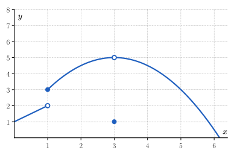
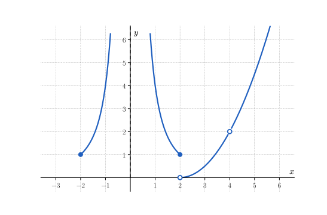
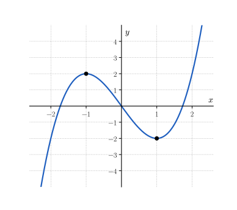
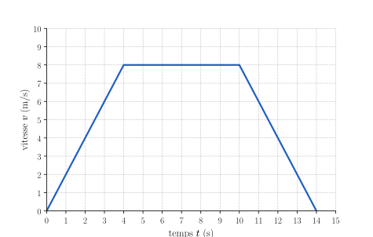
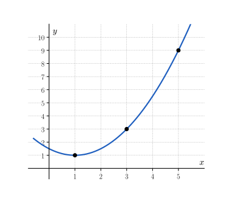
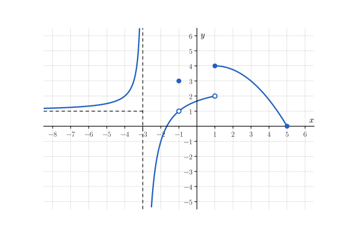
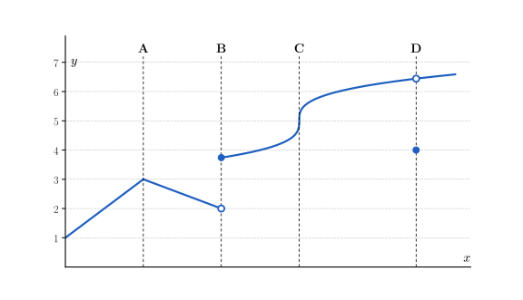

## Par où commencer ? {#start .smaller}

<style>
.qrow{display:flex;gap:.8em;border-bottom:1px solid #e5e9ef;padding:.28em .2em;font-size:.6em;line-height:1.35;align-items:flex-start}
.qrow .qans{flex:0 0 36%;font-weight:600}
.qrow .qwhy{flex:1 1 auto}
.qrow .qans p,.qrow .qwhy p{margin:0}
.qrow.ok{background:#f2f7ff}
.qrow.ok .qans::before{content:"✓ ";color:#276a2e;font-weight:700}
.qstem{font-size:.78em}
.qflex{display:flex;gap:1em;align-items:center}
.qflex img{max-width:330px;max-height:230px;width:auto;height:auto}
.reveal table.deroule a{font-weight:600}
.et-box{display:flex;flex-direction:column;align-items:center;gap:.5em;padding:.6em 1.4em;background:#f2f7ff;border:1px solid #dbe7fb;border-radius:.6em}
.et-timer{margin-top:.8em;display:flex;justify-content:center}
@keyframes et-pulse{0%,100%{opacity:1}50%{opacity:.35}}
.back{margin-top:.5em}
.qfoot{display:flex;gap:1.2em;align-items:center;margin-top:.45em;font-size:.55em}
.qfoot .back-btn{font-size:1em}
.qfoot .muted{color:#5a6b7b}
.back-btn{display:inline-block;font-size:.5em;font-weight:600;padding:.3em .8em;border:1.5px solid #1f5fbf;border-radius:.5em;color:#1f5fbf;background:#fff}
.back-btn:hover{background:#1f5fbf;color:#fff;text-decoration:none!important}
.exo-foot{margin-top:.8em;font-size:.55em}
.sol{font-size:.8em}
.sol.long{font-size:.68em}
.sol.xlong{font-size:.6em}
.tv table{margin:.3em auto;border-collapse:collapse;font-size:.8em}
.tv th,.tv td{border:1px solid #cfd8e3;padding:.22em .9em;text-align:center}
.tv th{background:#f4f7fa;color:#14304a}
.tv .f{color:#b5381f;font-weight:700}
.sit table{font-size:.72em;margin:.3em auto;border-collapse:collapse}
.sit th,.sit td{border:1px solid #cfd8e3;padding:.25em .7em}
.sit th{background:#f4f7fa;color:#14304a}
.sit .f{color:#b5381f;font-weight:700}
.promesse{border:2px solid #1f5fbf;border-radius:14px;background:#f2f7ff;padding:.6em 1em;text-align:center;font-size:1.05em;margin:.5em 0}
.xs { font-size: .7em; }
.fig{display:block;margin:.3em auto;max-height:340px;width:auto}
</style>
<style>
.cle-cols{display:flex;gap:1.2em;align-items:center}
.reveal .columns{align-items:center}
</style>
<style>
.cle-cols{display:flex;gap:1.2em;align-items:center}
.reveal .columns{align-items:center}
</style>

Tu as fait le QCM. Va directement à ce dont tu as besoin.

:::: {.columns}
::: {.column width="52%"}
**Va là pour le correctif du QCM :**

<ul>
<li><a href="#/q-D1">Q1 · Variation relative et taux moyen</a></li>
<li><a href="#/q-D2">Q2 · Taux moyen et sécante</a></li>
<li><a href="#/q-D3">Q3 · Limite et image</a></li>
<li><a href="#/q-D4">Q4 · Propriétés algébriques des limites</a></li>
<li><a href="#/q-D5">Q5 · Asymptotes</a></li>
<li><a href="#/q-D6">Q6 · Continue ou dérivable</a></li>
<li><a href="#/q-D7">Q7 · Dérivée et pente de la tangente</a></li>
<li><a href="#/q-D8">Q8 · Plausibilité d'une dérivée</a></li>
<li><a href="#/q-D9">Q9 · Dérivée seconde</a></li>
<li><a href="#/nav-d">Tout le correctif, avec les exercices de renforcement</a></li>
</ul>
:::
::: {.column width="48%"}
**Va là pour un rappel théorique sur :**

<ul>
<li><a href="#/cle-d1">Variation absolue, variation relative, taux moyen</a></li>
<li><a href="#/cle-d2">Taux moyen et sécante</a></li>
<li><a href="#/cle-d3">Lire une limite</a></li>
<li><a href="#/cle-d4">Propriétés algébriques des limites</a></li>
<li><a href="#/cle-d5">Asymptotes</a></li>
<li><a href="#/cle-d6">Continuité et dérivabilité</a></li>
<li><a href="#/cle-d7">Dérivée et tangente</a></li>
<li><a href="#/cle-d8">Plausibilité d'une dérivée</a></li>
<li><a href="#/cle-d9">Dérivées itérées</a></li>
<li><a href="#/cle-app">Joue avec la sécante (appli)</a></li>
</ul>
:::
::::

**Va là pour t'entraîner :** <a href="#/ex-d">exercices de renforcement</a> · **Pas encore fait le QCM ?** <a href="#/qcm-d">par ici</a>

# Corrections ciblées {.divider background-color="#14304a"}

## Où aller selon les résultats {#nav-d}

<table class="deroule" style="font-size:.6em"><thead><tr><th>QCM</th><th>Correction</th><th>Exercices</th></tr></thead><tbody>
<tr><td class="ph">D1</td><td><a href="#/q-D1">Variation relative et taux moyen</a></td><td><a href="#/ex-d-S1">S.1</a> · <a href="#/ex-d-R1">R.1</a></td></tr>
<tr><td class="ph">D2</td><td><a href="#/q-D2">Taux moyen et sécante</a></td><td><a href="#/ex-d-S2">S.2</a></td></tr>
<tr><td class="ph">D3</td><td><a href="#/q-D3">Limite et image</a></td><td><a href="#/ex-d-S3">S.3</a> · <a href="#/ex-d-R3">R.3</a></td></tr>
<tr><td class="ph">D4</td><td><a href="#/q-D4">Propriétés algébriques des limites</a></td><td><a href="#/ex-d-S4">S.4</a> · <a href="#/ex-d-R4">R.4</a></td></tr>
<tr><td class="ph">D5</td><td><a href="#/q-D5">Asymptotes</a></td><td><a href="#/ex-d-S3">S.3(c)(d)</a> · <a href="#/ex-d-R3">R.3(a)(d)</a></td></tr>
<tr><td class="ph">D6</td><td><a href="#/q-D6">Continue ou dérivable</a></td><td><a href="#/ex-d-S5">S.5</a> · <a href="#/ex-d-R5">R.5</a></td></tr>
<tr><td class="ph">D7</td><td><a href="#/q-D7">Dérivée et pente de la tangente</a></td><td><a href="#/ex-d-S6">S.6</a> · <a href="#/ex-d-R2">R.2</a> · <a href="#/ex-d-R8">R.8</a></td></tr>
<tr><td class="ph">D8</td><td><a href="#/q-D8">Plausibilité d'une dérivée</a></td><td><a href="#/ex-d-R6">R.6</a></td></tr>
<tr><td class="ph">D9</td><td><a href="#/q-D9">Dérivée seconde</a></td><td><a href="#/ex-d-S7">S.7</a> · <a href="#/ex-d-R7">R.7</a></td></tr>
</tbody></table>

## Q1 · Variation relative et taux moyen {#q-D1}

::: {.qstem}
Une culture passe de $200$ cellules à $t = 1$ h à $250$ cellules à $t = 3$ h. Quelle est la variation relative sur $[1,\,3]$ ?
:::

::::: {.qrow .ok}
::: qans
$+25\,\%$
:::
::: qwhy
$\Delta_{[1,3]} = 250 - 200 = 50$ ; on divise par la valeur de départ : $\dfrac{50}{200} = 0{,}25$.
:::
:::::

::::: qrow
::: qans
$+20\,\%$
:::
::: qwhy
On a divisé par la valeur d'arrivée : $\dfrac{50}{250} = 0{,}2$. La variation relative compare la variation à la valeur de départ $f(a)$.
:::
:::::

::::: qrow
::: qans
$+50\,\%$
:::
::: qwhy
$50$ est la variation absolue, en cellules : ce n'est pas un pourcentage.
:::
:::::

::::: qrow
::: qans
$+25$ cellules par heure
:::
::: qwhy
C'est le taux de variation moyen $\dfrac{50}{3 - 1} = 25$. La variation relative n'a pas d'unité.
:::
:::::

<div class="qfoot"><a class="back-btn" href="#/nav-d">← Où aller selon les résultats</a> <span class="muted">Exercices : <a href="#/ex-d-S1">S.1</a> · <a href="#/ex-d-R1">R.1</a></span></div>

## Q2 · Taux moyen et sécante {#q-D2}

::: {.qstem}
On sait que $f(1) = 2$ et $f(5) = 10$, donc $T_{[1,5]}(f) = \dfrac{10 - 2}{5 - 1} = 2$. Que représente ce nombre sur le graphe de $f$ ?
:::

::::: {.qrow .ok}
::: qans
La pente de la droite qui passe par $(1\,;\,2)$ et $(5\,;\,10)$.
:::
::: qwhy
C'est la définition : le taux de variation moyen sur $[a,\,b]$ est la pente de la sécante qui passe par les points d'abscisses $a$ et $b$.
:::
:::::

::::: qrow
::: qans
La pente de la tangente au graphe de $f$ en $x = 3$.
:::
::: qwhy
La tangente donne un taux instantané, calculé à l'aide d'une limite. Le taux moyen décrit une sécante ; il ne dit rien de la pente en un point précis.
:::
:::::

::::: qrow
::: qans
La pente de la tangente au graphe de $f$ en $x = 1$.
:::
::: qwhy
Même confusion : la tangente en $x = 1$ a pour pente $f'(1)$, qui n'est pas égale à $T_{[1,5]}(f)$ en général.
:::
:::::

::::: qrow
::: qans
La variation absolue de $f$ sur $[1,\,5]$.
:::
::: qwhy
La variation absolue vaut $10 - 2 = 8$ ; le taux moyen divise encore par $5 - 1 = 4$.
:::
:::::

<div class="qfoot"><a class="back-btn" href="#/nav-d">← Où aller selon les résultats</a> <span class="muted">Exercices : <a href="#/ex-d-S2">S.2</a></span></div>

## Q3 · Limite et image {#q-D3}

::: {.qstem}
On considère la fonction $g$ représentée ci-dessous. Que valent $\lim\limits_{x \to 3} g(x)$ et $g(3)$ ?

{.fig fig-alt="Graphique d'une fonction : un segment de (0 ; 1) à un point creux (1 ; 2), puis un arc de parabole qui part du point plein (1 ; 3), passe par un point creux en (3 ; 5) et redescend ; un point plein isolé en (3 ; 1)." height="250px"}
:::

::::: {.qrow .ok}
::: qans
$\lim\limits_{x \to 3} g(x) = 5$ et $g(3) = 1$
:::
::: qwhy
La limite décrit les valeurs de $g(x)$ pour $x$ proche de $3$, sans tester $x = 3$ : elles sont proches de $5$. L'image $g(3)$ est l'ordonnée du point plein.
:::
:::::

::::: qrow
::: qans
$\lim\limits_{x \to 3} g(x) = 1$ et $g(3) = 1$
:::
::: qwhy
On a lu le point plein pour la limite. La définition de la limite ne teste pas $x = 3$.
:::
:::::

::::: qrow
::: qans
$\lim\limits_{x \to 3} g(x) = 5$ et $g(3) = 5$
:::
::: qwhy
Le point $(3\,;\,5)$ est creux : il n'appartient pas au graphe. L'image est donnée par le point plein.
:::
:::::

::::: qrow
::: qans
$g$ n'a pas de limite en $3$.
:::
::: qwhy
Les limites à gauche et à droite sont égales à $5$ : la limite existe, même si elle est différente de $g(3)$.
:::
:::::

<div class="qfoot"><a class="back-btn" href="#/nav-d">← Où aller selon les résultats</a> <span class="muted">Exercices : <a href="#/ex-d-S3">S.3</a> · <a href="#/ex-d-R3">R.3</a></span></div>

## Q4 · Propriétés algébriques des limites {#q-D4}

::: {.qstem}
On sait que $\lim\limits_{x \to 2} f(x) = 3$, $\lim\limits_{x \to 2} g(x) = 2$, $f(2) = 5$ et $g(2) = 0$. Soit $h(x) = x^{2} - 3$, continue en tout réel. Que vaut $\lim\limits_{x \to 2} \sqrt{\dfrac{h\big(f(x)\big) + f(x)}{g(x)^{2}}}$ ?
:::

::::: {.qrow .ok}
::: qans
$\dfrac{3}{2}$
:::
::: qwhy
Quand $x \to 2$ : $h(f(x)) \to h(3) = 6$ (car $h$ est continue en $3$), donc le numérateur tend vers $6 + 3 = 9$ ; le dénominateur tend vers $2^{2} = 4 \neq 0$. Le quotient tend vers $\frac{9}{4}$ et la racine est continue en $\frac{9}{4}$ : la limite vaut $\sqrt{\frac{9}{4}} = \frac{3}{2}$.
:::
:::::

::::: qrow
::: qans
$\dfrac{9}{4}$
:::
::: qwhy
C'est la limite du quotient sous la racine : il reste à prendre la racine, continue en $\frac{9}{4}$.
:::
:::::

::::: qrow
::: qans
$3$
:::
::: qwhy
On a oublié de diviser par $g(x)^{2}$ : $\sqrt{9} = 3$ est la limite de la racine du seul numérateur.
:::
:::::

::::: qrow
::: qans
La limite n'existe pas : $g(2) = 0$ annule le dénominateur.
:::
::: qwhy
La limite ne dépend pas de $g(2)$, mais de la valeur dont $g(x)$ s'approche : ici $2$. Le dénominateur tend vers $4$, pas vers $0$.
:::
:::::

<div class="qfoot"><a class="back-btn" href="#/nav-d">← Où aller selon les résultats</a> <span class="muted">Exercices : <a href="#/ex-d-S4">S.4</a> · <a href="#/ex-d-R4">R.4</a></span></div>

## Q5 · Asymptotes {#q-D5}

::: {.qstem}
On sait que $\lim\limits_{x \to +\infty} f(x) = 4$ et que $\lim\limits_{x \to 1^+} f(x) = +\infty$. Quelles droites sont des asymptotes au graphe de $f$ ?
:::

::::: {.qrow .ok}
::: qans
La droite $y = 4$ et la droite $x = 1$.
:::
::: qwhy
Une limite finie $4$ à l'horizon $+\infty$ donne l'asymptote horizontale $y = 4$ ; une limite infinie en $x = 1$ donne l'asymptote verticale $x = 1$.
:::
:::::

::::: qrow
::: qans
La droite $x = 4$ et la droite $y = 1$.
:::
::: qwhy
Les équations sont inversées : la valeur de la limite est une ordonnée ($y = 4$), et le point d'approche est une abscisse ($x = 1$).
:::
:::::

::::: qrow
::: qans
Seulement la droite $y = 4$.
:::
::: qwhy
La limite infinie à droite de $1$ donne aussi une asymptote, verticale.
:::
:::::

::::: qrow
::: qans
Seulement la droite $x = 1$.
:::
::: qwhy
La limite finie à l'horizon $+\infty$ donne aussi une asymptote, horizontale.
:::
:::::

<div class="qfoot"><a class="back-btn" href="#/nav-d">← Où aller selon les résultats</a> <span class="muted">Exercices : <a href="#/ex-d-S3">S.3(c)(d)</a> · <a href="#/ex-d-R3">R.3(a)(d)</a></span></div>

## Q6 · Continue ou dérivable {#q-D6}

::: {.qstem}
Soit $f(x) = |x - 1|$. En $x = 1$, la fonction $f$ est :
:::

::::: {.qrow .ok}
::: qans
continue, mais pas dérivable.
:::
::: qwhy
Il n'y a pas de saut : $\lim\limits_{x \to 1} f(x) = 0 = f(1)$. Mais la pente vaut $-1$ à gauche et $+1$ à droite : point anguleux, pas de tangente.
:::
:::::

::::: qrow
::: qans
continue et dérivable.
:::
::: qwhy
La continuité n'entraîne pas la dérivabilité : un point anguleux empêche d'avoir une tangente.
:::
:::::

::::: qrow
::: qans
dérivable, mais pas continue.
:::
::: qwhy
Une fonction dérivable en un point est continue en ce point : la réciproque est fausse, pas cette implication.
:::
:::::

::::: qrow
::: qans
ni continue, ni dérivable.
:::
::: qwhy
La courbe se trace sans lever le crayon et $f(1)$ est égale à la limite : $f$ est continue en $1$.
:::
:::::

<div class="qfoot"><a class="back-btn" href="#/nav-d">← Où aller selon les résultats</a> <span class="muted">Exercices : <a href="#/ex-d-S5">S.5</a> · <a href="#/ex-d-R5">R.5</a></span></div>

## Q7 · Dérivée et pente de la tangente {#q-D7}

::: {.qstem}
Le nombre de cellules d'une culture est $N(t)$, avec $t$ en heures. La tangente à la courbe en $t = 3$ passe par $(3\,;\,50)$ et $(5\,;\,110)$. Que vaut $N'(3)$ ?
:::

::::: {.qrow .ok}
::: qans
$30$ cellules par heure
:::
::: qwhy
$N'(3)$ est la pente de la tangente : $\dfrac{110 - 50}{5 - 3} = 30$ cellules par heure.
:::
:::::

::::: qrow
::: qans
$50$ cellules
:::
::: qwhy
$50$ est $N(3)$, la valeur de la grandeur ; $N'(3)$ est une vitesse de variation, avec une autre unité.
:::
:::::

::::: qrow
::: qans
$60$ cellules par heure
:::
::: qwhy
$60$ est la variation $110 - 50$ ; il faut encore diviser par la durée $5 - 3 = 2$.
:::
:::::

::::: qrow
::: qans
$110$ cellules par heure
:::
::: qwhy
$110$ est l'ordonnée du second point, c'est-à-dire $N(5)$ et non une pente.
:::
:::::

<div class="qfoot"><a class="back-btn" href="#/nav-d">← Où aller selon les résultats</a> <span class="muted">Exercices : <a href="#/ex-d-S6">S.6</a> · <a href="#/ex-d-R2">R.2</a> · <a href="#/ex-d-R8">R.8</a></span></div>

## Q8 · Plausibilité d'une dérivée {#q-D8}

::: {.qstem}
Le graphe de $f$ est une parabole tournée vers le haut, de sommet $(2\,;\,-4)$. Quelle expression de $f'$ est plausible ?
:::

::::: {.qrow .ok}
::: qans
$f'(x) = 2x - 4$
:::
::: qwhy
La fonction $f$ décroît avant $2$, a une tangente horizontale en $2$ et croît ensuite : $f'$ doit être négative, nulle en $2$, puis positive. C'est le cas de $2x - 4$.
:::
:::::

::::: qrow
::: qans
$f'(x) = 4 - 2x$
:::
::: qwhy
Le signe est inversé : cette expression est positive pour $x < 2$, alors que $f$ y décroît.
:::
:::::

::::: qrow
::: qans
$f'(x) = 2x + 4$
:::
::: qwhy
Cette expression s'annule en $x = -2$, alors que la tangente est horizontale en $x = 2$.
:::
:::::

::::: qrow
::: qans
$f'(x) = x^{2} - 4$
:::
::: qwhy
Cette expression s'annule aussi en $x = -2$, où la tangente n'est pas horizontale, et elle est positive pour $x < -2$, alors que $f$ y décroît.
:::
:::::

<div class="qfoot"><a class="back-btn" href="#/nav-d">← Où aller selon les résultats</a> <span class="muted">Exercices : <a href="#/ex-d-R6">R.6</a></span></div>

## Q9 · Dérivée seconde {#q-D9}

::: {.qstem}
Un mobile a pour position $p(t) = 5t^{2}$, en mètres, avec $t$ en secondes. On admet que $p'(t) = 10t$. Que vaut $p''(t)$, avec son unité ?
:::

::::: {.qrow .ok}
::: qans
$10$ m/s²
:::
::: qwhy
$p''$ est la dérivée de $p'(t) = 10t$ : la vitesse augmente de $10$ m/s chaque seconde, donc $p''(t) = 10$ m/s².
:::
:::::

::::: qrow
::: qans
$10t$ m/s
:::
::: qwhy
$10t$ est $p'(t)$, la vitesse. La dérivée seconde demande de dériver une nouvelle fois.
:::
:::::

::::: qrow
::: qans
$10$ m/s
:::
::: qwhy
La valeur est correcte, mais pas l'unité : $p''$ est une vitesse divisée par une durée, soit des m/s².
:::
:::::

::::: qrow
::: qans
$0$ m/s²
:::
::: qwhy
La vitesse $10t$ n'est pas constante : elle varie, donc son taux de variation n'est pas nul.
:::
:::::

<div class="qfoot"><a class="back-btn" href="#/nav-d">← Où aller selon les résultats</a> <span class="muted">Exercices : <a href="#/ex-d-S7">S.7</a> · <a href="#/ex-d-R7">R.7</a></span></div>

# Notions clés {.divider background-color="#14304a"}

## Variation absolue, variation relative, taux moyen {#cle-d1 .smaller}

Sur un intervalle $[a,\,b]$, avec $a < b$ :

::: {.tv}
| Grandeur | Formule | Unité |
|:---:|:---:|:---:|
| Variation absolue | $\Delta_{[a,b]}(f) = f(b) - f(a)$ | celle de $f$ |
| Variation relative | $\Delta^{rel}_{[a,b]}(f) = \dfrac{f(b) - f(a)}{f(a)}$ | aucune ($\times 100$ : en $\%$) |
| Taux de variation moyen | $T_{[a,b]}(f) = \dfrac{f(b) - f(a)}{b - a}$ | celle de $f$ par celle de $x$ |
:::

. . .

Exemple : $N(1) = 200$ et $N(3) = 250$ cellules. On trouve $\Delta_{[1,3]}(N) = 50$ cellules, $\Delta^{rel}_{[1,3]}(N) = \tfrac{50}{200} = 0{,}25$, soit $+25\,\%$, et $T_{[1,3]}(N) = \tfrac{50}{2} = 25$ cellules par heure.

. . .

::: {.aretenir .smaller}
La variation relative divise par la valeur de départ $f(a)$ ; le taux de variation moyen divise par la durée $b - a$.
:::

## Taux moyen et sécante {#cle-d2 .smaller}

Le taux de variation moyen $T_{[a,b]}(f)$ est la **pente de la sécante** : la droite qui passe par $(a\,;\,f(a))$ et $(b\,;\,f(b))$.

. . .

Son équation est $y = f(a) + T_{[a,b]}(f) \cdot (x - a)$.

. . .

Exemple : $f(1) = 2$ et $f(5) = 10$. On a $T_{[1,5]}(f) = \tfrac{10 - 2}{5 - 1} = 2$, et la sécante a pour équation $y = 2 + 2(x - 1) = 2x$.

. . .

::: {.aretenir .smaller}
Le taux moyen résume l'intervalle par une seule pente : il ne dit rien de ce qui se passe entre $a$ et $b$. Sur $[1,\,3]$ et sur $[3,\,5]$, une même fonction peut avoir des taux différents de $T_{[1,5]}(f)$.
:::

## Lire une limite {#cle-d3 .smaller}

Pour lire $\lim\limits_{x \to a} f(x)$ sur un graphique :

1. Suis la courbe en approchant $a$ **par la gauche**, **sans regarder** le point d'abscisse $a$ : lis la valeur dont $f(x)$ se rapproche, ou $\pm\infty$.
2. Fais de même **par la droite**.
3. Les deux limites orientées sont égales : la limite existe. Elles sont différentes : il n'y a pas de limite.

. . .

Exemple : la courbe se rapproche du point creux $(3\,;\,5)$ des deux côtés, et un point plein isolé est en $(3\,;\,1)$. On a $\lim\limits_{x \to 3} g(x) = 5$ et $g(3) = 1$.

. . .

::: {.aretenir .smaller}
La limite ne teste pas $x = a$ : elle peut exister et être différente de $f(a)$. Si on ne peut approcher $a$ que d'un côté, on lit la limite orientée disponible.
:::

## Propriétés algébriques des limites {#cle-d4 .smaller}

Si $\lim\limits_{x \to a} f(x) = L$ et $\lim\limits_{x \to a} g(x) = M$, avec $L$ et $M$ finis :

::: {.tv}
| Opération | Limite en $a$ | Condition |
|:---:|:---:|:---:|
| $f(x) + g(x)$ | $L + M$ | |
| $k \cdot f(x)$ | $k \cdot L$ | |
| $f(x) \cdot g(x)$ | $L \cdot M$ | |
| $\dfrac{f(x)}{g(x)}$ | $\dfrac{L}{M}$ | $M \neq 0$ |
| $h\big(f(x)\big)$ | $h(L)$ | $h$ continue en $L$ |
:::

. . .

Exemple : $\lim\limits_{x \to 1} f(x) = 4$ et $\lim\limits_{x \to 1} g(x) = 2$. Alors $\lim\limits_{x \to 1} \dfrac{f(x) + g(x)}{g(x)} = \tfrac{6}{2} = 3$ et $\lim\limits_{x \to 1} \sqrt{f(x)} = \sqrt{4} = 2$.

. . .

::: {.aretenir .smaller}
Pour une composée, on calcule d'abord $L = \lim\limits_{x \to a} f(x)$, puis $h(L)$ : pas $h(a)$. Si la limite du dénominateur est nulle, la règle du quotient ne s'applique pas.
:::

## Asymptotes {#cle-d5 .smaller}

::: {.tv}
| Limite | Asymptote | Équation |
|:---:|:---:|:---:|
| $\lim\limits_{x \to \pm\infty} f(x) = L$ (finie) | horizontale | $y = L$ |
| $\lim\limits_{x \to a^{\pm}} f(x) = \pm\infty$ | verticale | $x = a$ |
:::

. . .

Exemple : $f(x) = 2 + \dfrac{1}{x - 1}$. Quand $x \to +\infty$, $\dfrac{1}{x - 1} \to 0$, donc $\lim\limits_{x \to +\infty} f(x) = 2$ : asymptote horizontale $y = 2$. Quand $x \to 1^+$, $\dfrac{1}{x - 1} \to +\infty$ : asymptote verticale $x = 1$.

. . .

::: {.aretenir .smaller}
La valeur de la limite est une ordonnée pour une asymptote horizontale ($y = L$) ; le point d'approche est une abscisse pour une asymptote verticale ($x = a$).
:::

## Continuité et dérivabilité {#cle-d6 .smaller}

**Continue en $a$** : $\lim\limits_{x \to a} f(x) = f(a)$. La limite existe, $f(a)$ existe, et elles sont égales : on trace la courbe sans lever le crayon.

. . .

**Dérivable en $a$** : la courbe a une tangente de pente finie en $(a\,;\,f(a))$.

. . .

::: {.tv}
| Situation | Continue ? | Dérivable ? |
|:---:|:---:|:---:|
| saut, ou point isolé | non | non |
| point anguleux ($\lvert x \rvert$ en $0$) | oui | non |
| tangente verticale | oui | non |
| courbe lisse | oui | oui |
:::

. . .

::: {.aretenir .smaller}
Dérivable en $a$ entraîne continue en $a$ ; la réciproque est fausse.
:::

## Dérivée et tangente {#cle-d7 .smaller}

Le quotient différentiel $\dfrac{f(a + h) - f(a)}{h} = T_{[a,\,a+h]}(f)$ est la pente d'une sécante. Quand $h \to 0$, la sécante tend vers la **tangente** :
$$f'(a) = \lim\limits_{h \to 0} \dfrac{f(a + h) - f(a)}{h}.$$

. . .

Tangente en $a$ : $y = f(a) + f'(a) \cdot (x - a)$. Approximation linéaire : $f(a + h) \approx f(a) + f'(a) \cdot h$. L'unité de $f'(a)$ est celle de $f$ par celle de $x$.

. . .

Exemple : $f(x) = x^{2}$ en $a = 2$. Le quotient vaut $\dfrac{(2 + h)^{2} - 4}{h} = 4 + h$, donc $f'(2) = 4$. La tangente est $y = 4 + 4(x - 2) = 4x - 4$, et $f(2{,}1) \approx 4 + 4 \cdot 0{,}1 = 4{,}4$ (valeur exacte : $4{,}41$).

. . .

::: {.aretenir .smaller}
$f(a)$ est une valeur de la grandeur ; $f'(a)$ est une vitesse de variation, avec une autre unité.
:::

## Plausibilité d'une dérivée {#cle-d8 .smaller}

Pour contrôler une expression de $f'$ à l'aide du graphique de $f$ :

1. **Signe** : $f$ croissante, $f'$ positive ; $f$ décroissante, $f'$ négative.
2. **Zéros** : tangente horizontale, par exemple en un maximum ou un minimum, $f'$ s'annule.
3. **Valeur** : en un point, compare $f'(a)$ à la pente de la tangente tracée.
4. **Unité** : celle de $f$ divisée par celle de la variable.

. . .

Exemple : pour $f(x) = 4 - x^{2}$, on propose $f'(x) = 2x$. La fonction $f$ décroît sur $[0,\,+\infty[$, mais $f'(1) = 2 > 0$ : le signe est inversé, la proposition n'est pas plausible.

. . .

::: {.aretenir .smaller}
Une proposition qui échoue à un seul contrôle est fausse ; elle n'est plausible que si elle réussit tous les contrôles.
:::

## Dérivées itérées {#cle-d9 .smaller}

On peut dériver la dérivée : $f''$ est la dérivée de $f'$, $f^{(3)}$ celle de $f''$, et ainsi de suite.

. . .

Pour une position $p(t)$ :

::: {.tv}
| Grandeur | Notation | Unité |
|:---:|:---:|:---:|
| position | $p(t)$ | m |
| vitesse | $p'(t)$ | m/s |
| accélération | $p''(t)$ | m/s² |
:::

. . .

Exemple : $p(t) = 5t^{2}$ donne $p'(t) = 10t$, puis $p''(t) = 10$ m/s², puis $p^{(3)}(t) = 0$.

. . .

::: {.aretenir .smaller}
$p'' > 0$ : la vitesse augmente ; $p'' < 0$ : la vitesse diminue. Le signe de $p'$ donne le sens du déplacement, celui de $p''$ dit si le mobile accélère ou freine.
:::

## Joue avec la sécante {#cle-app}

<div class="app7" id="app7">
<div class="app-tabs"><button type="button" data-m="car" class="on">x²</button><button type="button" data-m="cub">x³ − 3x</button><button type="button" data-m="dec">décroissance exponentielle</button></div>
<div class="app-body">
<svg class="app-svg" viewBox="0 0 640 420" role="img" aria-label="Graphe de la fonction, sécante et tangente"></svg>
<div class="app-ctrl">
<div class="app-formula"></div>
<div class="app-sliders"></div>
<div class="app-note"></div>
</div>
</div>
</div>

```{=html}
<style>
.app7{font-size:.5em;line-height:1.35}
.app7 .app-tabs{display:flex;gap:.5em;margin-bottom:.5em}
.app7 .app-tabs button{font:inherit;font-weight:600;padding:.3em .9em;border:1.5px solid #1f5fbf;border-radius:.5em;background:#fff;color:#1f5fbf;cursor:pointer}
.app7 .app-tabs button.on{background:#1f5fbf;color:#fff}
.app7 .app-body{display:flex;gap:1em;align-items:flex-start}
.app7 .app-svg{flex:0 0 62%;width:62%;height:auto;border:1px solid #dbe7fb;border-radius:.4em;background:#fff}
.app7 .app-ctrl{flex:1 1 auto}
.app7 .app-formula{font-size:1.35em;font-weight:600;color:#14304a;margin-bottom:.6em}
.app7 .app-sl{margin:.45em 0}
.app7 .app-sl label{display:flex;justify-content:space-between;font-weight:600}
.app7 .app-sl input{width:100%}
.app7 .app-note{margin-top:.7em;padding:.5em .7em;background:#f2f7ff;border:1px solid #dbe7fb;border-radius:.5em}
.app7 .app-note p{margin:.2em 0}
</style>
<script>
(function () {
  function fr(x, d) { if (d === undefined) d = 2; var s = (Math.round(x * Math.pow(10, d)) / Math.pow(10, d)).toString(); return s.replace('-', '−').replace('.', ','); }
  var MODELS = {
    car: { x: [-1, 5], y: [-2, 26], xt: 1, yt: 4, a: [0, 3, 0.5, 1], h: 1,
      f: function (x) { return x * x; }, formula: 'f(x) = x²' },
    cub: { x: [-3, 3], y: [-4, 4], xt: 1, yt: 1, a: [-2, 2, 0.5, 0], h: 1,
      f: function (x) { return x * x * x - 3 * x; }, formula: 'f(x) = x³ − 3x' },
    dec: { x: [-1, 5], y: [0, 12], xt: 1, yt: 2, a: [0, 4, 0.5, 1], h: 1,
      f: function (x) { return 8 * Math.pow(0.5, x); }, formula: 'f(x) = 8 · (½)<sup>x</sup>' }
  };
  function slope(m, a) { var e = 1e-5; return (m.f(a + e) - m.f(a - e)) / (2 * e); }
  function init() {
    var root = document.getElementById('app7');
    if (!root || root.__ok) return; root.__ok = true;
    var svg = root.querySelector('.app-svg'), box = root.querySelector('.app-sliders');
    var fbox = root.querySelector('.app-formula'), nbox = root.querySelector('.app-note');
    var cur = 'car', vals = {};
    Object.keys(MODELS).forEach(function (k) { vals[k] = { a: MODELS[k].a[3], h: MODELS[k].h }; });
    var W = 640, H = 420, L = 50, R = 15, T = 15, B = 35;
    function draw() {
      var m = MODELS[cur], v = vals[cur];
      var X = function (x) { return L + (x - m.x[0]) / (m.x[1] - m.x[0]) * (W - L - R); };
      var Y = function (y) { return T + (m.y[1] - y) / (m.y[1] - m.y[0]) * (H - T - B); };
      var s = '', x, y, i;
      for (x = m.x[0]; x <= m.x[1] + 1e-9; x += m.xt) s += '<line x1="' + X(x) + '" y1="' + T + '" x2="' + X(x) + '" y2="' + (H - B) + '" stroke="#eef2f7"/>' +
        '<text x="' + X(x) + '" y="' + (H - B + 18) + '" font-size="13" text-anchor="middle" fill="#5a6b7b">' + fr(x) + '</text>';
      for (y = m.y[0]; y <= m.y[1] + 1e-9; y += m.yt) s += '<line x1="' + L + '" y1="' + Y(y) + '" x2="' + (W - R) + '" y2="' + Y(y) + '" stroke="#eef2f7"/>' +
        '<text x="' + (L - 8) + '" y="' + (Y(y) + 4) + '" font-size="13" text-anchor="end" fill="#5a6b7b">' + fr(y) + '</text>';
      var y0 = Math.min(Math.max(0, m.y[0]), m.y[1]), x0 = Math.min(Math.max(0, m.x[0]), m.x[1]);
      s += '<line x1="' + L + '" y1="' + Y(y0) + '" x2="' + (W - R) + '" y2="' + Y(y0) + '" stroke="#24313d" stroke-width="1.5"/>';
      s += '<line x1="' + X(x0) + '" y1="' + T + '" x2="' + X(x0) + '" y2="' + (H - B) + '" stroke="#24313d" stroke-width="1.5"/>';
      s += '<clipPath id="app7clip"><rect x="' + L + '" y="' + T + '" width="' + (W - L - R) + '" height="' + (H - T - B) + '"/></clipPath><g clip-path="url(#app7clip)">';
      var d = '', N = 400;
      for (i = 0; i <= N; i++) { x = m.x[0] + (m.x[1] - m.x[0]) * i / N; d += (i ? 'L' : 'M') + X(x).toFixed(1) + ' ' + Y(m.f(x)).toFixed(1); }
      s += '<path d="' + d + '" fill="none" stroke="#1f5fbf" stroke-width="3"/>';
      var a = v.a, h = v.h, fa = m.f(a), tg = slope(m, a);
      var tx0 = m.x[0], tx1 = m.x[1];
      s += '<line x1="' + X(tx0) + '" y1="' + Y(fa + tg * (tx0 - a)) + '" x2="' + X(tx1) + '" y2="' + Y(fa + tg * (tx1 - a)) + '" stroke="#c76e00" stroke-width="2" stroke-dasharray="7 5"/>';
      var ok = Math.abs(h) > 1e-9, Tm = null;
      if (ok) {
        var fb = m.f(a + h); Tm = (fb - fa) / h;
        s += '<line x1="' + X(tx0) + '" y1="' + Y(fa + Tm * (tx0 - a)) + '" x2="' + X(tx1) + '" y2="' + Y(fa + Tm * (tx1 - a)) + '" stroke="#14304a" stroke-width="2"/>';
        s += '<circle cx="' + X(a + h) + '" cy="' + Y(fb) + '" r="6" fill="#14304a"/>';
      }
      s += '<circle cx="' + X(a) + '" cy="' + Y(fa) + '" r="6" fill="#c76e00"/></g>';
      svg.innerHTML = s;
      fbox.innerHTML = m.formula;
      var n = '<p><b>a</b> = ' + fr(a) + ' et <b>h</b> = ' + fr(h) + '.</p>';
      if (ok) n += '<p>Pente de la sécante (trait plein) : <b>T</b><sub>[a, a+h]</sub> = ' + fr(Tm) + '.</p>';
      else n += '<p>Il faut <b>h ≠ 0</b> : la sécante n\'est pas définie.</p>';
      n += '<p>Pente de la tangente en a (pointillés) : <b>' + fr(tg) + '</b>.</p>';
      nbox.innerHTML = n;
    }
    function build() {
      var m = MODELS[cur];
      box.innerHTML = '';
      [['a', m.a[0], m.a[1], m.a[2]], ['h', -2, 2, 0.1]].forEach(function (p) {
        var div = document.createElement('div'); div.className = 'app-sl';
        div.innerHTML = '<label><span>' + p[0] + '</span><span class="v"></span></label><input type="range" min="' + p[1] + '" max="' + p[2] + '" step="' + p[3] + '" value="' + vals[cur][p[0]] + '">';
        var inp = div.querySelector('input'), out = div.querySelector('.v');
        out.textContent = fr(vals[cur][p[0]]);
        inp.addEventListener('input', function () { vals[cur][p[0]] = parseFloat(inp.value); out.textContent = fr(vals[cur][p[0]]); draw(); });
        inp.addEventListener('keydown', function (e) { e.stopPropagation(); });
        box.appendChild(div);
      });
      draw();
    }
    Array.prototype.forEach.call(root.querySelectorAll('.app-tabs button'), function (b) {
      b.addEventListener('click', function () {
        cur = b.getAttribute('data-m');
        Array.prototype.forEach.call(root.querySelectorAll('.app-tabs button'), function (c) { c.classList.toggle('on', c === b); });
        build();
      });
    });
    build();
  }
  if (document.readyState === 'loading') document.addEventListener('DOMContentLoaded', init); else init();
  setTimeout(init, 500);
})();
</script>
```

::: notes
Choisir une fonction, fixer a, puis faire diminuer h et demander ce que devient la sécante avant de bouger le curseur. La pente de la sécante tend vers la pente de la tangente quand h tend vers 0, des deux côtés (h positif et h négatif). Faire aussi varier a pour voir le signe de la pente de la tangente : positive là où la courbe monte, nulle au sommet, négative là où elle descend.
:::

# Exercices de renforcement {.divider background-color="#14304a"}

## Exercices à réaliser pour consolider {#ex-d}

<table class="deroule" style="font-size:.5em"><thead><tr><th>QCM</th><th>Sujet</th><th>Exercices</th></tr></thead><tbody>
<tr><td class="ph">D1</td><td>Variation relative et taux moyen</td><td><a href="#/ex-d-S1">S.1</a> · <a href="#/ex-d-R1">R.1</a></td></tr>
<tr><td class="ph">D2</td><td>Taux moyen et sécante</td><td><a href="#/ex-d-S2">S.2</a></td></tr>
<tr><td class="ph">D3</td><td>Limite et image</td><td><a href="#/ex-d-S3">S.3</a> · <a href="#/ex-d-R3">R.3</a></td></tr>
<tr><td class="ph">D4</td><td>Propriétés algébriques des limites</td><td><a href="#/ex-d-S4">S.4</a> · <a href="#/ex-d-R4">R.4</a></td></tr>
<tr><td class="ph">D5</td><td>Asymptotes</td><td><a href="#/ex-d-S3">S.3(c)(d)</a> · <a href="#/ex-d-R3">R.3(a)(d)</a></td></tr>
<tr><td class="ph">D6</td><td>Continue ou dérivable</td><td><a href="#/ex-d-S5">S.5</a> · <a href="#/ex-d-R5">R.5</a></td></tr>
<tr><td class="ph">D7</td><td>Dérivée et pente de la tangente</td><td><a href="#/ex-d-S6">S.6</a> · <a href="#/ex-d-R2">R.2</a> · <a href="#/ex-d-R8">R.8</a></td></tr>
<tr><td class="ph">D8</td><td>Plausibilité d'une dérivée</td><td><a href="#/ex-d-R6">R.6</a></td></tr>
<tr><td class="ph">D9</td><td>Dérivée seconde</td><td><a href="#/ex-d-S7">S.7</a> · <a href="#/ex-d-R7">R.7</a></td></tr>
</tbody></table>

<p style="font-size:.5em">Les exercices R.n sont les exercices de renforcement de la séance 7 ; les exercices S.n sont ceux du socle de la séance 7.</p>

<div class="et-timer"><div class="et-box" data-default="1200">
<div class="et-row"><button class="et-btn et-minus" type="button">−1 min</button><div class="et-display">20:00</div><button class="et-btn et-plus" type="button">+1 min</button></div>
<div class="et-row"><button class="et-btn et-primary et-toggle" type="button">Démarrer</button><button class="et-btn et-reset" type="button">↺ Réinitialiser</button></div>
</div></div>

## Exercice R.1 (séance 7) <span class="obj">O1</span> {#ex-d-R1 .smaller}

La concentration $C$ d'une substance dans un liquide, en mg/L, est mesurée toutes les deux heures.

::: {.tv}
| $t$ (h) | $0$ | $2$ | $4$ | $6$ |
|:---:|:---:|:---:|:---:|:---:|
| $C(t)$ (mg/L) | $16$ | $12$ | $9$ | $6{,}75$ |
:::

\(a) Sur $[0,\,2]$, puis sur $[4,\,6]$, calcule la variation absolue, la variation relative et le taux de variation moyen de $C$, avec leurs unités.

\(b) Écris en une phrase ce que ces résultats signifient pour la concentration.

\(c) Calcule la variation relative sur $[0,\,4]$. Est-elle égale à la somme des variations relatives sur $[0,\,2]$ et sur $[2,\,4]$ ?

<div class="qfoot"><a class="back-btn" href="#/ex-d">← Exercices à réaliser</a><span class="muted">Solution rédigée : <a href="02-annexe.html#/sol-d-R1">annexe — R.1 (séance 7)</a></span></div>

## Exercice R.2 (séance 7) <span class="obj">O7</span> {#ex-d-R2 .smaller}

Soit la fonction $f(x) = 10 - x^{2}$. On cherche la pente de la tangente au graphe de $f$ au point d'abscisse $1$.

\(a) Calcule les taux de variation moyens $T_{[1,\,1+h]}(f)$ pour $h = 1$, $h = 0{,}5$ et $h = 0{,}1$.

\(b) Montre que, pour tout réel $h \neq 0$, on a $T_{[1,\,1+h]}(f) = -2 - h$. Déduis-en $f'(1)$.

\(c) Écris l'équation de la tangente au graphe de $f$ au point d'abscisse $1$.

<div class="qfoot"><a class="back-btn" href="#/ex-d">← Exercices à réaliser</a><span class="muted">Solution rédigée : <a href="02-annexe.html#/sol-d-R2">annexe — R.2 (séance 7)</a></span></div>

## Exercice R.3 (séance 7) <span class="obj">O3</span> {#ex-d-R3 .smaller}

La fonction $f$ est définie sur $[-2,\,+\infty[ \setminus \{0,\,4\}$. Le graphique ci-dessous la représente ; la droite pointillée verticale est l'axe des ordonnées. Vers la droite, la courbe monte sans limite.

{.fig fig-alt="Graphique d'une fonction : une branche qui part du point plein (−2 ; 1) et monte vers +∞ près de x = 0 ; une branche qui descend de +∞ près de x = 0 jusqu'au point plein (2 ; 1) ; une branche qui part du point vide (2 ; 0), passe par un point vide en (4 ; 2) et monte vers +∞."}

\(a) Lis $\lim\limits_{x \to 0^-} f(x)$ et $\lim\limits_{x \to 0^+} f(x)$. La fonction $f$ admet-elle une limite en $0$ ?

\(b) Lis $\lim\limits_{x \to 2^-} f(x)$, $\lim\limits_{x \to 2^+} f(x)$ et $f(2)$.

\(c) Lis $\lim\limits_{x \to 4} f(x)$. Que vaut $f(4)$ ?

\(d) Lis $\lim\limits_{x \to -2} f(x)$ et $\lim\limits_{x \to +\infty} f(x)$.

<div class="qfoot"><a class="back-btn" href="#/ex-d">← Exercices à réaliser</a><span class="muted">Solution rédigée : <a href="02-annexe.html#/sol-d-R3">annexe — R.3 (séance 7)</a></span></div>

## Exercice R.4 (séance 7) <span class="obj">O4</span> {#ex-d-R4 .smaller}

On sait que $\lim\limits_{x \to 2} f(x) = 3$ et $\lim\limits_{x \to 2} g(x) = -1$, et que la fonction $k$ est continue en $3$, avec $k(3) = 5$. Calcule, si c'est possible avec les propriétés algébriques des limites :

\(a) $\lim\limits_{x \to 2} \big(f(x) + g(x)\big)$

\(b) $\lim\limits_{x \to 2} \big(f(x) \cdot g(x)\big)$

\(c) $\lim\limits_{x \to 2} \dfrac{f(x)}{g(x)}$

\(d) $\lim\limits_{x \to 2} \big(2f(x) - 4g(x)\big)$

\(e) $\lim\limits_{x \to 2} k\big(f(x)\big)$

\(f) $\lim\limits_{x \to 2} \dfrac{g(x)}{f(x) - 3}$

<div class="qfoot"><a class="back-btn" href="#/ex-d">← Exercices à réaliser</a><span class="muted">Solution rédigée : <a href="02-annexe.html#/sol-d-R4">annexe — R.4 (séance 7)</a></span></div>

## Exercice R.5 (séance 7) <span class="obj">O6</span> {#ex-d-R5 .smaller}

Soient les fonctions $u$ et $w$ définies par
$$u(x) = \begin{cases} 2x + 1 & \text{si } x < 1, \\ x^{2} + 2 & \text{si } x \geq 1, \end{cases} \qquad w(x) = \begin{cases} x & \text{si } x < 2, \\ x + 1 & \text{si } x \geq 2. \end{cases}$$

\(a) Calcule les limites à gauche et à droite de $u$ en $1$, ainsi que $u(1)$. La fonction $u$ est-elle continue en $1$ ?

\(b) Mêmes questions pour $w$ en $2$. La fonction $w$ est-elle continue à gauche, à droite en $2$ ?

\(c) Que peut-on dire de la dérivabilité de $w$ en $2$ ?

<div class="qfoot"><a class="back-btn" href="#/ex-d">← Exercices à réaliser</a><span class="muted">Solution rédigée : <a href="02-annexe.html#/sol-d-R5">annexe — R.5 (séance 7)</a></span></div>

## Exercice R.6 (séance 7) <span class="obj">O8</span> {#ex-d-R6 .smaller}

Le graphique représente la fonction $f(x) = x^{3} - 3x$. Les points marqués sont $(-1\,;\,2)$ et $(1\,;\,-2)$.

{.fig fig-alt="Graphique d'une courbe qui monte jusqu'au point (−1 ; 2), descend jusqu'au point (1 ; −2), puis remonte ; elle passe par l'origine."}

Quatre étudiants proposent une expression de $f'(x)$ :

1. $f'(x) = 3x^{2} - 3$
2. $f'(x) = 3x^{2}$
3. $f'(x) = 3 - 3x^{2}$
4. $f'(x) = 3x^{2} - 6$

\(a) D'après le graphique, que doivent valoir $f'(-1)$ et $f'(1)$ ? Quel doit être le signe de $f'(0)$ ?

\(b) Pour chaque proposition, calcule $f'(1)$ et $f'(0)$, puis écris si elle est plausible.

<div class="qfoot"><a class="back-btn" href="#/ex-d">← Exercices à réaliser</a><span class="muted">Solution rédigée : <a href="02-annexe.html#/sol-d-R6">annexe — R.6 (séance 7)</a></span></div>

## Exercice R.7 (séance 7) <span class="obj">O9</span> {#ex-d-R7 .smaller}

Un mobile se déplace sur un axe. Le graphique donne sa vitesse $v(t) = p'(t)$, en m/s, en fonction du temps $t$, en secondes, où $p(t)$ est sa position.

{.fig fig-alt="Graphique de la vitesse : un segment de (0 ; 0) à (4 ; 8), un segment horizontal de (4 ; 8) à (10 ; 8), puis un segment de (10 ; 8) à (14 ; 0)."}

\(a) Calcule l'accélération $p''(t)$ sur chacune des trois phases $]0,\,4[$, $]4,\,10[$ et $]10,\,14[$.

\(b) Décris en une phrase le mouvement pendant chaque phase.

\(c) Quel est le signe de $p'(t)$ sur $]0,\,14[$ ? Que peut-on en déduire sur la position du mobile ?

<div class="qfoot"><a class="back-btn" href="#/ex-d">← Exercices à réaliser</a><span class="muted">Solution rédigée : <a href="02-annexe.html#/sol-d-R7">annexe — R.7 (séance 7)</a></span></div>

## Exercice R.8 (séance 7) <span class="obj">O7</span> {#ex-d-R8 .smaller}

Reprends les tailles médianes des garçons de l'exercice T.1 : $H(13) = 156{,}0$ cm, $H(16) = 172{,}9$ cm et $H(18) = 176{,}1$ cm, avec $H'(13) = 7$ cm/an.

\(a) Estime $H'(17)$ par le taux de variation moyen sur $[16,\,18]$, avec son unité.

\(b) Compare cette valeur à $H'(13)$, puis écris en une phrase ce que cette comparaison signifie.

<div class="qfoot"><a class="back-btn" href="#/ex-d">← Exercices à réaliser</a><span class="muted">Solution rédigée : <a href="02-annexe.html#/sol-d-R8">annexe — R.8 (séance 7)</a></span></div>

## Exercice S.1 (séance 7, socle) <span class="obj">O1</span> {#ex-d-S1 .smaller}

Une grandeur $N$ dépend du temps $t$, exprimé en heures. Le tableau donne quelques valeurs de $N$, en milliers d'individus.

::: {.tv}
| $t$ (h) | $0$ | $2$ | $4$ | $6$ |
|:---:|:---:|:---:|:---:|:---:|
| $N(t)$ (milliers) | $40$ | $60$ | $90$ | $135$ |
:::

\(a) Calcule la variation absolue $\Delta_{[0,2]}(N)$, la variation relative $\Delta^{rel}_{[0,2]}(N)$ et le taux de variation moyen $T_{[0,2]}(N)$, avec leurs unités. Fais de même sur l'intervalle $[4,\,6]$.

\(b) Compare les résultats obtenus sur les deux intervalles, et écris en une phrase ce qu'ils signifient pour la grandeur $N$.

<div class="qfoot"><a class="back-btn" href="#/ex-d">← Exercices à réaliser</a><span class="muted">Solution rédigée : <a href="02-annexe.html#/sol-d-S1">annexe — S.1 (séance 7, socle)</a></span></div>

## Exercice S.2 (séance 7, socle) <span class="obj">O2</span> {#ex-d-S2 .smaller}

Le graphique ci-dessous représente une fonction $f$. Les points marqués ont des coordonnées entières.

{.fig fig-alt="Graphique d'une parabole tournée vers le haut, de minimum en (1 ; 1), passant par les points marqués (1 ; 1), (3 ; 3) et (5 ; 9)."}

\(a) Lis $f(1)$, $f(3)$ et $f(5)$, puis calcule les taux de variation moyens $T_{[1,3]}(f)$, $T_{[3,5]}(f)$ et $T_{[1,5]}(f)$.

\(b) Écris l'équation de la sécante à la courbe aux points d'abscisses $1$ et $5$, puis trace-la sur le graphique.

<div class="qfoot"><a class="back-btn" href="#/ex-d">← Exercices à réaliser</a><span class="muted">Solution rédigée : <a href="02-annexe.html#/sol-d-S2">annexe — S.2 (séance 7, socle)</a></span></div>

## Exercice S.3 (séance 7, socle) <span class="obj">O3</span> {#ex-d-S3 .smaller}

La fonction $f$ est définie sur $]-\infty,\,5] \setminus \{-3\}$. Le graphique ci-dessous la représente. Les droites en pointillés sont des asymptotes au graphe de $f$. Un point plein appartient à la courbe ; un point creux n'en fait pas partie.

{.fig fig-alt="Graphique d'une fonction : à gauche de x = −3, une branche qui se rapproche de la droite y = 1 vers la gauche et monte vers +∞ près de x = −3 ; entre −3 et 1, une branche croissante qui part de −∞ près de x = −3, avec un point creux en (−1 ; 1), un point plein isolé en (−1 ; 3) et un point creux en (1 ; 2) ; à partir de x = 1, une branche qui part du point plein (1 ; 4) et descend jusqu'au point plein (5 ; 0)."}

\(a) Lis $\lim\limits_{x \to -1} f(x)$, puis $f(-1)$.

\(b) Lis $\lim\limits_{x \to 1^-} f(x)$, $\lim\limits_{x \to 1^+} f(x)$ et $f(1)$. La fonction $f$ admet-elle une limite en $1$ ?

\(c) Lis $\lim\limits_{x \to -3^-} f(x)$ et $\lim\limits_{x \to -3^+} f(x)$.

\(d) Lis $\lim\limits_{x \to -\infty} f(x)$, puis $\lim\limits_{x \to 5} f(x)$.

<div class="qfoot"><a class="back-btn" href="#/ex-d">← Exercices à réaliser</a><span class="muted">Solution rédigée : <a href="02-annexe.html#/sol-d-S3">annexe — S.3 (séance 7, socle)</a></span></div>

## Exercice S.4 (séance 7, socle) <span class="obj">O4</span> {#ex-d-S4 .smaller}

Soient les fonctions $f(x) = x^{2} - 1$, $g(x) = 3$ et $h(x) = \sqrt{x + 1}$. On admet que $\lim\limits_{x \to a} f(x) = f(a)$ pour tout réel $a$, et que $h$ est continue en tout point $a > -1$. Calcule les limites suivantes en utilisant les propriétés algébriques des limites.

\(a) $\lim\limits_{x \to 2} \big(f(x) + 2 \cdot g(x)\big)$

\(b) $\lim\limits_{x \to 3} \dfrac{h(x)}{f(x)}$

\(c) $\lim\limits_{x \to 2} (h \circ f)(x)$

\(d) Explique pourquoi la règle du quotient ne permet pas de calculer $\lim\limits_{x \to 1} \dfrac{g(x)}{f(x)}$.

<div class="qfoot"><a class="back-btn" href="#/ex-d">← Exercices à réaliser</a><span class="muted">Solution rédigée : <a href="02-annexe.html#/sol-d-S4">annexe — S.4 (séance 7, socle)</a></span></div>

## Exercice S.5 (séance 7, socle) <span class="obj">O6</span> {#ex-d-S5 .smaller}

\(a) Le graphique ci-dessous représente une fonction $f$ définie sur $[0,\,10]$. En chacun des points d'abscisses A, B, C et D, écris si $f$ est continue, puis si elle est dérivable, en justifiant par ce que tu vois sur le graphique.

{.fig fig-alt="Graphique d'une fonction avec quatre abscisses marquées : en A, deux segments forment une pointe ; en B, la courbe saute d'un point creux (B ; 2) à un point plein plus haut ; en C, la courbe est continue mais devient verticale ; en D, un point creux sur la courbe et un point plein isolé plus bas."}

\(b) Soit la fonction $g$ définie par
$$g(x) = \begin{cases} x + 1 & \text{si } x < 1, \\ 3 - x & \text{si } x \geq 1. \end{cases}$$
Écris si $g$ est continue en $1$, en justifiant par un calcul de limites. Trace ensuite le graphique de $g$. La fonction $g$ est-elle dérivable en $1$?

<div class="qfoot"><a class="back-btn" href="#/ex-d">← Exercices à réaliser</a><span class="muted">Solution rédigée : <a href="02-annexe.html#/sol-d-S5">annexe — S.5 (séance 7, socle)</a></span></div>

## Exercice S.6 (séance 7, socle) <span class="obj">O7</span> {#ex-d-S6 .smaller}

Soit la fonction $f(x) = x^{2} + 2x$.

\(a) Montre que, pour tout réel $a$ et tout réel $h \neq 0$, on a $\dfrac{f(a + h) - f(a)}{h} = 2a + 2 + h$. Déduis-en $f'(a)$.

\(b) Calcule $f'(1)$, puis écris l'équation de la tangente au graphe de $f$ au point d'abscisse $1$.

\(c) À l'aide de l'approximation linéaire au point d'abscisse $1$, donne une valeur approchée de $f(1{,}1)$. Compare-la à la valeur exacte.

<div class="qfoot"><a class="back-btn" href="#/ex-d">← Exercices à réaliser</a><span class="muted">Solution rédigée : <a href="02-annexe.html#/sol-d-S6">annexe — S.6 (séance 7, socle)</a></span></div>

## Exercice S.7 (séance 7, socle) <span class="obj">O9</span> {#ex-d-S7 .smaller}

Un mobile se déplace sur un axe. Sa position, en mètres, à l'instant $t \geq 0$, en secondes, vaut $p(t) = 3t^{2} + 2t$. On admet que sa vitesse vaut $v(t) = p'(t) = 6t + 2$, en m/s : on l'obtient avec le quotient différentiel, comme dans l'exercice S.6.

\(a) En répétant l'opération sur $p'$, calcule l'accélération $a(t) = p''(t)$.

\(b) Calcule $p'(1)$ et $p''(1)$, puis interprète ces deux nombres avec leurs unités.

\(c) Que valent $p^{(3)}(t)$ et, pour tout $n \geq 3$, $p^{(n)}(t)$ ?

<div class="qfoot"><a class="back-btn" href="#/ex-d">← Exercices à réaliser</a><span class="muted">Solution rédigée : <a href="02-annexe.html#/sol-d-S7">annexe — S.7 (séance 7, socle)</a></span></div>

## Pour la suite

- Les **solutions rédigées** des exercices et les corrections des questions de réserve sont dans le deck « Annexe » ([ouvrir l'annexe](02-annexe.html)).
- L'**appli** reste disponible : <a href="#/cle-app">Joue avec la sécante</a>.

## Pas encore fait le QCM ? {#qcm-d}

::: wooclap
::: wc-play
▶
:::

:::: wc-body
**Ouvre le Wooclap, réponds seul·e**

::: wc-lien
Code : OBMKFUU
:::
::::

::: {.wc-qr}

:::
:::

9 questions, une seule réponse correcte par question. Le Wooclap contient tous les thèmes : ouvre celui-ci, « Variations, limites et dérivées ».

<div class="et-timer"><div class="et-box" data-default="720">
<div class="et-row"><button class="et-btn et-minus" type="button">−1 min</button><div class="et-display">12:00</div><button class="et-btn et-plus" type="button">+1 min</button></div>
<div class="et-row"><button class="et-btn et-primary et-toggle" type="button">Démarrer</button><button class="et-btn et-reset" type="button">↺ Réinitialiser</button></div>
</div></div>

```{=html}
<script>
(function () {
  var audioCtx = null;
  function beep() {
    try {
      if (!audioCtx) audioCtx = new (window.AudioContext || window.webkitAudioContext)();
      var t0 = audioCtx.currentTime;
      [0, 0.35].forEach(function (o) {
        var osc = audioCtx.createOscillator(), g = audioCtx.createGain();
        osc.type = 'sine'; osc.frequency.value = 880;
        g.gain.setValueAtTime(0.0001, t0 + o);
        g.gain.exponentialRampToValueAtTime(0.3, t0 + o + 0.02);
        g.gain.exponentialRampToValueAtTime(0.0001, t0 + o + 0.28);
        osc.connect(g); g.connect(audioCtx.destination);
        osc.start(t0 + o); osc.stop(t0 + o + 0.3);
      });
    } catch (e) {}
  }
  function fmt(s) { s = Math.max(0, s); var m = Math.floor(s / 60), r = s % 60; return (m < 10 ? '0' : '') + m + ':' + (r < 10 ? '0' : '') + r; }
  function init() {
  Array.prototype.forEach.call(document.querySelectorAll('.et-box'), function (box) {
    var DEFAULT = parseInt(box.getAttribute('data-default'), 10) || 600;
    var display = box.querySelector('.et-display'), btn = box.querySelector('.et-toggle');
    var remaining = DEFAULT, running = false, id = null;
    function render() {
      display.textContent = fmt(remaining);
      display.classList.toggle('et-warn', running && remaining <= 60 && remaining > 0);
      display.classList.toggle('et-done', remaining === 0);
    }
    function stop() { running = false; btn.textContent = remaining > 0 ? 'Reprendre' : 'Démarrer'; if (id) { clearInterval(id); id = null; } }
    function tick() { remaining -= 1; if (remaining <= 0) { remaining = 0; stop(); beep(); } render(); }
    function start() {
      if (running) return;
      try { if (!audioCtx) audioCtx = new (window.AudioContext || window.webkitAudioContext)(); if (audioCtx.state === 'suspended') audioCtx.resume(); } catch (e) {}
      if (remaining <= 0) remaining = DEFAULT;
      render(); running = true; btn.textContent = 'Pause'; id = setInterval(tick, 1000);
    }
    btn.addEventListener('click', function () { running ? stop() : start(); });
    box.querySelector('.et-minus').addEventListener('click', function () { remaining = Math.max(0, remaining - 60); render(); if (remaining === 0) stop(); });
    box.querySelector('.et-plus').addEventListener('click', function () { remaining += 60; render(); });
    box.querySelector('.et-reset').addEventListener('click', function () { stop(); remaining = DEFAULT; btn.textContent = 'Démarrer'; render(); });
    render();
  });
  }
  if (document.readyState === 'loading') document.addEventListener('DOMContentLoaded', init); else init();
})();
</script>
```
