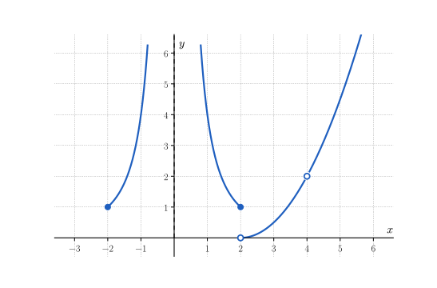
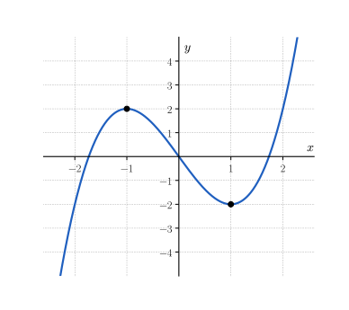
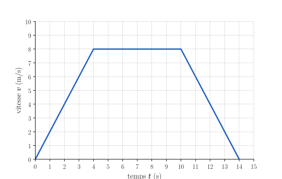
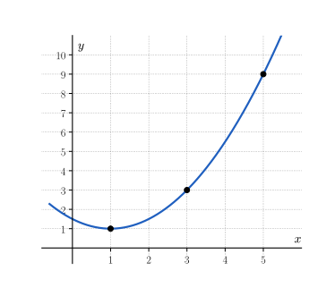
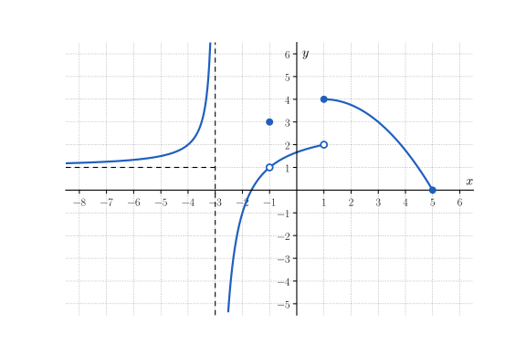
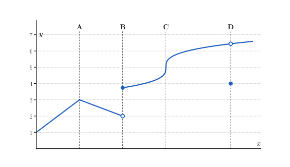

# Questions de réserve {.divider background-color="#14304a"}

## Réserve 1 · Une diminution en pourcentage {#q-DR1}

::: {.qstem}
Une grandeur passe de $80$ à $60$. Quelle est sa variation relative ?
:::

::::: {.qrow .ok}
::: qans
$-25\,\%$
:::
::: qwhy
$\dfrac{60 - 80}{80} = -0{,}25$ : on divise par la valeur de départ.
:::
:::::

::::: qrow
::: qans
$+25\,\%$
:::
::: qwhy
Le signe est faux : la grandeur diminue, donc la variation est négative.
:::
:::::

::::: qrow
::: qans
$-20\,\%$
:::
::: qwhy
$-20$ est la variation absolue, pas un pourcentage.
:::
:::::

::::: qrow
::: qans
environ $-33\,\%$
:::
::: qwhy
On a divisé par la valeur d'arrivée : $\dfrac{-20}{60} = -\dfrac{1}{3}$.
:::
:::::

<a class="back-btn" href="01-remediation.html#/nav-d">← Où aller selon les résultats</a> Exercices : <a href="01-remediation.html#/ex-d-R1">R.1</a>

## Réserve 2 · Limite d'une fonction définie par morceaux {#q-DR2}

::: {.qstem}
Soit $f(x) = x + 1$ si $x < 2$ et $f(x) = 5 - x$ si $x \geq 2$. Que vaut $\lim\limits_{x \to 2} f(x)$ ?
:::

::::: {.qrow .ok}
::: qans
$3$
:::
::: qwhy
À gauche, $x + 1 \to 3$ ; à droite, $5 - x \to 3$. Les limites orientées sont égales : la limite vaut $3$.
:::
:::::

::::: qrow
::: qans
Elle n'existe pas, car $f$ est définie par deux formules.
:::
::: qwhy
Deux formules n'empêchent pas la limite d'exister : il faut comparer les limites à gauche et à droite.
:::
:::::

::::: qrow
::: qans
$6$
:::
::: qwhy
On a additionné les deux limites orientées. Une limite n'est pas une somme : on compare les deux limites orientées.
:::
:::::

::::: qrow
::: qans
$2$
:::
::: qwhy
$2$ est le point d'approche, pas la valeur dont $f(x)$ se rapproche.
:::
:::::

<a class="back-btn" href="01-remediation.html#/nav-d">← Où aller selon les résultats</a> Exercices : <a href="01-remediation.html#/ex-d-R5">R.5</a>

## Réserve 3 · Quotient et limite nulle au dénominateur {#q-DR3}

::: {.qstem}
On sait que $\lim\limits_{x \to 1} f(x) = 2$ et $\lim\limits_{x \to 1} g(x) = 0$. Que peut-on affirmer sur $\lim\limits_{x \to 1} \dfrac{f(x)}{g(x)}$ ?
:::

::::: {.qrow .ok}
::: qans
La règle du quotient ne s'applique pas : on ne peut pas conclure avec elle.
:::
::: qwhy
La règle du quotient exige une limite non nulle au dénominateur. Selon la fonction $g$, on peut obtenir $+\infty$, $-\infty$ ou aucune limite.
:::
:::::

::::: qrow
::: qans
La limite vaut $0$.
:::
::: qwhy
On a confondu avec la limite du dénominateur. On ne divise jamais par une limite nulle.
:::
:::::

::::: qrow
::: qans
La limite vaut $2$.
:::
::: qwhy
On a oublié le dénominateur.
:::
:::::

::::: qrow
::: qans
La limite vaut $+\infty$.
:::
::: qwhy
Si $g$ prend des valeurs négatives près de $1$, le quotient tend vers $-\infty$ : la règle ne permet pas de choisir.
:::
:::::

<a class="back-btn" href="01-remediation.html#/nav-d">← Où aller selon les résultats</a> Exercices : <a href="01-remediation.html#/ex-d-R4">R.4(c)(f)</a>

## Réserve 4 · Signes de la vitesse et de l'accélération {#q-DR4}

::: {.qstem}
Un mobile avance dans le sens positif d'un axe en accélérant. On note $p(t)$ sa position. Que peut-on dire de $p'(t)$ et de $p''(t)$ ?
:::

::::: {.qrow .ok}
::: qans
$p'(t) > 0$ et $p''(t) > 0$
:::
::: qwhy
Il avance : la position augmente, donc $p'(t) > 0$. Il accélère : la vitesse augmente, donc $p''(t) > 0$.
:::
:::::

::::: qrow
::: qans
$p'(t) > 0$ et $p''(t) < 0$
:::
::: qwhy
$p''(t) < 0$ signifie que la vitesse diminue : le mobile freinerait.
:::
:::::

::::: qrow
::: qans
$p'(t) < 0$ et $p''(t) > 0$
:::
::: qwhy
$p'(t) < 0$ signifie que la position diminue : le mobile reculerait.
:::
:::::

::::: qrow
::: qans
$p'(t) < 0$ et $p''(t) < 0$
:::
::: qwhy
Le mobile avance : sa position augmente, donc $p'(t)$ ne peut pas être négative.
:::
:::::

<a class="back-btn" href="01-remediation.html#/nav-d">← Où aller selon les résultats</a> Exercices : <a href="01-remediation.html#/ex-d-R7">R.7</a>

# Solutions des exercices {.divider background-color="#14304a"}

## Énoncé R.1 (séance 7) O1 {#st-d-R1 .smaller}

La concentration $C$ d'une substance dans un liquide, en mg/L, est mesurée toutes les deux heures.

::: {.tv}
| $t$ (h) | $0$ | $2$ | $4$ | $6$ |
|:---:|:---:|:---:|:---:|:---:|
| $C(t)$ (mg/L) | $16$ | $12$ | $9$ | $6{,}75$ |
:::

\(a) Sur $[0,\,2]$, puis sur $[4,\,6]$, calcule la variation absolue, la variation relative et le taux de variation moyen de $C$, avec leurs unités.

\(b) Écris en une phrase ce que ces résultats signifient pour la concentration.

\(c) Calcule la variation relative sur $[0,\,4]$. Est-elle égale à la somme des variations relatives sur $[0,\,2]$ et sur $[2,\,4]$ ?

## Solution R.1 (séance 7) {#sol-d-R1}

::: {.sol .long}
\(a) Sur $[0,\,2]$ : $\Delta_{[0,2]}(C) = -4$ mg/L, $\Delta^{rel}_{[0,2]}(C) = -0{,}25$ et $T_{[0,2]}(C) = -2$ mg/L/h. Sur $[4,\,6]$ : $\Delta_{[4,6]}(C) = -2{,}25$ mg/L, $\Delta^{rel}_{[4,6]}(C) = -0{,}25$ et $T_{[4,6]}(C) = -1{,}125$ mg/L/h.

1. Sur $[0,\,2]$ : $\Delta_{[0,2]}(C) = 12 - 16 = -4$, $\Delta^{rel}_{[0,2]}(C) = \tfrac{-4}{16} = -0{,}25$ et $T_{[0,2]}(C) = \tfrac{-4}{2} = -2$.
2. Sur $[4,\,6]$ : $\Delta_{[4,6]}(C) = 6{,}75 - 9 = -2{,}25$, $\Delta^{rel}_{[4,6]}(C) = \tfrac{-2{,}25}{9} = -0{,}25$ et $T_{[4,6]}(C) = \tfrac{-2{,}25}{2} = -1{,}125$.
:::

<a class="back-btn" href="01-remediation.html#/ex-d">← Exercices à réaliser</a>

## Solution R.1 (séance 7) (suite) 

::: {.sol .xlong}
\(b) Sur chaque intervalle de deux heures, la concentration diminue de $25\,\%$, mais elle diminue en moyenne de $2$ mg/L par heure au début et de seulement $1{,}125$ mg/L par heure entre $4$ h et $6$ h.

Les variations relatives sont égales : la concentration est multipliée par $1 - 0{,}25 = 0{,}75$ toutes les deux heures. Comme la concentration est plus faible au début de $[4,\,6]$, la même diminution de $25\,\%$ représente moins de mg/L par heure : la concentration diminue de moins en moins vite.

\(c) La variation relative sur $[0,\,4]$ vaut $-\tfrac{7}{16} = -0{,}4375$, soit environ $-44\,\%$ : elle n'est pas égale à la somme $-0{,}25 + (-0{,}25) = -0{,}5$.

1. $\Delta^{rel}_{[0,4]}(C) = \dfrac{9 - 16}{16} = -\dfrac{7}{16} = -0{,}4375$.
2. Les variations relatives ne s'additionnent pas : ce sont les facteurs multiplicatifs qui se multiplient. On a $0{,}75 \cdot 0{,}75 = 0{,}5625 = 1 - 0{,}4375$.
:::

<a class="back-btn" href="01-remediation.html#/ex-d">← Exercices à réaliser</a>

## Énoncé R.2 (séance 7) O7 {#st-d-R2 .smaller}

Soit la fonction $f(x) = 10 - x^{2}$. On cherche la pente de la tangente au graphe de $f$ au point d'abscisse $1$.

\(a) Calcule les taux de variation moyens $T_{[1,\,1+h]}(f)$ pour $h = 1$, $h = 0{,}5$ et $h = 0{,}1$.

\(b) Montre que, pour tout réel $h \neq 0$, on a $T_{[1,\,1+h]}(f) = -2 - h$. Déduis-en $f'(1)$.

\(c) Écris l'équation de la tangente au graphe de $f$ au point d'abscisse $1$.

## Solution R.2 (séance 7) {#sol-d-R2}

::: {.sol .xlong}
\(a) $T_{[1,2]}(f) = -3$, $T_{[1;\,1{,}5]}(f) = -2{,}5$ et $T_{[1;\,1{,}1]}(f) = -2{,}1$.

1. $f(2) = 6$, donc $T_{[1,2]}(f) = \tfrac{6 - 9}{1} = -3$.
2. $f(1{,}5) = 10 - 2{,}25 = 7{,}75$, donc $T_{[1;\,1{,}5]}(f) = \tfrac{7{,}75 - 9}{0{,}5} = -2{,}5$.
3. $f(1{,}1) = 10 - 1{,}21 = 8{,}79$, donc $T_{[1;\,1{,}1]}(f) = \tfrac{8{,}79 - 9}{0{,}1} = -2{,}1$.

Les pentes des sécantes semblent tendre vers $-2$.

\(b) $T_{[1,\,1+h]}(f) = -2 - h$, donc $f'(1) = -2$.

1. $f(1 + h) - f(1) = 10 - (1 + 2h + h^{2}) - 9 = -2h - h^{2} = h\,(-2 - h)$.
2. Pour $h \neq 0$, on divise par $h$ : $T_{[1,\,1+h]}(f) = -2 - h$. On retrouve $-3$, $-2{,}5$ et $-2{,}1$ pour les valeurs de (a).
3. $f'(1) = \lim\limits_{h \to 0} (-2 - h) = -2$.

\(c) La tangente au point $(1\,;\,9)$ a pour équation $y = -2x + 11$.

$y = 9 + (-2)(x - 1) = -2x + 11$. Vérification : pour $x = 1$, on retrouve $y = 9 = f(1)$.
:::

<a class="back-btn" href="01-remediation.html#/ex-d">← Exercices à réaliser</a>

## Énoncé R.3 (séance 7) O3 {#st-d-R3 .smaller}

La fonction $f$ est définie sur $[-2,\,+\infty[ \setminus \{0,\,4\}$. Le graphique ci-dessous la représente ; la droite pointillée verticale est l'axe des ordonnées. Vers la droite, la courbe monte sans limite.

{.fig fig-alt="Graphique d'une fonction : une branche qui part du point plein (−2 ; 1) et monte vers +∞ près de x = 0 ; une branche qui descend de +∞ près de x = 0 jusqu'au point plein (2 ; 1) ; une branche qui part du point vide (2 ; 0), passe par un point vide en (4 ; 2) et monte vers +∞."}

\(a) Lis $\lim\limits_{x \to 0^-} f(x)$ et $\lim\limits_{x \to 0^+} f(x)$. La fonction $f$ admet-elle une limite en $0$ ?

\(b) Lis $\lim\limits_{x \to 2^-} f(x)$, $\lim\limits_{x \to 2^+} f(x)$ et $f(2)$.

\(c) Lis $\lim\limits_{x \to 4} f(x)$. Que vaut $f(4)$ ?

\(d) Lis $\lim\limits_{x \to -2} f(x)$ et $\lim\limits_{x \to +\infty} f(x)$.

## Solution R.3 (séance 7) {#sol-d-R3}

::: {.sol .xlong}
\(a) $\lim\limits_{x \to 0^-} f(x) = +\infty$ et $\lim\limits_{x \to 0^+} f(x) = +\infty$, donc $\lim\limits_{x \to 0} f(x) = +\infty$ ; la droite $x = 0$ est une asymptote verticale.

Des deux côtés de $0$, la courbe monte le long de l'axe des ordonnées : $f(x)$ devient aussi grand qu'on veut. Les deux limites orientées sont égales, donc la limite existe et vaut $+\infty$ ; c'est une limite infinie en un point fini, donc une asymptote verticale.

\(b) $\lim\limits_{x \to 2^-} f(x) = 1$, $\lim\limits_{x \to 2^+} f(x) = 0$ et $f(2) = 1$.

En arrivant par la gauche, la courbe arrive au point plein $(2\,;\,1)$ ; en arrivant par la droite, elle arrive au point vide $(2\,;\,0)$. Les deux limites orientées sont différentes : $f$ n'admet pas de limite en $2$. Comme $f(2) = 1$ est égal à la limite à gauche, $f$ est continue à gauche en $2$.
:::

<a class="back-btn" href="01-remediation.html#/ex-d">← Exercices à réaliser</a>

## Solution R.3 (séance 7) (suite) 

::: {.sol .long}
\(c) $\lim\limits_{x \to 4} f(x) = 2$, alors que $f(4)$ n'existe pas : $4$ n'appartient pas au domaine de $f$.

Des deux côtés de $4$, la courbe se rapproche du point vide $(4\,;\,2)$. La définition de la limite ne teste pas $x = 4$ : la limite existe même si $f$ n'est pas définie en $4$, car $4$ est arbitrairement approchable dans le domaine.

\(d) $\lim\limits_{x \to -2} f(x) = 1$ et $\lim\limits_{x \to +\infty} f(x) = +\infty$.

On ne peut approcher $-2$ que par la droite : on se contente de la limite orientée disponible, qui vaut $1$, la hauteur du point plein $(-2\,;\,1)$. Vers la droite, la courbe monte sans limite : $f(x)$ devient aussi grand qu'on veut.
:::

<a class="back-btn" href="01-remediation.html#/ex-d">← Exercices à réaliser</a>

## Énoncé R.4 (séance 7) O4 {#st-d-R4 .smaller}

On sait que $\lim\limits_{x \to 2} f(x) = 3$ et $\lim\limits_{x \to 2} g(x) = -1$, et que la fonction $k$ est continue en $3$, avec $k(3) = 5$. Calcule, si c'est possible avec les propriétés algébriques des limites :

\(a) $\lim\limits_{x \to 2} \big(f(x) + g(x)\big)$

\(b) $\lim\limits_{x \to 2} \big(f(x) \cdot g(x)\big)$

\(c) $\lim\limits_{x \to 2} \dfrac{f(x)}{g(x)}$

\(d) $\lim\limits_{x \to 2} \big(2f(x) - 4g(x)\big)$

\(e) $\lim\limits_{x \to 2} k\big(f(x)\big)$

\(f) $\lim\limits_{x \to 2} \dfrac{g(x)}{f(x) - 3}$

## Solution R.4 (séance 7) {#sol-d-R4}

::: {.sol .long}
**Réponse.** (a) $2$ ; (b) $-3$ ; (c) $-3$ ; (d) $10$ ; (e) $5$ ; (f) la règle du quotient ne s'applique pas.

1. Somme : $3 + (-1) = 2$.
2. Produit : $3 \cdot (-1) = -3$.
3. Quotient, avec une limite non nulle au dénominateur : $\tfrac{3}{-1} = -3$.
4. Produit par une constante et somme : $2 \cdot 3 - 4 \cdot (-1) = 6 + 4 = 10$.
5. Composée : $f(x)$ tend vers $3$ et $k$ est continue en $3$, donc $k\big(f(x)\big)$ tend vers $k(3) = 5$.
6. Le dénominateur $f(x) - 3$ tend vers $3 - 3 = 0$ : la règle du quotient ne s'applique pas, et les données ne permettent pas de conclure.
:::

<a class="back-btn" href="01-remediation.html#/ex-d">← Exercices à réaliser</a>

## Énoncé R.5 (séance 7) O6 {#st-d-R5 .smaller}

Soient les fonctions $u$ et $w$ définies par
$$u(x) = \begin{cases} 2x + 1 & \text{si } x < 1, \\ x^{2} + 2 & \text{si } x \geq 1, \end{cases} \qquad w(x) = \begin{cases} x & \text{si } x < 2, \\ x + 1 & \text{si } x \geq 2. \end{cases}$$

\(a) Calcule les limites à gauche et à droite de $u$ en $1$, ainsi que $u(1)$. La fonction $u$ est-elle continue en $1$ ?

\(b) Mêmes questions pour $w$ en $2$. La fonction $w$ est-elle continue à gauche, à droite en $2$ ?

\(c) Que peut-on dire de la dérivabilité de $w$ en $2$ ?

## Solution R.5 (séance 7) {#sol-d-R5}

::: {.sol .xlong}
\(a) $\lim\limits_{x \to 1^-} u(x) = 3$, $\lim\limits_{x \to 1^+} u(x) = 3$ et $u(1) = 3$ : $u$ est continue en $1$.

À gauche de $1$, $u(x) = 2x + 1$ tend vers $3$ ; à droite, $u(x) = x^{2} + 2$ tend vers $3$ ; et $u(1) = 1 + 2 = 3$. Les deux limites orientées sont égales à $u(1)$.

\(b) $\lim\limits_{x \to 2^-} w(x) = 2$, $\lim\limits_{x \to 2^+} w(x) = 3$ et $w(2) = 3$ : $w$ n'est pas continue en $2$ ; elle est continue à droite, mais pas à gauche.

Les deux limites orientées sont différentes, donc $w$ n'a pas de limite en $2$ et n'y est pas continue : le graphe fait un saut de $2$ à $3$. Comme $w(2) = 3$ est égal à la limite à droite, $w$ est continue à droite en $2$.

\(c) $w$ n'est pas dérivable en $2$, puisqu'elle n'y est pas continue.

Si $w$ était dérivable en $2$, elle y serait continue. Comme elle n'y est pas continue, elle n'y est pas dérivable.
:::

<a class="back-btn" href="01-remediation.html#/ex-d">← Exercices à réaliser</a>

## Énoncé R.6 (séance 7) O8 {#st-d-R6 .smaller}

Le graphique représente la fonction $f(x) = x^{3} - 3x$. Les points marqués sont $(-1\,;\,2)$ et $(1\,;\,-2)$.

{.fig fig-alt="Graphique d'une courbe qui monte jusqu'au point (−1 ; 2), descend jusqu'au point (1 ; −2), puis remonte ; elle passe par l'origine."}

Quatre étudiants proposent une expression de $f'(x)$ :

1. $f'(x) = 3x^{2} - 3$
2. $f'(x) = 3x^{2}$
3. $f'(x) = 3 - 3x^{2}$
4. $f'(x) = 3x^{2} - 6$

\(a) D'après le graphique, que doivent valoir $f'(-1)$ et $f'(1)$ ? Quel doit être le signe de $f'(0)$ ?

\(b) Pour chaque proposition, calcule $f'(1)$ et $f'(0)$, puis écris si elle est plausible.

## Solution R.6 (séance 7) {#sol-d-R6}

::: {.sol}
\(a) Les tangentes en $(-1\,;\,2)$ et en $(1\,;\,-2)$ sont horizontales, donc $f'(-1) = f'(1) = 0$ ; $f$ est décroissante en $0$, donc $f'(0) < 0$.

En $x = -1$, la fonction passe de croissante à décroissante, et en $x = 1$, de décroissante à croissante : la courbe y a une tangente horizontale, de pente nulle. Entre $-1$ et $1$, la fonction décroît : la pente de la tangente en $0$ est négative.
:::

<a class="back-btn" href="01-remediation.html#/ex-d">← Exercices à réaliser</a>

## Solution R.6 (séance 7) (suite) 

::: {.sol .long}
\(b) Seule la proposition 1 est plausible : elle donne $f'(1) = 0$ et $f'(0) = -3$. La proposition 2 donne $f'(1) = 3$, la proposition 3 donne $f'(0) = 3 > 0$, et la proposition 4 donne $f'(1) = -3$.

1. Proposition 1 : $f'(1) = 3 - 3 = 0$ et $f'(0) = -3 < 0$, ainsi que $f'(-1) = 0$ : plausible.
2. Proposition 2 : $f'(1) = 3 \neq 0$ : la tangente en $(1\,;\,-2)$ ne serait pas horizontale.
3. Proposition 3 : $f'(1) = 0$, mais $f'(0) = 3 > 0$ : $f$ serait croissante en $0$.
4. Proposition 4 : $f'(1) = -3 \neq 0$.

Ces contrôles n'établissent pas que la proposition 1 est correcte, mais ils éliminent les trois autres ; la séance 8 donnera les règles pour le confirmer.
:::

<a class="back-btn" href="01-remediation.html#/ex-d">← Exercices à réaliser</a>

## Énoncé R.7 (séance 7) O9 {#st-d-R7 .smaller}

Un mobile se déplace sur un axe. Le graphique donne sa vitesse $v(t) = p'(t)$, en m/s, en fonction du temps $t$, en secondes, où $p(t)$ est sa position.

{.fig fig-alt="Graphique de la vitesse : un segment de (0 ; 0) à (4 ; 8), un segment horizontal de (4 ; 8) à (10 ; 8), puis un segment de (10 ; 8) à (14 ; 0)."}

\(a) Calcule l'accélération $p''(t)$ sur chacune des trois phases $]0,\,4[$, $]4,\,10[$ et $]10,\,14[$.

\(b) Décris en une phrase le mouvement pendant chaque phase.

\(c) Quel est le signe de $p'(t)$ sur $]0,\,14[$ ? Que peut-on en déduire sur la position du mobile ?

## Solution R.7 (séance 7) {#sol-d-R7}

::: {.sol .long}
\(a) $p''(t) = 2$ m/s² sur $]0,\,4[$, $p''(t) = 0$ m/s² sur $]4,\,10[$ et $p''(t) = -2$ m/s² sur $]10,\,14[$.

L'accélération est la dérivée de la vitesse : $p'' = (p')' = v'$. Sur chaque phase, le graphe de $v$ est un segment, dont la pente est la dérivée : $\tfrac{8 - 0}{4} = 2$, $\tfrac{8 - 8}{6} = 0$ et $\tfrac{0 - 8}{4} = -2$, en m/s par seconde, c'est-à-dire en m/s².

\(b) De $0$ à $4$ s, le mobile accélère ; de $4$ à $10$ s, il avance à vitesse constante, $8$ m/s ; de $10$ à $14$ s, il freine jusqu'à l'arrêt.

Une accélération positive fait augmenter la vitesse, une accélération nulle la laisse constante, et une accélération négative la fait diminuer, ici jusqu'à $0$.
:::

<a class="back-btn" href="01-remediation.html#/ex-d">← Exercices à réaliser</a>

## Solution R.7 (séance 7) (suite) 

::: {.sol}
\(c) $p'(t) > 0$ sur $]0,\,14[$ : la position augmente pendant tout le mouvement ; le mobile avance toujours dans le même sens, même lorsqu'il freine.

La vitesse $p'(t)$ est positive sur tout l'intervalle, donc la fonction $p$ est croissante. Pendant le freinage, $p''(t) < 0$ mais $p'(t) > 0$ : la vitesse diminue sans changer de signe.
:::

<a class="back-btn" href="01-remediation.html#/ex-d">← Exercices à réaliser</a>

## Énoncé R.8 (séance 7) O7 {#st-d-R8 .smaller}

Reprends les tailles médianes des garçons de l'exercice T.1 : $H(13) = 156{,}0$ cm, $H(16) = 172{,}9$ cm et $H(18) = 176{,}1$ cm, avec $H'(13) = 7$ cm/an.

\(a) Estime $H'(17)$ par le taux de variation moyen sur $[16,\,18]$, avec son unité.

\(b) Compare cette valeur à $H'(13)$, puis écris en une phrase ce que cette comparaison signifie.

## Solution R.8 (séance 7) {#sol-d-R8}

::: {.sol .long}
\(a) $H'(17) \approx 1{,}6$ cm/an.

Le taux de variation moyen sur l'intervalle $[16,\,18]$, centré en $17$, estime la pente de la tangente en $17$ : $\dfrac{176{,}1 - 172{,}9}{2} = \dfrac{3{,}2}{2} = 1{,}6$ cm/an.

\(b) $H'(17)$ est environ quatre fois plus petit que $H'(13)$ : à $17$ ans, la taille augmente encore, mais lentement ; la croissance est presque terminée.

On a $\tfrac{7}{1{,}6} \approx 4{,}4$. La dérivée reste positive, car la taille augmente, mais elle se rapproche de $0$.
:::

<a class="back-btn" href="01-remediation.html#/ex-d">← Exercices à réaliser</a>

## Énoncé S.1 (séance 7, socle) O1 {#st-d-S1 .smaller}

Une grandeur $N$ dépend du temps $t$, exprimé en heures. Le tableau donne quelques valeurs de $N$, en milliers d'individus.

::: {.tv}
| $t$ (h) | $0$ | $2$ | $4$ | $6$ |
|:---:|:---:|:---:|:---:|:---:|
| $N(t)$ (milliers) | $40$ | $60$ | $90$ | $135$ |
:::

\(a) Calcule la variation absolue $\Delta_{[0,2]}(N)$, la variation relative $\Delta^{rel}_{[0,2]}(N)$ et le taux de variation moyen $T_{[0,2]}(N)$, avec leurs unités. Fais de même sur l'intervalle $[4,\,6]$.

\(b) Compare les résultats obtenus sur les deux intervalles, et écris en une phrase ce qu'ils signifient pour la grandeur $N$.

## Solution S.1 (séance 7, socle) {#sol-d-S1}

::: {.sol .xlong}
\(a) Sur $[0,\,2]$ : $\Delta_{[0,2]}(N) = 20$ milliers, $\Delta^{rel}_{[0,2]}(N) = 0{,}5$ et $T_{[0,2]}(N) = 10$ milliers par heure. Sur $[4,\,6]$ : $\Delta_{[4,6]}(N) = 45$ milliers, $\Delta^{rel}_{[4,6]}(N) = 0{,}5$ et $T_{[4,6]}(N) = 22{,}5$ milliers par heure.

On applique les trois définitions du cours sur chaque intervalle $[a,\,b]$.

1. La variation absolue est la différence des valeurs aux extrémités : $\Delta_{[0,2]}(N) = 60 - 40 = 20$ milliers et $\Delta_{[4,6]}(N) = 135 - 90 = 45$ milliers. Elle a l'unité de $N$.
2. La variation relative divise la variation absolue par la valeur de départ : $\Delta^{rel}_{[0,2]}(N) = \tfrac{20}{40} = 0{,}5$ et $\Delta^{rel}_{[4,6]}(N) = \tfrac{45}{90} = 0{,}5$. C'est un nombre sans unité.
3. Le taux de variation moyen divise la variation absolue par la durée : $T_{[0,2]}(N) = \tfrac{20}{2} = 10$ et $T_{[4,6]}(N) = \tfrac{45}{2} = 22{,}5$. Il s'exprime en milliers par heure, c'est-à-dire l'unité de $N$ divisée par l'unité de $t$.
:::

<a class="back-btn" href="01-remediation.html#/ex-d">← Exercices à réaliser</a>

## Solution S.1 (séance 7, socle) (suite) 

::: {.sol .xlong}
\(b) Sur les deux intervalles, la grandeur augmente de $50\,\%$, mais elle augmente en moyenne de $10$ milliers par heure sur $[0,\,2]$ et de $22{,}5$ milliers par heure sur $[4,\,6]$.

On compare séparément les variations relatives et les taux de variation moyens.

1. Une variation relative de $0{,}5$ correspond à un pourcentage d'accroissement de $100 \cdot 0{,}5 = 50\,\%$ : la grandeur est multipliée par le même facteur $1 + 0{,}5 = 1{,}5$ sur chacun des deux intervalles.
2. Les taux de variation moyens sont différents : comme la grandeur est plus grande au début de $[4,\,6]$, la même augmentation de $50\,\%$ représente plus d'individus par heure.

Comme dans le cours, la même variation relative est produite sur deux intervalles différents par des taux différents.
:::

<a class="back-btn" href="01-remediation.html#/ex-d">← Exercices à réaliser</a>

## Énoncé S.2 (séance 7, socle) O2 {#st-d-S2 .smaller}

Le graphique ci-dessous représente une fonction $f$. Les points marqués ont des coordonnées entières.

{.fig fig-alt="Graphique d'une parabole tournée vers le haut, de minimum en (1 ; 1), passant par les points marqués (1 ; 1), (3 ; 3) et (5 ; 9)."}

\(a) Lis $f(1)$, $f(3)$ et $f(5)$, puis calcule les taux de variation moyens $T_{[1,3]}(f)$, $T_{[3,5]}(f)$ et $T_{[1,5]}(f)$.

\(b) Écris l'équation de la sécante à la courbe aux points d'abscisses $1$ et $5$, puis trace-la sur le graphique.

## Solution S.2 (séance 7, socle) {#sol-d-S2}

::: {.sol .xlong}
\(a) On lit $f(1) = 1$, $f(3) = 3$ et $f(5) = 9$, donc $T_{[1,3]}(f) = 1$, $T_{[3,5]}(f) = 3$ et $T_{[1,5]}(f) = 2$.

On lit les ordonnées des points marqués, puis on applique la définition du taux de variation moyen.

1. $T_{[1,3]}(f) = \dfrac{3 - 1}{3 - 1} = 1$.
2. $T_{[3,5]}(f) = \dfrac{9 - 3}{5 - 3} = 3$.
3. $T_{[1,5]}(f) = \dfrac{9 - 1}{5 - 1} = 2$.

\(b) La sécante aux points d'abscisses $1$ et $5$ a pour équation $y = 2x - 1$.

La sécante est la droite qui relie $(1\,;\,f(1))$ et $(5\,;\,f(5))$ : sa pente est le taux de variation moyen $T_{[1,5]}(f) = 2$.

1. La droite a une équation de la forme $y=2x+p$, où $p$ est à déterminer.
2. La droite passe par $(1\,;\,1)$, donc $1=2\cdot 1+p$. Donc $p=-1$. On obtient donc comme équation $y = 2x - 1$.

On peut vérifier l'équation avec le point $(5\,;\, f(5))$ : pour $x = 5$, on obtient $y = 9 = f(5)$.
:::

<a class="back-btn" href="01-remediation.html#/ex-d">← Exercices à réaliser</a>

## Énoncé S.3 (séance 7, socle) O3 {#st-d-S3 .smaller}

La fonction $f$ est définie sur $]-\infty,\,5] \setminus \{-3\}$. Le graphique ci-dessous la représente. Les droites en pointillés sont des asymptotes au graphe de $f$. Un point plein appartient à la courbe ; un point creux n'en fait pas partie.

{.fig fig-alt="Graphique d'une fonction : à gauche de x = −3, une branche qui se rapproche de la droite y = 1 vers la gauche et monte vers +∞ près de x = −3 ; entre −3 et 1, une branche croissante qui part de −∞ près de x = −3, avec un point creux en (−1 ; 1), un point plein isolé en (−1 ; 3) et un point creux en (1 ; 2) ; à partir de x = 1, une branche qui part du point plein (1 ; 4) et descend jusqu'au point plein (5 ; 0)."}

\(a) Lis $\lim\limits_{x \to -1} f(x)$, puis $f(-1)$.

\(b) Lis $\lim\limits_{x \to 1^-} f(x)$, $\lim\limits_{x \to 1^+} f(x)$ et $f(1)$. La fonction $f$ admet-elle une limite en $1$ ?

\(c) Lis $\lim\limits_{x \to -3^-} f(x)$ et $\lim\limits_{x \to -3^+} f(x)$.

\(d) Lis $\lim\limits_{x \to -\infty} f(x)$, puis $\lim\limits_{x \to 5} f(x)$.

## Solution S.3 (séance 7, socle) {#sol-d-S3}

::: {.sol .long}
\(a) On a $\lim\limits_{x \to -1} f(x) = 1$ et $f(-1) = 3$.

\(b) On a $\lim\limits_{x \to 1^-} f(x) = 2$, $\lim\limits_{x \to 1^+} f(x) = 4$ et $f(1) = 4$. Les deux limites orientées sont différentes, donc $f$ n'admet pas de limite en $1$.

\(c) On a $\lim\limits_{x \to -3^-} f(x) = +\infty$ et $\lim\limits_{x \to -3^+} f(x) = -\infty$ : la droite d'équation $x = -3$ est une asymptote verticale.

\(d) On a $\lim\limits_{x \to -\infty} f(x) = 1$ : la droite d'équation $y = 1$ est une asymptote horizontale. On a $\lim\limits_{x \to 5} f(x) = 0$ : seule l'approche par la gauche est possible.
:::

<a class="back-btn" href="01-remediation.html#/ex-d">← Exercices à réaliser</a>

## Énoncé S.4 (séance 7, socle) O4 {#st-d-S4 .smaller}

Soient les fonctions $f(x) = x^{2} - 1$, $g(x) = 3$ et $h(x) = \sqrt{x + 1}$. On admet que $\lim\limits_{x \to a} f(x) = f(a)$ pour tout réel $a$, et que $h$ est continue en tout point $a > -1$. Calcule les limites suivantes en utilisant les propriétés algébriques des limites.

\(a) $\lim\limits_{x \to 2} \big(f(x) + 2 \cdot g(x)\big)$

\(b) $\lim\limits_{x \to 3} \dfrac{h(x)}{f(x)}$

\(c) $\lim\limits_{x \to 2} (h \circ f)(x)$

\(d) Explique pourquoi la règle du quotient ne permet pas de calculer $\lim\limits_{x \to 1} \dfrac{g(x)}{f(x)}$.

## Solution S.4 (séance 7, socle) {#sol-d-S4}

::: {.sol .xlong}
\(a) $\lim\limits_{x \to 2} \big(f(x) + 2 \cdot g(x)\big) = 9$.

Les deux limites existent et sont finies : $\lim\limits_{x \to 2} f(x) = f(2) = 2^{2} - 1 = 3$ et $\lim\limits_{x \to 2} g(x) = 3$, car $g$ est constante. Par la règle de la somme et la règle du produit par une constante, la limite vaut $3 + 2 \cdot 3 = 9$.

\(b) $\lim\limits_{x \to 3} \dfrac{h(x)}{f(x)} = \dfrac{1}{4}$.

Comme $h$ est continue en $3$, $\lim\limits_{x \to 3} h(x) = h(3) = \sqrt{4} = 2$, et $\lim\limits_{x \to 3} f(x) = f(3) = 8$. Comme $8 \neq 0$, la règle du quotient s'applique : la limite vaut $\tfrac{2}{8} = \tfrac{1}{4}$.

\(c) $\lim\limits_{x \to 2} (h \circ f)(x) = 2$.

On utilise la règle de la composée.

1. Quand $x$ tend vers $2$, $f(x)$ tend vers $b = f(2) = 3$.
2. La fonction $h$ est continue en $3$, donc $\lim\limits_{x \to 2} h\big(f(x)\big) = \lim\limits_{y \to 3} h(y) = h(3) = \sqrt{4} = 2$.
:::

<a class="back-btn" href="01-remediation.html#/ex-d">← Exercices à réaliser</a>

## Solution S.4 (séance 7, socle) (suite) 

::: {.sol}
\(d) La règle du quotient exige que la limite du dénominateur soit différente de $0$ ; or $\lim\limits_{x \to 1} f(x) = f(1) = 0$.

On a $f(1) = 1^{2} - 1 = 0$, donc la limite du dénominateur est nulle. La règle du quotient ne s'applique pas : on ne divise jamais par une limite nulle, et il faut une autre méthode, par exemple lire le graphique.
:::

<a class="back-btn" href="01-remediation.html#/ex-d">← Exercices à réaliser</a>

## Énoncé S.5 (séance 7, socle) O6 {#st-d-S5 .smaller}

\(a) Le graphique ci-dessous représente une fonction $f$ définie sur $[0,\,10]$. En chacun des points d'abscisses A, B, C et D, écris si $f$ est continue, puis si elle est dérivable, en justifiant par ce que tu vois sur le graphique.

{.fig fig-alt="Graphique d'une fonction avec quatre abscisses marquées : en A, deux segments forment une pointe ; en B, la courbe saute d'un point creux (B ; 2) à un point plein plus haut ; en C, la courbe est continue mais devient verticale ; en D, un point creux sur la courbe et un point plein isolé plus bas."}

\(b) Soit la fonction $g$ définie par
$$g(x) = \begin{cases} x + 1 & \text{si } x < 1, \\ 3 - x & \text{si } x \geq 1. \end{cases}$$
Écris si $g$ est continue en $1$, en justifiant par un calcul de limites. Trace ensuite le graphique de $g$. La fonction $g$ est-elle dérivable en $1$?

## Solution S.5 (séance 7, socle) {#sol-d-S5}

::: {.sol .xlong}
\(a) En A, $f$ est continue mais pas dérivable (point anguleux). En B, $f$ n'est pas continue (saut), donc pas dérivable. En C, $f$ est continue mais pas dérivable (tangente verticale). En D, $f$ n'est pas continue (la limite existe mais diffère de l'image), donc pas dérivable.

On examine d'abord la continuité, puis la dérivabilité, en se rappelant qu'une fonction dérivable en un point y est continue.

1. En A, la courbe se trace sans lever le crayon, mais deux segments de pentes différentes s'y rejoignent : il n'y a pas une seule tangente, donc $f$ n'est pas dérivable.
2. En B, la limite à gauche vaut $2$ (point creux), alors que $f(\text{B})$ est l'ordonnée du point plein, plus haut : les deux limites orientées sont différentes, donc $f$ n'est pas continue en B. Elle est continue à droite, puisque la limite à droite est égale à $f(\text{B})$. Comme elle n'est pas continue, elle n'est pas dérivable.
3. En C, la courbe est continue, mais la tangente est verticale : sa pente n'est pas finie, donc $f$ n'est pas dérivable.
4. En D, la limite existe (la hauteur du point creux), mais $f(\text{D})$ est l'ordonnée du point plein, plus bas : la limite est différente de l'image, donc $f$ n'est pas continue, et pas dérivable.
:::

<a class="back-btn" href="01-remediation.html#/ex-d">← Exercices à réaliser</a>

## Solution S.5 (séance 7, socle) (suite) 

::: {.sol .xlong}
\(b) On a $\lim\limits_{x \to 1^-} g(x) = 2$, $\lim\limits_{x \to 1^+} g(x) = 2$ et $g(1) = 2$, donc $g$ est continue en $1$. Elle n'est pas dérivable en $1$ : le graphe y présente un point anguleux.

On calcule les deux limites orientées avec l'expression qui convient de chaque côté.

1. Pour $x < 1$, $g(x) = x + 1$, donc $\lim\limits_{x \to 1^-} g(x) = 1 + 1 = 2$.
2. Pour $x > 1$, $g(x) = 3 - x$, donc $\lim\limits_{x \to 1^+} g(x) = 3 - 1 = 2$.
3. Comme $1 \geq 1$, $g(1) = 3 - 1 = 2$. Les deux limites orientées sont égales à $g(1)$, donc $g$ est continue en $1$.
4. À gauche de $1$, le graphe est une droite de pente $1$ ; à droite, une droite de pente $-1$. Les pentes sont différentes : le graphe présente un point anguleux en $(1\,;\,2)$ et $g$ n'est pas dérivable en $1$.
:::

<a class="back-btn" href="01-remediation.html#/ex-d">← Exercices à réaliser</a>

## Énoncé S.6 (séance 7, socle) O7 {#st-d-S6 .smaller}

Soit la fonction $f(x) = x^{2} + 2x$.

\(a) Montre que, pour tout réel $a$ et tout réel $h \neq 0$, on a $\dfrac{f(a + h) - f(a)}{h} = 2a + 2 + h$. Déduis-en $f'(a)$.

\(b) Calcule $f'(1)$, puis écris l'équation de la tangente au graphe de $f$ au point d'abscisse $1$.

\(c) À l'aide de l'approximation linéaire au point d'abscisse $1$, donne une valeur approchée de $f(1{,}1)$. Compare-la à la valeur exacte.

## Solution S.6 (séance 7, socle) {#sol-d-S6}

::: {.sol .xlong}
\(a) Le quotient différentiel vaut $2a + 2 + h$, donc $f'(a) = 2a + 2$.

On développe le numérateur, comme dans *Quotient différentiel : exemple*.

1. $f(a + h) = a^{2} + 2ah + h^{2} + 2a + 2h$.
2. $f(a + h) - f(a) = a^{2} + 2ah + h^{2} + 2a + 2h - a^{2} - 2a = 2ah + h^{2} + 2h = h\,(2a + h + 2)$.
3. Comme $h \neq 0$, on peut diviser par $h$ : $\dfrac{f(a + h) - f(a)}{h} = 2a + 2 + h$.
4. On passe à la limite : $f'(a) = \lim\limits_{h \to 0} (2a + 2 + h) = 2a + 2$.

\(b) On a $f'(1) = 4$, et la tangente au point $(1\,;\,3)$ a pour équation $y = 4x - 1$.

La tangente passe par le point $(1\,;\,f(1))$ et a pour pente $f'(1)$.

1. $f(1) = 1 + 2 = 3$ et $f'(1) = 2 \cdot 1 + 2 = 4$.
2. $y = f(1) + f'(1) \cdot (x - 1) = 3 + 4(x - 1) = 4x - 1$.
:::

<a class="back-btn" href="01-remediation.html#/ex-d">← Exercices à réaliser</a>

## Solution S.6 (séance 7, socle) (suite) 

::: {.sol .long}
\(c) L'approximation linéaire donne $f(1{,}1) \approx 3{,}4$ ; la valeur exacte est $f(1{,}1) = 3{,}41$.

On prend $a = 1$ et $h = 0{,}1$ dans l'approximation linéaire.

1. $f(1{,}1) \approx f(1) + f'(1) \cdot 0{,}1 = 3 + 4 \cdot 0{,}1 = 3{,}4$.
2. Valeur exacte : $f(1{,}1) = 1{,}21 + 2{,}2 = 3{,}41$.

L'erreur vaut $0{,}01$, soit $h^{2}$ : elle est très petite parce que $h$ est petit. La valeur approchée est la valeur prise par la tangente en $x = 1{,}1$.
:::

<a class="back-btn" href="01-remediation.html#/ex-d">← Exercices à réaliser</a>

## Énoncé S.7 (séance 7, socle) O9 {#st-d-S7 .smaller}

Un mobile se déplace sur un axe. Sa position, en mètres, à l'instant $t \geq 0$, en secondes, vaut $p(t) = 3t^{2} + 2t$. On admet que sa vitesse vaut $v(t) = p'(t) = 6t + 2$, en m/s : on l'obtient avec le quotient différentiel, comme dans l'exercice S.6.

\(a) En répétant l'opération sur $p'$, calcule l'accélération $a(t) = p''(t)$.

\(b) Calcule $p'(1)$ et $p''(1)$, puis interprète ces deux nombres avec leurs unités.

\(c) Que valent $p^{(3)}(t)$ et, pour tout $n \geq 3$, $p^{(n)}(t)$ ?

## Solution S.7 (séance 7, socle) {#sol-d-S7}

::: {.sol .xlong}
\(a) L'accélération vaut $a(t) = p''(t) = 6$, en m/s².

La dérivée seconde est la dérivée de la dérivée : $p'' = (p')'$.

1. $\dfrac{p'(t + h) - p'(t)}{h} = \dfrac{6(t + h) + 2 - 6t - 2}{h} = \dfrac{6h}{h} = 6$ pour $h \neq 0$.
2. On passe à la limite : $p''(t) = 6$.

\(b) On a $p'(1) = 8$ et $p''(1) = 6$ : à l'instant $t = 1$ s, le mobile avance à $8$ m/s, et sa vitesse augmente de $6$ m/s par seconde.

1. $p'(1) = 6 + 2 = 8$. La vitesse est le taux de variation instantané de la position par rapport au temps : elle s'exprime en m/s.
2. $p''(1) = 6$. L'accélération est le taux de variation instantané de la vitesse par rapport au temps : elle s'exprime en (m/s)/s, c'est-à-dire en m/s². Comme elle est positive, la vitesse augmente.
:::

<a class="back-btn" href="01-remediation.html#/ex-d">← Exercices à réaliser</a>

## Solution S.7 (séance 7, socle) (suite) 

::: {.sol}
\(c) On a $p^{(3)}(t) = 0$, et $p^{(n)}(t) = 0$ pour tout $n \geq 3$.

La fonction $p''$ est constante : son quotient différentiel vaut $\tfrac{6 - 6}{h} = 0$, donc $p^{(3)}(t) = 0$. Toutes les dérivées suivantes sont des dérivées de la fonction nulle, donc elles sont nulles.
:::

<a class="back-btn" href="01-remediation.html#/ex-d">← Exercices à réaliser</a>

