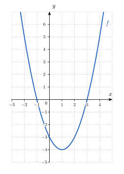
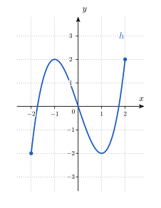
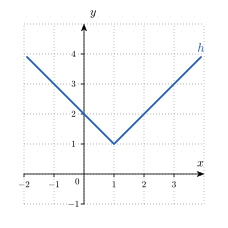
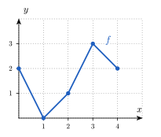

## Par où commencer ? {#start .smaller}

<style>
.qrow{display:flex;gap:.8em;border-bottom:1px solid #e5e9ef;padding:.28em .2em;font-size:.6em;line-height:1.35;align-items:flex-start}
.qrow .qans{flex:0 0 36%;font-weight:600}
.qrow .qwhy{flex:1 1 auto}
.qrow .qans p,.qrow .qwhy p{margin:0}
.qrow.ok{background:#f2f7ff}
.qrow.ok .qans::before{content:"✓ ";color:#276a2e;font-weight:700}
.qstem{font-size:.78em}
.qflex{display:flex;gap:1em;align-items:center}
.qflex img{max-width:330px;max-height:230px;width:auto;height:auto}
.reveal table.deroule a{font-weight:600}
.et-box{display:flex;flex-direction:column;align-items:center;gap:.5em;padding:.6em 1.4em;background:#f2f7ff;border:1px solid #dbe7fb;border-radius:.6em}
.et-timer{margin-top:.8em;display:flex;justify-content:center}
@keyframes et-pulse{0%,100%{opacity:1}50%{opacity:.35}}
.back{margin-top:.5em}
.qfoot{display:flex;gap:1.2em;align-items:center;margin-top:.45em;font-size:.55em}
.qfoot .back-btn{font-size:1em}
.qfoot .muted{color:#5a6b7b}
.back-btn{display:inline-block;font-size:.5em;font-weight:600;padding:.3em .8em;border:1.5px solid #1f5fbf;border-radius:.5em;color:#1f5fbf;background:#fff}
.back-btn:hover{background:#1f5fbf;color:#fff;text-decoration:none!important}
.exo-foot{margin-top:.8em;font-size:.55em}
.sol{font-size:.8em}
.sol.long{font-size:.68em}
.sol.xlong{font-size:.6em}
.tv table{margin:.3em auto;border-collapse:collapse;font-size:.8em}
.tv th,.tv td{border:1px solid #cfd8e3;padding:.22em .9em;text-align:center}
.tv th{background:#f4f7fa;color:#14304a}
.tv .f{color:#b5381f;font-weight:700}
.sit table{font-size:.72em;margin:.3em auto;border-collapse:collapse}
.sit th,.sit td{border:1px solid #cfd8e3;padding:.25em .7em}
.sit th{background:#f4f7fa;color:#14304a}
.sit .f{color:#b5381f;font-weight:700}
.promesse{border:2px solid #1f5fbf;border-radius:14px;background:#f2f7ff;padding:.6em 1em;text-align:center;font-size:1.05em;margin:.5em 0}
.xs { font-size: .7em; }
</style>
<style>
.cle-cols{display:flex;gap:1.2em;align-items:center}
.reveal .columns{align-items:center}
</style>

Tu as fait le QCM. Va directement à ce dont tu as besoin.

:::: {.columns}
::: {.column width="52%"}
**Va là pour le correctif du QCM :**

- [Q1 · Domaine d'une fonction](#/q-F1)
- [Q2 · Entrée connue ou sortie connue ?](#/q-F2)
- [Q3 · Composition : valeur](#/q-F3)
- [Q4 · Domaine d'une composée](#/q-F4)
- [Q5 · Extrema sur un intervalle ouvert](#/q-F5)
- [Q6 · Fonction réciproque](#/q-F6)
- [Q7 · Étude de signe d'un quotient](#/q-F7)
- [Tout le correctif, avec les exercices de renforcement](#/nav-f)
:::
::: {.column width="48%"}
**Va là pour un rappel théorique sur :**

- [Entrée, sortie : deux questions](#/cle-f1)
- [Le domaine : où la règle a un sens](#/cle-f2)
- [Composer : la sortie devient l'entrée](#/cle-f3)
- [Croissance et extrema](#/cle-f4)
- [Réciproque : défaire la fonction](#/cle-f5)
- [Étude de signe d'un quotient](#/cle-f6)
:::
::::

**Va là pour t'entraîner :** [exercices de renforcement](#/ex-f) · **Pas encore fait le QCM ?** [par ici](#/qcm-f)

# Corrections ciblées {.divider background-color="#14304a"}

## Où aller selon les résultats {#nav-f}

<table class="deroule" style="font-size:.66em"><thead><tr><th>QCM</th><th>Correction</th><th>Exercices</th></tr></thead><tbody>
<tr><td class="ph">F1</td><td><a href="#/q-F1">Domaine d'une fonction</a></td><td><a href="#/ex-f-R5">R.5(a)(b)(c)</a></td></tr>
<tr><td class="ph">F2</td><td><a href="#/q-F2">Entrée connue ou sortie connue ?</a></td><td><a href="#/ex-f-R2">R.2(a)(b)(c)</a> · <a href="#/ex-f-R5">R.5(d)(e)</a></td></tr>
<tr><td class="ph">F3</td><td><a href="#/q-F3">Composition : valeur</a></td><td><a href="#/ex-f-R9">R.9(a)</a> · <a href="#/ex-f-R10">R.10(a)</a></td></tr>
<tr><td class="ph">F4</td><td><a href="#/q-F4">Domaine d'une composée</a></td><td><a href="#/ex-f-R9">R.9(b)</a></td></tr>
<tr><td class="ph">F5</td><td><a href="#/q-F5">Extrema sur un intervalle ouvert</a></td><td><a href="#/ex-f-R8">R.8</a> · <a href="#/ex-f-R7">R.7(d)</a></td></tr>
<tr><td class="ph">F6</td><td><a href="#/q-F6">Fonction réciproque</a></td><td><a href="#/ex-f-R10">R.10(b)(c)(d)</a></td></tr>
<tr><td class="ph">F7</td><td><a href="#/q-F7">Étude de signe d'un quotient</a></td><td><a href="#/ex-f-R7">R.7(a)(b)</a></td></tr>
</tbody></table>

## Q1 · Domaine d'une fonction {#q-F1}

::: {.qstem}
Quel est le domaine de la fonction $f(x) = \dfrac{\sqrt{x - 1}}{x - 5}$ ?
:::

::::: {.qrow .ok}
::: qans
$[1,\ +\infty[\ \setminus \{5\}$
:::
::: qwhy
La racine impose $x \geq 1$, le quotient impose $x \neq 5$ ; $5$ appartient à $[1,\ +\infty[$, donc on le retire.
:::
:::::

::::: qrow
::: qans
$[1,\ +\infty[$
:::
::: qwhy
La condition du dénominateur a été oubliée : $x = 5$ annule $x - 5$, donc $f(5)$ n'existe pas.
:::
:::::

::::: qrow
::: qans
$]1,\ +\infty[\ \setminus \{5\}$
:::
::: qwhy
La condition de la racine est $x - 1 \geq 0$ (inégalité large) : $\sqrt{0} = 0$ existe, donc $1$ appartient au domaine.
:::
:::::

::::: qrow
::: qans
$\mathbb{R} \setminus \{5\}$
:::
::: qwhy
La condition de la racine a été oubliée : $\sqrt{x - 1}$ n'existe que pour $x \geq 1$.
:::
:::::

<div class="qfoot"><a class="back-btn" href="#/nav-f">← Où aller selon les résultats</a> <span class="muted">Exercices : <a href="#/ex-f-R5">R.5(a)(b)(c)</a></span></div>

## Q2 · Entrée connue ou sortie connue ? {#q-F2}

::: {.qstem}
L'indice de masse corporelle d'un adulte de $80$ kg, en fonction de sa taille $h$ (en mètres), vaut $\mathit{IMC}(h) = \dfrac{80}{h^2}$ kg/m². Pour quelle taille l'IMC vaut-il $25$ kg/m² ?
:::

::::: {.qrow .ok}
::: qans
$h \approx 1{,}79$ m
:::
::: qwhy
L'IMC $25$ est la **sortie** : on résout $\frac{80}{h^2} = 25$, donc $h^2 = 3{,}2$ et $h = \sqrt{3{,}2} \approx 1{,}79$ m.
:::
:::::

::::: qrow
::: qans
$h = \pm 1{,}79$ m
:::
::: qwhy
L'équation a deux solutions, mais une taille est strictement positive : le domaine pratique exclut $-1{,}79$.
:::
:::::

::::: qrow
::: qans
$h = 3{,}2$ m
:::
::: qwhy
La racine carrée a été oubliée : on a trouvé $h^2$, pas $h$.
:::
:::::

::::: qrow
::: qans
$h \approx 0{,}56$ m
:::
::: qwhy
Le quotient a été inversé : $h^2 = \frac{25}{80}$ au lieu de $\frac{80}{25}$.
:::
:::::

<div class="qfoot"><a class="back-btn" href="#/nav-f">← Où aller selon les résultats</a> <span class="muted">Exercices : <a href="#/ex-f-R2">R.2(a)(b)(c)</a> · <a href="#/ex-f-R5">R.5(d)(e)</a></span></div>

::: {.footer-note}
Source : Organisation mondiale de la Santé, Obesity: preventing and managing the global epidemic, WHO Technical Report Series 894, 2000 : l'indice de masse corporelle est le quotient de la masse en kilogrammes par le carré de la taille en mètres.
:::

## Q3 · Composition : valeur {#q-F3}

::: {.qstem}
Soient $f(x) = x^2$ et $g(x) = x - 3$. Que vaut $(g \circ f)(4)$ ?
:::

::::: {.qrow .ok}
::: qans
$13$
:::
::: qwhy
$(g \circ f)(4) = g(f(4)) = g(16) = 13$ : $f$ s'applique en premier.
:::
:::::

::::: qrow
::: qans
$1$
:::
::: qwhy
C'est $(f \circ g)(4) = f(g(4)) = f(1) = 1$ : l'ordre de composition est inversé.
:::
:::::

::::: qrow
::: qans
$17$
:::
::: qwhy
C'est $f(4) + g(4) = 16 + 1$ : composer ne consiste pas à additionner les deux fonctions.
:::
:::::

::::: qrow
::: qans
$16$
:::
::: qwhy
C'est $f(4) \cdot g(4) = 16 \cdot 1$ : composer ne consiste pas à multiplier les deux fonctions.
:::
:::::

<div class="qfoot"><a class="back-btn" href="#/nav-f">← Où aller selon les résultats</a> <span class="muted">Exercices : <a href="#/ex-f-R9">R.9(a)</a> · <a href="#/ex-f-R10">R.10(a)</a></span></div>

## Q4 · Domaine d'une composée {#q-F4}

::: {.qstem}
Soient $f(x) = \dfrac1x$ et $g(x) = \sqrt{x - 2}$. Quel est le domaine de $g \circ f$ ?
:::

::::: {.qrow .ok}
::: qans
$]0,\ \tfrac12]$
:::
::: qwhy
Il faut $x \neq 0$ et $\frac1x \geq 2$ : pour $x < 0$ on a $\frac1x < 0$, impossible ; pour $x > 0$, $1 \geq 2x$ donne $x \leq \frac12$.
:::
:::::

::::: qrow
::: qans
$\mathbb{R} \setminus \{0\}$
:::
::: qwhy
Seule la condition de $f$ a été prise : il faut aussi que la sortie $f(x)$ soit dans le domaine de $g$.
:::
:::::

::::: qrow
::: qans
$[2,\ +\infty[$
:::
::: qwhy
C'est le domaine de $g$, c'est-à-dire l'ensemble des **sorties** $f(x)$ permises, pas des entrées $x$.
:::
:::::

::::: qrow
::: qans
$[\tfrac12,\ +\infty[$
:::
::: qwhy
L'inégalité $\frac1x \geq 2$ a été résolue comme $x \geq \frac12$ : pour $x > 0$, passer à l'inverse renverse le sens ($x \leq \frac12$).
:::
:::::

<div class="qfoot"><a class="back-btn" href="#/nav-f">← Où aller selon les résultats</a> <span class="muted">Exercices : <a href="#/ex-f-R9">R.9(b)</a></span></div>

## Q5 · Extrema sur un intervalle ouvert {#q-F5}

::: {.qstem}
La fonction $f(x) = x^2$ est étudiée sur l'intervalle ouvert $]-1,\ 2[$. Que peut-on dire de ses extrema ?
:::

::::: {.qrow .ok}
::: qans
Elle admet uniquement un minimum, atteint en $x = 0$.
:::
::: qwhy
$f(x) \geq 0$ et $f(0) = 0$ avec $0 \in\ ]-1,\ 2[$. Aucune abscisse de l'intervalle n'atteint la plus grande valeur : $2$ est exclu.
:::
:::::

::::: qrow
::: qans
Elle admet un minimum $0$ et un maximum $4$.
:::
::: qwhy
La valeur $4$ serait atteinte en $x = 2$, qui n'appartient pas à l'intervalle : un extremum doit être atteint en une abscisse de l'intervalle.
:::
:::::

::::: qrow
::: qans
Elle admet uniquement un maximum, atteint en $x = 2$.
:::
::: qwhy
L'abscisse $2$ est exclue, et le minimum $0$ en $x = 0$ existe bien.
:::
:::::

::::: qrow
::: qans
Elle n'admet ni minimum ni maximum.
:::
::: qwhy
Le minimum existe : $f(0) = 0 \leq f(x)$ pour tout $x$, et $0$ est dans l'intervalle.
:::
:::::

<div class="qfoot"><a class="back-btn" href="#/nav-f">← Où aller selon les résultats</a> <span class="muted">Exercices : <a href="#/ex-f-R8">R.8</a> · <a href="#/ex-f-R7">R.7(d)</a></span></div>

## Q6 · Fonction réciproque {#q-F6}

::: {.qstem}
Selon Tanaka, Monahan et Seals, la fréquence cardiaque maximale d'un adulte en bonne santé, en battements par minute, est $\mathit{FC}(a) = 208 - 0{,}7\,a$, où $a$ est l'âge en années. Quelle est l'expression de la fonction réciproque, qui donne l'âge en fonction de la fréquence $y$ ?
:::

::::: {.qrow .ok}
::: qans
$\mathit{FC}^{-1}(y) = \dfrac{208 - y}{0{,}7}$
:::
::: qwhy
On pose $y = 208 - 0{,}7a$, donc $0{,}7a = 208 - y$ et $a = \frac{208 - y}{0{,}7}$.
:::
:::::

::::: qrow
::: qans
$\mathit{FC}^{-1}(y) = \dfrac{y - 208}{0{,}7}$
:::
::: qwhy
Le signe a été perdu : de $y = 208 - 0{,}7a$ on tire $0{,}7a = 208 - y$. Contrôle : $y = 208$ doit donner $a = 0$.
:::
:::::

::::: qrow
::: qans
$\mathit{FC}^{-1}(y) = 208 - 0{,}7\,y$
:::
::: qwhy
C'est $\mathit{FC}$ elle-même avec $y$ comme variable : la réciproque défait la fonction, elle ne la répète pas.
:::
:::::

::::: qrow
::: qans
$\mathit{FC}^{-1}(y) = \dfrac{1}{208 - 0{,}7\,y}$
:::
::: qwhy
L'inverse multiplicatif a été pris. La réciproque $f^{-1}$ n'est pas $\frac1f$.
:::
:::::

<div class="qfoot"><a class="back-btn" href="#/nav-f">← Où aller selon les résultats</a> <span class="muted">Exercices : <a href="#/ex-f-R10">R.10(b)(c)(d)</a></span></div>

::: {.footer-note}
Source : H. Tanaka, K. D. Monahan et D. R. Seals, « Age-predicted maximal heart rate revisited », Journal of the American College of Cardiology, 37(1), 2001, p. 153-156.
:::

## Q7 · Étude de signe d'un quotient {#q-F7}

::: {.qstem}
Pour quelles valeurs de $x$ a-t-on $\dfrac{x - 1}{x + 2} \geq 0$ ?
:::

::::: {.qrow .ok}
::: qans
$]-\infty,\ -2[\ \cup\ [1,\ +\infty[$
:::
::: qwhy
Tableau de signes : $+$ avant $-2$, $\nexists$ en $-2$, $-$ entre $-2$ et $1$, $0$ en $1$, $+$ après. On garde $1$ (racine) et on exclut $-2$.
:::
:::::

::::: qrow
::: qans
$]-\infty,\ -2]\ \cup\ [1,\ +\infty[$
:::
::: qwhy
En $x = -2$ le dénominateur est nul : le quotient n'existe pas, donc $-2$ est exclu.
:::
:::::

::::: qrow
::: qans
$]-2,\ 1]$
:::
::: qwhy
Les signes sont inversés : entre les deux valeurs critiques le quotient est négatif.
:::
:::::

::::: qrow
::: qans
$\mathbb{R} \setminus \{-2\}$
:::
::: qwhy
Seule la valeur interdite a été retirée : le quotient est négatif sur $]-2,\ 1[$.
:::
:::::

<div class="qfoot"><a class="back-btn" href="#/nav-f">← Où aller selon les résultats</a> <span class="muted">Exercices : <a href="#/ex-f-R7">R.7(a)(b)</a></span></div>

# Notions clés {.divider background-color="#14304a"}

## Entrée, sortie : deux questions {#cle-f1 .smaller}

Selon Tanaka, Monahan et Seals, la fréquence cardiaque maximale d'un adulte en bonne santé (en battements par minute) est $\mathit{FC}(a) = 208 - 0{,}7\,a$, où $a$ est l'âge en années.

**Dans chaque question, qu'est-ce qui est connu : l'entrée ou la sortie ?**

<table class="deroule" style="font-size:.7em">
<thead><tr><th>Question</th><th>Connu</th><th>Cherché</th></tr></thead>
<tbody>
<tr><td>Quelle est la fréquence maximale à $30$ ans ?</td><td>l'entrée, $a = 30$</td><td>la sortie</td></tr>
<tr><td>À quel âge la fréquence maximale vaut-elle $180$ ?</td><td>la sortie, $180$</td><td>l'entrée</td></tr>
</tbody>
</table>

. . .

**Évaluer** : $\mathit{FC}(30) = 208 - 0{,}7 \cdot 30 = 187$. **Résoudre** : $208 - 0{,}7\,a = 180$ donne $a = 40$ ; $40$ est l'antécédent de $180$.

::: {.piege}
::: {.pg-titre}
Piège
:::
Calculer $\mathit{FC}(180) = 82$ répond à une autre question : $180$ est ici la sortie, pas l'entrée.
:::

::: {.footer-note}
Source : H. Tanaka, K. D. Monahan et D. R. Seals, « Age-predicted maximal heart rate revisited », Journal of the American College of Cardiology, 37(1), 2001, p. 153-156. Formule simplifiée.
:::

## Le domaine : où la règle a un sens {#cle-f2 .smaller}

**Domaine de $g(x) = \dfrac{\sqrt{5 - x}}{x + 1}$.**

. . .

1. **Opérations à risque** : une racine carrée (positive ou nulle) et un quotient (dénominateur non nul).

. . .

2. **Conditions** : $5 - x \geq 0$, soit $x \leq 5$ ; et $x + 1 \neq 0$, soit $x \neq -1$.

. . .

3. **Domaine** : $-1 \in\ ]-\infty,\ 5]$, donc on le retire : $\mathit{Dom}(g) = ]-\infty,\ 5]\ \setminus \{-1\}$.

. . .

::: {.aretenir .smaller}
Le **domaine pratique** peut être plus petit que le domaine mathématique : pour $\mathit{IMC}(h) = \dfrac{80}{h^2}$, le domaine mathématique est $\mathbb{R}_0$, mais une taille est strictement positive : le domaine pratique est $]0,\ +\infty[$.
:::

::: {.footer-note}
Source : Organisation mondiale de la Santé, Obesity: preventing and managing the global epidemic, WHO Technical Report Series 894, 2000 : l'indice de masse corporelle est le quotient de la masse en kilogrammes par le carré de la taille en mètres.
:::

## Composer : la sortie devient l'entrée {#cle-f3}

Soient $f(x) = x^2$ et $g(y) = \sqrt{y - 4}$.

. . .

$(g \circ f)(x) = g(f(x)) = \sqrt{x^2 - 4}$ : on applique $f$ en premier. L'autre ordre donne $(f \circ g)(x) = \left(\sqrt{x - 4}\right)^2 = x - 4$ : la composition n'est pas commutative.

. . .

**Domaine de $g \circ f$** : deux conditions.

- $x \in \mathit{Dom}(f) = \mathbb{R}$ ;
- $f(x) \in \mathit{Dom}(g) = [4,\ +\infty[$, soit $x^2 \geq 4$, donc $x \leq -2$ ou $x \geq 2$.

. . .

::: {.aretenir .smaller}
$\mathit{Dom}(g \circ f) = \{x \in \mathit{Dom}(f) \mid f(x) \in \mathit{Dom}(g)\}$. Ici $\mathit{Dom}(g \circ f) = ]-\infty,\ -2]\ \cup\ [2,\ +\infty[$, alors que $\mathit{Dom}(f \circ g) = [4,\ +\infty[$.
:::

## Croissance et extrema {#cle-f4 .smaller}

**Croissance, vue comme une promesse.** $f$ est croissante sur $I$ si, pour tous $x_1$, $x_2$ de $I$ : $x_1 < x_2 \Rightarrow f(x_1) \leq f(x_2)$.

. . .

La promesse est rompue quand $x_1 < x_2$ et $f(x_1) > f(x_2)$. Pour $f(x) = x^2$ : sur $[0,\ 3]$ elle est tenue ; sur $[-2,\ 2]$ elle est rompue avec $x_1 = -2$, $x_2 = -1$ ($4 > 1$).

. . .

**Extrema.** Un extremum doit être **atteint en une abscisse de l'intervalle**. Pour $h(x) = |x|$ :

::: {.tv}
| Intervalle | Minimum | Maximum |
|:--:|:--:|:--:|
| $[-3,\ 2]$ | $0$ en $x = 0$ | $3$ en $x = -3$ |
| $]-3,\ 2]$ | $0$ en $x = 0$ | aucun : $-3$ est exclu et les valeurs se rapprochent de $3$ |
:::

. . .

::: {.aretenir .smaller}
Fermer ou ouvrir une borne peut faire apparaître ou disparaître un extremum.
:::

## Réciproque : défaire la fonction {#cle-f5 .smaller}

Avec $\mathit{FC}(a) = 208 - 0{,}7\,a$ : de la fréquence, retrouver l'âge.

. . .

On pose $y = 208 - 0{,}7\,a$, puis on isole $a$ : $a = \dfrac{208 - y}{0{,}7}$, donc $\mathit{FC}^{-1}(y) = \dfrac{208 - y}{0{,}7}$. **Contrôle** : $\mathit{FC}^{-1}(180) = \dfrac{28}{0{,}7} = 40$, l'antécédent trouvé à la slide « Entrée, sortie ».

. . .

**Toujours possible ?** Pour $h(x) = x^2 - 1$ : $h(2) = h(-2) = 3$. La valeur $3$ a deux antécédents : pas de réciproque sur $\mathbb{R}$. Sur $[0,\ +\infty[$, deux nombres différents ont des carrés différents : $h^{-1}(x) = \sqrt{x + 1}$.

. . .

::: {.aretenir .smaller}
Une réciproque existe quand chaque sortie provient d'**une seule** entrée (fonction bijective). Sinon, on restreint le domaine.
:::

::: {.footer-note}
Source : H. Tanaka, K. D. Monahan et D. R. Seals, « Age-predicted maximal heart rate revisited », Journal of the American College of Cardiology, 37(1), 2001, p. 153-156. Formule simplifiée.
:::

## Étude de signe d'un quotient {#cle-f6 .smaller}

**Signe de $f(x) = \dfrac{x + 4}{x - 3}$.**

. . .

::: {.tv}
| $x$ | $-\infty$ | | $-4$ | | $3$ | | $+\infty$ |
|:---:|:---:|:---:|:---:|:---:|:---:|:---:|:---:|
| signe de $x + 4$ | $-$ | $-$ | $0$ | $+$ | $+$ | $+$ | $+$ |
| signe de $x - 3$ | $-$ | $-$ | $-$ | $-$ | $0$ | $+$ | $+$ |
| signe de $f(x)$ | $+$ | $+$ | $0$ | $-$ | $\nexists$ | $+$ | $+$ |
:::

. . .

::: {.aretenir .smaller}
Chaque facteur a sa ligne. Le numérateur donne une racine ($f(-4) = 0$). La valeur qui annule le dénominateur est interdite : on note $\nexists$, pas $0$. Les signes sont ceux d'un produit de facteurs.
:::

# Exercices de renforcement {.divider background-color="#14304a"}

## Exercices à réaliser pour consolider {#ex-f}

<table class="deroule" style="font-size:.62em"><thead><tr><th>QCM</th><th>Sujet</th><th>Exercices</th></tr></thead><tbody>
<tr><td class="ph">F1</td><td>Domaine d'une fonction</td><td><a href="#/ex-f-R5">R.5(a)(b)(c)</a></td></tr>
<tr><td class="ph">F2</td><td>Entrée connue ou sortie connue ?</td><td><a href="#/ex-f-R2">R.2(a)(b)(c)</a> · <a href="#/ex-f-R5">R.5(d)(e)</a></td></tr>
<tr><td class="ph">F3</td><td>Composition : valeur</td><td><a href="#/ex-f-R9">R.9(a)</a> · <a href="#/ex-f-R10">R.10(a)</a></td></tr>
<tr><td class="ph">F4</td><td>Domaine d'une composée</td><td><a href="#/ex-f-R9">R.9(b)</a></td></tr>
<tr><td class="ph">F5</td><td>Extrema sur un intervalle ouvert</td><td><a href="#/ex-f-R8">R.8</a> · <a href="#/ex-f-R7">R.7(d)</a></td></tr>
<tr><td class="ph">F6</td><td>Fonction réciproque</td><td><a href="#/ex-f-R10">R.10(b)(c)(d)</a></td></tr>
<tr><td class="ph">F7</td><td>Étude de signe d'un quotient</td><td><a href="#/ex-f-R7">R.7(a)(b)</a></td></tr>
</tbody></table>

<div class="et-timer"><div class="et-box" data-default="1260">
<div class="et-row"><button class="et-btn et-minus" type="button">−1 min</button><div class="et-display">21:00</div><button class="et-btn et-plus" type="button">+1 min</button></div>
<div class="et-row"><button class="et-btn et-primary et-toggle" type="button">Démarrer</button><button class="et-btn et-reset" type="button">↺ Réinitialiser</button></div>
</div></div>

## Exercice R.2 (séance 5) <span class="obj">O1</span> {#ex-f-R2 .smaller}

:::: {.columns}
::: {.column width="62%"}
Soit la fonction $f$ définie sur $\mathbb{R}$ par $f(x) = x^2 - 2x - 3$. Son graphe est dessiné ci-contre.

\(a) Calcule $f(4)$ et $f(-1)$ à l'aide de la formule.

\(b) Résous l'équation $f(x) = 5$, puis écris l'ensemble des antécédents de $5$.

\(c) Indique combien d'antécédents ont $-4$ et $-5$, en t'aidant du graphe. Justifie la réponse pour $-4$ par un calcul.

\(d) Écris l'image de $f$ sous la forme d'un intervalle, puis explique pourquoi $-5$ n'en fait pas partie.
:::
::: {.column width="38%"}

:::
::::

<div class="qfoot"><a class="back-btn" href="#/ex-f">← Exercices à réaliser</a><span class="muted">Solution rédigée : <a href="02-annexe.html#/sol-f-R2">annexe — R.2 (séance 5)</a></span></div>

## Exercice R.5 (séance 5) <span class="obj">O1</span> {#ex-f-R5 .smaller}

\(a) Écris le domaine de $f_1(x) = \sqrt{6 - x}$ sous la forme d'un intervalle.

\(b) Écris le domaine de $f_2(x) = \dfrac{1}{x^2 - 9}$ sous la forme « $\mathbb{R}$ privé de certaines valeurs ».

\(c) Écris le domaine de $f_3(x) = \dfrac{\sqrt{x + 2}}{x - 4}$ : d'abord chaque condition d'existence, puis le domaine.

\(d) L'indice de masse corporelle d'un adulte de $80$ kg, en fonction de sa taille $h$ (en mètres), est $\mathit{IMC}(h) = \dfrac{80}{h^2}$ kg/m². Écris le domaine mathématique maximal, puis le domaine pratique.

\(e) Calcule l'IMC d'un adulte de $80$ kg qui mesure $2$ m.

::: {.footer-note}
Source : Organisation mondiale de la Santé, Obesity: preventing and managing the global epidemic, WHO Technical Report Series 894, 2000 : l'indice de masse corporelle est le quotient de la masse en kilogrammes par le carré de la taille en mètres.
:::

<div class="qfoot"><a class="back-btn" href="#/ex-f">← Exercices à réaliser</a><span class="muted">Solution rédigée : <a href="02-annexe.html#/sol-f-R5">annexe — R.5 (séance 5)</a></span></div>

## Exercice R.7 (séance 5) <span class="obj">O7</span> {#ex-f-R7 .smaller}

:::: {.columns}
::: {.column width="62%"}
La fonction $h$ est définie sur l'intervalle $[-2,\ 2]$ par $h(x) = x^3 - 3x$. Son graphe est dessiné ci-contre.

\(a) Calcule les racines de $h$ : écris $h(x) = x(x^2 - 3)$ et factorise $x^2 - 3$.

\(b) Étudie le signe de $h$ sur $[-2,\ 2]$ dans un tableau de signes.

\(c) Lis sur le graphe les intervalles de croissance et de décroissance de $h$.

\(d) Écris tous les extrema locaux de $h$, puis ses extrema globaux sur $[-2,\ 2]$, avec l'abscisse et la valeur de chacun.
:::
::: {.column width="38%"}

:::
::::

<div class="qfoot"><a class="back-btn" href="#/ex-f">← Exercices à réaliser</a><span class="muted">Solution rédigée : <a href="02-annexe.html#/sol-f-R7">annexe — R.7 (séance 5)</a></span></div>

## Exercice R.8 (séance 5) <span class="obj">O3</span> {#ex-f-R8 .smaller}

:::: {.columns}
::: {.column width="62%"}
La fonction $h$ est définie sur $\mathbb{R}$ par $h(x) = |x - 1| + 1$ ; une partie de son graphe est dessinée ci-contre. Pour chaque intervalle, indiquer si $h$ admet un maximum et un minimum, uniquement un maximum, uniquement un minimum, ou aucun des deux, en donnant l'abscisse et la valeur de chaque extremum.

\(a) $[-1,\ 3[$

\(b) $]-1,\ 3[$

\(c) $]1,\ 3]$

\(d) $[0,\ 2]$
:::
::: {.column width="38%"}

:::
::::

<div class="qfoot"><a class="back-btn" href="#/ex-f">← Exercices à réaliser</a><span class="muted">Solution rédigée : <a href="02-annexe.html#/sol-f-R8">annexe — R.8 (séance 5)</a></span></div>

## Exercice R.9 (séance 5) <span class="obj">O5</span> {#ex-f-R9 .smaller}

:::: {.columns}
::: {.column width="62%"}
La fonction $f$ est définie sur $[0,\ 4]$ par le graphe ci-contre (points $(0\,;\,2)$, $(1\,;\,0)$, $(2\,;\,1)$, $(3\,;\,3)$, $(4\,;\,2)$ reliés par des segments). La fonction $g$ est définie sur $\{0,\ 1,\ 2,\ 3\}$ par :

::: {.tv}
| $y$ | $0$ | $1$ | $2$ | $3$ |
|:--:|:--:|:--:|:--:|:--:|
| $g(y)$ | $5$ | $-1$ | $4$ | $7$ |
:::

\(a) Calcule $(g \circ f)(x)$ pour $x = 0,\ 1,\ 2,\ 3,\ 4$ et présente les résultats dans un tableau.

\(b) Calcule $(f \circ g)(2)$. Explique pourquoi $(f \circ g)(1)$ n'existe pas.
:::
::: {.column width="38%"}

:::
::::

<div class="qfoot"><a class="back-btn" href="#/ex-f">← Exercices à réaliser</a><span class="muted">Solution rédigée : <a href="02-annexe.html#/sol-f-R9">annexe — R.9 (séance 5)</a></span></div>

## Exercice R.10 (séance 5) <span class="obj">O6</span> {#ex-f-R10 .smaller}

Soient les fonctions $f$, $g$ et $h$ définies sur $\mathbb{R}$ par $f(x) = 3x - 2$, $g(x) = x^2$ et $h(x) = x^2 - 1$.

\(a) Écris les expressions de $(g \circ f)(x)$ et de $(f \circ g)(x)$, développées et simplifiées.

\(b) Calcule l'expression de $f^{-1}$, puis vérifie-la en calculant $(f \circ f^{-1})(x)$.

\(c) Donne deux nombres différents qui ont la même image par $h$ et conclus sur l'existence d'une réciproque de $h$ sur $\mathbb{R}$.

\(d) On restreint $h$ à $\mathbb{R}^{+}$. Calcule la réciproque de cette restriction et écris son domaine.

<div class="qfoot"><a class="back-btn" href="#/ex-f">← Exercices à réaliser</a><span class="muted">Solution rédigée : <a href="02-annexe.html#/sol-f-R10">annexe — R.10 (séance 5)</a></span></div>

## Pour la suite

- Les **solutions rédigées** des exercices et les corrections des questions de réserve sont dans le deck « Annexe » ([ouvrir l'annexe](02-annexe.html)).

## Pas encore fait le QCM ? {#qcm-f}

::: wooclap
::: wc-play
▶
:::

:::: wc-body
**Ouvre le Wooclap, réponds seul·e**

::: wc-lien
Code : OBMKFUU
:::
::::

::: {.wc-qr}

:::
:::

7 questions, une seule réponse correcte par question. Le Wooclap contient les quatre thèmes : ouvre celui-ci, « Les fonctions ».

<div class="et-timer"><div class="et-box" data-default="540">
<div class="et-row"><button class="et-btn et-minus" type="button">−1 min</button><div class="et-display">09:00</div><button class="et-btn et-plus" type="button">+1 min</button></div>
<div class="et-row"><button class="et-btn et-primary et-toggle" type="button">Démarrer</button><button class="et-btn et-reset" type="button">↺ Réinitialiser</button></div>
</div></div>

```{=html}
<script>
(function () {
  var audioCtx = null;
  function beep() {
    try {
      if (!audioCtx) audioCtx = new (window.AudioContext || window.webkitAudioContext)();
      var t0 = audioCtx.currentTime;
      [0, 0.35].forEach(function (o) {
        var osc = audioCtx.createOscillator(), g = audioCtx.createGain();
        osc.type = 'sine'; osc.frequency.value = 880;
        g.gain.setValueAtTime(0.0001, t0 + o);
        g.gain.exponentialRampToValueAtTime(0.3, t0 + o + 0.02);
        g.gain.exponentialRampToValueAtTime(0.0001, t0 + o + 0.28);
        osc.connect(g); g.connect(audioCtx.destination);
        osc.start(t0 + o); osc.stop(t0 + o + 0.3);
      });
    } catch (e) {}
  }
  function fmt(s) { s = Math.max(0, s); var m = Math.floor(s / 60), r = s % 60; return (m < 10 ? '0' : '') + m + ':' + (r < 10 ? '0' : '') + r; }
  function init() {
  Array.prototype.forEach.call(document.querySelectorAll('.et-box'), function (box) {
    var DEFAULT = parseInt(box.getAttribute('data-default'), 10) || 600;
    var display = box.querySelector('.et-display'), btn = box.querySelector('.et-toggle');
    var remaining = DEFAULT, running = false, id = null;
    function render() {
      display.textContent = fmt(remaining);
      display.classList.toggle('et-warn', running && remaining <= 60 && remaining > 0);
      display.classList.toggle('et-done', remaining === 0);
    }
    function stop() { running = false; btn.textContent = remaining > 0 ? 'Reprendre' : 'Démarrer'; if (id) { clearInterval(id); id = null; } }
    function tick() { remaining -= 1; if (remaining <= 0) { remaining = 0; stop(); beep(); } render(); }
    function start() {
      if (running) return;
      try { if (!audioCtx) audioCtx = new (window.AudioContext || window.webkitAudioContext)(); if (audioCtx.state === 'suspended') audioCtx.resume(); } catch (e) {}
      if (remaining <= 0) remaining = DEFAULT;
      render(); running = true; btn.textContent = 'Pause'; id = setInterval(tick, 1000);
    }
    btn.addEventListener('click', function () { running ? stop() : start(); });
    box.querySelector('.et-minus').addEventListener('click', function () { remaining = Math.max(0, remaining - 60); render(); if (remaining === 0) stop(); });
    box.querySelector('.et-plus').addEventListener('click', function () { remaining += 60; render(); });
    box.querySelector('.et-reset').addEventListener('click', function () { stop(); remaining = DEFAULT; btn.textContent = 'Démarrer'; render(); });
    render();
  });
  }
  if (document.readyState === 'loading') document.addEventListener('DOMContentLoaded', init); else init();
})();
</script>
```
