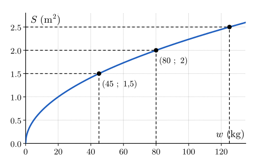
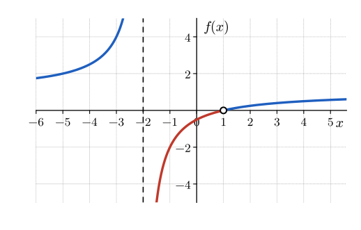
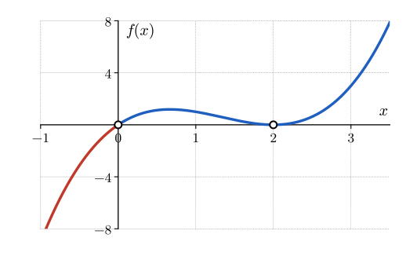

# Rappel {.divider background-color="#14304a"}

## Où trouver l'aide pendant la séance

[1]{.step} **Cherche d'abord seul·e** : bloquer fait partie de l'apprentissage.

[2]{.step} **Bloqué·e ?** Ouvre les **coups de pouce** du site, un à un et dans l'ordre : la référence théorique, la question à te poser, une étape, et seulement en dernier la solution.

[3]{.step} **Besoin d'une méthode type ?** La **boîte à outils** et les **fiches méthode** sont sur le site.

[4]{.step} **Toujours bloqué·e après les coups de pouce ?** Lève la main : quelqu'un passe t'aider.

::: aretenir
Le site est accessible tout le temps, en séance comme à la maison.
:::

::: notes
C'est normal de bloquer : ça fait partie de l'apprentissage. Quand ça t'arrive, cherche l'aide dans cet ordre : d'abord les coups de pouce du site, un à un, puis la boîte à outils et les fiches méthode, et si tu bloques encore, lève la main et quelqu'un viendra t'aider. Le site reste disponible tout le temps, en séance comme chez toi.
:::


# Échauffement {.divider background-color="#14304a"}

## Les questions

::::::::::::::: columns
::::: {.column width="62%"}
:::: {style="font-size:.85em"}
**Q1** [[Rappel]{.obj}]{style="float:right"} — que vaut le produit scalaire $(3, 1) \cdot (-1, 2)$ ? Que peux-tu en conclure sur l'angle entre ces deux vecteurs ?

**Q2** [[Rappel]{.obj}]{style="float:right"} — quelle est la pente de la droite qui passe par les points $(1, 2)$ et $(3, 8)$ ?

**Q3** [[Rappel]{.obj}]{style="float:right"} — la relation $A = 2C + 1$ donne $A$ à partir de $C$. Quelle valeur de $C$ donne $A = 7$ ?

**Q4** [[Rappel]{.obj}]{style="float:right"} — quelles sont les solutions de l'équation $x^2 - 5 = 11$ ?
::::
:::::

::::::::::: {.column width="38%"}
::::: wooclap
:::: wc-body
**Vote sur Wooclap**

::: wc-lien
Code : À COMPLÉTER
:::
::::

<!--
::: {.wc-qr}

:::
-->


:::::

::::::: et-timer
```{=html}
<style>
@keyframes et-pulse { 0%, 100% { opacity: 1; } 50% { opacity: .35; } }
</style>
```

:::::: {#et-timer-box data-default="300"}
:::: et-row
<button id="et-minus" class="et-btn" type="button" aria-label="Retirer une minute">

−1 min

</button>

::: {#et-display .et-display}
05:00
:::

<button id="et-plus" class="et-btn" type="button" aria-label="Ajouter une minute">

+1 min

</button>
::::

::: et-row
<button id="et-toggle" class="et-btn et-primary" type="button">

Démarrer

</button>

<button id="et-reset" class="et-btn" type="button" aria-label="Réinitialiser">

↺ Réinitialiser

</button>
:::
::::::
:::::::
:::::::::::
:::::::::::::::

```{=html}
<script>
(function () {
  var box = document.getElementById('et-timer-box');
  if (!box) return;
  var DEFAULT = parseInt(box.getAttribute('data-default'), 10) || 300;
  var display = document.getElementById('et-display');
  var btnToggle = document.getElementById('et-toggle');
  var btnMinus = document.getElementById('et-minus');
  var btnPlus = document.getElementById('et-plus');
  var btnReset = document.getElementById('et-reset');

  var remaining = DEFAULT;
  var running = false;
  var intervalId = null;
  var audioCtx = null;

  function fmt(s) {
    s = Math.max(0, s);
    var m = Math.floor(s / 60);
    var sec = s % 60;
    return (m < 10 ? '0' : '') + m + ':' + (sec < 10 ? '0' : '') + sec;
  }

  function render() {
    display.textContent = fmt(remaining);
    display.classList.toggle('et-warn', running && remaining <= 30 && remaining > 0);
    display.classList.toggle('et-done', remaining === 0);
  }

  function beep() {
    try {
      if (!audioCtx) audioCtx = new (window.AudioContext || window.webkitAudioContext)();
      var t0 = audioCtx.currentTime;
      [0, 0.35].forEach(function (offset) {
        var osc = audioCtx.createOscillator();
        var gain = audioCtx.createGain();
        osc.type = 'sine';
        osc.frequency.value = 880;
        gain.gain.setValueAtTime(0.0001, t0 + offset);
        gain.gain.exponentialRampToValueAtTime(0.3, t0 + offset + 0.02);
        gain.gain.exponentialRampToValueAtTime(0.0001, t0 + offset + 0.28);
        osc.connect(gain);
        gain.connect(audioCtx.destination);
        osc.start(t0 + offset);
        osc.stop(t0 + offset + 0.3);
      });
    } catch (e) {}
  }

  function stop() {
    running = false;
    btnToggle.textContent = remaining > 0 ? 'Reprendre' : 'Démarrer';
    if (intervalId) { clearInterval(intervalId); intervalId = null; }
  }

  function tick() {
    remaining -= 1;
    if (remaining <= 0) {
      remaining = 0;
      stop();
      beep();
    }
    render();
  }

  function start() {
    if (running) return;
    try {
      if (!audioCtx) audioCtx = new (window.AudioContext || window.webkitAudioContext)();
      if (audioCtx.state === 'suspended') audioCtx.resume();
    } catch (e) {}
    if (remaining <= 0) remaining = DEFAULT;
    render();
    running = true;
    btnToggle.textContent = 'Pause';
    intervalId = setInterval(tick, 1000);
  }

  btnToggle.addEventListener('click', function () { running ? stop() : start(); });
  btnMinus.addEventListener('click', function () {
    remaining = Math.max(0, remaining - 60);
    render();
    if (remaining === 0) stop();
  });
  btnPlus.addEventListener('click', function () {
    remaining = remaining + 60;
    render();
  });
  btnReset.addEventListener('click', function () {
    stop();
    remaining = DEFAULT;
    btnToggle.textContent = 'Démarrer';
    render();
  });

  render();
})();
</script>
```

## Q1 [[Rappel]{.obj}]{style="float:right"}

Que vaut le produit scalaire $(3, 1) \cdot (-1, 2)$ ? Que peux-tu en conclure sur l'angle entre ces deux vecteurs ?

. . .

::: aretenir
On multiplie les coordonnées deux à deux, puis on additionne : $(3, 1) \cdot (-1, 2) = 3 \cdot (-1) + 1 \cdot 2 = -1$.

Le produit scalaire est négatif, donc l'angle entre les deux vecteurs est **obtus**.

Additionner les valeurs absolues des produits ($3 + 2 = 5$) fait perdre le signe, et c'est justement le signe qui renseigne sur l'angle.
:::

## Q2 [[Rappel]{.obj}]{style="float:right"}

Quelle est la pente de la droite qui passe par les points $(1, 2)$ et $(3, 8)$ ?

. . .

::: aretenir
La pente est le rapport de la variation verticale à la variation horizontale :
$$\frac{8 - 2}{3 - 1} = \frac{6}{2} = 3.$$

Inverser le rapport donne $\frac13$ : c'est l'erreur classique.
:::

## Q3 [[Rappel]{.obj}]{style="float:right"}

La relation $A = 2C + 1$ donne $A$ à partir de $C$. Quelle valeur de $C$ donne $A = 7$ ?

. . .

::: aretenir
On remplace $A$ par $7$ : $7 = 2C + 1$. On soustrait $1$ : $6 = 2C$. On divise par $2$ : $C = 3$.

Vérification : $2 \cdot 3 + 1 = 7$, ce qui redonne bien la sortie.

Ici, on connaissait la **sortie** et on cherchait l'**entrée** : c'est la situation de l'exercice T.1 et de la première méthode.
:::

::: notes
Cette question prépare le corrigé de T.1 et la méthode 1. L'erreur typique est de diviser par 2 avant de soustraire 1, ce qui donne $2{,}5$ au lieu de $3$.
:::

## Q4 [[Rappel]{.obj}]{style="float:right"}

Quelles sont les solutions de l'équation $x^2 - 5 = 11$ ?

. . .

::: aretenir
On ajoute $5$ : $x^2 = 16$. Il y a **deux** nombres dont le carré vaut $16$ : $x = 4$ et $x = -4$.

Oublier la solution négative est l'erreur classique. Elle explique pourquoi une même sortie peut avoir deux antécédents.
:::

::: notes
Cette question prépare la notion d'antécédents multiples, rencontrée dans le socle (S.3 et S.7).
:::

# Exercice T.1 : corrigé pas à pas {.divider background-color="#1f5fbf"}

::: notes
À montrer au milieu de la séance, après le socle, quand la plupart des étudiant·es ont cherché T.1 seul·es.
:::

## L'énoncé

La surface corporelle $S$ d'un patient, en m², sert à ajuster la dose de certains médicaments. La formule de Mosteller la calcule à partir de la taille $h$, en cm, et de la masse $w$, en kg :
$$S = \sqrt{\frac{h\,w}{3600}}.$$
Un patient mesure $180$ cm.

::: {style="font-size:.9em"}
**(a)** Écris $S$ comme une fonction de la masse $w$ pour ce patient, sous la forme d'une racine carrée d'une expression simple de $w$. Calcule ensuite la surface corporelle de ce patient s'il pèse $45$ kg. Donne le résultat en m².

**(b)** Le médecin veut ajuster la dose pour une surface corporelle de $2$ m². Calcule la masse correspondante, en kg.

**(c)** Écris la masse $w$ en fonction de la surface corporelle $S$ pour ce patient. Écris ensuite, sous la forme d'un intervalle, les valeurs de $S$ pour lesquelles cette expression a un sens dans le contexte.
:::

## Étape 1 : ce qui est donné et ce qui est cherché

:::::: columns
::::: {.column width="50%"}
::: aretenir
**Donné.** La formule de Mosteller, la taille $h = 180$ cm, et les unités : $S$ en m², $w$ en kg.

**Cherché.** (a) $S$ en fonction de $w$, puis $S(45)$. (b) La valeur de $w$ pour laquelle $S = 2$. (c) $w$ en fonction de $S$, puis l'intervalle des valeurs de $S$ qui ont un sens.
:::
:::::
::::: {.column width="50%"}
::: aretenir
**Relation du cours.** Une fonction a une **entrée**, une **sortie** et des **paramètres**.

Ici, l'entrée est $w$, la sortie est $S$ et le paramètre est $h$, que l'on fixe à $180$ cm.
:::
:::::
::::::

## Étape 2, question (a) : fixer le paramètre

On remplace $h$ par $180$, puis on simplifie la fraction.

. . .

::: aretenir
$$S(w) = \sqrt{\frac{180\,w}{3600}} = \sqrt{\frac{w}{20}}, \qquad\text{car}\qquad \frac{180}{3600} = \frac{1}{20}.$$

Pour $w = 45$ : $S(45) = \sqrt{\dfrac{45}{20}} = \sqrt{\dfrac94} = \dfrac32 = 1{,}5$.

Un patient de $45$ kg a donc une surface corporelle de **$1{,}5$ m²**.
:::

## Quatre représentations d'une même fonction

:::::: columns
::::: {.column width="46%"}
**Formule.** $S(w) = \sqrt{\dfrac{w}{20}}$

**Texte.** La surface corporelle augmente avec la masse, mais de moins en moins vite.

| $w$ (kg) | $45$ | $61{,}25$ | $80$ | $125$ |
|:---:|:---:|:---:|:---:|:---:|
| $S(w)$ (m²) | $1{,}5$ | $1{,}75$ | $2$ | $2{,}5$ |
:::::
::::: {.column width="54%"}
{fig-alt="Graphe de S en fonction de w : courbe croissante qui passe par les points (45 ; 1,5) et (80 ; 2)." width="100%"}
:::::
::::::

## Étape 3, question (b) : la sortie est connue

On connaît la sortie $S = 2$ et on cherche l'entrée $w$.

. . .

::: aretenir
On remplace $S$ par $2$ : $2 = \sqrt{\dfrac{w}{20}}$. Les deux membres sont positifs, donc on les élève au carré : $4 = \dfrac{w}{20}$. On multiplie par $20$ : $w = 80$.

Vérification : $S(80) = \sqrt{\dfrac{80}{20}} = \sqrt4 = 2$, ce qui redonne bien la valeur de départ. C'est le point $(80\ ;\ 2)$ du graphe.

La masse cherchée est de **$80$ kg**.
:::

::: notes
Erreur typique : écrire $w/20 = 2$ et trouver $40$, en oubliant d'élever $2$ au carré. Le contrôle $S(40) = \sqrt2 \neq 2$ la révèle.
:::

## Étape 4, question (c) : exprimer $w$ en fonction de $S$

On isole $w$ dans la formule, une seule fois, pour toutes les valeurs de $S$.

. . .

::: aretenir
On élève au carré : $S^2 = \dfrac{w}{20}$, donc $w = 20\,S^2$.

**Domaine.** Dans le contexte, $w$ est une masse, donc $w > 0$, et $S$, racine carrée de $\dfrac{w}{20} > 0$, est strictement positive. Inversement, toute valeur $S > 0$ correspond à la masse $w = 20\,S^2 > 0$. Les valeurs de $S$ qui ont un sens sont donc celles de l'intervalle $]0,\,+\infty[$, en m².

Contrôle : $20 \cdot 1{,}5^2 = 20 \cdot 2{,}25 = 45$, ce qui redonne bien la masse de la question (a).
:::

## Ce que le corrigé nous apprend

::: aretenir
Dans (b) et (c), on connaissait la **sortie** et on cherchait l'**entrée**. On a remplacé la sortie par sa valeur, défait les opérations dans l'ordre inverse, puis vérifié la solution.

C'est la **méthode 1** de la séance, que l'on généralise dans quelques instants.
:::

# Méthode 1 : retrouver l'entrée à partir de la sortie {.divider background-color="#1f5fbf"}

## Avant de commencer

Avec tes mots : comment retrouves-tu la valeur de départ d'une formule quand tu connais le résultat ?

::::::: wooclap
::: wc-play
▶
:::

:::: wc-body
**Ouvre le Wooclap**

::: wc-lien
Code : À COMPLÉTER
:::
::::

<!--
::: {.wc-qr}


Entrée et sortie
:::
-->

:::::::

## Notre fil rouge

La température se mesure en degrés Fahrenheit ($F$) aux États-Unis et en degrés Celsius ($C$) en Belgique. La conversion est
$$F = 1{,}8\,C + 32.$$
Un thermomètre américain indique $104$ °F.

Quelle est la température en °C ?

## Étape 1 : nommer l'entrée et la sortie

[1]{.step} **Qu'est-ce qui est donné, et qu'est-ce qui est cherché ?**

. . .

::: aretenir
La **sortie** est connue : $F = 104$ °F. L'**entrée** est cherchée : $C$, en °C.

La formule qui relie les deux est $F = 1{,}8\,C + 32$.
:::

## Étapes 2 et 3 : remplacer, puis défaire

[2]{.step} **Que devient la formule quand on remplace la sortie ?** [3]{.step} **Dans quel ordre défait-on les opérations ?**

. . .

::: aretenir
On remplace $F$ par $104$ : $104 = 1{,}8\,C + 32$.

La formule multiplie par $1{,}8$ puis ajoute $32$. On défait donc d'abord l'addition, puis la multiplication :
$$104 - 32 = 1{,}8\,C \quad\text{donc}\quad 72 = 1{,}8\,C \quad\text{donc}\quad C = \frac{72}{1{,}8} = 40.$$
:::

## Étape 4 : vérifier

[4]{.step} **Comment s'assurer du résultat ?**

. . .

::: aretenir
On remet la solution dans la formule : $1{,}8 \cdot 40 + 32 = 72 + 32 = 104$, ce qui redonne bien la sortie.

On vérifie aussi que $C = 40$ appartient au domaine de la fonction : ici, toute température est possible.

La température est de **$40$ °C**.
:::

## Une conversion, quatre registres

La même fonction s'écrit de quatre façons. Passer de l'une à l'autre fait partie du travail.

:::::: columns
::::: {.column width="50%"}
::: {.aretenir .smaller}
**Texte.** On multiplie la température en °C par $1{,}8$, puis on ajoute $32$.

**Formule.** $F = 1{,}8\,C + 32$.

| $C$ (°C) | $20$ | $37$ | $40$ |
|:---:|:---:|:---:|:---:|
| $F$ (°F) | $68$ | $98{,}6$ | $104$ |
:::
:::::
::::: {.column width="50%"}
{fig-alt="Droite F = 1,8 C + 32 ; le point (40 ; 104) est repéré par des pointillés." width="100%"}
:::::
::::::

## En diagramme sagittal

Chaque flèche relie une entrée à sa sortie. Retrouver l'entrée à partir de la sortie, c'est **remonter la flèche**.

{fig-alt="Diagramme sagittal de la conversion : 20 vers 68, 37 vers 98,6 et 40 vers 104. Une flèche en pointillés remonte de 104 vers 40." width="55%"}

::: {.aretenir .smaller}
Comme chaque entrée a une seule sortie et que chaque sortie vient d'une seule entrée, on peut remonter les flèches sans ambiguïté : la fonction réciproque est bien définie.
:::

## Plusieurs valeurs : la fonction réciproque

Si tu dois convertir beaucoup de valeurs, isole $C$ **une seule fois** dans la formule.

:::::: columns
::::: {.column width="48%"}
::: aretenir
$$F = 1{,}8\,C + 32 \quad\text{donne}\quad C = \frac{F - 32}{1{,}8}.$$

| $F$ (°F) | $68$ | $98{,}6$ | $104$ |
|:---:|:---:|:---:|:---:|
| $C$ (°C) | $20$ | $37$ | $40$ |
:::
:::::
::::: {.column width="52%"}
{fig-alt="Droite F = 1,8 C + 32 ; le point (40 ; 104) est repéré par des pointillés." width="100%"}
:::::
::::::

## Et s'il y a plusieurs solutions ?

Soit $f(x) = x^2 - 4$, où $x$ est une longueur en cm. Quelle entrée donne la sortie $5$ ?

. . .

::: aretenir
On remplace : $x^2 - 4 = 5$, donc $x^2 = 9$. L'équation a **deux** solutions, $3$ et $-3$.

Une longueur n'est pas négative : le domaine pratique est $[0,\,+\infty[$, donc on ne garde que $x = 3$ cm.

Sans contexte, les deux solutions resteraient possibles : la fonction n'aurait pas de réciproque sans restreindre son domaine.
:::

## Le piège à connaître

:::: piege
::: pg-titre
Piège
:::

Défaire les opérations dans le même ordre que celui de la formule, par exemple diviser par $1{,}8$ avant de soustraire $32$ : on obtient $\dfrac{104}{1{,}8} - 32 \approx 25{,}8$, qui ne redonne pas $104$ quand on le remet dans la formule. On oublie aussi parfois de vérifier que la solution appartient au domaine.
::::

## La carte « Retrouver l'entrée » {.smaller}

C'est la page qui t'attend sur ta **feuille de méthode** : même squelette, tu la remplis en même temps.

:::::::::::::: fiche
::: fiche-head
Retrouver l'entrée d'une fonction à partir de sa sortie [[O3]{.obj}]{style="float:right"}
:::

:::::::::::: fiche-body
:::::: fiche-col
::: {.fiche-field .empty}
Exercices associés (numéros)

*à noter toi-même*
:::

::: {.fiche-field .empty}
Théorie associée (chapitre / slide)

*à noter toi-même*
:::

::: {.fiche-field .fragment}
Quand l'utiliser ?

On connaît la grandeur obtenue (la sortie) et on cherche la grandeur de départ (l'entrée).
:::
::::::

::::::: fiche-col
:::: fiche-field
Étapes

::: incremental
1.  **Nommer** l'entrée et la sortie, et écrire la formule.
2.  **Remplacer** la sortie par sa valeur : l'inconnue est l'entrée.
3.  **Défaire** les opérations dans l'ordre inverse.
4.  **Vérifier** : domaine ou domaine pratique, puis valeur remise dans la formule.
5.  **Trier** s'il y a plusieurs solutions : garder celles du domaine pratique.
6.  **Isoler** l'entrée une seule fois si la sortie change : c'est la réciproque.
:::
::::

::: {.fiche-field .fragment}
Exemple

Reprendre la conversion de $104$ °F en °C.
:::

::: {.fiche-field .fragment}
Le piège

Défaire les opérations dans le même ordre que la formule ; oublier de vérifier le domaine.
:::
:::::::
::::::::::::
::::::::::::::

::: footer-note
Cette fiche rejoint ta **boîte à outils** sur le site.
:::

# Méthode 2 : étudier le signe d'une fonction {.divider background-color="#1f5fbf"}

## Avant de commencer

Avec tes mots : comment sais-tu où une fonction est positive et où elle est négative ?

::::::: wooclap
::: wc-play
▶
:::

:::: wc-body
**Ouvre le Wooclap**

::: wc-lien
Code : À COMPLÉTER
:::
::::

<!--
::: {.wc-qr}


Signe d'une fonction
:::
-->

:::::::

## Notre fil rouge

Soit la fonction $f(x) = \dfrac{x - 1}{x + 2}$.

Où $f$ est-elle positive, et où est-elle négative ?

On procède par étapes.

## Étapes 1 et 2 : le domaine, puis les racines

[1]{.step} **Quel est le domaine ?** [2]{.step} **Quelles sont les racines ?**

. . .

::: aretenir
Le dénominateur s'annule en $x = -2$, donc $\mathit{Dom}(f) = \mathbb{R} \setminus \{-2\}$ : la valeur $-2$ est **exclue**.

Un quotient est nul quand son numérateur est nul et son dénominateur non nul, donc la seule racine est $1$.
:::

## Étapes 3 et 4 : les intervalles, puis un point test

[3]{.step} **Quels points découpent le domaine en intervalles ?** [4]{.step} **Quel est le signe de $f$ dans chacun ?**

. . .

::: aretenir
La racine $1$ **et** la valeur exclue $-2$ découpent le domaine en trois intervalles : $]-\infty,\,-2[$, $]-2,\,1[$ et $]1,\,+\infty[$.

Sur chacun, le signe de $f$ ne change pas : un seul point test par intervalle suffit.

$f(-3) = \dfrac{-4}{-1} = 4$, $f(0) = -\dfrac12$ et $f(2) = \dfrac14$.
:::

## Étape 5 : le tableau de signes et le graphe

:::::: columns
::::: {.column width="48%"}
::: {.aretenir .smaller}
| $x$ | $]-\infty,\,-2[$ | $-2$ | $]-2,\,1[$ | $1$ | $]1,\,+\infty[$ |
|:---:|:---:|:---:|:---:|:---:|:---:|
| signe de $f(x)$ | $+$ | exclu | $-$ | $0$ | $+$ |

La fonction $f$ est strictement positive sur $]-\infty,\,-2[$ et sur $]1,\,+\infty[$, strictement négative sur $]-2,\,1[$, et nulle en $1$. Elle change de signe en $-2$ sans s'y annuler.
:::
:::::
::::: {.column width="52%"}
{fig-alt="Graphe de f(x) = (x−1)/(x+2) : en bleu là où f est positive, en rouge là où f est négative ; racine en 1, valeur exclue en −2 marquée par une droite verticale en tirets." width="100%"}
:::::
::::::

## Le piège à connaître

Soit $h(x) = x\,(x - 2)^2$. Ses racines sont $0$ et $2$. Change-t-elle de signe en $2$ ?

. . .

:::::: columns
::::: {.column width="50%"}
:::: piege
::: pg-titre
Piège
:::

Conclure que le signe change à **chaque** racine. Le facteur $(x - 2)^2$ est positif ou nul : de part et d'autre de $2$, $h$ garde le signe de $x$, donc elle est positive des deux côtés ($h(1) = 1$ et $h(3) = 3$).
::::
:::::
::::: {.column width="50%"}
{fig-alt="Graphe de h(x) = x(x−2)² : la courbe touche l'axe des abscisses en 2 sans le traverser." width="100%"}
:::::
::::::

## La carte « Signe d'une fonction » {.smaller}

:::::::::::::: fiche
::: fiche-head
Étudier le signe d'une fonction [[O2]{.obj}]{style="float:right"}
:::

:::::::::::: fiche-body
:::::: fiche-col
::: {.fiche-field .empty}
Exercices associés (numéros)

*à noter toi-même*
:::

::: {.fiche-field .empty}
Théorie associée (chapitre / slide)

*à noter toi-même*
:::

::: {.fiche-field .fragment}
Quand l'utiliser ?

Il faut savoir où une fonction est positive ou négative, ou résoudre une inégalité du type $f(x) > 0$.
:::
::::::

::::::: fiche-col
:::: fiche-field
Étapes

::: incremental
1.  **Déterminer** le domaine et noter les valeurs exclues.
2.  **Résoudre** $f(x) = 0$ : ce sont les racines.
3.  **Placer** les racines et les valeurs exclues : elles découpent le domaine en intervalles.
4.  **Tester** un point par intervalle, ou le signe de chaque facteur.
5.  **Écrire** le tableau de signes, puis conclure par une phrase.
:::
::::

::: {.fiche-field .fragment}
Exemple

Reprendre $f(x) = \dfrac{x - 1}{x + 2}$.
:::

::: {.fiche-field .fragment}
Le piège

Supposer que le signe change à chaque racine, même quand la racine vient d'un facteur au carré ; oublier les valeurs exclues du domaine.
:::
:::::::
::::::::::::
::::::::::::::

::: footer-note
Cette fiche rejoint ta **boîte à outils** sur le site.
:::
