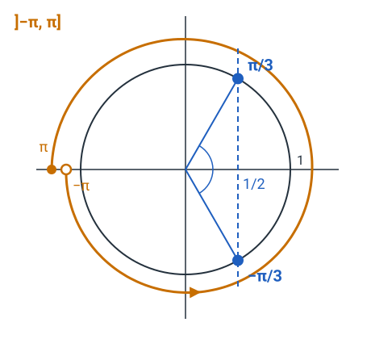

## Résultats du sondage {.smaller}

| Ce que vous avez dit | Adaptation aux séances |
|:---|:---|
| La difficulté convient à $78\,\%$ d'entre vous. | Le socle et le transfert ne sont pas durcis. Les **défis**, optionnels, sont là pour celles et ceux qui trouvent les exercices trop faciles. |
| Vous voulez davantage de corrections en séance, surtout pour le transfert. | À chaque séance, **un exercice du socle et un exercice du transfert** sont corrigés ensemble, puis on en dégage **une méthode**. |
| Seuls $21\,\%$ terminent le transfert. | Le transfert est plus court, et l'exercice corrigé est placé **en premier**. |
| Les réponses finales sont trop détaillées. | Dans la solution, la **réponse finale** est donnée d'abord ; le raisonnement complet s'affiche si tu cliques sur **Je veux plus de détails**. |

::: notes
Une à deux minutes. Pour les deux exercices corrigés en séance, le site donne les indices et les réponses finales ; les détails sont donnés lors de la correction. La jauge de bruit et la sonnerie du minuteur sont retirées. Ces changements valent pour cette séance et pour les suivantes.
:::

# Échauffement {.divider background-color="#14304a"}

## Les questions

::::::::::::::: columns
::::: {.column width="62%"}
:::: {style="font-size:.9em"}
**Q1** [[Rappel]{.obj}]{style="float:right"} — que vaut $\dfrac{e^{5}}{e^{2}}$ ?

**Q2** [[Rappel]{.obj}]{style="float:right"} — que vaut $\log_{10}(1000) + \log_{10}(0{,}01)$ ?

**Q3** [[Rappel]{.obj}]{style="float:right"} — résous l'équation $2\cos(x) = 1$ dans l'intervalle $]-\pi,\,\pi]$.
::::
:::::

::::::::::: {.column .outils-serres width="38%"}
::::: wooclap
:::: wc-body
**Vote sur Wooclap**

::: wc-lien
Code : KQQDGMK
:::
::::


::: {.wc-qr}

:::


:::::

::: {.minuteur data-minutes="5"}

:::
:::::::::::
:::::::::::::::

```{=html}
<style>
.outils-serres { display: flex; flex-direction: column; gap: .35em; }
.outils-serres .wooclap { margin: 0; }
.outils-serres .et-timer { margin-top: 0; }
.outils-serres .et-timer, .outils-serres .et-box { width: 100%; box-sizing: border-box; }
</style>
```

::: notes
Cinq minutes sur papier, puis le vote (les choix sont dans wooclap-echauffement.md). Les trois questions portent sur des prérequis : une sur l'exponentielle, une sur le logarithme, une petite équation trigonométrique.
:::

## Q1 [[Rappel]{.obj}]{style="float:right"}

Que vaut $\dfrac{e^{5}}{e^{2}}$ ?

. . .

::: aretenir
Diviser deux puissances d'une même base revient à soustraire les exposants : $\dfrac{e^{5}}{e^{2}} = e^{5 - 2} = e^{3}$.

:::

::: notes
Erreurs classiques : diviser les exposants ($e^{5/2}$), les additionner ($e^{7}$), les multiplier ($e^{10}$).
:::

## Q2 [[Rappel]{.obj}]{style="float:right"}

Que vaut $\log_{10}(1000) + \log_{10}(0{,}01)$ ?

. . .

::: aretenir
On écrit chaque nombre comme une puissance de $10$. Ici, $1000 = 10^{3}$ et $0{,}01 = 10^{-2}$, donc $\log_{10}(1000) + \log_{10}(0{,}01) = 3 + (-2) = 1$.

On peut aussi utiliser le logarithme d'un produit : on a 

 $\log_{10}(1000) + \log_{10}(0{,}01)=\log_{10}(1000 \cdot 0{,}01) = \log_{10}(10) = 1$. 
:::

::: notes
Erreurs classiques : oublier le signe de $\log_{10}(0{,}01)$ ($5$), multiplier les logarithmes ($-6$), calculer le produit $1000 \cdot 0{,}01$ sans prendre le logarithme ($10$).
:::

## Q3 [[Rappel]{.obj}]{style="float:right"}

Résous l'équation $2\cos(x) = 1$ dans l'intervalle $]-\pi,\,\pi]$.

. . .

:::::: columns
::::: {.column width="50%"}
::: aretenir
$2\cos(x) = 1$, donc $\cos(x) = \dfrac{1}{2}$.

Deux points du cercle ont pour abscisse $\dfrac{1}{2}$ : $x = \dfrac{\pi}{3}$ et $x = -\dfrac{\pi}{3}$.
:::
:::::
::::: {.column width="50%"}
{width="430" fig-alt="Cercle trigonométrique : la droite verticale d'abscisse 1/2 coupe le cercle aux angles π/3 et −π/3 ; l'intervalle ]−π, π] est un tour complet, de −π exclu à π inclus."}
:::::
::::::

::: notes
L'arc orange est l'intervalle $]-\pi,\,\pi]$ : un tour complet, de $-\pi$ exclu à $\pi$ inclus. Oublier la deuxième solution ferait perdre la moitié des solutions de l'exercice S.6. Erreurs classiques : une seule solution ($\tfrac{\pi}{3}$), confusion avec $\cos\left(\tfrac{\pi}{6}\right) = \tfrac{\sqrt{3}}{2}$ ($\pm\tfrac{\pi}{6}$), erreur de signe ($\pm\tfrac{2\pi}{3}$, où le cosinus vaut $-\tfrac{1}{2}$).
:::

# Socle — 35 minutes {.divider background-color="#14304a"}

::: notes
Lancer le socle. Annoncer que l'exercice S.4 sera corrigé ensemble juste après le socle : chacun doit l'avoir cherché seul et repérer l'endroit exact où il bloque.
:::

## Au travail {.travail .sans-jauge data-minutes="35"}



# Exercice S.4 : correction, puis méthode 1 {.divider background-color="#1f5fbf"}

::: notes
Quinze minutes : environ 8 minutes de correction, puis 7 minutes pour la carte « Résoudre une équation exponentielle ».
:::

## Quelles solutions as-tu trouvées ? [[O4]{.obj}]{style="float:right"}

::::::::::::::: columns
::::: {.column width="58%"}
Résous chaque équation et écris la solution sous forme exacte.

| | Équation |
|:---:|:---:|
| (a) | $3 \cdot 2^{x} = 48$ |
| (b) | $5 \cdot 2^{x} = 35$ |
| (c) | $100 \cdot \left(\tfrac{1}{2}\right)^{t} = 20$ |
| (d) | $4\,e^{0{,}5\,x} = 12$ |
:::::

::::::::::: {.column .outils-serres width="42%"}
::::: wooclap
:::: wc-body
**Vote sur Wooclap**.

::: wc-lien
Code : FGXCGSS
:::
::::

::: {.wc-qr}

:::
:::::
:::::::::::
:::::::::::::::

::: notes
Une question Wooclap par équation (les choix sont dans wooclap-S4.md). Les résultats disent par où commencer la correction : on corrige d'abord l'équation où les votes sont les plus partagés, probablement (b). Une valeur approchée de la bonne solution figure parmi les choix : elle est juste, mais l'énoncé demande la forme exacte.
:::

## S.4 (a) [[O4]{.obj}]{style="float:right"} {.smaller}

**(a)** $\;3 \cdot 2^{x} = 48$

. . .

[1]{.step} On isole la puissance en divisant par $3$ : $2^{x} = 16$.

. . .

[2]{.step} $16 = 2^{4}$, donc $2^{x} = 2^{4}$ et $x = 4$.

. . .

[3]{.step} L'ensemble des solutions est $S = \{4\}$.

. . .

::: aretenir
**Piège : coller le facteur à la base.** $3 \cdot 2^{x}$ n'est pas $6^{x}$ : l'exposant ne porte que sur $2$. On divise d'abord par $3$.
:::

## S.4 (b) [[O4]{.obj}]{style="float:right"} {.smaller}

**(b)** $\;5 \cdot 2^{x} = 35$

. . .

[1]{.step} On isole la puissance en divisant par $5$ : $2^{x} = 7$.

. . .

[2]{.step} $7$ n'est pas une puissance entière de $2$ : on garde la base et on applique $\ln$ aux deux membres, qui sont strictement positifs : $x\ln(2) = \ln(7)$.

. . .

[3]{.step} On divise par $\ln(2)$ : $x = \dfrac{\ln(7)}{\ln(2)}$.

. . .

[4]{.step} L'ensemble des solutions est $S = \left\{\dfrac{\ln(7)}{\ln(2)}\right\}$.

. . .

::: aretenir
**Piège : diviser par la base.** $2^{x} = 7$ ne donne pas $x = \tfrac{7}{2}$ : $2^{x}$ n'est pas $2x$. Seul le logarithme fait descendre l'exposant.

**Piège : oublier de diviser par $\ln(2)$.** $x\ln(2) = \ln(7)$ ne donne pas $x = \ln(7)$ : $x$ est encore multiplié par $\ln(2)$.
:::

## S.4 (c) [[O4]{.obj}]{style="float:right"} {.smaller}

**(c)** $\;100 \cdot \left(\tfrac{1}{2}\right)^{t} = 20$

. . .

[1]{.step} On isole la puissance en divisant par $100$ : $\left(\tfrac{1}{2}\right)^{t} = \tfrac{1}{5}$.

. . .

[2]{.step} On écrit chaque membre comme une puissance : $\left(\tfrac{1}{2}\right)^{t} = \left(2^{-1}\right)^{t} = 2^{-t}$ et $\tfrac{1}{5} = 5^{-1}$, donc $2^{-t} = 5^{-1}$.

. . .

[3]{.step} Les deux membres sont strictement positifs : on applique $\ln$, donc $-t\ln(2) = -\ln(5)$.

. . .

[4]{.step} On divise par $-\ln(2)$ : $t = \dfrac{\ln(5)}{\ln(2)}$.

. . .

[5]{.step} L'ensemble des solutions est $S = \left\{\dfrac{\ln(5)}{\ln(2)}\right\}$.

. . .

::: aretenir
**Piège : perdre un signe moins.** $2^{-t} = 5^{-1}$ ne donne pas $t = -\tfrac{\ln(5)}{\ln(2)}$ : les deux membres portent un signe moins, car $\ln\left(5^{-1}\right) = -\ln(5)$.
:::

## S.4 (d) [[O4]{.obj}]{style="float:right"} {.smaller}

**(d)** $\;4\,e^{0{,}5\,x} = 12$

. . .

[1]{.step} On isole l'exponentielle en divisant par $4$ : $e^{0{,}5\,x} = 3$.

. . .

[2]{.step} Les deux membres sont strictement positifs : on applique $\ln$, qui défait l'exponentielle, donc $0{,}5\,x = \ln(3)$.

. . .

[3]{.step} On divise par $0{,}5$, c'est-à-dire qu'on multiplie par $2$ : $x = 2\ln(3) \approx 2{,}2$.

. . .

[4]{.step} L'ensemble des solutions est $S = \{2\ln(3)\}$.

. . .

::: aretenir
**Piège : diviser au lieu de multiplier.** $0{,}5\,x = \ln(3)$ ne donne pas $x = \tfrac{\ln(3)}{2}$ : diviser par $0{,}5$ revient à multiplier par $2$.
:::

## Un exemple de plus : un membre négatif {.smaller}

**(e)** $\;2\,e^{x} + 10 = 4$

. . .

[1]{.step} On isole l'exponentielle : on soustrait $10$, donc $2\,e^{x} = -6$, puis on divise par $2$, donc $e^{x} = -3$.

. . .

[2]{.step} Le premier membre est strictement positif, car $e^{x} > 0$ pour tout réel $x$, alors que le second membre est négatif. Aucun réel $x$ ne peut donc vérifier l'équation, et on ne peut pas appliquer $\ln$, puisque $\ln(-3)$ n'existe pas.

. . .

[3]{.step} L'équation n'a pas de solution : l'ensemble des solutions est $S = \emptyset$.

. . .

::: aretenir
**Piège : appliquer $\ln$ à un nombre négatif.** $e^{x} = -3$ ne donne pas $x = \ln(-3)$ : $\ln$ n'est défini que pour des nombres strictement positifs, et $e^{x} > 0$.
:::

::: notes
Cet exemple ne fait pas partie de S.4 : il illustre le cas prévu à l'étape 3 de la carte, « un membre négatif et l'autre positif : pas de solution ».
:::

## La carte « Résoudre une équation exponentielle » {.smaller}

:::::::::::::: fiche
::: fiche-head
Résoudre une équation exponentielle [[O4]{.obj}]{style="float:right"}
:::

:::::::::::: fiche-body
:::::: fiche-col
::: {.fiche-field .empty}
Exercices associés (numéros)

*à noter toi-même*
:::

::: {.fiche-field .empty}
Théorie associée (chapitre / slide)

*à noter toi-même*
:::

::: {.fiche-field .fragment}
Quand l'utiliser ?

L'inconnue figure dans un exposant et il faut la calculer, par exemple pour trouver le temps nécessaire pour atteindre une valeur donnée d'un modèle exponentiel.
:::
::::::

::::::: {.fiche-col style="font-size:.82em"}
:::: fiche-field
Étapes

::: incremental
1.  **Isole** la puissance : soustrais les termes ajoutés, puis divise par le facteur qui la multiplie.
2.  **Si** l'autre membre est une puissance de la même base, **égale** les exposants.
3.  **Sinon**, **garde** la base et, si les deux membres sont strictement positifs, **applique** $\ln$ ; $\ln\left(a^{u}\right) = u\ln(a)$ fait descendre l'exposant ; **isole** l'inconnue. Un membre négatif et l'autre positif : pas de solution.
4.  **Vérifie** en remplaçant $x$ dans l'équation de départ par la valeur trouvée.
5.  **Conclus** : écris l'ensemble des solutions, ou, dans un problème, une phrase avec l'unité.
:::
::::

::: {.fiche-field .fragment}
Exemple

$6 \cdot 3^{x} = 60$ donne $3^{x} = 10$, puis $x\ln(3) = \ln(10)$, donc $S = \left\{\dfrac{\ln(10)}{\ln(3)}\right\}$.
:::

::: {.fiche-field .fragment}
Le piège

Reprends les pièges des slides de correction.
:::
:::::::
::::::::::::
::::::::::::::

::: footer-note
Cette fiche rejoint ta **boîte à outils** sur le site.
:::

# Pause — 10 minutes {.divider background-color="#14304a"}

::: {.minuteur data-minutes="10" data-auto="oui"}

:::

# Transfert — 35 minutes {.divider background-color="#14304a"}

::: notes
Commencer par T.1, qui sera corrigé ensemble à la fin du transfert : chacun doit l'avoir cherché seul. Les autres exercices (T.2 à T.4) se font avec les coups de pouce du site.
:::

## Au travail {.travail .sans-jauge data-minutes="35"}



# Exercice T.1 : correction, puis méthode 2 {.divider background-color="#1f5fbf"}

::: notes
Quinze minutes : environ 8 minutes de correction, puis 7 minutes pour la carte « Exploiter une grandeur logarithmique ».
:::

## Quelles réponses as-tu trouvées ? [[O4]{.obj}]{style="float:right"}

::::::::::::::: columns
::::: {.column width="58%"}
La charge virale $C$ du VIH s'exprime en copies/mL, et souvent par son logarithme décimal $L = \log_{10}(C)$. Une baisse de « $1$ log » signifie que $L$ diminue de $1$.

- Charge élevée avant traitement : plus de $100\,000$ copies/mL.
- Charge indétectable : moins de $20$ copies/mL.
- Variation significative : au moins $0{,}5$ log.
- On donne $\log_{10}(2) \approx 0{,}30$.
:::::

::::::::::: {.column .outils-serres width="42%"}
::::: wooclap
:::: wc-body
**Vote sur Wooclap**.

::: wc-lien
Code : SOCTGHB
:::
::::

::: {.wc-qr}

:::
:::::
:::::::::::
:::::::::::::::

::: notes
Sources dans l'énoncé de T.1 (Mills et al., 2021 ; recommandations DHHS). Une question Wooclap par sous-question (les choix sont dans wooclap-T1.md). On corrige d'abord la sous-question où les votes sont les plus partagés ; erreurs attendues : $\log_{10}(20) = 2$ en (a), une baisse de $2$ log lue comme une division par $2$ en (c), le logarithme de la différence en (d).
:::

## T.1 (a) [[O4]{.obj}]{style="float:right"}

Calcule $L$ pour une charge virale de $100\,000$ copies/mL, puis pour une charge virale de $20$ copies/mL. On donne $\log_{10}(2) \approx 0{,}30$.

. . .

[1]{.step} $100\,000 = 10^{5}$, donc $L = \log_{10}\left(10^{5}\right) = 5$.

. . .

[2]{.step} $20 = 2 \cdot 10$, donc $L = \log_{10}(2) + \log_{10}(10) \approx 0{,}30 + 1 = 1{,}3$.

. . .

::: aretenir
Pour une charge virale de $100\,000$ copies/mL, on a $L = 5$ ; pour une charge virale de $20$ copies/mL, on a $L \approx 1{,}3$.
:::

## T.1 (b) [[O4]{.obj}]{style="float:right"}

Un patient commence un traitement avec une charge virale de $100\,000$ copies/mL. Calcule de combien de log sa charge virale doit baisser pour devenir indétectable, c'est-à-dire inférieure à $20$ copies/mL. Écris le résultat avec une décimale.

. . .

[1]{.step} D'après (a), $L$ vaut $5$ au départ et environ $1{,}3$ au seuil d'indétectabilité.

. . .

[2]{.step} La baisse vaut la différence des deux logarithmes : $5 - 1{,}3 = 3{,}7$.

. . .

::: aretenir
La charge virale de ce patient doit baisser d'environ $3{,}7$ log pour devenir indétectable.
:::

## T.1 (c) [[O4]{.obj}]{style="float:right"}

Après quelques semaines de traitement, la charge virale de ce patient a baissé de $2$ log. Écris par quel nombre elle a été divisée, puis calcule la nouvelle charge virale, en copies/mL.

. . .

[1]{.step} $L$ passe de $5$ à $5 - 2 = 3$.

. . .

[2]{.step} La nouvelle charge virale vaut donc $C = 10^{3} = 1000$ copies/mL.

. . .

[3]{.step} Elle a été divisée par $\dfrac{10^{5}}{10^{3}} = 10^{2} = 100$.

. . .

::: aretenir
Une baisse de $2$ log divise la charge virale par $100$ ; la nouvelle charge virale vaut $1000$ copies/mL.
:::

## T.1 (d) [[O4]{.obj}]{style="float:right"} {.smaller}

Une variation de la charge virale n'est considérée comme significative que si elle atteint au moins $0{,}5$ log. Chez un patient A, la charge virale passe de $40\,000$ à $10\,000$ copies/mL ; chez un patient B, elle passe de $20\,000$ à $10\,000$ copies/mL. Calcule chacune des deux baisses en log, puis écris si elle est significative.

. . .

[1]{.step} La baisse en log est la différence des logarithmes, c'est-à-dire le logarithme du quotient des deux charges.

. . .

[2]{.step} A : $\log_{10}(40\,000) - \log_{10}(10\,000) = \log_{10}(4) = 2\log_{10}(2) \approx 0{,}6$, et $0{,}6 \geq 0{,}5$.

. . .

[3]{.step} B : $\log_{10}(20\,000) - \log_{10}(10\,000) = \log_{10}(2) \approx 0{,}3$, et $0{,}3 < 0{,}5$.

. . .

::: aretenir
Chez le patient A, la baisse vaut environ $0{,}6$ log : elle est significative. Chez le patient B, la baisse vaut environ $0{,}3$ log : elle n'est pas significative.
:::

## Les pièges à connaître {.smaller}

::: aretenir
**Compter les chiffres.** $\log_{10}(20)$ ne vaut pas $2$ : c'est $\log_{10}(100)$ qui vaut $2$. Comme $20 = 2 \cdot 10$, $\log_{10}(20) \approx 1{,}3$.

**Lire l'écart comme un facteur.** Une baisse de $2$ log ne divise pas la charge par $2$, mais par $10^{2} = 100$.

**Prendre le logarithme de la différence.** La baisse en log n'est pas $\log_{10}(40\,000 - 10\,000)$, mais $\log_{10}(40\,000) - \log_{10}(10\,000) = \log_{10}(4) \approx 0{,}6$.
:::

## La carte « Exploiter une grandeur logarithmique » {.smaller}

:::::::::::::: fiche
::: fiche-head
Exploiter une grandeur logarithmique [[O4]{.obj}]{style="float:right"}
:::

:::::::::::: fiche-body
:::::: fiche-col
::: {.fiche-field .empty}
Exercices associés (numéros)

*à noter toi-même*
:::

::: {.fiche-field .empty}
Théorie associée (chapitre / slide)

*à noter toi-même*
:::

::: {.fiche-field .fragment}
Quand l'utiliser ?

Une grandeur est exprimée par son logarithme décimal, comme un pH ou une charge virale en log, et il faut passer de l'une à l'autre ou comparer deux valeurs.
:::
::::::

::::::: fiche-col
:::: fiche-field
Étapes

::: incremental
1.  **Repère** la grandeur, son unité et la relation qui donne son logarithme.
2.  **Grandeur → logarithme** : écris-la comme un nombre fois une puissance de $10$, puis $\log_{10}\left(a \cdot 10^{k}\right) = \log_{10}(a) + k$.
3.  **Logarithme → grandeur** : écris une puissance de $10$, par exemple $C = 10^{L}$.
4.  **Compare** deux valeurs par la différence des logarithmes : un écart $d$ correspond à un facteur $10^{d}$.
5.  **Conclus** par une phrase, avec l'unité.
:::
::::

::: {.fiche-field .fragment}
Exemple

$[\mathrm{H}^+] = 2 \cdot 10^{-5}$ mol/L donne un pH de $5 - 0{,}30 = 4{,}7$ ; un liquide de pH $6{,}7$ contient $10^{2} = 100$ fois moins d'ions hydrogène.
:::

::: {.fiche-field .fragment}
Le piège

Croire qu'un écart de $2$ sur le logarithme correspond à un facteur $2$.
:::
:::::::
::::::::::::
::::::::::::::

